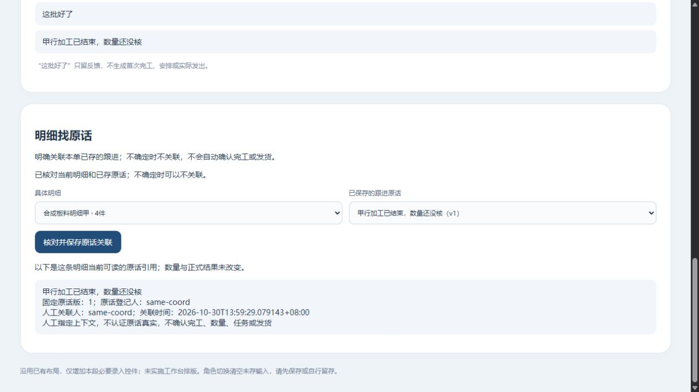

# 10月30日阶段结果

revision 14；supersedes r13，r13字节留项目外line-task-handoff-prototype-20261030/docs-before-P2-observation/5.md；以下历史；supersedes r12，r12字节留项目外line-task-handoff-prototype-20261030/docs-before-two-hour-results/3.md；以下历史；supersedes r11，r11字节留项目外line-overview-prototype-20261030/docs-before-overview-results/3.md；以下历史；supersedes r10，r10字节留项目外line-note-prototype-20261030/docs-before-direct-results/3.md；以下历史：supersedes r9，r9原字节留项目外line-source-prototype-20261030/docs-before-source-results/3.md；以下历史：supersedes r8，r8字节留项目外manual-lines-prototype-20261030/docs-before-final-handoff/0.md；以下历史：supersedes r7，r7字节留项目外manual-lines-prototype-20261030/docs-before-result/5.md；以下历史：supersedes r6，r6字节留项目外same-shipment-prototype-20261030/manual-entry-plan-before；以下历史：supersedes r5，r5字节留项目外same-shipment-prototype-20261030/registration-review-before；以下历史：supersedes r4，r4字节留项目外same-shipment-prototype-20261030/docs-before-s2；以下历史：supersedes r3，r3字节留项目外same-plan-prototype-20261030/docs-before-a3；以下历史：supersedes r2，r2字节留项目外same-result-prototype-20261030/docs-before-f2；以下历史：supersedes r1，原字节留项目外detail-progress-prototype-20261030/docs-before-d2 · 1号。先做好无AI基础系统，完整范围保留，按用户已选顺序持续推进；用户已取消Git上传。

## 当前只看这一段

已能人工建明细、补记并查原话；本轮又接通目录选单，以及从新人工单原话准备任务、明确下发、员工反馈和发起人回查。另做了从备份包恢复后按给定演示权限读回。**仍是虚构功能小样，尚无正式员工试用版；首次有效进展、完整资料合版及运行承接等条件未齐。**

[本轮简明报告](2026-10-30-两小时连续工作报告.md)｜[具体实测与限制](技术验证/2026-10-30-目录选单原话派事与恢复接续实测.md)。P2只读返回原单已有普通观察：[当前正常演示](http://127.0.0.1:57485/manual-review#m-collaboration)本机约17:53到期；原任务全链证据仍按H3，不说全部重跑。新单／任务资料接入已画差异图纸，未新运行。旧段全部按历史时点读，不把“未运行”和“已做片段”混作今天整体结论。

## 历史记录｜一张清单看各条明细的跟进

甲乙明细各有一张卡：看数量、看相关原话、展开历史、回本行补记；不会把原话条数当完成件数。本次主要改善查看，不增加业务写入。修了同毫秒内微秒排序问题，旧失败与修后方法分开，见[本段实测](技术验证/2026-10-30-同单明细跟进只读清单实测.md)。仍为虚构功能实验，未确认完工／出货或员工正式试用。

[当前本机演示](http://127.0.0.1:60484/manual-review#line-overview)约16:14正常到期。下一候选是从订单目录选单进入，尚未运行；原W按自己的15:34生命周期。原3号核源码／P1，原4号核已存证据；都没有将静态核对说成完整产品验收。

以下按原版本时点阅读。

## 历史记录｜在明细下直接补一句

已能选明细直接写一句，一次保存原话和关联；不用先去另一个表单保存再回来挑选。甲乙草稿分开，原成功只清未改原稿，后写字留在原行。正常保存／重开、超时查原、权限变化和两处事务失败按方法有[限定证据](技术验证/2026-10-30-明细下直接补记与同事务关联实测.md)，仍是虚构功能实验，不确认加工或发货。

[新正常演示](http://127.0.0.1:60671/manual-review#line-sources)本机约15:34到期。原V约15:04按自己生命周期；下一已备“同单各明细跟进清单”只读方案，尚未运行。

以下按原版本时点阅读。

## 历史记录｜明细能找到原话了

从某条明细选本单已存跟进，明确关联后能找到原话、登记人和关联时间；没有自动确认完工／发货。普通页面补三条原话、甲乙各关联一条，含糊那条留在普通跟进。重复、重开、权限及超时查原按限定方法验证；两处接缝已修，详见[本段实测](技术验证/2026-10-30-明细关联跟进原话与原操作查回实测.md)。仍是虚构实验，不是员工上线版。

新正常查看：[明细找原话](http://127.0.0.1:63237/manual-review#line-sources)，本机约15:04到期，原午间地址按自己的14:23生命周期。下一候选已写成“从明细直接补一句，同次保存原话和关联”，尚未运行。

以下午间及更早记录按当时版本阅读。

## 午间结果｜先看这几句

**补上的功能：员工可以亲手登记订单的两条明细，保存后重新打开还能看到。** 这次用虚构订单测试4件＋6件，也另测4件＋数量未知；没有要求给每块钢材编号。旧演示中的结果仍按原来源保留，不硬套到新明细上。

**可靠性结果：**所测保存、重开、同次查回、重复／竞争保存、旧回执与新输入、切角色及整页刷新后的人工查原已按各版本留证。修了旧回执清掉新稿、清理待查标记失败反复锁住页面等问题；故障注入和默认正常模式分开。细节在[本轮实测](技术验证/2026-10-30-人工明细首次录入与原操作查回实测.md)，不能把内部检查数当功能数或员工验收数。

**它暂时不代表完工或发货。** 4件是这条明细所述数量，是否加工完成、实际发出了多少，还需要各自的来源和有权办理。当前仍是隔离虚构功能实验，未进入员工正式试用。

**下一步已画好：**从一条明细选择本单已经保存的跟进原话，明确关联，以后从该行找到依据；不让员工再抄一遍，不因原话写“好了”就确认完工。见[下一段卡r4第7节](../软件开发计划+施工清单/施工与验收/人工明细与业务依据录入-下一段卡.md)。这段尚未实现新API，真实权限／完工依据继续集中待核，暂无新问卷。

本机临时查看：[人工明细正常演示](http://127.0.0.1:62122/manual-review)，约14:23自动正常结束，仅这台电脑可访问。进去选择“协调演示员”并点“进入角色”，看两条明细、来源和登记信息；不是新增完整工作台入口。查看副本和本轮已经结束的测试服务生命周期分开。

以下为上午各轮沿革，按当时版本阅读。

## 当前一句话

同一张虚构订单已能演示跟进、派事、资料、局部更正、改安排、指定发出和物流补记；人工明细首段已在独立新单从普通页面录入并有限验证，接下来补具体明细的进展来源设计，再接完整日排和同版输出。**仍是功能实验，不是员工可上线版本。** 最新[入口和差距收拢](../软件开发计划+施工清单/施工与验收/同单整段走查与可试用差距-下一段卡.md)已列“去哪登记、去哪看记录”。用户允许UI后做，当前不改排版。下文旧分段按当时版本阅读。

## 能直接说明的进展

1. 用户开启Work本地浏览器并重启后，内置浏览器实际连通。S6在普通页面复验同一订单、跟进/任务/固定版资料/限定首次安排；任务切项、旧详情迟回与顺序资料失权有指定观察，详见[阶段实测r2](技术验证/2026-10-30-同一订单接续与切任务保护阶段记录.md)。不是完整产品或公司授权/规则认证。
2. 将用户要求的[总流程与当前小样覆盖图](../软件开发计划+施工清单/页面与原型/总流程与当前小样覆盖图.md)保存，明确当前4类能力是中段的一部分，任务/资料横向支撑，不按4/12计完成率。前段报价/确认、正式下单、实际发出/物流/财务等未接。
3. 收拢[下一段卡](../软件开发计划+施工清单/施工与验收/订单明细与局部进度接续卡.md)：先接同一订单明细/范围的只读有效结果及待核反馈，再考虑正式办理与实际交付。原r1只有设计；当前已完成[D2同单只读实测](技术验证/2026-10-30-同单明细与局部进度只读实测.md)。普通补记与预置加工结果、原安排分开，不自动更正/放行。不让实习生补猜制度，G03/G04等仍按原安排暂存。

## 对老板怎么讲

现在演示能围绕一张正在做的订单留记录、交任务、找资料和安排本次两件货。本轮补上“具体哪几件有进度依据”的只读区，把原话反馈、有据局部结果和原安排放在同一张单里。之后才能可靠接发货和后续统计；已安排不等已发，员工回复也不等整单做完。

最小清单r11/任务包r41已同步当前证据和下一段，原六受审/16W/36B保留；功能仍未正式上线或交付EXE。独立查看副本的地址/到期先核项目外review-pointer/status，不沿用旧测试已停止的判断。

## 本轮新增与下一处

已验证：普通补记“这批好了”保存重开不改2件结果；另一隔离状态仅1件有当前依据时，原2件安排仍在并提示核S02。加工/检验/不同明细不混算，单位只支持件。3号静态审出单位维度和漏录入时间两处，已修并复验。D1/D2测试正常结束，独立查看副本另计。

接着准备正式结果如何办理的小卡；先分清谁有权、依据是什么、范围和单位、旧结果/原安排怎样保留。实际制度仍待岗位依据，不让实习生猜，不把只读小样当已能真实确认加工或发货。

## 本轮继续：同一订单的局部误计更正已有限跑通

[实际记录](技术验证/2026-10-30-同单局部误计更正与原操作查回实测.md)：普通页面明确把原误计2件更正为1件，旧记录/依据/人/理由可查，重开仍1；超时先查原操作，不重复写。原出货安排仍2，只提示核对S02，不替公司取消或放行。原2/资格/来源是合成预置，首次确认与真实发货未做。

同事务末写失败回滚、两次竞争写只一成功、读到旧版或新版但不拼混均有指定接口证据；3号静态审查与本机运行分开记。F1/F2测试正常停，独立查看W另计。最小清单r12/任务r42§40/总图r3对应。下一先收拢本单安排的核查与人工处置，真实规则仍待依据。

## 本轮继续：订单内的意见、草稿与单件改排

[本轮记录](技术验证/2026-10-30-同单核查意见草稿与单件改排实测.md)：意见不改计划，草稿不生效，明确采用只改S02至第二车18:00；S01原14:30与旧版保留。受控超时查原不多改，失权清旧来源但保本人字，明确版本拒绝后能重新核对，均按轮次/方法留证。新增未发/可改依据是夹具，不能代公司放行；测试资源正常停，独立X查看另计。下一是本次实际发出/物流的具体设计，尚未运行。最小清单r13/任务r43§41/总图r4对应。

## 本轮继续：实际发出和物流原话已有限接入

[实际记录](技术验证/2026-10-30-同单实际发出与物流原话实测.md)：普通核明确来源登记S02一件，原计划不变；保存预计两天到站、地点未知“已到”、待收款通知自提三原话，不生成签收/到账。发生时间未知与登记时间分开，超时查原不重复、失权清旧源保本人字有证据。正面来源/用途/角色为夹具，真实业务未开放。

已核保存关系：同O-ID两任务/两资料引用、加工S01、计划两件、实际S02和三原话一致关联，含义各自保留；非从空库全链重跑。下一先同入口整段走查和可试用差距收敛，清楚列预置/缺入口/真实规则，不继续只报模块数。最小清单r14/任务r44§42/总图r5对应。

## 本轮收拢：登记入口和下一批真正的缺口

只读核正常停S2快照和页面源：同一订单两任务可追溯已存跟进／发布草稿版、一个回复匹配发布接收者、两资料引用找到固定v1；源快照未变。本轮浏览器读页面失败，沿文档尝试AX／DOM两路径未恢复，因此没有新增视觉／点击或从空库全流程通过。

已把各登记与已存记录位置、角色／已用来源可能隐藏表单、人工入口和预置数据差别写入整段卡r2；最小清单r15清理了首页“同单更正／实际尚未接”的过时概述，历史原文另存。下一优先明细／首次进展／实际来源的人工依据入口，再补完整日排同版输出与受控试用运行条件；不新增问卷、不改UI、不扩真实业务或Git授权。

## 本轮继续：先补员工能亲手建立的明细

已写[人工依据录入方案](../软件开发计划+施工清单/施工与验收/人工明细与业务依据录入-下一段卡.md)。次序为人工明细→首次进展来源→实际发出来源；首段只建议在一张无既存明细的虚构单上，通过页面填两行／保存重开，不自动完工／发货。这里发现两项不能照搬到公司的实验限制：S01/S02不等要求每块钢编号；没有可靠排车计划时不能为记实际而编一份计划。

本轮只有已有来源／源码核对和纸面验收设计，未新增表单或运行。清单r16、任务r46§44及整段卡r3/README已接新入口；UI排版仍后做，暂无新问卷或真实业务／Git安排。

原3号指定回读人工录入卡r1§1—4后，r2将第一段收紧为仅空明细集合首次建齐两行；已有明细新操作拒绝并保输入，已成功原操作合法重试查回原结果，两个新键并发至多一套两行。仅静态意见及设计修订，无新运行。

## 午间长线：人工明细从后台预置转为普通录入

**大白话：**现在可以亲手把一张虚构订单的两条明细记进去，关掉本轮服务再开副本仍找得到；在所测重试／竞争／回滚路径没有重复或半套明细；也没有把“这批好了”直接算完工。保存回复没回来时可以查原；同标签页整页刷新后也能核权再接着查。新输入和旧回执、当前账号和旧回包分别保护。正常模式和受控故障测试按方法留证，真实公司制度尚未认证。

实际证据、失败与限制见[人工明细实测r2](技术验证/2026-10-30-人工明细首次录入与原操作查回实测.md)。首段为新O-ID，原同单任务／资料／更正／安排／实际链继续按原来源，未声称全去预置或同版全链交付。另补[数量／批次／逐件取舍](技术调研/2026-10-30-明细数量批次与逐件标识取舍.md)，借鉴成熟开源设计而不强迫员工逐件编号或套其库存制度。

下一先设计把已存原话明确关联到本单某条明细，保持普通反馈／正式结果分离；不问新实习生代猜G03/G04，也不在这两小时里扩正式业务或UI大改。测试M1—M9资源正常停；最终查看副本按项目外review-pointer/status另核。当前仍无Git上传或关机安排。

下一段来源关联图纸已补人工录入卡r4§7：仅把本单已存跟进固定版明确关联到一条当前明细，先解决上下文，不改原话、不确认完工／数量；六项仅纸面预期，无新API运行。

本轮阅读与接续说明已补：模块入口r9区分当前人工明细独立页／旧12模块骨架／旧S2同单链；4号仅指定r8前置段静态回读后，澄清“首次录入后追加未做”。根接续说明已前置午间状态，历史正文逐字保留核对通过。lsr-smf仍进行中，不因本段完成关闭整体业务调研。
