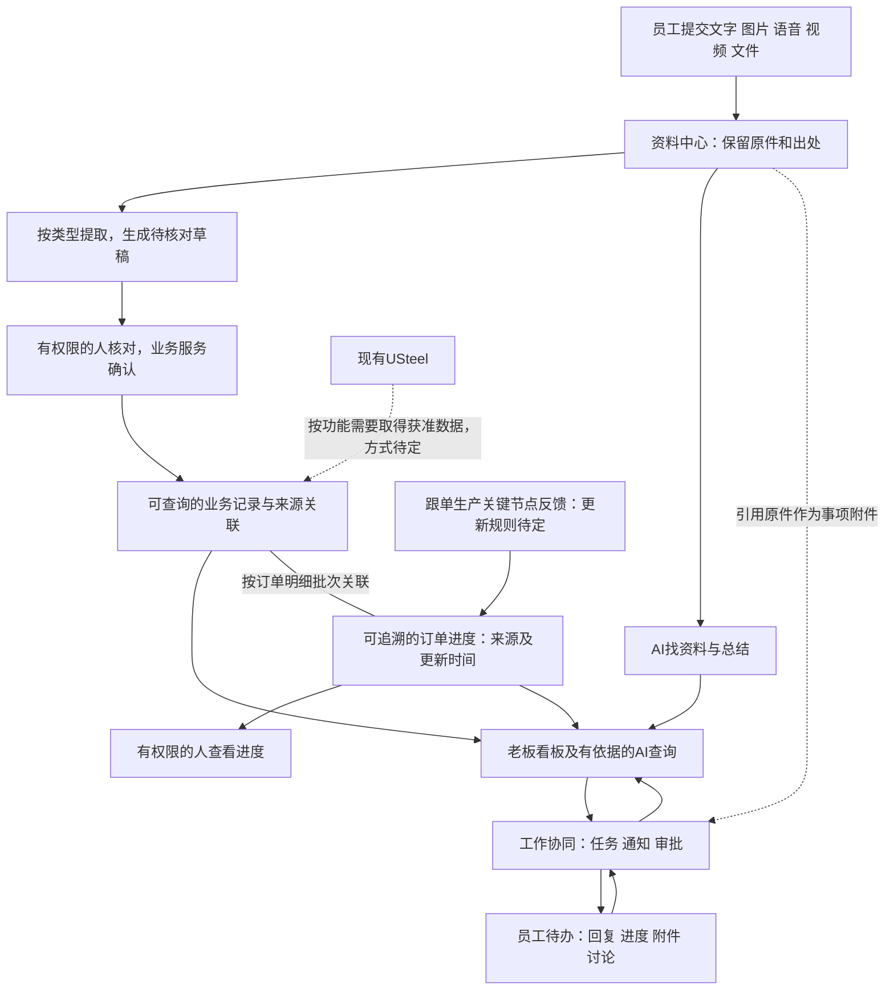

> 2026-10-27最新范围调整：本文为先前总体描述，当前范围入口改为旧软件基础功能迁移清单；原技术/旧接入描述不覆盖用户新方向。 先读[基础功能迁移清单](../../软件开发计划+施工清单/需求与范围/基础功能迁移清单.md)。旧版正文保留，不表示已获正式开发批准。

# longshi系统全貌：一页说明

创建：2026-10-24；更新：2026-10-26。整理：1号。revision：7。supersedes：revision 6尚未明确公司内外使用方向；保留五部门、主管图和此前需求/证据，旧稿保全项目外。状态：概览草案，不是施工规格。来源：[五部门资料融合](2026-10-26-五部门资料融合与系统设计增量.md)、[主管流程摘要](../公开接续/2026-10-26-主管流程图业务主线摘要.md)、用户需求及旧研究；未开始正式业务开发。

最新方向（revision 7）：用户明确未来“公司内外都能用，包括外出或家里”。部署和Windows/手机入口纳入这一目标；共用受控业务服务是候选，服务放公司还是云上仍比较，不等于云采购/网络改动/原件外送已授权。当前见[运行部署图与技术职责候选](../技术调研/2026-10-26-运行部署图与技术职责候选.md)，不再重复问是否需要外出使用。

最新资料（revision 6）：新目录已做全量索引和分专题核读，补出网络来源/业务归属历史、客户跟进阶段、日周月计划与复盘、报价条件与版本、品质事件—措施—验证—关闭以及多种行政事项。它们细化现有逻辑功能，交付批次仍待审。表格中的错位公式、空值/零、模板和原作者分析不直接变成可信经营事实；资料性质、版本与适用范围需随来源保留。当前读取边界和具体设计影响以融合报告为入口，不将文件数量当调查完成率。

最新资料（revision 5）：用户从主管取得并转交业务流程图。图载商务主线为“询盘→钢材/外协/模胚分类报价→审核及大额条件确认→客户确认→传单→下单→PMC统筹交期、进度及出货→送货/收货→对账开票→收款明细及跟款核销”。这补出了宏观交接岗位，后续不再让用户重述整条主线；进度调查纳入PMC，老板不是所有事项的必经审批人。图未展开加工/检验细节、稳定明细键及软件授权，不能直接变成12状态或12套模块，也不代表首版重做ERP/财务。原图和含姓名电话的逐字记录保留私有。

## 想解决什么

最新补充（revision 4）：用户说明日常过程主要在微信、口头沟通及跟单/生产人员处，通常不归档入系统，ERP记录订单结果；未来选取关键需求、重要变更和任务反馈补记，避免逐条登记聊天。新增明确需求为“部分有权限的人可查看订单实时进度”，其过程更新来源、角色范围和时效仍待设计，不能假设ERP已有足够过程数据。见[员工上报流程走查](2026-10-26-员工上报流程走查.md)及[订单进度查看调研](2026-10-26-订单进度查看功能调研.md)。revision 3原稿保存在项目外。

2026-10-26补充（说明revision 3，supersedes：此前未确定员工上传默认顺序与上报触发原则的状态；其余待审范围不变）：用户确认默认先上传，系统推荐分类和归属，员工核对，也允许提前选择；资料何时算上报按类别分别决定，暂不统一。具体各类触发点和审批规则未确认。详见[员工上报流程走查](2026-10-26-员工上报流程走查.md)。原revision 2已保存在项目外，未改绘PNG或开始开发。

员工方便提交各类工作资料，系统帮忙整理并保留出处；主管和老板能快速查看、追问、安排工作及得到反馈。日常客户/业务资料、质量问题、行政上报、培训和技术知识都按适用场景组织，不强行全部挂在订单上。

## 系统大致有哪些部分

| 部分 | 用日常话说明 |
| --- | --- |
| 员工上报入口 | 选取关键需求、重要变更和任务反馈，可交文字/截图等或简短补记；系统帮助整理，不要求逐条登记聊天 |
| 资料中心 | 保管原始文件、文件夹与版本，按客户/事项等适用线索找回，技术文档与培训资料也可归档 |
| 业务记录与关联 | 整理客户/线索、归属历史、跟进、报价版本、订单/交付及品质事件与来源；现有ERP内容研究引用方式，维护分工及是否替换以后确定 |
| 订单进度查看 | 部分有权限的人查看订单的最新过程进度；与跟单/生产关键反馈、订单和来源关联，具体更新责任、节点与时效待核 |
| 老板及主管工作台 | 按权限汇总业务、汇报、待处理事项及协同进度；从这里进入具体任务、通知和审批 |
| 工作协同与交流 | 老板下发任务/通知、处理适用审批；员工反馈、补件与讨论。日计划、问题措施和复盘可引用已有记录；行政事项按类别路由，提交/批准/验收/执行分别成立 |
| AI助手 | 帮提取、找资料、总结和解释，支持以后研究语音提问；缺事实时说明缺口，不能直接修改正式业务数据 |
| 数据看板 | 按需显示经营/工作及日周月复盘，可下钻明细；计划/实际、期间/分母、规则版本和数据时点明确后再汇总，缺失/模板/错误缓存不当有效业绩 |
| 账号与权限 | 员工默认看自己提交的，主管本部，老板全公司；具体协作、字段与交接例外以后核实，所有入口遵守同一范围 |

以上是九类逻辑功能，不要求独立部署九套软件；具体交付顺序后定。工作协同、交流及按权限看订单进度需求已明确，页面名、状态、提醒、更新责任和审批线路仍待讨论。

## 它们怎么连起来

员工上传成功、AI提取成功、人工核对和正式业务生效是不同环节。找原文可用有权限资料；算金额和业绩要有正式依据。图中流程为建议，不代表当前接口、规则和组件均已验证。

## 工作协同具体包含什么

| 事项 | 使用例子及需要区分的状态（建议，后续确认） |
| --- | --- |
| 任务 | 老板指派负责人、说明要求/截止时间并附资料；员工接收、更新进度、提交结果，老板查看反馈。提交结果与确认完成可以分开，延期/转交等以后细化 |
| 通知 | 发给适用员工或部门，接收人查看并回复；已送达、已读和要求反馈是否完成分别表达，是否必须确认阅读按类型后定 |
| 审批 | 员工发起事项，有权限的人查看、同意、驳回或要求补充；多级/代理/金额规则暂不追问，批准与实际执行结果分开 |
| 围绕事项交流 | 任务、通知、审批各自可有留言、追问和附件，讨论能回到对应事项。是否再做类似微信的独立即时聊天尚未确认，不自动当成本轮必做 |

例子（合成场景）：老板要求“本周整理一批客户跟进情况”→员工在同一任务里回复进度、附资料→老板追问→员工补充→有权限的人确认完成。具体状态名称并非已定规则。

参与者应能看到获分配/接收的事项及必要附件；关联客户/订单、成本利润仍按原权限分别控制，不能因参与任务就开放全部业务资料。AI可以按授权总结讨论、提取任务草稿，正式下发、审批决定和业务变更由有权限的人及业务系统执行。

## USteel和新系统怎样分工

建议先以“补充现有软件”为研究起点：USteel继续承担当前公司实际使用的业务，新系统重点研究多类型资料上报、整理检索、管理反馈和老板查询。实际哪些记录由哪个系统维护，仍按业务逐步确认，不能自动认定未来永不替换或现在全面重建ERP。

现在用`E:/database/AI文员文档`及已有截图继续梳理，不用拿ERP全部数据。以后哪个功能需要哪部分数据，再经批准找维护方取得相应范围；当前未取数、未连接生产库、未启动实验。

## 接下来怎样让用户看清楚

本页先审阅模块与关系。方向认可后，建议下一工作段做四张可审阅页面草图：员工上报、老板工作台、工作协同中心（任务/通知/审批与事项讨论）、AI问答及出处。草图不接生产数据，未知规则用待定标记，不编造统计数字。

执行补充：用户要求等待经理回答期间先做其他工作，1号据此完成[四页静态低保真草图](页面草图/README.md)，任务lsr-e07。仅表现已有方向，未确认的规则和页面设计仍待审；未接ERP、调用模型或实现业务功能。

检查重点是：有无遗漏重要日常工作、模块关系是否符合期望、员工操作是否繁琐。具体页面和先后顺序供用户调整；仍保持一周研究安排，正式代码按后续确认的图纸和施工步骤推进。

修订记录：revision 1旧稿保存在项目外`C:/Users/华硕/.codex/tools/longshi-collaboration-lab/work/business-01a16bce/system-overview-revision1.md`；revision 2按用户补充单列工作协同及交流，补参与权限与人类审批边界，草图建议由三页增为四页。未开始开发或固定审批规则。
