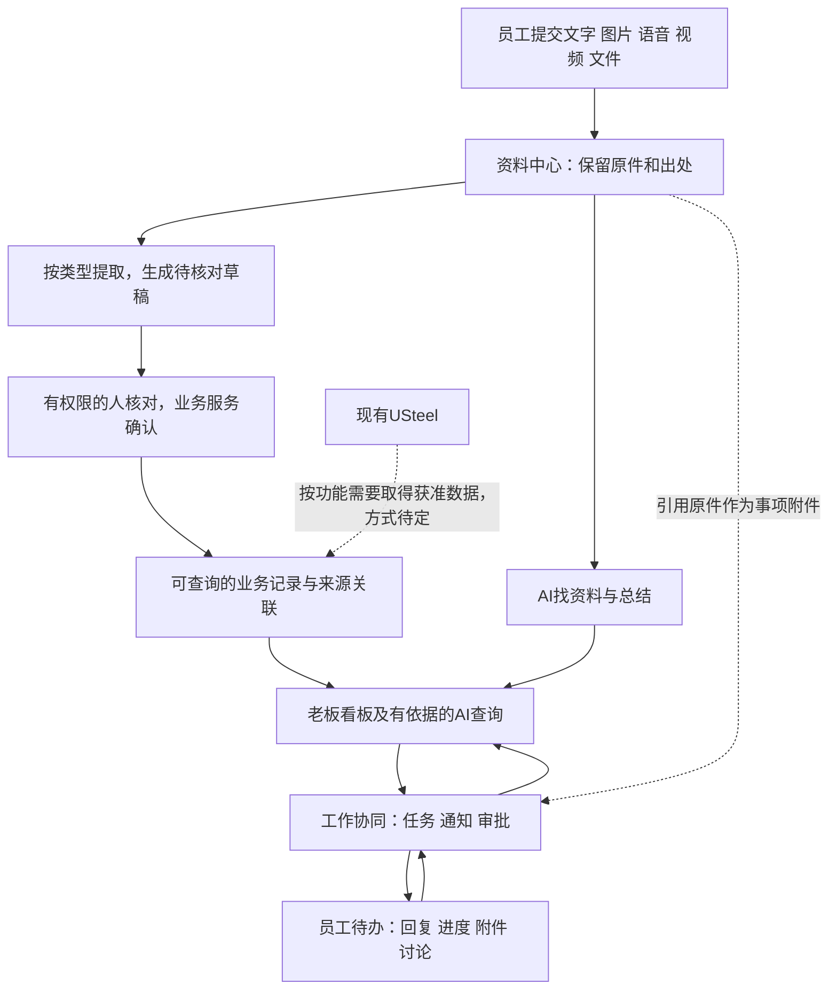

# longshi系统全貌：一页说明

日期：2026-10-24。整理：1号。revision：2。supersedes：revision 1中协同能力仅列在工作台及三页面草图安排的表达。状态：概览草案；任务、通知、审批及交流反馈为用户明确需求，具体模块布局/流转仍proposed，不是施工规格。来源：[最新阶段调整（公开摘要）](../公开接续/公司业务资料研究概览.md)、用户本轮补充“老板需要下发任务给员工，或者说通知和审批”、[公司业务与字段关联（公开摘要）](../公开接续/公司业务资料研究概览.md)、首轮三专题；不要求新增资料或整库。

## 想解决什么

员工方便提交各类工作资料，系统帮忙整理并保留出处；主管和老板能快速查看、追问、安排工作及得到反馈。日常客户/业务资料、质量问题、行政上报、培训和技术知识都按适用场景组织，不强行全部挂在订单上。

## 系统大致有哪些部分

| 部分 | 用日常话说明 |
| --- | --- |
| 员工上报入口 | 交文字、截图、语音、视频、表格，填写必要说明；处理不全时显示缺什么 |
| 资料中心 | 保管原始文件、文件夹与版本，按客户/事项等适用线索找回，技术文档与培训资料也可归档 |
| 业务记录与关联 | 整理客户、人员、报价/订单/交付等记录和来源关系；现有ERP已有的内容先研究引用方式，是否新建/替换模块以后确定 |
| 老板及主管工作台 | 按权限汇总业务、汇报、待处理事项及协同进度；从这里进入具体任务、通知和审批 |
| 工作协同与交流 | 老板向员工下发任务、发布通知、处理适用审批；员工查看分配/通知给自己的事项，回复、反馈进度和补附件；每件事保留交流记录，流程细则后核 |
| AI助手 | 帮提取、找资料、总结和解释，支持以后研究语音提问；缺事实时说明缺口，不能直接修改正式业务数据 |
| 数据看板 | 按需求显示经营/工作情况，可下钻明细；图表形式灵活，统计需要相应的有效数据和口径 |
| 账号与权限 | 员工默认看自己提交的，主管本部，老板全公司；具体协作、字段与交接例外以后核实，所有入口遵守同一范围 |

以上是八类逻辑功能，不要求独立部署八套软件；具体交付顺序后定。工作协同及交流需求已明确，页面名、状态、提醒和审批线路仍待讨论。

## 它们怎么连起来

员工上传成功、AI提取成功、人工核对和正式业务生效是不同环节。找原文可用有权限资料；算金额和业绩要有正式依据。图中流程为建议，不代表当前接口、规则和组件均已验证。

## 工作协同具体包含什么

| 事项 | 使用例子及需要区分的状态（建议，后续确认） |
| --- | --- |
| 任务 | 老板指派负责人、说明要求/截止时间并附资料；员工接收、更新进度、提交结果，老板查看反馈。提交结果与确认完成可以分开，延期/转交等以后细化 |
| 通知 | 发给适用员工或部门，接收人查看并回复；已送达、已读和要求反馈是否完成分别表达，是否必须确认阅读按类型后定 |
| 审批 | 员工发起事项，有权限的人查看、同意、驳回或要求补充；多级/代理/金额规则暂不追问，批准与实际执行结果分开 |
| 围绕事项交流 | 任务、通知、审批各自可有留言、追问和附件，讨论能回到对应事项。是否再做类似微信的独立即时聊天尚未确认，不自动当成本轮必做 |

例子（合成场景）：老板要求“本周整理一批客户跟进情况”→员工在同一任务里回复进度、附资料→老板追问→员工补充→有权限的人确认完成。具体状态名称并非已定规则。

参与者应能看到获分配/接收的事项及必要附件；关联客户/订单、成本利润仍按原权限分别控制，不能因参与任务就开放全部业务资料。AI可以按授权总结讨论、提取任务草稿，正式下发、审批决定和业务变更由有权限的人及业务系统执行。

## USteel和新系统怎样分工

建议先以“补充现有软件”为研究起点：USteel继续承担当前公司实际使用的业务，新系统重点研究多类型资料上报、整理检索、管理反馈和老板查询。实际哪些记录由哪个系统维护，仍按业务逐步确认，不能自动认定未来永不替换或现在全面重建ERP。

现在用`E:/database/AI文员文档`及已有截图继续梳理，不用拿ERP全部数据。以后哪个功能需要哪部分数据，再经批准找维护方取得相应范围；当前未取数、未连接生产库、未启动实验。

## 接下来怎样让用户看清楚

本页先审阅模块与关系。方向认可后，建议下一工作段做四张可审阅页面草图：员工上报、老板工作台、工作协同中心（任务/通知/审批与事项讨论）、AI问答及出处。草图不接生产数据，未知规则用待定标记，不编造统计数字。

执行补充：用户要求等待经理回答期间先做其他工作，1号据此完成[四页静态低保真草图](页面草图/README.md)，任务lsr-e07。仅表现已有方向，未确认的规则和页面设计仍待审；未接ERP、调用模型或实现业务功能。

检查重点是：有无遗漏重要日常工作、模块关系是否符合期望、员工操作是否繁琐。具体页面和先后顺序供用户调整；仍保持一周研究安排，正式代码按后续确认的图纸和施工步骤推进。

修订记录：revision 1旧稿保存在项目外`C:/Users/华硕/.codex/tools/longshi-collaboration-lab/work/business-01a16bce/system-overview-revision1.md`；revision 2按用户补充单列工作协同及交流，补参与权限与人类审批边界，草图建议由三页增为四页。未开始开发或固定审批规则。
