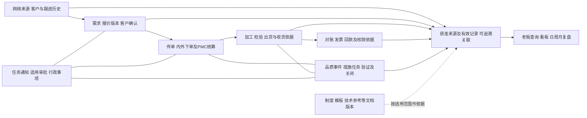

# 五部门资料融合与系统设计增量

日期：2026-10-26。整理：1号，综合2/3/4号本轮专题。revision：2。supersedes：revision 1的读取范围措辞及未具体列出的报价尺寸限制；保留原结论与证据边界。

状态：公司新资料、主管流程图与旧研究的合并分析，以及候选系统图纸增量；不是已批准首版、现行制度确认或施工开工。原件/真实主体/金额/详细定位留私有，本文只保留去标识业务结论。源目录由用户说明为老板补充，主管图由用户说明从主管取得；提供来源明确不等于每张模板均在执行。

## 先看这五点

1. **系统需要连起客户跟进、订单交付和管理复盘。** 新资料补出网络来源、运营/业务归属、客户阶段、历史跟进及周月汇报，可以减少多表重复整理。
2. **品质异常有自己的措施、验证和关闭。** 加工结果、检验结论、异常处置、任务验收分别有依据，不能共用一个“完成”。
3. **报价和财务要保留用途与版本。** 成本/售价、净尺寸/余量、请款/到账/核销、估算/实际不是同一字段；先引用获准来源，再确定哪个系统维护什么。
4. **老板看板先有可信统计。** 实际发现公式错位、除零/空缓存、占位文本和不一致比例。保留原件，统计规则另行明确，AI不能凭旧数字生成确定结论或人员评价。
5. **部门文件要拆分访问范围。** 同件内可能混成本、联系人、人事或账户内容；查看业务进度不等于拿到整本文件，进入AI前也需限制获准片段。

## 1. 五部门分别补了什么

| 资料范围 | 本轮有文件支持的增量 | 对系统的候选影响 |
| --- | --- | --- |
| 网络部 | 多渠道、运营归属、业务接收/当前跟进、报价及转化日期等 | 客户/线索与来源、归属历史分别记录；改派不改写过去归因 |
| 业务部 | 客户阶段台账、日计划/问题/协助、周月汇报、质量材料和检测报告 | 跟进/任务/进度供汇报引用，保留原文与人工原因分析；报告按检测类型及范围关联 |
| 报价部 | 材料/加工模式、计重/余量、单件/总量、成本/售价和不同版本条件 | 报价保留条件快照和版本；业务分流、形状、计价模式分开；不自动套通用余量或价格 |
| 财务部 | 请款/收款混名、现金/票据、交易日/归属期、开票/回票、客户/公司利润等 | 申请/对账/票据/实际交易/分配核销分别调查；不能凭单行或标题生成到账 |
| 行政部 | 事项申请/核准/执行/领取、岗位/设备/检验、点检、培训及人事混合表单 | 协同按事项分类路由；设备/行政事件可独立于订单；个人资料及整件附件单独受控 |

新目录有这五类分组，不表示已核定公司只设五个部门。组织图、岗位文档、员工实际账号与当前任职关系仍需在相关设计门槛前对齐，不能直接用文件夹名称生成角色权限。

## 2. 与主管主线连接后的业务图

主线来自主管图；客户前段、质量支线、行政及复盘是新资料与旧研究的补强，连线为待核的逻辑关系，不表示已取得稳定外键或每单必须依次经过。品质事件也可来自供应商/内部检验，不强制每项有客户或订单；不存在的关联保留未知。通用任务可以与客户/订单无关。

## 3. 现在能细化的对象和接口边界

下列为proposed职责，不预定数据库表名、接口名或独立服务数量。

| 记录/职责 | 需要保留的区别 | 与其他部分怎样连接 |
| --- | --- | --- |
| 客户/线索及归属历史 | 来源、首次接收、当前跟进、客户阶段、联系人；编号/同名/复制表不是天然唯一键 | 关联多次沟通、询价、报价及订单，不重复计客户；历史归属与当前权限分开 |
| 报价及条件版本 | 客户要求、用途、材料/工序、尺寸与余量、数量单位、成本/售价、适用时间、审核/发送/接受 | 订单引用获确认版本；待改价和客户接受不抹原报价，条件未核不自动算正式价 |
| 订单明细与工作范围 | 订单、明细、加工安排、生产/交付范围和炉批分别识别 | 关键岗位反馈、PMC统筹和检验/送货证据按可靠范围关联；对单不明不猜全单 |
| 品质事件与措施 | 资料待补、问题/原因主张、临时措施、长期对策、负责人/期限、验证、关闭 | 可引用客户资料、工序/批次、检测报告及任务；实施措施不等验证通过，关闭需适用规则和授权 |
| 协同事项 | 发起、分派/通知、接收、讨论、提交结果、审批/验收、执行 | 合适时引用同一有效阶段结果，减少抄写；不同事项保留不同路由，不照搬一套全员老板审批 |
| 交易与统计依据 | 对账、发票、应收应付、实际交易、分配/冲回；期间、单位和估算/实际 | 仅获准且口径明确的有效记录进入正式数值汇总；源系统维护权及接入方式仍待核 |
| 目标、复盘及统计规则 | 计划/实际、前期/同期、去重范围、分母、截止时点、作者解释 | 日周月视图尽量共享记录；人写的原因分析与已核事实分别保存，旧报表为当时快照 |
| 原件与知识资料 | 制度要求、空模板、实例、汇报分析、技术参考、宣传话术等性质；版本/适用范围 | 可多标签或待判；嵌图/扫描文字不能因普通文本为空而丢失；来源不自动变正式事实 |

客户去重须先核身份及统计口径，不能凭同名自动合并。网络表存在以询盘日填“转化时间”的公式线索，字段标题不证明真实成交时点。客户需求净尺寸、报价计重尺寸、采购下料尺寸与加工公差分开；下单说明的大/小加工条件有字面重叠，目前不自动决定加工或供应商路线。

AI继续只处理获准字段/片段、提取候选、查找、总结和展示，不决定客户归属、审批、检验合格、关案、财务核销或人员评价。现有ERP和新系统按对象/字段/事件分别定维护方；旧Excel能读不证明ERP接口可用。

## 4. 两个新来源推动的走查补充

**品质事项（候选，不是运行测试）：** 员工提交关键图片/反馈→缺资料可按类别登记并指定补充→相关岗位处理及回填措施→有权者验证→按规则关闭。紧急风险反馈不应因AI未提取完或未到会议时间而静默滞留；通知、现场处置和正式停发/恢复分别授权。文件中出现的期限与签署位仍需确认有效版本，不硬编码。

**复盘查询（候选，不是新口径批准）：** 从同一获准记录按明确期间与客户/人员范围汇总→展示结果及来源时点→人员补原因与行动→生成日周月视图/待办。合成反例：100变为150，按前期基数为增长50%，按现期基数为差额占比约33.3%；它们不能都叫同一增长率。空模板的0、缓存错误、将来计划和实际成交也不能混算。

以上补充复用[关系图与贯穿案例](2026-10-26-系统关系图与贯穿场景走查.md)及3号KF案例。它们帮助明确数据/确认/展示职责，不把一周调查压成一次原型或擅自批准所有表单进首版。

## 5. 实际读取与尚未补齐的证据

全目录207文件、约373MB；其中51个Office锁文件，156个非锁对象已分工并登记读取层次。归档索引和机器提取不等于全部人工逐字、逐图、逐格核实。

| 负责方 | 实际覆盖 | 尚有限制 |
| --- | --- | --- |
| 1号业务部18 | 28个普通表格页签、140页PPT正文、2份DOCX文本和1页PDF；实际看PDF整页及3个嵌图样本 | 关键结构/代表区人工核读，未对所有图、技术知识、客户记录和统计逐项验证；没有原生Office重算 |
| 2号报价15及新旧比较 | 普通页保存值/公式结构及价格/模式/条件重点；对有限旧索引作字节对照 | 2个确切同字节、2个近名候选字节不同，152个有限索引未命中不证明全新；两份宏表没有执行/核读；价格未逐项核定，嵌图/打印未视觉核，BIFF公式源串及共享公式全量语义未核，未重算 |
| 3号网络/行政文本36 | 网络8页签提取、31份DOCX文本及4页PDF文本；普通流程核读、4份敏感材料仅结构审视；PDF仅第3页视觉核对，表格仅原始表A3:Q7导入预览 | 3份旧式Word/伪RTF正文未读；DOCX缺可用版面渲染，页码/图像/形状箭头不全；预览组标题重叠，非原生排版保真；未全本PDF视觉核查或原生Excel重算，非逐格公式审计 |
| 4号财务/行政表单87 | 83份xlsx共281页签，另2份xls共8个普通页及2个zip；普通表单文字字段/签署栏、巨表代表区 | 未逐行核账/逐图，签署栏存在不表示已签署；zip仅列目录未读内部；行政规则有效版本及财务闭环未核 |

为旧xls先查现成开源方案，在项目外配置双库，对7份文件22个普通页保存值交叉读取，比较范围未见值差异。该验证只涉及资料读取，不验证公式/业务含义或宏表；不是产品组件实验。详细维护、许可证、问题及局部结果见[只读解析工具比较](../技术调研/2026-10-26-旧版Excel只读解析工具比较.md)。公司原件没有发送到外部解析服务。

原件位置、真实主体和精确单元/段落证据在私有报告。公开接续分专题见[报价与版本](../公开接续/2026-10-26-报价与资料版本补充摘要.md)、[网络与行政流程](../公开接续/2026-10-26-网络与行政流程补充摘要.md)、[财务与行政记录](../公开接续/2026-10-26-财务与行政记录补充摘要.md)。引用其他窗口的核读不算1号独立复验；本轮也没有取得完整正常订单从明细到签收、到账及核销的闭环。

## 6. 连续推进的具体落点

按现有资料继续细化候选字段/来源、状态和接口，先围绕“关键反馈与事项→可信订单/质量进度→有依据的老板查询”，把客户前段及复盘接上。行政、设备、培训和财务扩展保留完整调查记录，交付批次未定，不因出现在新目录就全部塞首版，也不因候选排序删掉。

优先处理会影响正确性的少数缺口：实际订单明细映射、采用哪个有效规则版本、完成/验证的定义、确认/更正/附件权限、统计口径及更新来源时效。先查已有材料，确实挡住对应设计定稿时再单点核实，不重发问卷。遇不熟悉功能先查维护活跃、许可明确的GitHub同类设计，比较依赖和失败条件；没有证据不承诺可用、不直接复制代码。

当前完成的是资料融合、证据追踪及候选图纸增量；没有正式业务开发、生产连接、开票/支付/扣薪动作或Git推送。源数据异常不在本轮直接修复。

## 7. 本轮指定范围复核

2、3、4号均已实际阅读revision 1并对照各自专题，指定复核第1/3/5节（4号另读全文）；相关回执已收。revision 2采纳报价尺寸/路线、客户身份/日期含义、文本提取与视觉核查及签署栏等修订。复核仅覆盖各自结论、接口及读取范围，不等于互相重读所有原件、全稿技术审计或公司制度批准。revision 1保留在项目外工作记录中。
