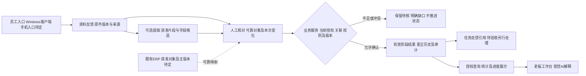

# 关键反馈到老板查询：字段、状态与接口设计草案

日期：2026-10-26。整理：1号。revision：7。supersedes：revision 6之后补第13节EXP-07有限PG实测与未采样边界；r6保全项目外。旧段落“没有运行”对应此前设计工作段，正式业务仍未开发。此前revision 5之后据合成授权/结构校验实测补第12节；r5保全项目外，原业务设计和各版本回执范围保留。第10—12节均是候选，不是正式接口批准或新增功能已实现。

状态：proposed／可审阅的局部设计草案。承接[五部门融合r2](2026-10-26-五部门资料融合与系统设计增量.md)和[关系图及贯穿案例r2](2026-10-26-系统关系图与贯穿场景走查.md)。不是首版范围批准、公司现行规则、最终技术选型或施工开工。本轮只形成字段、状态、操作契约及验收预期，没有运行业务功能。

## 先看这一页

员工遇到关键变化，可以选取文字/截图或简短补记；系统保管资料并帮助整理；有权岗位核对自己的实际结果；跟单查漏、PMC统筹；老板按权限看到有依据、带时间和范围的进度。

**员工不必重复填客户、单号和汇报表。** 可以从可靠的任务/订单上下文带出信息；无可靠依据的保留未知。AI不是必须经过的关卡，能直接确认的人工操作可以走业务系统。现场发生了什么，仍需有依据的人确认；AI不能自行改变正式状态。

| 入口 | 员工主要做什么（候选） | 系统应帮助完成什么 |
| --- | --- | --- |
| 已关联任务/订单 | 核对本次范围、实际变化、数量含义；必要时补图/说明 | 带出可靠上下文、当前有效版本及获准来源；记录身份和提交时点 |
| 自由上传/补记 | 先保存，核对推荐分类和关联；不清楚可留待核 | 找出候选和缺项；不会因文件名/客户同名猜中一张订单就使其生效 |
| 品质异常 | 登记关键问题、已知范围和紧急性线索 | 支持补资料、措施任务、验证及关闭分别留依据；紧急反馈不等待AI完成才可发起适用处置 |
| 老板查询 | 选订单/范围或提出问题；有歧义时澄清 | 展示当前获准的确认记录、发生/确认时点、待核和缺更新；需要时回到可见依据 |

核对与确认可以在**当前权限、关联和业务规则均允许时**合成一次明确操作；不统一增加主管复点，也不默认每个提交者都有确认权。按类别决定何时算上报，上传保存不能一律等同上报或审批。

## 1. 本条链的模块与数据流

框是逻辑职责，可以在同一业务服务内实现；不要求微服务或独立工作流引擎。手机与电脑均常用，不等于EXE能在手机运行；手机资料入口、网络及部署仍须调查。订单引用可先研究获准副本或厂商服务，当前不连接生产、不以全库导出为前提。

## 2. 信息由谁提供：少填不等于少依据

以下是数据语义，不表示每项都做成必填输入框。确认某类正式结果需要哪些字段，须由该类规则决定。

| 信息组 | 建议获得方式 | 缺失或疑义怎样处理 |
| --- | --- | --- |
| 订单、明细、作业范围、范围类型及关联版本 | 可靠任务/订单上下文或有依据的授权人工对单 | 可保存未关联反馈；不能正式推进猜中的订单；生产批/炉批/交付批不互换 |
| 本次陈述的节点和实际变化 | 人选取关键内容，AI可提出候选；人核对 | “做完了”未说明做完什么，就补范围；不自动变检验合格或已发货 |
| 数量、单位及新增/累计/纠正含义 | 从依据提取或人补充；可靠单位上下文可带出 | 保留原始表达；不按计划量补实际量，不把累计再加一次，不跨阶段相加 |
| 来源与位置 | 系统记录原件版本、页/单元格/视频片段；手工补记标员工陈述 | 没录音就没有逐字客户原话；脱离原文的AI推断单列且不能作事实依据 |
| 业务发生、原消息、登记、确认时间 | 已知业务/消息时间核对；登记及确认由可信服务记录 | 业务时间未知留空，上传时间不能补作完成时间；晚到资料不自动覆盖较新事实 |
| 提交者、确认者及有效权限 | 服务从当前可信身份及规则取得 | 不接受模型/请求自行指定“老板已批准”或任意确认人 |
| 结果版本、请求身份、来源版本 | 服务生成并检查；客户端保留本次请求标识供查询 | 超时查询原操作，不换标识重加数量；同标识改内容须提示冲突 |

资料正文中识别出的姓名、单号和批次都是候选；员工勾选也需有依据。人核对某句话准确，不等于其有权为该订单确认正式结果。来源、字段核对、对象关联和业务生效分别留依据。

## 3. 不让一个“完成”支配全部功能

各维度可并存、独立变化，具体枚举仅为候选，不强制每类都经过全部状态。

| 维度 | 例子与生效边界 |
| --- | --- |
| 文件保管与提取运行 | 保存成功／部分失败；未处理／处理中／成功／失败。提取失败不抹原件，也不说明业务失败 |
| 关联与字段核对 | 未关联／候选／有依据已关联；待核／有缺项／已核。关联更正须评估既有结果，不能只换客户名称 |
| 分类上报 | 何时上报、能否带缺项、通知谁按类别定；原件可见范围和提醒状态分别控制 |
| 业务阶段结果 | 在指定明细、作业范围和阶段形成有效结果；部分数量、质量待复核、后续变化分别表述 |
| 任务办理 | 已下发／已接收／反馈已交／待验收／按规则完成等；引用进度结果不自动验收任务 |
| 审批与执行 | 某项申请获批准不代表已经执行；技术流程跳转也不证明岗位业务完成 |
| 品质处置 | 登记、补资料、措施实施、验证、关闭分别留依据；加工已完成可与质量待核并存 |
| 读取与新鲜度 | 查询时点、业务发生/确认时点、派生视图水位不同；刷新成功不等现场刚更新 |

例如一个反馈可以同时显示“原件已保存、文字待核、已按适用规则上报”，但没有任何正式进度。另一个可以显示“本加工批次已有确认、任务待验收、质量待复核”。界面按职责命名，避免一个绿色完成标签造成误判。

## 4. 操作契约：先明确能力，再定API和技术栈

下表不是已实现接口或固定URL；所有读取、提交、后台处理和重试均需当前授权，范围与片段授权在进入AI前处理。

| 能力 | 输入与系统检查 | 应返回什么／不能冒充什么 |
| --- | --- | --- |
| 保存资料/补记 | 文件或文字、可选关联；核上传/处理范围与资源限制 | 逐项保管结果及来源版本；部分成功不得报全批成功 |
| 请求提取/整理 | 获准来源版本和处理任务；记录运行版本及错误 | 候选字段、证据、缺项/矛盾和运行状态，绑定本次输入来源版本及草稿版本；晚到旧输出保留为旧候选，不覆盖较新人工核对；不是正式结果 |
| 保存人工核对 | 草稿/源版本、字段修订及核对依据；检查版本冲突 | 新草稿版本、已核字段和余缺；不替代业务确认 |
| 确认阶段结果 | 可靠对象范围、动作/数量语义、依据、期望版本及操作标识；同一标识绑定请求内容 | 原子核验当前授权/关联/规则；同标识不同内容拒绝；同标识重试不再执行，按当前权限裁剪返回；成功返回结果身份/版本，或明确待核/冲突/拒绝，不能部分写入后假称全成功 |
| 查询原操作 | 原操作身份；检查调用主体及当前范围 | 已处理／待处理／无法确定等受控结果；暂不可见不触发重新执行，查询未找到也不立即证明原请求未执行 |
| 请求/执行更正 | 指向原结果、理由、依据与期望版本；检查独立更正规则 | 留历史及替代关系，列需复核的下游；真实后续返工和原来录错分开 |
| 关联任务反馈/验收 | 引用同一有效结果；检查任务语义和各自动作权限 | 反馈引用可复用；另需验收仍待验收，不生成第二套相同业务事实 |
| 读取进度/AI查询 | 身份、对象范围、字段及统计/时间条件；对歧义先澄清 | 获准有效结果与来源/版本/时点/覆盖缺口；无数据不等于0，不泄露无权对象存在 |
| 查看依据/导出 | 对象、来源版本、所需片段或字段；生成和领取都核权 | 有权片段/文件或拒绝；进度可见不自动开放整件、成本或全部导出 |

一次业务确认成功后，进度与任务可以引用同一结果身份。若使用异步派生视图，应明确“结果已确认、视图更新中”，并有恢复/对账机制；不能把异步通知当成事务成功，也不承诺消息恰好一次。若同一人确有核对和确认权，可用一次显式操作完成相关检查，实际写入仍由业务服务执行。

AI提取服务凭据只获读取/产出草稿能力；人的正式确认能力不放入AI可自由调用的工具。表单结构合法、模型高置信或工作流组件允许跳转，都不能单独满足业务生效条件。

## 5. 老板看到什么：沿用同一个合成案例

沿用关系图案例：订单A的明细1需求10件，本加工范围的批次甲含4件；对象、数量及授权均为假定。

1. 岗位在可靠上下文确认本批4件完成本加工，系统保留依据及发生时间（已知时）与确认时点。
2. 获准视图显示“本加工／批次甲：4件已有确认”；明细其他范围显示未获相应更新，不能算整单40%或认定其余未开工。
3. 任务若需验收，显示“反馈已交，待验收”；检验或出货没有有效依据就不标完成。
4. 后来发现质量问题，分别展示质量待核与既有加工事实；是否停发、返工、恢复由适用业务规则和有权者决定。
5. 原数量录错时走更正；看板可解释现行版本、原记录和理由。旧AI回答不改写成当时已知新事实，再次打开时重新核访问和过时提示。

## 6. 怎样验收这张图纸及未来实现

复用[KF-01—08](../技术调研/2026-10-26-关键反馈到订单进度的可信链路补查.md)及既有EXP-07/08/09，不再另建一套测试编号。下列是未来验收预期，本轮尚未运行。

| 对照范围 | 必须出现的行为 |
| --- | --- |
| KF-01 正常关联 | 人工无需重抄可靠上下文，授权确认后各入口引用同一结果；仍分别显示任务验收及其他节点 |
| KF-02 缺项、KF-03 多单 | 看不清/缺少依据留空；候选只在获准范围展示，多单分开核；不猜单、不强造数量 |
| KF-04 数量及EXP-07防重 | 累计/新增/更正不同；响应丢失重试同操作不增加第二笔，换标识的同事件仍需业务防重 |
| KF-05 品质与冲突 | 加工与品质并存；同对象/节点/范围/时点/口径的相斥事实才转冲突处理；不得自动判返工或责任 |
| KF-06 时间及更正 | 晚上传不覆盖新事实，未知发生时间不补猜；旧提取任务晚到不覆盖较新人工核对；提取纠错、事实更正及后来真实变化分别处理 |
| KF-07 口头来源 | 复述有明确标识，不伪造原话、录音位置或消息时间；AI推断不进入事实字段 |
| KF-08及EXP-08权限 | 能看进度不等于看整件或确认；处理/查询/重试时当前撤权生效；不同出口有一致的授权依据 |
| EXP-09保管与降级 | 部分上传失败逐项呈现；AI不可用时原件可找回、允许的人工流程可继续；不承诺未核类别已上报 |

要求追踪：UP-01/02对应入口与分类上报；UP-03的沟通/询价双草稿保留在原走查，本文不把所有上传转进度；UP-04对应关键反馈与减负。OP-01/02/03对应受控查看、轻量核对、关键岗位确认及跟单查漏。品质/协同/COV-06/05/11/18由独立结果与任务/验证边界承接。设计和验收预期已列，开发任务尚未下发。

## 7. 尚未定稿的门槛与准备工作目标

| 必须核清的点 | 在何时影响什么 | 当前怎样继续 |
| --- | --- | --- |
| 已有客户编号＋订单材料序号＋尺寸规则和已填明细，怎样跨源可靠对应 | 正式对象模型、迁移映射及确认规则定稿前 | 工单全景/局部和真实检验多行已固定样本；继续核某纸单行、实物标识、ERP明细及下游的唯一对应，不再宽泛称没有编号或真实明细 |
| 已有岗位/节点规则怎样落实到当前账号及适用版本，未给动作另核 | 状态/授权定稿和开放真实数据前 | PMC安排、工人执行自检、工单标注转待检及品质共同验证关闭已有原文；按这些画图，具体账号/附件/更正权不从岗位名称自动授予 |
| 类别上报触发、提醒及验收需要 | 相关交互和通知规则定稿前 | 不设所有资料统一上报时点，不增加统一老板审批 |
| 现场设备、数据量、网络、维护及获准ERP接口 | 部署、性能、手机入口及产品技术选型前 | 复用既有研究，候选比较和验证条件先列，未知不填成公司实况 |

按用户希望的一周准备，1号当前工作量估计为本周五（2026-10-30）提交第一版完整可审阅图纸：周一至周二细化流程/字段/权限，周三至周四补技术/接口/部署及关键验证，周五汇总施工顺序与验收。它是目标及估计，不保证所有岗位答复、实验或批准按期完成；相关关键缺口未解时明确限制对应部分，不能把到期当通过。

本文先供纸面审阅，不因文档生成就声称全部准备完工。不发布新问卷、不修改公司原件、不连接生产、不安装业务组件、不写正式业务代码、不推送GitHub。

## 8. 本段专题交付与开源机制取舍

| 专题 | 本轮可复用成果 | 对本图纸的实际作用及限制 |
| --- | --- | --- |
| 2号字段证据 | [12行字段来源与3个拒绝反例](../公开接续/2026-10-26-进度记录字段来源与关联门槛.md)r1 | 区分可摘原值、只有字段/流程线索和缺可靠映射；本轮未新增原件核读，不将字段存在当外键或必填制度 |
| 3号提取契约 | [草稿字段与虚构JSON](../技术调研/2026-10-26-关键反馈提取草稿字段契约.md)r1 | 明确来源片段、复述/推断、多对象未确认、缺失和核对记录；只检查示例语法及引用，未跑模型/业务接口 |
| 4号开源机制 | [任务审批状态机制比较](../技术调研/2026-10-26-任务审批状态机制开源借鉴比较.md)r1 | 比较Frappe工作流、django-fsm-2与普通服务显式转换检查，核许可/维护/依赖/原始问题；未安装或证明公司适用 |

当前proposed倾向是先用显式转换表画清少量已知流程，复用有依据的状态、授权和事务设计。django-fsm-2可在最终选择Django且需求匹配时评估；Frappe按完整平台评估。框架选择、人工派单产品、审批配置及业务正确性分别论证，不能因一个状态组件有权限钩子就认为已经完成公司权限与审批。完整比较和原始来源在4号报告，不把本轮研究扩大为实现授权。

实际回执：2号209、3号210、4号216交付；2号213审revision 1第2/5节未见所审冲突；3号214审第3/4节，建议输入/草稿版本及晚到提取不得覆盖新核对；4号217审第3/4节，建议操作标识绑定请求内容、重试按当前权限返回。本revision 2已采纳后两项。以上为指定范围纸面对照，不是全稿审计、原件全量互验、revision 2独立复审或功能验收。

1号实际全文读三专题新稿，并定点复核原项目的Frappe标签MIT及Python依赖、开发版权限Issue，以及django-fsm-2标签的权限调用/并发要求及依赖。其余上游条目按4号来源账复用，不冒称全部独立核查；对照未推翻上述局部结论，也没有证明本机兼容或生产效果。

## 9. 回原件后的明确依据补入

用户要求助手自己查既有资料，本轮实际核到的标识、工单照片、加工去向、品质状态/分工及固定样本见[已有资料核查结果](../公开接续/2026-10-26-已有资料核查结果与可用样本.md)。品质文件明确PMC维护异常表，“措施完成但未验证”仍待验证，由业务主管与生产PMC主管验证有效、填验证人/日期及依据后关闭；缺资料先登记，紧急不等会议。机台原文区分加工/尺寸核对/工单标注、半成品转下工序和成品转待检。上述为已核到的文件内容，不再全部列未知；当前适用/签批、账号授权及具体某批的实际执行仍分别留证。

本r3只更新证据支持程度及缺口表述，不声称r1纸面审阅已覆盖r3，不新增正式系统规则或功能测试。五份固定字段样本和相关真实明细/标记片段已保存对照，后续组件验证从这些现成材料准备。

## 10. 提取证据怎样进入字段草稿

本节为proposed，依据[组件对照实测](../技术验证/2026-10-26-固定资料提取组件对照实测.md)发现的合并位置、图片格空文字、标签/提示合框及阅读顺序变化补设计。它承接3号既有草稿契约，不改其原件，也不将纸面字段变成已实现接口；未知候选值仍可为null，但须与原文件表示分开。

| 层次 | 应保留什么 | 不得怎样转换 |
| --- | --- | --- |
| 来源片段 | 原件版本、页/页签/对象、原始坐标或单元位置、变换与提取器版本 | 不把缩放图坐标当原图坐标，不用工作表图片锚点代替图片内部位置 |
| 原始表示 | 原文本、原数据类型；空字符串/无值单元/被合并格覆盖位置；同件图片等内容的存在及读取范围 | 不先统一改成null/0后丢掉来源差别；未读图片不能称为空资料 |
| 内容角色 | 标签、表头、提示语、实际填写值、规范条款、原件所载结果主张或未知等候选 | 不按OCR数组先后机械配对，不把“请输入…”作已填业务值，规范要求不当已发生事件 |
| 字段候选 | 字段含义、原表达、解释/规范化值、单位与范围、依据及不确定原因 | 不把范围变实测，不把界面开关外观变后台已保存状态；合法JSON或高分不补足语义依据 |
| 明细与关联 | 明细所属对象/范围候选，以及原始行、重复显示或分项关系的依据 | 不以同值全局去重，也不按物理行列直接增加订单数或数量；缺稳定映射仍待核 |
| 核对与生效 | 人工处理记录、当前来源/草稿版本及适用权限 | 核对只处理草稿；正式阶段结果仍走第4节的业务服务，不让提取器改状态 |

“原件某栏确实未填”“解析器没读出来”“该矩阵位置根本没有独立格”“有图片但未识别”“只有提示文字”“无法判断”是不同情况。候选字段显示未知时应保留具体原因和依据，不能把所有情况写成公司没有这项数据；未处理内容与确已核空白分别记录。无法判定时允许留待核或人工简短补记，不强求AI猜齐。

数量关系用一个全虚构反例说明：同一件数在表头区相邻显示两次，不能相加成两批；两条不同规格恰好各2件，也不能因值相同就删成一条。是否为重复显示必须有模板/位置/字段映射依据，是否同一业务事件还须有可靠对象和范围，不能用字符串相同替代。

后续按EXP-05细分检查原生结构、文字/图片覆盖、字段角色、单位/范围和关联，分别保留实际失败。即使本页表格几何已取得，也不把手工映射称通用抽取，不提前声称自动分类、业务JSON、去重或正式写入验证通过。

接续[跨版式检查](../技术验证/2026-10-26-跨版式提取与字段归属验证.md)又发现合并区非锚点可另存不同值、普通组件内存中可能将其清理为None；原始表示与组件输出须分层保留，不能将这种None追溯成原件确实没填。规范PDF所选页有正文而无表，表检测结果为空不触发新建空业务记录。建议把同一冲突聚合成一个待核点，按字段实际用途影响相关确认，避免逐物理格增加员工工作；此为候选交互，未批准类别规则或实现拒识。

## 11. 老板查询按任务取依据

本节proposed，依据[合成检索实测](../技术验证/2026-10-26-合成语料关键词与语义检索实测.md)。虚构数据中，BGE及重排会将相近编号另一订单排在前列，规范条款和旧版也可高相关；结构化编号等值另加当前/正式类型才取到所需记录。实验标签是人工预置，尚未实现下面的自动查询路由、类型判断或公司授权。

| 用户想查什么 | 应取得的依据与候选路线 | 不够时怎样处理 |
| --- | --- | --- |
| 指定某单/客户/人员的记录 | 可靠已选对象或经核对的标识，再走结构化查询及当前权限；不以相似度代替编号等值 | 无精确匹配可明示近似候选供核，不自动绑定；多个对象或没有指代先澄清 |
| 当前数量、阶段或已定义指标 | 当前有效正式记录、对象范围、时间/单位及指标口径，由获准业务查询计算 | 缺确认、口径或覆盖就说明不足；不数检索篇数，不加旧版、计划或重复摘要 |
| 某类沟通或技术资料 | 可用字面关键词/语义候选；每个结果保留源版本、位置及计划/规范/陈述等性质 | 默认全文未找到不证明不存在；提示可用检索范围，不补猜业务零或已完成 |
| 某节点是否真的做完 | 对应对象/范围的有效事件依据及适用确认规则；规范、建议和现场结果分别看 | 只有“应该做”或资料相关，不肯定“已经做”；必要时说明需实际确认 |

相关性分数和重排sigmoid不作事实或权限概率，不能用一个阈值替代这些分支。实验以预选字面词命中，不代表系统已经把自然问句自动转为该词；中文查词/索引方式仍须按实际部署测试。

AI拟通过获准查询能力和结构化条件请求服务端取数；具体SQL、字段授权、版本及归集口径由业务服务控制，不把任意SQL或自由指定“已确认”的字段交给模型执行。本轮参数化SQL是独立合成实验，不是已开放的AI工具或产品接口。

各分支在取候选、重排、模型输入、结果发布、原件回看和重试时仍须相应的当前授权/版本检查。这里只补职责及失败预期，没有验证完整权限、撤权、缓存复用或生成答案，也不因SQL合成求和正确就声明老板查询可上线。

## 12. 资料可见、引用可用与业务事实分层

本节proposed，依据[合成权限与AI资料边界实测](../技术验证/2026-10-26-合成权限与AI资料边界实测.md)。226条限定授权决策与49项场景约束对照支持下表的局部机制；它们不是原10个Q案例、真实认证、公司制度或完整系统通过。AI用本地预设替身，语义错误可通过结构检查的反例仍未解决。

| 检查层 | 服务端候选职责 | 出错/不足时的边界 |
| --- | --- | --- |
| 主体与动作 | 从认证会话取真实主体；AI/客户端只提供允许的读取条件，不提供actor、权限名单、策略版本或确认权 | 非白名单字段/动作拒绝；本轮只验夹具身份，不声称已做登录 |
| 当前对象授权 | 分别检查记录、片段、整件下载等动作；使用服务端当前策略 | 同件摘要可读不开放成本；撤片段不自动抹除仍有独立许可的正式记录；授权不可用不沿用未核旧许可 |
| 本次模型上下文 | 在实际发送前重核片段、版本和用途，保存本次确已发送的来源身份 | 发送前已撤的片段不送；发送后撤权阻止后续复用/发布，但不能召回已发送文本 |
| 发布与引用回看 | 重核当前权限、来源存在、本次实际上下文及当前/历史用途；旧缓存和引用也走检查 | 来源存在且可读仍不表示本次用了它；旧版不能借回答字段伪装当前依据 |
| 员工端投影 | 获准字段明确列出，内部原因/权限元数据不直接返回；拒绝用中性外形 | 不因“不存在/无权限”不同诊断暴露受限对象；本轮只验数据形状，网络及日志侧信道待验 |
| 事实与展示 | 正式值由业务服务取得可靠对象下的有效记录和已定义口径；结构化结果保留单位、范围、时点和来源；自由解释另核语义支撑 | 格式/授权/引用全部通过也不等于答对，不允许“2件待核”被自由解释成“6件已通过”并成为正式事实 |

许可策略和来源有效性是不同维度，历史可读并不表示可加入当前统计。本轮“只撤三个片段、保留正式记录”只是测试设定，真实级联规则仍须由公司确认。业务查询若可读记录但不可读原证据，可展示获准业务字段，证据出口独立核权，不随记录泄露受限来源内容或名单。

候选授权库可复用PyCasbin的精确决策，Pydantic承担结构与白名单校验；它们不负责认证、业务确认、语义真值或跨进程自动即时撤权。后续部署图须说明当前策略如何发布、重载及失败关闭；不承诺零竞态或删除已发送副本。正常结构化查询的数值一致检查、未知/歧义和历史标签先写清契约，再按影响安排小验证。

## 13. 同一确认怎样落到实际事务：有限合成补证

[确认机制实测](../技术验证/2026-10-26-确认防重并发超时与更正合成实测.md)实际运行了8CF与独立弱反例。操作键+请求绑定、版本条件更新、结果/当前指针/简化审计同事务，在所选虚构规则和调度下可防重复作用、旧版覆盖；应用回复超时可查原操作，4→3更正保留旧记录，旧键重放仍指出当前2版/3件。弱表无版本条件时双受理且后写覆盖先写。

这不是公司完成定义/确认授权已确定，也没有实现真实登录、撤权竞争、通知、跨原件存储或崩溃恢复。30安全阶段状态可比，7安全与2NC完整表时点未采，原NC错误映射及事后静态r2保留；完整EXP-07仍未通过，不把相邻时点快照冒充缺失阶段。
