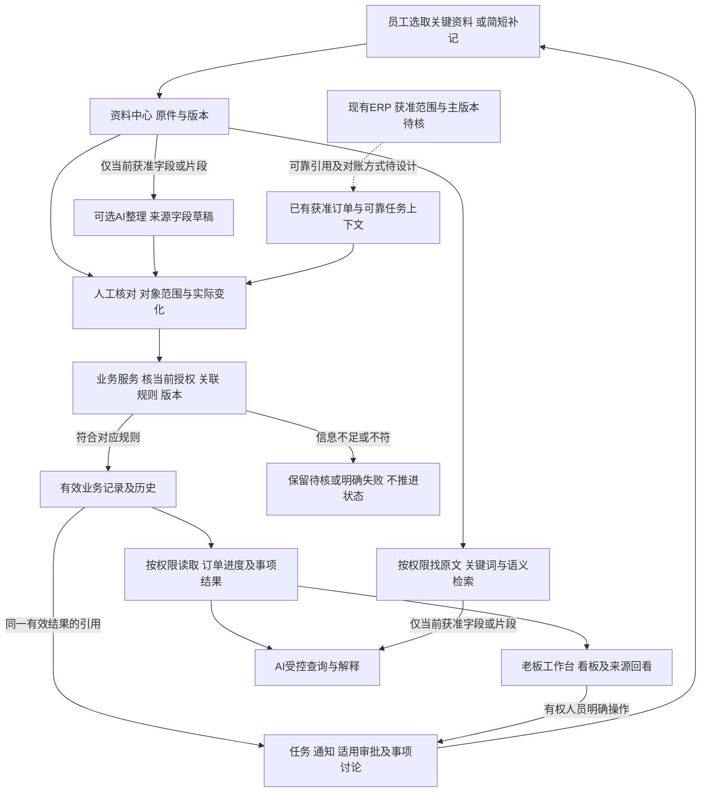

# 系统关系图与贯穿场景走查

日期：2026-10-26。整理：1号。revision：2。supersedes：revision 1的合成数量范围及AI输入边界不够显式；旧稿保全项目外，修订来源见文末。

状态：proposed／关系草图和合成纸面走查。依据[业务与系统记录对照](2026-10-26-业务流程与系统记录对照.md)、[主管流程摘要](../公开接续/2026-10-26-主管流程图业务主线摘要.md)、[订单进度研究r5](2026-10-26-订单进度查看功能调研.md)及三专题补查。用户要求研究连续推进，本文件不再逐页停等；首版范围、公司细则及正式开发仍未批准。本轮没有运行功能、模型或接口。

## 1. 系统各部分怎样连接

这是职责关系，不是十二个强制状态、固定数据库表或独立部署服务。各类资料的上报触发分别决定；文件归档不必形成订单，任务也不必都附文件。纯手工且有可靠依据的授权操作可不调用AI。AI对资料的提取/解释和系统正式确认是不同职责。

原件提取和查询引用进入AI前均须核处理范围，不能整件送入后再隐藏答案；后台服务处理权与请求人阅读权分开核定，模型出域/服务凭据不因此自动获准。本图不预定模型运行地点或最终授权实现。

PMC是图载的交期、进度、出货统筹岗位；关键节点事实可来自相应岗位，跟单参与查漏。它们之间的实际确认/代理/更正权未定，不把每条变化都要求PMC或老板再点一次。

## 2. 一条贯穿案例：关键反馈怎样到老板眼前

以下订单A、明细1、批次甲、数量及人员全部为合成设置：假定明细1需求10件，本次工作范围为明细1的某项加工，批次甲仅涵盖其中4件，不代表订单A全部需求或其他加工/检验范围。只为走查假定对象关联可靠、岗位对该加工范围有确认权、完成含义已明确；这些条件尚未在公司核实。

| 步骤 | 人和系统分别做什么（建议） | 留下的结果及不可越过的边界 |
| --- | --- | --- |
| 1 有一项进度跟进任务 | 有权人员发起跟进事项，可关联订单A并附范围/期限；实际节点确认还须定位到明细1、本加工范围和批次甲 | 任务建立或关联整单不代表确认粒度已齐，也不代表加工完成；AI可整理任务草稿，不自行正式下发 |
| 2 岗位提供关键反馈 | 岗位选取“本批4件加工完成”或直接在可靠上下文补记，不搬全群聊天 | 保存来源或明确标员工复述；上传、上报触发与正式生效按类别分开 |
| 3 整理及核对 | 可选AI提出批次/加工/4件草稿；人核对范围、数量含义及来源，无依据时间留未知 | 带出上下文减少抄写；不是每张图都需有单号，不以单纯预选/相似名称放行 |
| 4 有权确认 | 业务服务按当前权限、规则和版本处理；条件满足时记录本批有效加工结果 | 确认请求超时先查处理结果；不能换个键再加4件；真实累计/新增口径须定稿前核 |
| 5 任务及进度引用 | 同一有效结果被进度视图及任务反馈引用；PMC按获准范围统筹，跟单查漏 | 任务如果另需验收，仍待验收；不得自动显示检验合格、已出货或任务已验收 |
| 6 老板查询与查看 | 获准查看者通过工作台/搜索/AI查看本批结果、来源类型、数据时点及待核事项 | 只说本加工范围的批次甲4件有确认；明细1另6件没有信息就标未获更新，不称整单剩余6件，不报整单40%或未开工 |
| 7 后续反馈与更正 | 后来质量待复核可与加工结果并存；如真录错，由有权人按更正规则处理并留历史 | 质量疑问不自动认定返工；旧消息/新模型输出不覆盖已确认事实；有效下游不得自动删除 |

这一案例验证的是纸面逻辑能否对齐，不是已经证明员工省时或系统准确。异常、权限变化、多单及口头来源的更多反例复用[3号KF-01—08](../技术调研/2026-10-26-关键反馈到订单进度的可信链路补查.md)，不重复造一套验收编号或假装执行测试。

## 3. 四种关系要分清

| 关系 | 当前设计候选 | 定稿门槛／来源 |
| --- | --- | --- |
| 资料到业务对象 | 一份资料可支撑多个草稿/事项；多份资料可支撑同一结果，保留片段与版本；非订单资料独立归档 | 关联范围及稳定键未明时保留待对单。依据2号[有限原件补查](../公开接续/2026-10-26-订单关联补查摘要.md)，不是已验证外键 |
| 任务到阶段结果 | 反馈引用同一有效结果，另有任务验收时单独处理 | 同义事实才复用确认；具体任务种类/验收权未定，不把所有任务当生产节点 |
| 当前结果到历史 | 当前可用结果与来源/更正关系分别保留；后续真实变化不抹去此前事实 | 更正效力、依赖范围及授权须核。参考4号[一致性补查](../技术调研/2026-10-26-订单进度权限与一致性职责补查.md)，未决定具体数据结构 |
| 查询到原件及统计 | 按对象/动作/字段授权；精确业务数取获准有效记录，语义检索用于找证据 | 看进度不等于下载整件或看成本；检索无结果不等于业务为零；原件混有受限内容时不能整件放开 |

## 4. 技术图纸接续清单

在此逻辑基础上连续形成候选技术图纸；不必先固定界面颜色或所有次要字段，也不以本表跳过关键核实。

| 图纸部分 | 下一份设计要回答什么 | 复用及仍缺的依据 |
| --- | --- | --- |
| 模块与运行边界 | EXE客户端、业务服务、资料存储、结构化记录、文本/检索及AI各负责什么；断网/AI不可用怎样继续 | 复用既有底座及提取报告，不重新堆产品名单；本机/服务器部署、规模及维护条件还需核 |
| 对象与数据流 | 来源/草稿/正式记录/任务/投影如何关联，版本和多种时间怎样带出 | 订单/明细及三类批次真实映射仍是定稿门槛，技术不能替岗位作答 |
| 接口与权限 | 谁可读、提交草稿、确认、更正、下发/验收、查看附件；AI仅调用受控读取/草稿能力 | 岗位名称不是权限；确认/审批/执行分开；草案可画，正式策略不能自行批准 |
| 技术选择与验证 | 每个候选处理哪一职责、为何适合longshi、替代/失败退路、版本许可和最小验证 | 旧研究可复用，必要时核更新；没有实际对照的效果/性能/恢复仍待测，新增实验按确认范围执行 |
| 施工和验收映射 | 需求到设计、任务、允许/禁止行为及验证证据怎样对应 | 用户确认可审阅方案后再进入正式开发，不把研究文档的生成当验证完成 |

## 5. 指定接口审阅及修订

2号159实际审r1第1—3节，认为未把未知映射当已知，建议明确合成10件属于明细1、本次4件属于其某加工范围的批次甲；r2已在开场及步骤1/6修正。3号160实际审第1—3节及上下文，未见与KF案例的实质冲突，建议图上显式限制提取/查询进入AI前的获准片段；r2已补两条边和说明。4号158实际审第1—4节，确认同一结果引用、验收独立、超时防重、当前授权和技术图纸门槛未见实质冲突，不要求重复抄其技术细则。

三者均实际回读最新连续推进规则并在各自原任务内审阅；只代表上述纸面接口核对，不是全稿安全审计、公司事实核验、r2独立复审或软件实验通过。1号按来源做r2定点修订，未改三者旧稿。没有正式业务开发、生产取数、业务组件安装、对外发布或Git推送；协作工具静音验证与业务系统实验分开。
