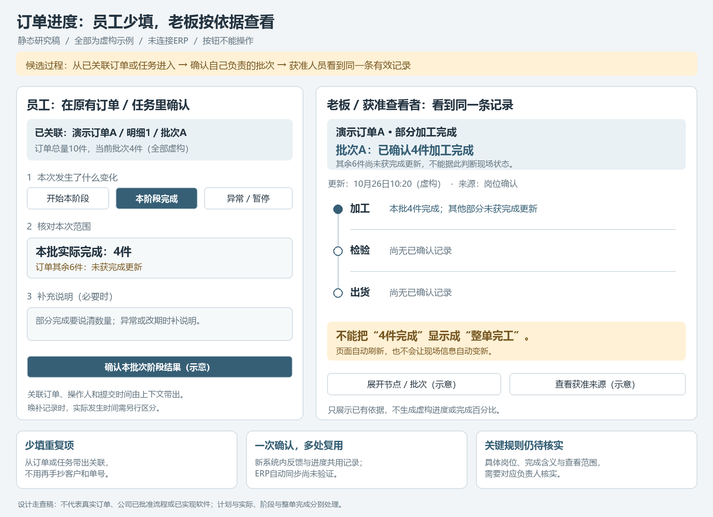

# 订单进度查看功能调研

日期：2026-10-26。整理：1号/business-01a16bce。revision：5。supersedes：revision 4尚未纳入主管提供流程图中的PMC与物流/收款交接；revision 1—4原稿保存在项目外。用户已选择混合分工；现补文件级岗位证据，保留原需求和静态走查，不代表公司软件权限已定稿。
状态：功能需求及用户描述的数据来源已明确；页面、更新规则、授权矩阵、时效标准和接入方式待调研。未开发或验证数据接入。

最新来源补充：用户本轮转交主管业务流程图，图中PMC统筹订单交期、进度及出货，售后跟单制作送货单、跟物流并确认客户收货。后续调查/职责图必须纳入PMC，不再宽泛询问谁统筹这一大段；具体节点由谁提供事实、谁确认/更正仍待核。文件未展开加工/检验及分批关联，也未说明ERP实现，不能覆盖此前用户对现场渠道的描述。见[主管流程摘要](../公开接续/2026-10-26-主管流程图业务主线摘要.md)。原六类细节点候选、05静态图及部分/整单区别保留，不用商务12步代替生产细节。

2026-10-26来源说明补充：用户再次说明为新来的实习生。本文“用户明确/确认”记录其需求与设计选择，不代表公司决策者或经手岗位已经核实/批准。ERP结果与群/人员进度来源继续作为用户提供线索，混合分工是用户选择的未来设计方向；实际适用性按[业务核实转发清单](2026-10-26-业务核实转发清单.md)核实。原话与候选节点保留，不冒充已完成访谈。
来源：用户本聊天新增“部分有权限的人可以查看订单的实时进度”，并回答当前查进度靠“跟单/生产人员和微信群，ERP里一定是结果”。关联任务lsr-smf，调查域COV-02/03/05/08/13/16/17/18；复用[系统全貌](2026-10-24-系统全貌一页说明.md)、[员工关键事项记录](2026-10-26-员工上报流程走查.md)及[系统底座研究](../技术调研/2026-10-24-系统底座与技术职责调研.md)。

## 1. 已确认需求与现状

| 编号 | 内容 | 证据及边界 |
| --- | --- | --- |
| OP-01 | 部分有权限的人可查看订单实时进度 | 用户明确功能需要；哪些人看哪些单、哪些字段，尚未指定，不能默认所有员工可查全部订单 |
| OP-SRC-01 | 当前订单过程主要靠跟单/生产人员和微信群掌握，ERP记录结果 | 用户陈述，未独立检查ERP或现场流程；不能假设现有ERP提供足够过程节点或可用实时接口 |
| UP-04关联 | 未来补记关键需求、重要变更及任务反馈，避免每条聊天都登记 | 用户已选；不因此要求全量微信抓取、持续录音或强制登记所有口头交流 |
| OP-02 | 平衡老板希望详细与员工新增操作负担 | 用户表示老板看来越详细越好，但若使员工任务繁琐可不必太详细，并请助手提出办法；具体界面、阶段、字段和阈值尚未批准 |
| OP-03 | 混合分工：关键岗位顺手确认自己的节点，跟单负责查漏补缺 | 用户本轮选择；具体岗位名单、权限、代理及查漏规则待核。不等于跟单可以无依据覆盖其他人的结果，也不要求每名员工维护全单 |

“实时”的更新时限、状态覆盖、离线和漏更新处理均待确认，当前不承诺秒级自动刷新或与现场完全同步。用户已要求继续调研，不构成正式开发授权。

## 2. 目前的信息流与新增方向

当前（用户描述）：

`现场发生变化 → 跟单/生产人员掌握或在微信群沟通 → 有人查询时找人/查群；ERP保留订单结果。`

新系统候选方向（proposed）：

`关键节点反馈/选取群消息/简短补记 → 关联具体订单或明细/批次 → 核对及有权限人员确认 → 更新可追溯进度 → 有权限的人查看。`

ERP内获准取得的订单结果可作为对单与对照依据；具体取得方式待核。过程反馈由什么岗位、何种入口更新仍待定，不将“现在谁知道”直接等同“未来谁必须填”。系统不能凭最终订单结果推测全部生产过程；无更新来源就无法得知现场新变化。

## 3. 页面建议：一张订单现在怎样了

以下为候选展示内容，不是已经确认的必填字段：

| 展示内容 | 要解决的问题 | 待核事项 |
| --- | --- | --- |
| 订单及明细/批次标识 | 知道在查哪一张单、哪一部分 | 如何与ERP订单及拆分批次对应 |
| 当前阶段和已确认节点 | 快速了解做到哪一步 | 排产、加工、检验、待发/已发等只是候选，不预定公司状态全集 |
| 计划与实际、预计完成/交期 | 判断承诺、实际和可能延期 | 时间含义、谁能更新预计值、客户请求与内部批准分别显示 |
| 负责人及需协调事项 | 知道找谁了解或处理 | 岗位责任和可见范围待核 |
| 异常或阻塞 | 看见缺料、返工、延期等风险 | 异常分类/处理/关闭由业务核实，不能据文字自动判责 |
| 更新时间、更新来源和确认状态 | 判断信息是否足够新、是否有依据 | 报告时间与现场发生时间分开；多久算陈旧待核 |
| 节点历史及相关反馈/附件 | 能追溯从何时、由谁变成当前状态 | 更正/撤销/历史权限和是否允许看原附件待核 |

查看入口可研究订单列表/搜索、订单详情进度区、老板工作台及AI问答；最终独立页面还是嵌入现有页面待定。无需仅为显示进度自动增加独立部署服务。

## 4. 更新与查看必须分开授权

- 查到订单进度不自动获得更新进度、修改交期、审批变更或查看成本利润的权限。
- “部分有权限的人”需要明确到角色、订单/部门/协作范围及字段；不能把原件、评论、搜索、AI和导出当授权例外。
- 关键反馈可以帮助形成候选进度，但AI不能把一句群消息直接改成正式订单状态。谁核对和确认需要单独调查。
- 正式节点、未经确认的反馈与估计分开展示；没有进度信息显示未获更新，不自动填为“未开始”或“已完成”。

## 5. 后续必须走查的异常

| 情况 | 要检查的行为（proposed，未实现） |
| --- | --- |
| 一张订单分多批、多工序或部分交付 | 局部完成不能自动等于整单完成；阶段、数量和批次粒度待核 |
| 返工、暂停、退回或订单取消 | 能表达回退/异常，不只采用一路向前的百分比条 |
| 群消息与跟单记录不一致 | 保留冲突及来源，由明确岗位确认，不让AI静默选择 |
| 重复反馈、晚到反馈或离线补记 | 不重复推进节点，不让旧消息覆盖更新事实；发生与录入时间分别保留 |
| 很久未更新 | 显示最后更新时间与缺口，不能以页面自动刷新冒充现场数据新鲜 |
| 客户变更尚未批准 | 不直接改正式交期或订单；变更请求与当前有效值分开 |
| 查看者没有权限 | 查询、详情、附件、AI及导出按相同授权范围处理 |

## 6. 尚待核实，不要求现在一次补齐

1. 先看哪些阶段和业务范围：整单主要节点，还是细工序、批次、数量、交付等。
2. 哪些岗位在什么动作后更新；员工上报、任务反馈与进度更新如何衔接、避免重复填报。
3. 怎样对上唯一订单/明细；群消息没有单号或涉及多单怎样处理。
4. 哪些角色看哪些订单/字段；哪些人能确认或更正，提醒与审批是否适用。
5. 更新时效、漏更新、异常跟进和现场/网络条件；不能先拍定自动采集或硬件方案。

本节是助手内部缺口，不作为整套问卷。用户最新说明影响大的问题仍应问；先查已有资料，必要时择机单点核实，按第12节区分当前可推进与定稿前必须确认的事项。不能因为少打扰就跳过影响数据正确性/权限的核实，也不让实习生猜答案。旧九问安排不再直接作为当前待发清单。

## 7. 要求追踪与交付边界

| 要求 | 设计位置 | 后续验收办法（未执行） | 状态 |
| --- | --- | --- | --- |
| OP-01按权限看订单实时进度 | 订单进度区/列表及工作台候选入口 | 指定允许/禁止身份查看同一订单；关键节点更新后，查看值、来源、确认状态及时点一致 | 需求已确认，规格待调研 |
| OP-SRC-01过程来源在人员与群 | 更新链路与订单关联 | 有可核对来源的真实关键事件能对上订单；只给ERP结果时不编造过程 | 用户已说明现状，未做接入验证 |
| UP-04关键节点轻量记录 | 员工入口/任务反馈与进度衔接 | 不要求全量聊天搬运，同一反馈可关联事项及进度而不重复人工填报 | 记录原则已确认，具体交互待定 |

截至revision 1，已完成需求落档及缺口梳理，尚未绘制进度页。revision 4新增静态走查图及视觉检查，见第11节；仍未新增模型/ERP实验、未选定最终技术、未开始业务开发或推送GitHub。

## 8. 展示分层与轻量记录候选（proposed）

本节回应用户关于细度与员工负担的取舍。**分层查看、关键节点更新、异常再补充**为助手建议，尚未经用户选定，不能记成已确定实施范围。

### 8.1 同一份有效数据，分层查看

| 层次 | 老板/获准查看者可看到什么 | 录入边界 |
| --- | --- | --- |
| 一眼概览 | 当前大阶段、预计交期、异常提示、最后更新时间 | 优先展示已确认数据；没有预计值就留缺口，不要求为了卡片完整额外猜填 |
| 展开节点 | 有记录的关键节点、责任岗位、完成时间，适用的明细/批次与数量 | 不强制每个工序都人工记日志；具体关键节点需按流程调查 |
| 继续追溯 | 对应任务反馈、检验/发货等已有记录及允许查看的附件 | 复用已有且有权访问的依据；缺失标未采集，不由AI补造细节 |

展示得更详细，不必等于要求员工填更多字段；已有依据能支持多细就显示多细，业务上确实缺少的过程不会因界面分层自动出现。

### 8.2 尽量在原本动作上顺手留痕

- 从已关联订单/任务进入，复用订单、责任人和计划值；系统可记录当前操作账号及提交时间。现场实际发生时间如不同，应能区分，不能自动当成提交时间。
- 授权人员完成自己负责的关键节点时，用明确的完成/转交动作留痕；有合适业务含义和授权时，同一次确认同时更新任务及对应进度，避免重复填写。
- 已提交的检验或发货等结果，先查能否复用其业务确认动作。只上传报告或附件不等于合格、已发货或整单完成，不能见文件就自动推进。
- 员工选取微信内容或简短补记后，AI只帮助整理候选。正式节点由权限与业务规则控制，不因追求少操作而省掉必要确认。
- 正常情况优先复用既有字段；返工、缺料、延期、交期变化时按需补原因、影响和附件。分批/部分完成即使正常，也须在必要时记录数量与范围，不能为了省点击将整单误标完成。
- 不要求反复上报“还在加工”。是否需要定期核实、多久未更新提示、提醒谁及如何防骚扰待核，不能以减少填报为由把长期无更新当现场未变。

### 8.3 可检查的合成操作例子

例子仅为界面建议：员工进入已关联订单/批次的任务，完成自己负责的阶段后执行“本阶段完成”。系统记下操作人、提交时间和对应阶段，获准查看者可见该次有效更新。部分完成需明确数量/范围；有返工/延期则补必要说明。订单整体完成与阶段完成分开，不能一次点击无条件改变全单。

这里“一次动作”是减少重复操作的设计目标，不是实测耗时或保证。角色、现场入口、节点名称、确认责任尚未确定。

### 8.4 怎样判断这个取舍适合longshi

在获准的后续走查/试用中，比较现有问人/查群方式与候选记录过程：员工新增操作次数及耗时、同一信息是否重复填写、关键节点漏记、数据陈旧、老板能否回答实际问题及减少多少追问。没有实测前不承诺每单几秒或自动化比例。

先用少量有代表性的订单类型选择关键节点；详细工序能力保留调查，只有确有用途且数据能稳定提供时再深化。尚未选择最终节点全集、首版切割或必填制度，不以此候选方案替代其余功能调查。

## 9. 结合公司已有资料的节点候选

本轮复用本机现有《公司业务资料首轮分析》《公司资料字段与业务关联对照》，不重复打开其已读原件。公开范围见[公司资料研究概览](../公开接续/公司业务资料研究概览.md)。原报告已观察到：材料/加工需求、采购及PMC岗位线索、外协计划/实际完成字段、检验中的订单/规格/件数、出货中的客户及数量等。它们证明有相关业务与字段线索，不能证明公司当前已有可自动读取的节点进度；用户关于人员/微信群掌握过程、ERP留结果的最新陈述继续有效。

下表是proposed节点框架，尚未经公司逐项确认；责任栏是待核角色候选，不是现行制度或任命。

| 节点候选 | 主要想知道什么 | 已有资料线索及可研究复用项 | 尚需核实/补记的内容 |
| --- | --- | --- | --- |
| 订单已建立/确认 | 跟踪的是哪张单、哪些明细及承诺要求 | 下单需求表的客户、材料/加工要求、出货时间；ERP结果可研究获准取得 | 唯一订单/明细标识、谁确认生效、如何对单。订单建立不能等同已经排产 |
| 物料准备 | 材料是否到位、是否缺料 | 采购/入库岗位及材料验收线索 | 到位或缺料的确认动作、岗位、数量/批次；不需采购的订单可按适用规则跳过采购 |
| 生产安排 | 是否安排、计划何时完成 | PMC岗位、排单及计划完成线索 | 责任岗位和排产依据；计划开始不能自动当实际开工 |
| 加工执行 | 内部加工/外协做到哪里、是否卡住 | 外协记录中供应商/加工类别/计划及实际完成字段；生产岗位线索 | 关键阶段开始/完成由谁确认、部分数量、外协反馈与厂内接收的区别；不能默认外协信息已实时接入 |
| 检验 | 哪批已检、结果怎样、是否需要返工 | 检验表的订单/明细、规格、件数、公差及检测项 | 实际结果、合格/待处理含义、质量确认岗位；有空模板或上传报告不等于合格 |
| 出货 | 已准备、已发哪些批次和数量，是否还有未发部分 | 出货/送货记录中的客户、规格、数量、重量线索 | 与订单明细的可靠关联、实际发出确认、部分交付与更正；已发货不等于客户签收或回款 |

这是六类调查节点，不要求六次固定手工填报：哪些能复用已存在的有效业务确认，哪些需要少量新增动作，按数据实际可得性逐项确定。财务回款、客户签收及上游报价等是否进入同一进度视图继续保留为范围问题，没有据此删掉相关业务调查。

### 9.1 不采用固定直线的情况

- 内部加工与外协可能分支或并行；物料准备、计划与部分加工的先后和并行条件待核，不能强制所有订单按同一顺序。
- 一单多明细或多批次时，节点先落在明确范围，再汇总整单；不能让一批完成触发全单完成。
- 检验不合格、返工、补料、暂停和取消保留异常路径；不能把进度做成只能不断增加的完成百分比。
- 某阶段完成不表示下一阶段已经开工；没有可靠开始信息时应表达“待下一阶段/未获更新”，不猜当前现场状态。

## 10. 已确认的混合分工怎样落到候选流程

| 参与方 | 已确认的分工方向 | 需要进一步设计的边界 |
| --- | --- | --- |
| 关键岗位 | 对自己负责的节点顺手确认 | 哪些岗位、能确认哪些订单/批次、什么动作算完成、是否复核及代理，待核 |
| 跟单 | 查漏补缺 | 查看缺更新、疑似延期、来源冲突等；有依据且在授权范围内补记。能否更正他人已确认记录及如何留痕待核，不能默认全部可改 |
| 老板/其他获准人员 | 查看订单进度 | 可见哪些订单/节点/字段，沿用统一授权调查；不自动获得修改和成本查看权 |
| AI及系统 | 系统保管授权记录，AI辅助整理候选及按权限解释 | AI不自行确认开工/完成、不改正式订单；提醒条件和频率仍待核，不先部署催报规则 |

候选操作例子：检验岗位在对应订单/批次确认实际检验结果，若业务规则和权限允许，同次动作记录对应检验节点；跟单看到这批已有有效记录，不再重复录一遍。资料缺少结果或关联不明时留待核，不自动标检验完成。这个例子未实现或实测。

### 10.1 本轮完成与下一处缺口

已完成：从已有研究复用节点/字段依据，提出六类节点及分支/粒度限制；用户确认混合维护分工。没有新增原件读取、模型/ERP验证或业务开发，没有据此承诺自动同步、每单耗时或节点全部适用。

后续由助手继续对照已有节点/字段依据；需要人核实的内容按第12节阶段门槛安排，不把本节全部变成当前问卷。已知分工与来源不重复问，具体岗位名称及现行制度未知继续待核，不要求用户重交全套资料。

## 11. 轻量记录到老板查看：静态走查

依据：用户要求继续独立推进，并指出重要问题仍应问。复用已有公司字段对照和前述候选设计，未重新读取业务原件或联系同事。输出为1600×1160静态图，不是业务原型程序。

### 11.1 既有资料支持什么，不能直接支持什么

| 观察依据 | 可据此推进的设计 | 仍须保留的限制 |
| --- | --- | --- |
| 原字段对照记录检验表含订单号、规格、件数及检测项 | 从具体订单/明细/批次进入检验确认，研究复用有效结果 | 有订单号字段不证明唯一、各表一致或有自动接口；空模板/上传报告不等于检验合格 |
| 出货表已有客户、规格、件数、重量等字段，抽样表头未明确见订单号 | 从已关联订单或任务进入可减少手抄，并研究复用交付数量 | 不凭客户+规格猜单；抽样未见不代表全文件或ERP没有，可靠关联尚未核实 |
| 外协资料有供应商、加工类别、计划/实际完成字段 | 可以分开展示计划与实际、内部加工与外协结果 | 历史字段存在不证明实时维护、状态含义正确或接入可用 |
| 已有副本/空检验/冲突数值的研究结果 | 将来源、确认状态、批次粒度和版本作为显示依据 | 不能把文件新增、旧缓存或重复副本直接当新业务进度 |

这些结论来自复用既有研究报告，不是本轮独立重跑全部原件。公开摘要见[公司资料研究概览](../公开接续/公司业务资料研究概览.md)，详细定位仍在原机私有资料分析中。

### 11.2 一个完全虚构的批次例子

演示订单A共10件，当前任务对应明细1/批次A。员工核对并确认本批4件加工完成。这里的订单、批次、数量、时间及人员均为新编合成内容，不对应公司真实记录。

| 环节 | 员工动作及可少填内容（proposed） | 老板/获准人员得到什么 |
| --- | --- | --- |
| 进入已关联订单/任务 | 上下文带出订单、明细、批次，不要求再次手抄客户和单号；授权与关联仍要校验 | 确认进度属于哪张单、哪一部分 |
| 选择本次变化 | 明确开始、阶段完成或异常；阶段完成含义由后续业务规则决定 | 知道这次发生的是什么，不能把计划当实际 |
| 核对数量/范围 | 本次实际完成4件，由员工核对；计划批量不能静默当实际完成 | 只把本批4件记为该阶段已确认，其他6件未获更新 |
| 必要时补说明 | 部分完成保留必要数量；异常/改期补说明。能引用已有获准来源的，不再反复上传 | 追溯异常和依据；没有资料则说明缺口 |
| 执行有效确认 | 用户有权且规则允许时，由业务系统记录身份/提交时点，实际发生时间晚补需区分 | 在允许范围内查看同一条有效记录和更新时间，跟单不在新系统里再抄一份 |

右侧仅展示当前有依据的批次结果；检验、出货没有确认记录时显示缺口，不标为“未开始”或“已完成”。不把4/10件加工完成解释为整单40%完成，也不因页面刷新就伪称现场信息已更新。

“一次确认、多处复用”是新系统内部的候选交互目标，不证明可免除ERP现有操作或已完成自动同步。当前关联上下文在图中是合成设定；真实订单识别、节点确认权限及幂等一致性都未实现。

### 11.3 本轮检查与限制

已生成PNG，检查中文可读、边界、左右信息对应、全部虚构标识和批次/整单区别；外部生成记录未报画布越界。原四页和四页总览保持原样，05号为新增走查图。

没有功能、权限、提取效果、ERP同步、性能或员工耗时测试；按钮不能操作。尚不能由静态图得出“员工一定只花几秒”“进度已经实时可用”或公司认可该操作的结论。

## 12. 哪些问题影响大、什么时候必须问

用户原话：“这些问题对推进的影响大不大？大的话该问还是得问。”本节据此修正“减少打扰”的执行：关键问题要解决，按当前工作阶段安排，不一律停问，也不重新发整套问卷。

| 级别与缺口 | 不核实的影响 | 现阶段可做什么 | 必须明确的门槛/适合核实者 |
| --- | --- | --- | --- |
| 高：订单/明细/批次怎样可靠对应 | 将别单信息放错，重复/漏算或整单状态失真 | 用合成标识画草图，继续核已有编号/字段 | 正式关联规则与导入/接入设计定稿前；实际跟单或ERP经手/维护者 |
| 高：什么算阶段完成、部分完成、整单完成 | 4件完成被说成整单完成；待检与合格混同 | 在例子里分清含义，不预定公司完成标准 | 节点及确认流程定稿前；相应业务/生产/品质负责人 |
| 高：谁可确认/更正，谁看哪些订单及字段 | 越权查看、错误变更或责任不清 | 按既有默认方向标角色示意，例外留待核 | 授权和更正规则设计定稿、开放真实数据前；有决定权的业务负责人 |
| 重要：哪些实际动作可顺手复用 | 方案看似省事，员工实际还要重复填报 | 依据现有表单画候选，记录新增动作 | 确定具体录入方式及试用前；适时看一次实际经手操作，避免长问卷 |
| 重要：更新时效与漏更新处理 | 老板把过时信息当现场状态 | 显示来源/更新时间，未知不猜，先不承诺秒级 | 对“实时”作验收承诺前；跟单/现场负责人结合实际频率核实 |
| 可后放：颜色、菜单排序、详细展开样式 | 影响体验，可修改 | 助手先给一致的静态候选 | 用户或实际使用者方便时反馈，不阻塞业务资料研究 |

上述高风险点不妨碍当前继续画待审图，但影响对应设计定稿和正式开发，不能用助手假设直接绕过。先查已有资料能否解决，再把必要且查不出的点交给相应人员；普通员工不负责替公司决定权限。

如果资料核对后仍缺订单映射，下一次优先只补“现有加工、检验、出货记录靠什么标识对回同一张订单”这一点，由实际经手者说明即可，不索整库或完整案例包。当前没有代用户发送问题或要求同事马上回复；其他问题仍在内部台账按影响推进。
