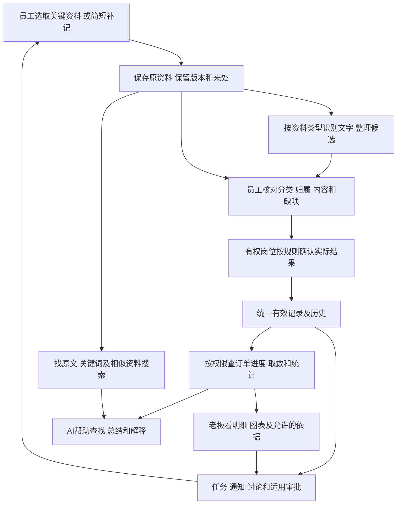

> 2026-10-27最新范围调整：本文原资料输入至老板查看的说明只覆盖部分能力，不能替代完整旧软件基础板块。 先读[基础功能迁移清单](../../软件开发计划+施工清单/需求与范围/基础功能迁移清单.md)。旧版正文保留，不表示已获正式开发批准。

# 软件总图与当前设计进度

2026-10-27；revision 6；proposed设计汇总，供公司审阅。supersedes r5：按用户新方向以进行中订单为主、完成订单供历史分析；r5保全项目外。历史r5 supersedes r4：接入限定PG确认机制实测，保留缺失阶段和NC预期纠错；r4保全项目外。总图仍待审，未批准业务开发。云端主本/按需缓存仍为待分析设想，本系统优先服务未完成和正在进行的订单，已完成订单保留用于历史查询和数据分析。**这是设计图和已有试验的对照，还不是做好的软件，也不是批准开工的施工方案。** 原始研究、来源及限制沿文末入口保留。

## 这套软件怎样帮公司做事

本系统优先服务未完成和正在进行的订单，已完成订单保留用于历史查询和数据分析。

员工遇到关键需求、变更或任务反馈，选取文字、截图、语音、视频或简短补记。系统保存原资料，帮助整理和关联；该由人确认的实际结果仍由有权岗位确认。老板按权限查进度、看汇总、下任务，少让员工为不同报表重复抄同一份信息。

图中连线是职责关系，不强制所有资料都挂订单、都调用AI或都由老板审批。“上传了”“识别了”“已经上报”“业务已确认”“检验通过”各有含义，不能共用一个“完成”。各类资料何时算上报仍按类别决定。

## 各部件做什么，现在到哪一步

| 部件 | 大白话职责／技术候选 | 目前有的依据 | 还没证明什么 |
| --- | --- | --- | --- |
| 员工和老板入口 | 电脑EXE、候选手机入口；共用一套规则 | 已有页面草图和内外访问设计；Tauri与.NET路线仍在比较 | 正式安装、升级、手机及实际网络使用未联验 |
| 资料柜 | 存原件、文件夹、版本和出处；存储路线待选 | 已跑合成续传/顺序防重/双版本/部分文件夹及静止台账和文件恢复，保留首轮问题与补测 | 真实权限、并发/崩溃原子性、生产数据库及在线成组恢复未验 |
| 识别与整理 | 原生文档读取、图片OCR，音视频按需拆解 | 图片、表格、PDF已有有限实测和错误记录 | 不是所有格式都能读准；自动判断字段/归属及真实音视频效果未整体验证 |
| 正式记录 | 数据库保存有效结果、历史和关联；PostgreSQL等为候选 | 合成PG确认防重/版本竞争/超时、回滚及更正已跑，细阶段有缺口 | 真实口径、可靠明细、实际授权、崩溃/全流程未验；最小适配器不是正式实现 |
| 找资料 | 精确编号、关键词、相似搜索分工 | 已跑限定SQL、BGE排名和重排；发现当前中文索引配置限制 | 相似不等于同一订单；中文索引路线、混合搜索及完整权限链未验 |
| 谁能看和操作 | 登录、对象/字段/片段及动作授权 | 合成策略和撤权顺序等局部试验已有结果 | 不代表公司真实账号和权限已配置；跨进程撤权/并发未验 |
| 老板图表和AI | 系统负责取数与规则，AI选允许的展示/解释，图表绑定结果 | 固定字段校验和两个实际合格结果到柱图已跑 | 真实问句能否选对人/订单/指标，任意AI解释是否有依据、正式界面均未验 |
| 任务与审批 | 下发、接收、讨论、反馈；审批/执行/验收分开 | 已梳理流程和状态候选，并查过开源机制 | 公司各事项的实际路由、提醒及确认权仍要按相关定稿门槛核实 |

这些部件可以先由少量受控服务协作，图上的一个框不等于一台服务器。正式业务记录不交给AI任意修改；原件访问、搜索、AI和图表也不能绕开权限。

用户曾在2号窗口提出“共享文本有统一云端主版本、大素材云存储、电脑按需缓存、安装包不带全量库”，并说明希望先看分析；1号已回读原消息。按这个设想优先分析共享主资料＋客户端副本，不能把某台电脑当唯一资料来源。具体云服务/资料位置仍待论证；本地Office组件随软件部署也是设想，需另核许可、体积、兼容及打印，不因提到“核心组件”就打包整套Office。进行中记录、变更和完成后的归档继续在本系统内说明；哪些岗位维护和确认哪些内容按对象/字段核定，不因归档就向更多人开放。

## 当前重点和定稿门槛

已把现有研究收进[系统设计总图（待审）](../../软件开发计划+施工清单/技术与部署方案/系统设计总图.md)：8个逻辑模块、对象身份和交接、独立状态、技术落位、既有要求到验收的对应及5组定稿门槛。它是图纸草案，不是已批准技术栈、排期或开工清单；无需用户逐文档说“下一步”。

本轮更具体的结论：保存资料不强制挂订单；同一有效结果可被进度与任务引用，任务仍按规则验收；请求重试防重与“累计/新增是否同一业务事实”分别处理。草图可以继续，真实进度累计、正式统计及授权不能靠合成答案定制度。

本轮[上传、版本与恢复合成实测](../技术验证/2026-10-26-资料上传版本与备份恢复合成实测.md)已完成限定检查：中断续传、新旧版本、部分文件夹和记录/文件恢复有证据；两项首轮不足及复测均保留。接下来把已有证据收进模块、数据流、状态和验收门槛，收窄真正缺口；不重做已有调查，也不自动转入正式开发。

后续定稿仍有三个跨域门槛：真实订单明细怎样可靠对应；实际完成/核对/更正由谁确认；关键指标怎样定义并限定范围。已在资料里查明的部分继续引用，剩余部分择机向真正负责者核实，不让实习生代答，不发整套新问卷。

[本次确认机制实测](../技术验证/2026-10-26-确认防重并发超时与更正合成实测.md)把“重复点确认、两人同时提交、提交后等不到回复、录错更正”落到实际PG连接和SQL。主要行为有证据，细阶段和公司规则仍未闭合。

## 详细依据放哪里

- [业务主线与部门关系](2026-10-26-五部门资料融合与系统设计增量.md)：主管流程、新旧资料及模块关系，文件所载不自动等于现行制度。
- [运行位置和技术职责](../技术调研/2026-10-26-运行部署图与技术职责候选.md)：电脑、手机、共享服务、文件/数据/AI分工及第8节统一证据表。
- [资料提取实测](../技术验证/2026-10-26-固定资料提取组件对照实测.md)、[检索实测](../技术验证/2026-10-26-合成语料关键词与语义检索实测.md)、[授权实测](../技术验证/2026-10-26-合成权限与AI资料边界实测.md)、[结果到图表实测](../技术验证/2026-10-26-查询结果到图表的数据一致性实测.md)：分别列条件、实际失败和未验证范围，不能加总成软件完成率。
