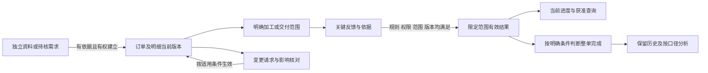

# 在途订单操作与状态候选

2026-10-27；2号／source-analysis-01a16bf8；任务 `lsr-nh4`；revision 1；supersedes：无。

状态：**proposed／以既有资料为依据的操作与状态候选**。用户已确认“优先服务未完成／正在进行订单，完成订单可留作分析”的方向；下列建单条件、状态名称、变更和归档规则是助手建议，尚非公司现行制度、首版批准或正式实现。本文承接[首版在途订单范围候选](../../软件开发计划+施工清单/需求与范围/首版在途订单范围候选.md)及[系统设计总图](../../软件开发计划+施工清单/技术与部署方案/系统设计总图.md)r4，不修改公共规则。

## 1. 已有依据到什么程度

| 来源与定位 | 已有资料支持 | 本稿怎样采用／不能据此断言什么 |
| --- | --- | --- |
| 根AGENTS“在途订单优先”、共同方向 `longshi/decision/2026-10-27-在途订单优先` | 用户本轮明确当前订单主线及完成后分析方向 | 订单在本系统建立、跟进和变更，不以其他结果工具接入为前置；不等于公司已批准全部操作制度 |
| [主管流程摘要](../公开接续/2026-10-26-主管流程图业务主线摘要.md)步骤05—09 | 客户确认订单与传单／下单分别存在；PMC统筹交期、进度、出货；跟单跟物流和确认收货 | 分开客户确认、系统登记、加工执行与交付；图载岗位职责不直接变成账号权限，也不能把12步当12个强制状态 |
| [订单关联补查](../公开接续/2026-10-26-订单关联补查摘要.md)第1—3节；既有私有《真实订单标识与明细对应再核》E01—E10 | 已有材料标识文字“客户编号＋订单材料序号＋材料尺寸”；有已填工单图和多行检验样本；存在补料订单引用、订单量／抽检量等模板 | 复用编号和范围线索，不能再说没有真实样本。跨来源具体明细唯一映射、标识适用范围及现行执行仍未接通；本段未重读原件 |
| [字段来源与关联门槛](../公开接续/2026-10-26-进度记录字段来源与关联门槛.md)12行字段 | 订单／明细／加工范围、生产安排／炉批／交付范围、数量口径及时间需要分别表达 | 本稿采用这些区别；不是新增12项员工手填表，也不是已定数据库字段 |
| [订单进度研究](2026-10-26-订单进度查看功能调研.md)第4、8—12节 | 用户选择关键岗位顺手确认、跟单查漏；局部完成不等整单，缺更新不等未开工 | 继续候选操作及未知提示；岗位实际确认权、更新时限和完成定义仍待核 |
| [五部门融合](2026-10-26-五部门资料融合与系统设计增量.md)第1、3—4节；[报价版本摘要](../公开接续/2026-10-26-报价与资料版本补充摘要.md)第3—4节 | 要求／计价／下料尺寸和加工公差用途不同；品质措施、验证、关闭不同；报价保留条件版本 | 变更需说明改了什么及影响范围，不把改尺寸当普通改文字，也不以返工消息直接推定品质问题关闭 |

以上为既有报告的限定复用；没有新增原件核验、岗位访谈或现行制度确认。原件路径、真实编号、客户及价格不复制到本稿。

## 2. 工作对象与最少上下文

**未完成订单工作池不等于“已经开工”。** 可同时收录已建立待安排、正在加工、部分交付、暂停待处理等符合范围的订单；这些是工作视图候选，具体状态仍看各自证据。资料待对单另有入口，不伪装成有效订单。

| 对象／上下文 | 候选保留内容及作用 | 可以暂缺什么／正式推进门槛 |
| --- | --- | --- |
| 订单 | 本系统稳定身份、可辨认的客户／需求上下文、来源或人工登记依据、建立人／登记时间、内容版本 | 外部编号可暂缺，不因此禁止在本系统登记。客户身份未能消歧或订单尚未成立时先存待核草稿，不以询价截图自动激活订单 |
| 订单明细 | 独立稳定身份、需求描述、适用材质／尺寸及其用途、目标数量和单位（有依据时）、来源定位 | 来源行号用于回看，不能替稳定身份。数量／交期未知可显式待补，不生成0或“今天”；缺少必需范围时不放行相应数量确认 |
| 加工范围 | 所属明细、具体工作内容、所覆盖的货品／数量及适用单位；有分组时保留归属 | 不要求每单先建全工艺路线。跨明细合并安排须能保留各自分配，不能凭同规格自动合批 |
| 批次与交付 | 生产安排、材料炉批、交付范围分别保留标识和关系 | 无依据不造批号；一个炉批不能替代加工范围或一次交付身份 |
| 结果与来源 | 哪一范围发生何事、数量性质、业务发生时间／精度、依据、确认身份及版本 | 不能只凭一句“完成了”确定对象、工序和数量；原件可先保存，反馈可待核，不能借此推进全单 |
| 维护与查看 | 哪类动作允许谁对哪个对象／字段操作；来源与当前授权分别检查 | 用户的员工看自己、主管本部、老板全公司是默认查看方向，不自动成为建单／确认／改期／更正权；跨部门订单例外仍待定 |

“稳定身份”是本系统管理记录的设计建议，不证明已经找到历史单据的全局主键。内部身份不能替代原编号、关联依据或业务真实性。可由系统和可靠上下文带出以上信息，不要求用户每次重抄。

中途接入一张进行中订单时，建议记录**接入时点和已知基线**：有依据的当前需求、各范围已确认情况、尚缺的过去记录。不要为了补全时间线制造历史开工／检验／交付事件；缺失基线也不能让第一次反馈被当成从零开始的完整累计。

## 3. 正常与异常操作候选

下表角色均指未来经授权的操作者，不任命公司岗位。界面可研究“未完订单列表→订单详情→需求与范围／当前结果／变更／事项／来源历史”分区；未关联资料及独立任务保持自己的入口。

| 编号／动作 | 人最少需要核什么 | 系统候选保存／成功表现 | 不满足或出现异常时 |
| --- | --- | --- | --- |
| O01 建立／接入订单 | 对象确为要跟进的订单，需求及来源可辨；已有订单候选可对照 | 有权明确操作后建立稳定身份及首版需求；接入中的单另记已知基线／缺口；未获开工信息不自动标开工 | 询价、同名客户或相似截图只形成候选；疑似重复展示依据供核对，不自动新建第二单或合并他单 |
| O02 增加／修订明细 | 是新需求行还是旧行修订；材质、尺寸用途、数量单位和交期的已知部分 | 新行新身份；修订保留身份和版本，插行排序不改变已有反馈归属 | 不以行号、同规格或序号复用判断同一行；旧范围已生效时按O07处理影响，不能静默搬到另一行 |
| O03 安排加工／拆分范围 | 哪些明细承担哪些工作、每份覆盖哪些对象；分配量若适用须可对账 | 工作范围保留需求归属；并行、内外加工或不适用阶段按依据表示，不强制所有单走一条直线 | 范围重叠、量不明或跨单位时不自动汇总。拆成子范围后原父范围不得与子范围同时重复累计；拆合规则未明先留候选 |
| O04 记录关键变化 | 本次是实际开始／局部结果／异常，还是计划／估计；适用对象及必要差异 | 保存反馈、依据及发生／登记时间；从可靠任务上下文带出对象，免重复填写 | 可先留未关联反馈，不更新正式进度。任务指向全单而反馈仅涉及其中一部分时，必须细化范围，不能继承成全单 |
| O05 确认范围结果 | 当前有权；对象、工序、单位、数量性质、依据和期望版本清楚 | 同一有效结果供详情、任务引用和查询使用；加工、检验、出货分别成立 | 未获确认显示待核；无更新显示未获更新，不能默认为未开始。冲突或旧版不覆盖当前，提示查看差异 |
| O06 部分完成／分批交付 | 本次覆盖对象、实际量和“新增／累计／纠正”含义；确认结果属于哪一阶段 | 明细／范围显示有效量与依据；交付引用具体需求分配，不从一次送货推全单完成 | 重复附件／累计重复报告不增加量；加工、合格、已发、签收不得相加，未获其他部分更新时仍显示缺口 |
| O07 提交／生效需求变更 | 改哪一版哪些值、原因、影响的明细／工作范围；是否有适用批准要求 | 变更请求与当前有效值并列；有权且条件满足后形成新版本，保留生效时间和依赖影响 | 客户提出改期不自动改承诺；需批准的按适用路由处理，不统一交老板。已在制、已交付或旧审批所依内容变化需提示，不能全量无条件继承 |
| O08 纠正录错／处理真实返工 | 是原事实记错，还是当时做过、后来发生新问题；准确目标及权限 | 录错更正引用旧结果，历史保留；返工是新的实际事件／工作范围，可关联质量事项 | 不以返工抹去曾完成事实，也不把重做数量再加到合格交付；错关联已有有效结果时必须受控更正归属，不能拖动附件悄悄改统计 |
| O09 暂停／取消／恢复 | 覆盖全单还是部分范围、原因、已成立结果、需协调事项及适用权 | 请求与生效分开；暂停保留已有结果；部分取消保留取消范围和未取消需求；恢复明确对象及版本 | 暂停不自动取消、取消不等完成；已交付不能因取消消息变为从未交付或自动退款。恢复不默认所有下游任务可执行 |
| O10 申请／确认完成 | 当前需求版本及适用完成条件、各范围覆盖、未决变更／异常；谁有权决定 | 条件和权限明确时形成有依据的完成记录；申请本身显示待判定，不冒充已完 | 不采用“加工量达到目标”“上传报告”“任务已验收”任一项自动整单完成；条件未定不放行正式完成规则 |
| O11 留档／历史查询 | 是整理展示还是改变业务状态；保留范围和当前查看权 | 历史保留需求、结果、更正及完成依据；归档作为组织标记，默认工作池可筛已完历史 | 归档不等业务完成或删除，不把暂停／取消藏成已完；完成后新增质量问题可关联原单，是否重开另按规则，不无条件重开所有事项 |
| O12 查看／提问／导出 | 当前有权范围、问题指的阶段／数量／时间；缺口怎样影响结论 | 返回同一有效记录的值、单位、范围、依据及时点；当前与历史入口分明 | 无权不由搜索／AI／附件／导出绕过；未知不补0，旧快照不当现在。无获准结果不证明全公司没有相关订单 |

对超时、重试、冲突的共同建议：沿用原操作身份查询结果，按当前权读取；不因暂时查无结果立刻换操作身份再确认。客户端取消请求不等于撤销已生效业务。以上为业务要求，具体接口及技术职责由4号专题对应。

## 4. 状态分开看，避免一个“完成”包办全部

| 维度 | 可采用的显示候选 | 不能推出的事实 |
| --- | --- | --- |
| 订单登记 | 待核草稿／已建立跟踪记录 | 已建立不等客户接受所有新变更、已经下单或开工 |
| 需求版本 | 当前有效／待生效变更／已替代历史 | 新文件不自动成为当前版；旧版结果仍须保留适用范围 |
| 实际范围结果 | 未获更新／待确认／本范围有有效结果／已更正或撤销 | “未获更新”是系统知识缺口，不是业务未开始；撤销不能抹历史 |
| 业务阶段 | 有依据的安排、加工、检验、发出、收货等分别展示 | 一阶段完成不代表下一阶段开始；阶段可并行或不适用 |
| 异常与处置 | 已报告／处理中／待验证／按规则关闭 | 措施执行或消息已读不等质量验证通过，不自动判责任或扣款 |
| 暂停／取消 | 请求待处理／限定范围已生效／恢复记录 | 取消不是正向完成，部分取消不影响未涉及范围的身份 |
| 整单完成 | 未判定／申请待判定／按条件确认完成 | 不把未知条件填成未完成的现场事实；不能靠一个比例自动判完成 |
| 资料、协同、归档 | 原件已保管／提取中；任务已反馈／待验收；归档标记等各自记录 | 文件保管、AI提取、任务验收与订单完成独立，归档不改有效结果 |

上述名称用于审阅含义，不是状态码全集或一条强制流转链。订单“未判定完成”与实际正在加工、暂停等信息可以并存。界面主摘要可组合“明细甲加工有结果、检验未获更新、变更待处理”，不强选一个词遮住其他维度。

箭头表示对象和职责联系；不是每次反馈都必须重建订单或多点几次确认，普通资料／事项可以保持独立。暂停、异常、更正等通过上表作用于明确范围，不强塞进主图一条串行链。

## 5. 全虚构纸面走查及预期

沿用“需求10件、某加工范围4件”的既有合成设定。以下额外数字和情节均为虚构，用于查设计错误；**没有运行功能测试，也没有套用为公司计量制度**。

| 编号／输入操作 | 候选正确表现 | 要拒绝的错误表现／未决条件 |
| --- | --- | --- |
| T01 无外部编号接入一张进行中订单，有可辨需求和人工依据 | 有权者可建立内部记录；基线和缺失历史显式说明，后续按可靠明细关联 | 要求先接其他结果工具才准建单；编一套过去节点补齐历史 |
| T02 同客户、同规格两张单，截图无可消歧单据上下文 | 保留截图及待对单候选，不自动确认归属 | 取搜索最相似订单；客户码＋材料序号脱离其适用范围当全局键 |
| T03 明细L1、L2插入新行并改变显示顺序 | 原L1、L2身份及其结果引用不变；新行新身份 | 以表格行号重连，旧L2的结果转到新行 |
| T04 目标10件，仅明确范围甲4件加工完成 | 甲的加工有效量4件；其他6件未获更新，检验／发货保持缺口 | “全单40%”“剩余6件未加工”或“4件已合格”均不能由此推出 |
| T05 再报相同范围“累计4件” | 若依据证明同一累计范围／时点，则复用或记录新报告而不新增量；范围不明先待核 | 相加成8件；换文件名或新操作身份绕过事实去重 |
| T06 甲原记录4件确为录错，有权更正为3件 | 在合成替换语义下，旧4留历史，当前甲3；旧操作重试不复活4 | 相加成7；据此断言全单另7件未加工。该替换语义仍须公司相应规则确认 |
| T07 甲实际做过4件，其中1件后来返工 | 历史加工事件保留，新增返工事项／范围；检验合格、交付有效量另按依据确认 | 把原完成改成3伪装录错；返工一次又记新增1件成5件产品 |
| T08 需求10件拟改12件，同时旧版反馈／审批晚到 | 当前需求仍10，变更待生效；有权生效为12时保留旧版、核反馈覆盖及审批依赖 | 客户一句话即改分母；旧批准无条件支持改后内容；数量变更自动生成新完成量 |
| T09 总需求10，其中4件按明确依据交付、6件取消请求待批 | 已交付4仍成立；取消请求单独待处理，整单完成未据此成立 | 把6记交付，取消获准后自动当完成率100%，或将原4抹为0 |
| T10 两次送货覆盖L1不同明确份额，单位／映射可靠 | 可按已确认的不重叠分配汇总该明细的已发量；客户收货单独看依据 | 同时把批次总量及各分配行再相加；已发自动当签收、回款 |
| T11 订单按适用规则确认完成后发现历史录错／新质量问题 | 录错保留更正链；新质量问题独立关联原单。是否撤回完成／重开按影响和权限判断 | 直接删历史、把问题关闭当订单完成，或重开后在“未完”和“已完”两个当前分母重复计同一单 |
| T12 正式确认提交后客户端超时；随后操作者失去读取权 | 查原操作并按当前权限处理；已生效与是否可返回详情分别判断 | 立即换键重记；凭曾成功的缓存回执泄漏如今无权看的字段 |

T04中10−4只是该设定下未被这条结果覆盖的数量，不是全单剩余工作量。只有某个**明确阶段、同一单位、可靠目标分母、互不重复且覆盖充分的有效结果**都成立，才可讨论该阶段覆盖比例；仍不能改称整单完成率。取消、拆分、返工和目标变更会影响分母／有效集合，规则未定时不出确定比例。

## 6. 已完成订单怎样供分析

建议保留三类不同的查询，结果标出采用哪类，避免把历史重算当当时事实：

| 查询目的 | 候选选数与标记 | 仍须明确 |
| --- | --- | --- |
| 现在有哪些未完／需处理订单 | 取当前有权范围、当前有效需求及完成／暂停／取消的适用状态；已完历史另有入口，异常可跨视图提示 | 工作池纳入／排除规则、暂停／取消如何单列、数据覆盖与更新时间 |
| 某时点当时已知什么 | 按系统当时已保存／确认的版本回看，标记当时知识和缺口 | 历史查询权限、登记／确认先后和查询时点；不得用后来补录冒充当时已知 |
| 对历史期间按现有更正重算 | 按指定发生期间、当前适用更正及规则版本重算，注明更正影响和数据截止时点 | 采用发生日、完成日还是其他口径；更正跨期、取消／重开、单位及指标定义 |

历史订单仍按当前查看权过滤；曾经参与不自动永久可读，完成也不自动公开附件或成本。已生成的历史报表保持其来源与当时快照，若另出修订版应可追溯，不能静默替换旧结论。归档只组织记录，不默认移动原件、清缓存、设保留年限或永久删除；这些沿资料生命周期规则另定。

老板候选问法可以是“哪些订单最近缺更新”“本周有哪些已确认交付”“这张单哪里卡住”。这是助手构造的示例，不是老板访谈原话。回答须区别系统已记录事实与现场仍未知，统计不能把没有反馈的订单当0、未开工或无异常。

## 7. 要求、设计与定稿门槛

| 要求／调查域 | 本稿设计及纸面检查 | 尚需的证据／阻止哪一步 |
| --- | --- | --- |
| 在途主线；COV-02/18 | 第2节、O01—03；T01—03 | 当前建单资格、订单成立及最少业务依据；阻止正式建单／明细规则定稿，不阻止候选设计 |
| OP-01—03；COV-03/11/18 | O04—06、第4节；T04—05、T10 | 明细到加工／检验／交付的实际对应，范围及数量性质；阻止真实自动对单／汇总，不阻止保存待核反馈 |
| 变更、更正及异常；COV-02/06/11 | O07—09；T06—09 | 哪种改动可由谁生效、下游受影响怎样处置、真实返工／取消规则；阻止相应正式变更／更正规则 |
| 完成后分析；COV-03/04/13 | O10—12、第6节；T11 | 完成指哪一种业务目标、部分取消／未结品质／财务是否影响完成、何人有权；未核不能启用自动整单完成或相关经营指标 |
| 默认查看方向；COV-08/09/12/17 | 第2、4、6节及T12 | 当前订单跨部门查看和建单／确认／更正／附件动作授权；阻止真实数据开放和动作矩阵定稿 |
| 防重、版本及失败处理；COV-11/16 | O05、07—08及T05—06、T12 | 复用已有[EXP-07限定实测](../技术验证/2026-10-26-确认防重并发超时与更正合成实测.md)；只是虚构范围最小事务，7个安全阶段及2个反例额外表时点未采，非生产、真实权限或全部失败时序通过 |

当前只保留三组优先内部核实点，不转成问卷或在本窗口催答：**订单如何成立并对应具体明细／范围；各阶段及整单完成的具体含义；谁可建立、确认、变更、更正和查看什么。** 先沿现有资料补证；确实挡相关定稿且资料不能解决时，由1号按影响择机单点找实际经手者／有决定权者，不能让新实习生代填。统计及运行承诺在各自阶段另核。

本段已完成：上述既有报告的限定阅读、在途操作和独立状态候选、12组虚构预期及历史分析边界。已验证：本人原信箱登记、共同Memory实读、Beads原任务心跳，以及1号对双码往返回信的实际回执；这些只验证本轮协作接通。业务内容仍是资料复用与纸面推演，未验证候选操作的现场适用性、公司制度或产品行为。

本段未新增公司原件读取、外部技术选型、组件安装／运行、正式代码、生产连接、问卷或推送。既有技术研究按原证据范围复用，未以本稿替代4号技术验收对应或3号员工输入走查。公共文件及首版收敛由1号审核后维护。
