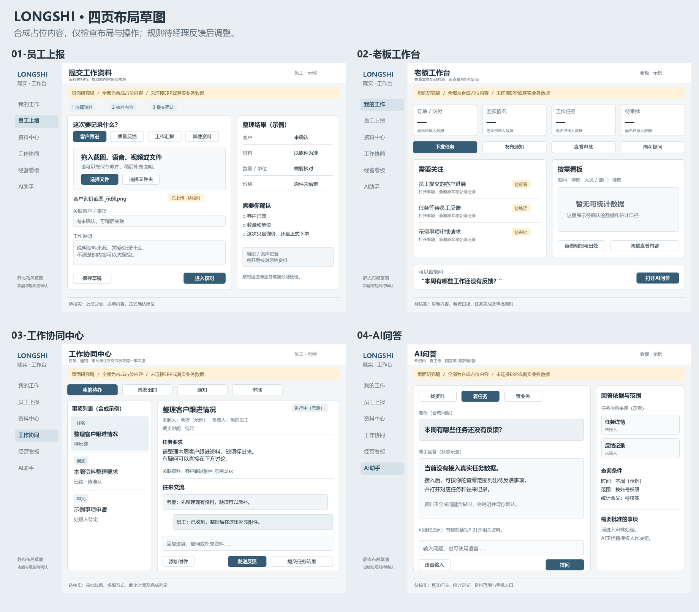

# 页面草图：原四页及订单进度补充

原四页日期：2026-10-24；05号图及说明更新：2026-10-26。整理：1号。说明revision：4；原四页PNG不变，05号为新增revision 1。任务：lsr-e07（原四页已交付）、lsr-smf（流程走查中）。状态：静态低保真研究稿；用户需求及偏好、候选设计、业务负责人待核规则分开，不代表整体公司方案已批准，未实现软件功能。

新增：[05 订单进度轻量记录与查看](05-订单进度轻量记录.png)。1600×1160，左侧员工确认本批结果、右侧获准查看者看到同一条有效记录；演示订单/10件/本批4件/时间均为虚构，不以部分加工完成认定整单完工。设计依据和高风险定稿门槛见[订单进度调研第11—12节](../2026-10-26-订单进度查看功能调研.md#11-轻量记录到老板查看静态走查)。

最新走查：[员工上报流程走查](../2026-10-26-员工上报流程走查.md)。用户已确认默认先上传、系统推荐分类/归属后员工核对，也允许提前选择；何时算上报按资料类别分别决定，当前不统一。旧图分类按钮、顶部“提交确认”不代表必须先分类或所有资料共用一个提交规则。仅更新说明，PNG尚未改绘。

2026-10-26后续补充：日常过程目前主要在微信/口头沟通与人员掌握中；未来只补记关键需求、重要变更和任务反馈，不要求逐条搬运聊天。另新增[按权限查看订单实时进度](../2026-10-26-订单进度查看功能调研.md)的明确需求，旧四页尚未展开订单进度页面；仅更新说明，不声称旧图已覆盖新功能。

依据：[系统全貌revision 2](../2026-10-24-系统全貌一页说明.md)、已明确的任务/通知/审批与交流需求、[当前阶段要求（公开摘要）](../../公开接续/公司业务资料研究概览.md)。九个经理问题[已存档待回复](../2026-10-24-首轮业务核实准备清单.md)，不催问，不用猜测补答。

**先看布局和操作顺序即可。** 图中都是合成占位内容，按钮不能操作；没有真实客户、金额、人员或经营统计。示例任务和AI问法不是经理已确认的需求实例。侧栏仅示意导航，正式菜单和数据可见性仍需按角色规则确定。

| 页面 | 主要表现 | 尚待确定的内容 |
| --- | --- | --- |
| [01 员工上报](01-员工上报.png) | 选资料/文件夹、保存原件、补说明；对照原件核对提取字段、保留草稿 | 部门上报类型、必填内容、客户归属、谁核对/正式确认 |
| [02 老板工作台](02-老板工作台.png) | 需要关注的事项、下发任务/通知、审批入口、按需看板及AI入口 | 真正常看的内容/指标及排序；数据未接入时用缺省状态，不显示虚构数值 |
| [03 工作协同中心](03-工作协同中心.png) | 任务/通知/审批入口、任务详情、负责人/截止、往来回复、附件和提交结果 | 创建表单、审批详情与分支尚未展开；已读/反馈/完成判定、提醒、转交与权限按后续反馈细化；独立即时聊天未定 |
| [04 AI问答](04-AI问答.png) | 找资料/看任务/查业务，输入或语音入口；回答依据、范围、无数据和审批边界 | 常见问法、指标口径、可访问来源及数据时点；没有调用模型或实现来源跳转 |
| [05 订单进度轻量记录](05-订单进度轻量记录.png) | 已关联订单/批次中确认阶段结果，获准人员查看部分完成和缺口 | 对单方式、完成定义、确认/查看权限和时效待核；仅静态双视图，不接ERP |

## 页面关系与研究追踪

员工上报 → 保存原件 → 核对草稿 → 授权的业务确认；老板工作台 → 协同事项 → 员工回复/附件 → 提交结果/按流程确认；老板工作台 → AI问答 → 回到允许查看的事项或原件。当前仅展示这些关系，未实现接口或后台。

| 已有要求 | 草图位置 | 设计检查与实际边界 |
| --- | --- | --- |
| 多模态资料、原件和草稿核对；COV-09/10/11 | 01主区、右侧结果及原件入口 | 上传成功不等于核对/业务批准；字段与按钮为提议，不代表已有可用OCR/ASR |
| 老板快速看情况及灵活看板；COV-13 | 02关注事项、看板、快捷动作 | 未编造业务数字；侧栏经营看板不证明普通员工被授权看全公司 |
| 任务/通知/审批与反馈交流；USR-LS-03、COV-05/15 | 02快捷动作与03列表、详情、回复/附件、提交结果 | 图中待反馈/已读待确认/进行中为不同示意状态；完整审批线路、完成核验和例外尚未定案 |
| AI授权读取、说明依据和缺口；COV-08/12/13 | 04回答、来源栏、条件和审批说明 | 没有数据就说明未接入，不填0；没有向模型传资料、执行查询或作审批 |

## 本轮实际完成

已生成四张1400×1040 PNG及一张总览，逐张查看中文、文字边界、卡片间距和关键操作；修正总览两行之间间距及画布高度。没有功能、模型、权限或性能测试，不用画面完整代表系统已完成。

生成脚本与运行记录在项目外`C:/Users/华硕/.codex/tools/longshi-collaboration-lab/work/business-01a16bce/`，项目内仅保存longshi专属图片和说明；未安装依赖、访问ERP、改原件或推送GitHub。

当前不安排整套问卷。用户最新说明影响大的问题仍需问；助手先查已有资料，关键点按阶段门槛择机单点核实，已有答复不重复问，未核事项不直接写成公司规则。其余不依赖答案的研究继续推进。
