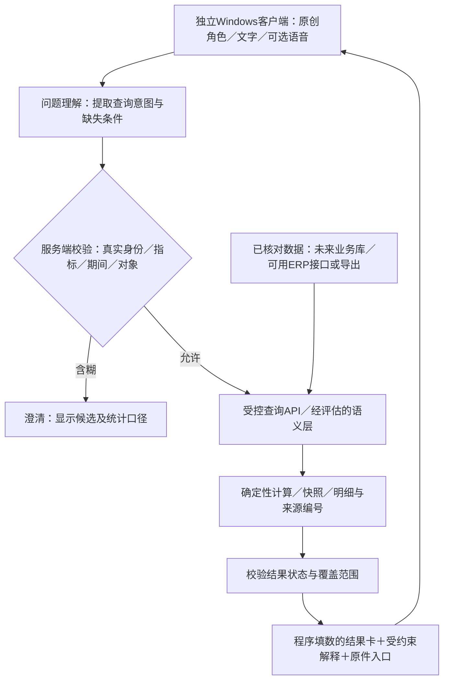

# 卡通老板问答助手：开源比较与独立Windows方案

日期：2026-10-24（Asia/Shanghai）。  
作者：Codex，boss-agent-research-1024。  
状态：proposed／初步研究建议；不是正式选型、施工计划或已验证产品。revision：1；supersedes：无。  
任务：项目外Beads `lsr-8tg`，独立窄专题；复用COV-13、EXP-08与现有研究，不代替其他窗口任务。  
来源：本聊天用户原话、项目既有依据及下列官方仓库／许可／原始问题记录。查证日期均为2026-10-24。

## 1. 新需求、已有事实和未知

本聊天用户明确提出：

- 设计一个代表本厂形象的卡通Agent，主要回答老板问题，从企业系统查询数据，希望保证不出错。
- 风格参考近期流行的“大肥鱼”，尚未指定某个仓库或动画版本。
- 企业软件还没完成，需要时间；当前可以先做Windows桌面形式，或者独立软件。这不等于已经决定必须是全桌面置顶桌宠。
- 用户暂时不知道老板最常问的三句话。不能据此编造“已确认首批问题”，后续由研究者从业务资料整理候选再供挑选。

上述是用户表达的目标与现状；下面的具体架构、指标及实施顺序均是建议。来源是本聊天，不覆盖其他聊天已确认事实。

已有依据：项目目标为内部Windows EXE；USteel仍在用，但版本、接口、数据库与导出能力未确认。AI不得直接改正式业务数据。复用[可信数据链路第7节](2026-10-24-资料到可信数据链路调研.md)、[技术职责](技术职责与验证清单.md)和[功能覆盖COV-13（公开摘要）](../公开接续/功能与细节调研覆盖总表.md)，不重新宣称这些工作已完成。

重要判断：没有核实到一个开源项目能直接同时完成“隆实专属卡通形象＋公司真实数据接入＋业务口径正确＋所有回答零错误”。现成项目可复用组件；可靠性仍取决于数据、业务定义、代码约束和验收。不能承诺任意自然语言、任何数据条件下绝对不出错。

## 2. 开源候选按同一职责比较

维护信息来自当日GitHub仓库API的`archived`、`pushed_at`，只证明仓库状态／最近推送，不证明发布质量、维护承诺或longshi可用性。未安装、未运行候选，未锁定生产版本。

| 候选与官方来源 | 可借用的能力、原理 | 集成代价与主要限制 | 许可与维护快照／研究取舍 |
| --- | --- | --- | --- |
| [dsh-pet-indesktop](https://github.com/MerZlin/dsh-pet-indesktop) | Python＋PySide6桌宠，播放角色动画，支持透明置顶、拖动、气泡及可选AI对话；很接近“大肥鱼”交互方向 | 是独立桌宠运行框架，不提供本公司指标与业务事实；若未来客户端采用Web UI，Qt界面不能直接嵌入复用，需接线或重做表现层。屏幕缩放、穿透与动画解码要实机测 | 代码MIT；[第三方声明](https://github.com/MerZlin/dsh-pet-indesktop/blob/main/THIRD_PARTY_NOTICES.md)对角色动画另有限制，不能套用代码MIT。未归档，最近推送2026-10-23；优先参考交互与状态，不直接采用角色资产 |
| [whale-pet](https://github.com/elyoncatnecoe/whale-pet) | Electron＋Three.js程序化3D虎鲸，通过事件流驱动idle/working/needs-input等状态 | 主要适配DSH；业务接口与身份都需改造。用户未指定这一版本，只作为另一种大肥鱼相关路线辨别 | 源码MIT；仓库明确将鲸鱼品牌形象排除在代码授权之外。本轮只核查README／许可说明，未核维护API和渲染代码；可参考状态机，不作为工厂品牌现成资产 |
| [AIRI](https://github.com/moeru-ai/airi) | 虚拟角色框架，提供Live2D／VRM、语音与多种模型集成方向，Web与桌面形态 | 功能面广，需抽取角色／语音能力，并另做企业查询接口、权限、来源与统计；整套引入会扩大部署和维护范围。具体渲染与语音能力以选定版本验证 | [主体代码MIT](https://github.com/moeru-ai/airi/blob/main/LICENSE)，SDK、模型、角色素材另核；未归档，最近推送2026-10-24。适合需要丰富角色互动时深入评估，暂不整套定选 |
| [Open-LLM-VTuber](https://github.com/Open-LLM-VTuber/Open-LLM-VTuber) | 语音对话、打断、Live2D形象的整合参考 | 适合研究会说话的形象，不等于企业问数系统。README说明v2重写处于早期讨论／规划，v1继续修bug但不收新功能诉求，存在迁移成本 | 主体代码MIT，Live2D样例资产另有许可；未归档，最近推送2026-05-15。作为语音角色路线备选，先验证中文人名、数字、时延与打断后结果归属 |
| [lottie-web](https://github.com/airbnb/lottie-web)＋原创角色动画 | 在Web UI中渲染动画JSON，由业务请求状态切换待机、倾听、查询、澄清、回答、失败动作 | 仅是动画播放器，需要自行做聊天、状态控制、语音及数据接口；动画制作／导出工具与动画作品授权另算。可替代路线为原创透明帧序列或SVG/CSS动画，无需引入完整虚拟人框架 | MIT；未归档，最近推送2025-09-01。对当前“企业问答＋卡通形象”的需求，建议优先比较这一轻量路线；不以最后推送日期单独判断成熟度 |
| [WrenAI](https://github.com/Canner/WrenAI) | 定义指标、枚举、单位与关联的语义层，再辅助自然语言生成SQL，适合研究企业问数 | 仍需公司定义业务口径与建模，不能把执行成功当答案正确；USteel连接能力未核。当前主线已变为核心库／CLI／SDK路线，不能照旧教程假设有同样的完整Web应用 | [分路径许可](https://github.com/Canner/WrenAI/blob/main/LICENSE)：当前core/sdk/skills/examples为Apache-2.0、docs为CC BY 4.0，未来AGPL模块按实际路径另核；未归档，最近推送2026-10-23。适合列入问数候选；与自有受控查询API做同题对照后再决定 |
| [Vanna](https://github.com/vanna-ai/vanna) | 自然语言→SQL→表格／图表，2.0提供身份和自定义工具接入方向 | 旧教程多，不能只凭教程或README的enterprise表述直接采用；需核实具体版本的权限接线与维护替代路径 | MIT；当日API确认`archived=true`，仓库页面标注2026-03-29归档，最近推送2026-02-02。此处指`vanna-ai/vanna`仓库，不推断相关公司或所有产品停止。当前不作为新项目首选底座 |

品牌判断仅转述上述仓库的许可与资产声明，并非法律确权结论。对本项目的具体建议是创作自有工厂形象并保留授权来源；不将外部同人／品牌素材当成公司自有IP。Live2D运行SDK、样例与自制模型也应分别核对，不能用外层框架MIT一笔带过。

Wren主线迁移依据：[官方CHANGELOG](https://github.com/Canner/WrenAI/blob/main/CHANGELOG.md)记载旧GenBI应用转入`legacy/v1`分支及`v1-final`标签，核心库合并进`core/`。选择历史发行版时须重新核实其能力、许可与漏洞，不能把当前主线与历史应用混用。

## 3. 外部成功／失败证据的实际含义

| 原始证据 | 能说明什么 | 不能说明什么／longshi影响 |
| --- | --- | --- |
| dsh-pet README的v4.3.4发布说明，2026-10-19；[固定发布页](https://github.com/MerZlin/dsh-pet-indesktop/releases/tag/v4.3.4) | 维护者报告修正混合DPI／多屏坐标问题，记录本机双屏与125%缩放测试；同时保留未实测组合 | 是维护者测试报告，本机没有复现或安装，不代表企业终端都能稳定运行；若做置顶桌宠，必须纳入多屏、缩放、穿透和恢复入口验收 |
| [Wren #2746](https://github.com/Canner/WrenAI/issues/2746)，2026-09-15提出，本轮页面仍Open | 报告`transform_sql`丢失`IGNORE NULLS`，存在SQL执行成功但分析语义错误的风险 | 是外部用户带示例的报告，未在本机复现、未证实修复进入拟用版本；不能扩展为所有Wren查询都会错。后续固定引擎／方言／版本做对照 |
| [Vanna #1103](https://github.com/vanna-ai/vanna/issues/1103)，2026-02-23提出，本轮页面仍Open | 用户报告语义错误但执行成功的查询进入工具记忆，后续继续复用；提醒“自动积累经验”可能累积错误 | 未由本机复现，也不能据此判定所有版本；正式查询范例须经业务对照验证，不能仅以没有报错就自动升级为可信范例 |
| AIRI与Open-LLM-VTuber官方功能说明 | 证明这些是相关实现方向和可研究源码，避免全部从零写角色／语音 | 不是本公司的成功案例；尚无本公司机器、中文行业词、老板问数与权限闭环的实测结果 |

## 4. 推荐方向：独立Windows软件，后续复用查询能力

建议先规划“隆实卡通经营助手”独立Windows小软件。常态是可收起的角色入口；展开后有对话、数据结果卡、表格／图表、来源明细。是否跨应用悬浮仍待用户选定；不能从“Windows桌面”推断必须做全桌面常驻宠物。

外观建议是原创小钢锭／小机器人等与工厂有关的角色，圆润卡通风格可作为候选，但不是已批准形象。名称、配色、工装、声音、语气与动作表均待审阅。状态由真实请求事件驱动：查询未完成时显示查询，缺条件显示澄清，接口失败显示失败，不用动画假装工作已完成。

轻量客户端可以沿用项目现有Tauri＋React候选研究；Electron或Qt仍作为实际替代路线。尚未锁栈，不能宣称某套库可无成本移植。语音复用既有FunASR／Whisper研究，不预设首版一定要全离线或必须配显卡。

角色和对话UI在客户端；数据适配、权限、统计与审计放在独立业务边界内。多用户时优先研究内网服务；单机导出验证可研究本地受控服务，但不能将其直接当企业多用户部署。模型本地或云端尚未确定；先确认哪些字段允许外发，再比较时延、设备与费用。未来嵌入企业系统时复用查询契约和角色资产，桌面窗口部分可能需适配。

### 数据如何先接入

1. 先核实USteel是否有授权接口／报表导出，不直接猜数据库结构或绕过原系统权限。
2. 若可取得导出，保存原文件、期间、导出时间、来源、导入批次和校验状态；经核对后才进入可统计数据。缺字段应说明无法回答，不能用模型补齐。
3. 展示“截至某批次／某时点”，区别未同步、无记录、确实为零；不能把昨天导出冒充实时。
4. 未来新企业系统完成后增加适配器，保持相同指标、权限、明细和来源契约。新旧系统去重、主版本、历史覆盖仍须调查。

这是接口／导出能力成立时的建议路线，目前未取得可用接口或导出闭环证据。

### 接口边界建议

模型只能提出`metric_id`、对象候选、期间、筛选和展示意图；身份和数据范围从真实登录会话取得。服务验证指标白名单、枚举、单位、日期、对象唯一性、资源预算和权限，不能只检查JSON格式。数字查询优先调用审阅过的固定业务函数／参数化查询；SQL生成候选仅在隔离只读数据、权限与语义对照成立后评估，不能因只读就认为统计必对。

返回结果建议包括：查询ID、明确口径及版本、筛选与期间、业务时点、数据更新时间、覆盖状态、单位与金额精度、确定性结果、组成明细的受控引用和来源定位。图表与文字结果卡取自同一结果对象；关键数字由程序填充，AI不重新手算或改写。模型补充原因说明时必须引用能够支持它的记录；相关性不当因果，没有原因记录就回答“当前记录不能确定原因”。

## 5. 怎样把“不出错”转成可检查要求

- 统计事实与资料解释分开：出货额、回款、欠款等来自已确认记录和确定规则；聊天、PDF、图片可帮助查原因，不能只检索几个相似片段就算全公司总数。
- 同名、月份、单位或“业绩”定义不清时澄清。语音涉及人名与关键数字时能展示转写并纠正。
- 权限由业务层执行，检索片段、历史对话、缓存、图表明细和附件同样受控；资料中的伪指令不能变成授权。
- 拒答／部分结果是正常状态：未同步、未确认、相互冲突、没有权限、接口失败必须有区别；不得用0或编造解释掩盖失败。
- 数字可下钻到组成记录；汇总与明细在同一快照及相同规则下相符，防止重复关联、跨期、退货、撤销、精度和历史归属错误。
- 金额和单位由程序处理；关键事实输出可采用模板。任意自由解释仍有误差风险，提示词、引用和第二个模型复核都不能代替业务对照。

## 6. 候选问法与验证安排（均未执行）

用户暂不清楚真实问法，先从公司已有业务域形成以下候选，不标为已确认范围：

| 候选问题 | 要先讲清什么 | 对照／失败行为 |
| --- | --- | --- |
| 本月出了多少货、金额多少？ | 出货生效点、退货、税额、期间、单位、重复单据 | 与已核报表及组成明细逐笔核对，不能用报价或合同额代替 |
| 哪些客户欠款、哪些逾期？ | 应收、核销、部分回款、退款、到期规则和时点 | 缺少核销／账期不能声称逾期排名准确 |
| 某订单到哪一步、为何还未交？ | 订单唯一性、状态来源、分批交付、原因记录 | 无延误原因记录时只报已知状态及缺口 |
| 某业务员这个月做得怎么样？ | 同名、归属、期间、“业绩”指落单／出货／回款哪种 | 含糊先澄清，换人／换月不沿用旧筛选 |
| 找某客户的报价、规格或沟通依据 | 客户别名、版本、正式生效与资料权限 | 引用实际支持答案的页／单据／片段，不能虚构来源 |

后续经用户审阅安排，复用EXP-08增加固定问题及正确答案集；同题比较“受控业务API”与Wren候选的正确性、澄清、越权拒绝和明细回溯。另以原创占位角色验证Windows显示／收起／缩放／资源占用和可选语音，不能只做动画演示就称企业助手验证完成。本聊天未授权或执行这些实验，没有真实数据准确率。

## 7. 要求追踪、未决项与当前完成状态

| 用户要求 | 设计位置／后续研究任务 | 验收方向 | 当前状态 |
| --- | --- | --- | --- |
| 卡通形象代表工厂 | 第2／4节，原创角色及资产来源评估 | 形象经用户审阅，资产授权清楚，可表达真实请求状态 | 用户目标明确；具体形象proposed |
| 从系统查数据回答老板 | 第4节数据与接口；关联COV-13／EXP-08 | 使用真实合法来源，回答可回明细，权限贯穿 | 设计建议；数据入口未验证 |
| 保证不出错 | 第3／5／6节，业务口径＋对照集 | 定义范围内对照通过，歧义／缺数据／冲突明确处理；不宣传普遍零错误 | 目标已记录；不能承诺绝对零错误 |
| 现阶段Windows桌面或独立软件 | 第4节客户端／服务边界 | Windows独立启动并可收起，未来接入不重写指标规则 | 用户方向明确；跨应用悬浮待定 |
| 借助开源开发 | 第2／3节候选、许可与失败记录 | 固定拟用版本再核许可、依赖及公司机器表现 | 官方资料初核完成；未定选／未安装 |

未决重点：USteel与现有文件的数据入口／更新频率；指标定义及主版本；独立窗口与桌面悬浮的选择；网络／服务器与模型数据边界；最终角色及声音。已知道用户暂不能提供真实问法，后续先提供业务候选供挑选，不重复要求其先写需求文档。

本段完成：官方候选比较、归档与主线迁移检查、资产许可提醒、原始失败证据及独立软件的初步职责设计。  
已验证：仅官方页面／API读取得到的仓库状态与许可文字；不是运行验证。  
待验证：真实数据接入、业务口径、所有候选运行／权限／统计／形象／语音／安装升级。  
未开展：业务代码、软件原型、公司数据上传、模型准确率实验、正式开发与发布。  
公共总表与共同规则不由本专题直接修改；本记录不改变既有AI只读边界及用户审阅关口。
