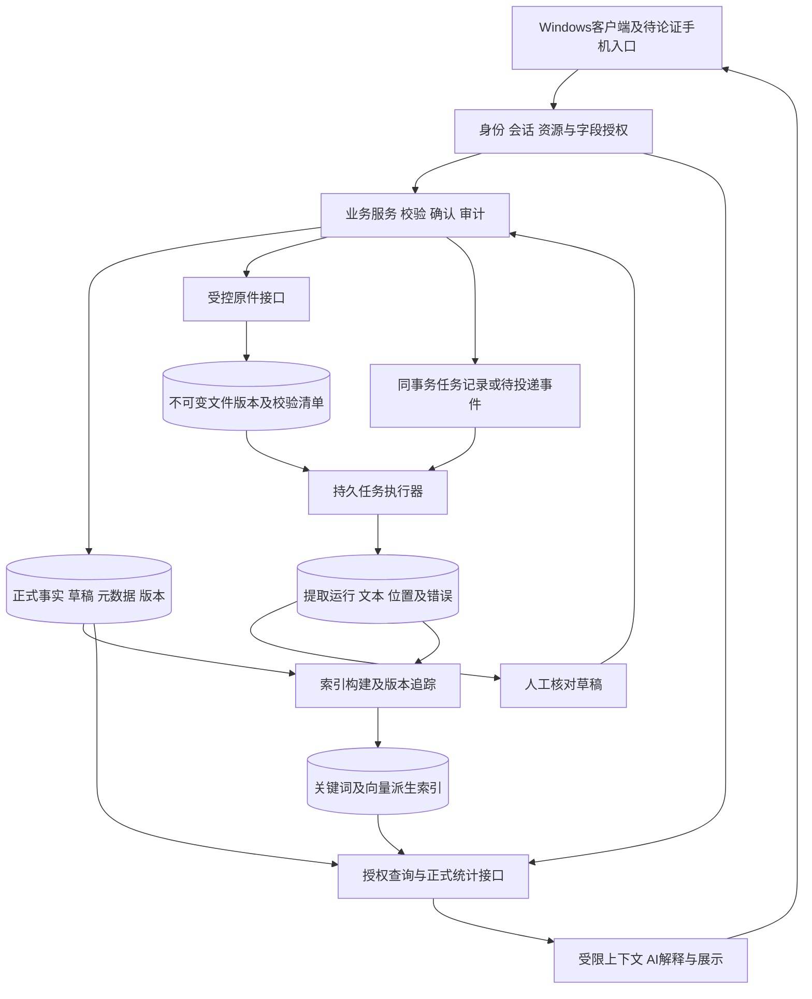

# 系统底座与技术职责调研（公开版）

日期：2026-10-24（Asia/Shanghai）。作者：4号。任务：`lsr-13i`。revision：2（公开发布整理）。supersedes：revision 1的公开呈现方式及“USteel客户端版本未知”等已更新的局部状态；技术研究及未验证边界保留。

公开范围：原revision 1已完整备份到项目外，备份与原稿SHA-256一致，不随公开仓库发布。本版隐去真实业务标识、金额和私有原件定位，不用虚构数值替换原观察。真实证据报告及原件留在本机；本版本地交接引用统一使用[公开接续概览](../公开接续/公司业务资料研究概览.md)，该概览不等于原始证据或独立复验。带LSF/TRC/DLV等标记的内容是本地研究索引号，不是客户码或订单号，外部读者不能据此重建私有原件。

状态：第一工作段研究交付，含官方资料核查、原始问题记录及待验证设计；全部架构建议为 **proposed**。不是最终技术栈、正式接口规格或开工依据。专题保持进行中，一周调研要求不变。

本轮审阅关口：用户在1号原话“好的，做完汇报给我，我来检查，确认无误后再进行下一步”，4号已实际读取该用户消息，并收到1号信箱消息33。当前只完成首工作段与本轮交叉审查，随后由1号汇报、等待用户审阅；文中的下一段/实验均是待安排提案，不是立即执行指令。

最新阶段约定：先利用已有资料梳理大致业务、页面和模块关系，未接通同单不代表没有资料；不要求用户重复准备完整样本包，不以精细历史扣款/审批责任阻塞当前概览。经理九问全部待答，等用户统一提供，不催问、不追加、不自行补答。当前版本仅作用户已授权的公开发布整理，不代表开始下一轮调查、实验或正式开发。

授权及责任：四窗口任务与交付总表（[公开接续入口](../公开接续/公司业务资料研究概览.md)）。只维护本文件，公共总表、共同规则及验证台账的变更由1号合并。

## 1. 先说明本轮能得出的结论

目前应先固定职责与正确性条件，再用样本选择产品。把所有内容存进一个向量库、把所有组件塞进每台EXE，或同步维护两套可写订单，都没有现有证据支持。

以下是工程建议，尚未被公司验收：

1. 正式事实、原件、提取结果、检索派生物分别保留身份和版本；可以共用基础设施，但不能互相冒充。
2. 业务服务掌握正式确认与统一授权；模型、索引和文件存储不决定谁能看、哪笔收入生效。
3. 优先比较共享服务端承载正式数据、Windows客户端承载操作的路线，同时保留本地处理、轻量服务及手机补充入口的对照。尚不确定物理部署位置。
4. 对USteel先查可验证的导出/授权接口和分对象主版本，不启动生产库访问、逆向或替换。
5. 最先验证越权、重复确认、数据与附件恢复一致性、跨表编号和金额对账；检索速度及界面效果不能代替这些条件。

### 1.1 已知事实、复用范围与新增研究

| 类别 | 本轮实际依据 | 能说明与不能说明什么 |
| --- | --- | --- |
| confirmed用户要求 | 公司业务资料首轮分析（[公开接续入口](../公开接续/公司业务资料研究概览.md)）的USR-LS-02—05及后续阶段补充；共享约定实际读取 | 员工默认自己提交、主管本部、老板全公司；任务/通知/审批及交流反馈需求明确；USteel仍在用，客户端版本已知1.2.16.52。兼岗例外、字段授权、接口及主版本仍待核 |
| 既有样本证据，非本轮重新抽样 | 字段与业务关联对照（[公开接续入口](../公开接续/公司业务资料研究概览.md)）、来源索引（[公开接续入口](../公开接续/公司业务资料研究概览.md)） | 已有客户编号/历史归属、报价与成交、客户模号/本厂编号、检验/补料/财务样本；并非已可靠接通同一订单 |
| 既有技术研究 | 技术职责清单（[公开接续入口](../公开接续/公司业务资料研究概览.md)）、数据流草案（[公开接续入口](../公开接续/公司业务资料研究概览.md)）、组件核查（[公开接续入口](../公开接续/公司业务资料研究概览.md)）、18仓库快照（[公开接续入口](../公开接续/公司业务资料研究概览.md)）、Office比较（[公开接续入口](../公开接续/公司业务资料研究概览.md)） | 本文复用已有职责、许可及Office比较，不重新制作产品排名，不把主分支快照当稳定发行版 |
| 本轮新增外部核查 | 第13节的官方页面、pgvector #719、Celery #9963、Tauri #2242 | 核查过滤召回、授权绕过条件、重投递、备份边界、部署依赖；外部报告及官方声明均非公司实测 |
| 本轮本机核查 | 项目规则、共享约定、信箱、Beads任务及文件存在性 | `lsr-13i`成功原子领取给本角色；没有安装数据库、索引、队列、模型或Office引擎，没有运行组件实验 |

**旧台账的样本前提需要修订。** 验证台账（[公开接续入口](../公开接续/公司业务资料研究概览.md)）第1节及部分“缺公司模板”形成于新资料到达前。现在已有47个xlsx抽样、检验/报价/利润模板及来源索引，可筹备EXP-05/10；尚缺逐模板任务定义、完整审阅和独立期望答案。USteel原始导出、音视频对照答案、目标运行环境仍缺。本文件不直接修改公共台账，也不把可取得样本写成验证通过。

上述台账修订属于首段时点记录，后由协调者修正公开研究前提。资料和样本已存在；后续验证所缺的是明确任务、可靠对照及授权环境，不是让用户现在重交资料。

### 1.2 工作协同需求的最新边界

已明确需要老板下发任务、通知、审批及员工接收反馈；“工作协同中心”是概览中的逻辑功能。事项内回复、追问、进度、附件及页面布局为proposed，独立即时聊天、提醒频率、转交/撤回、审批级次/代理和完成判定仍待核。参与事项不自动开放关联成本利润。AI可按授权总结讨论和出草稿，正式下发、审批及业务变更由有权限的人和业务系统执行；本文的统一授权、版本、幂等与审计建议仍适用，不因此删减业务需要。

## 2. 业务问题到技术风险的对应

本表按错误的影响安排调查先后，未给虚构评分；后面的内容均属于研究范围，没有据此删减18域。

表中风险与后文实验顺序用于后续正确性核实，不作为当前大致业务/页面概览的前置门槛。

| 优先顺序 | 具体触发及已有线索 | 若判断错会怎样 | 底座要回答的问题；关联 |
| --- | --- | --- | --- |
| 第一组：授权与正式事实 | 同一订单含报价、供应商加工金额及利润；USR-LS-02、LSF-004/009/011 | 有权看任务的人从附件/AI看到成本；模型把识别结果写成成交 | 统一资源及字段授权、正式写权限隔离；COV-08/11/13，EXP-07/08 |
| 第一组：金额、身份与主版本 | LSF-003/004/005/044/045中的不同编号、粒度、日期；USteel在用 | 错单、重复收入、双系统互相覆盖 | 稳定源键、版本映射、对账、确认并发；COV-02/04/17/18，EXP-07 |
| 第一组：可恢复性 | 原件、正式记录、权限和任务分开保存 | 数据库恢复而附件缺失，撤权用户重新获得访问 | 共同恢复清单及恢复后安全复核；COV-09/16/17，EXP-09/12 |
| 第二组：可靠录入 | 断网、重复点击、长视频/Office处理、worker重启 | 丢任务、重复写、旧结果覆盖新确认 | 上传完成协议、持久任务、幂等、租约及取消；EXP-07/09/11 |
| 第二组：可查但不误判 | 中文材质、同名客户、权限窄范围和索引滞后 | 搜索空结果被解释为无业务，旧片段泄露 | 精确/字面/向量分工，授权集合基线、版本水位及回退；EXP-06/08 |
| 第三组：长期使用 | 手机电脑并用，员工普通权限、模板公式、软件升级 | 装不起来、打印错、维护和费用失控 | 部署取舍、Office职责、可观测、容量及许可；EXP-10/11/12 |

## 3. 模块、数据流与不可混淆的职责

以下为逻辑设计；图中的一个框不等于必须部署一个微服务。第一轮可以比较单体业务服务加独立任务进程，避免为画图增加运维组件。

| 逻辑数据 | 建议保存的最小语义，字段名仅供讨论 | 正确性及替换要求 |
| --- | --- | --- |
| 正式业务事实 | `business_id`、业务类型/明细身份、状态、业务时间、数值及单位、`revision`、确认人、主版本来源 | 只能经业务规则和授权写入；金额用确定精度及舍入口径，空值与0分开。撤销/更正留痕，不能被重提取覆盖 |
| 原件及版本 | `file_id/version_id`、受控存储定位、大小/类型/哈希、上传者/时间、对象版本、业务引用 | 原件字节保留；改名/移动不换身份；同字节哈希只提示可能重复，不能跨权限暴露另一份上传 |
| 提取运行 | `run_id`、输入版本、组件/模型/参数版本、起止、状态、错误、重试关联 | 同一原件可重处理；输出不得覆盖人工确认；精确复现可能需保留权重/配置或记录其不可再取得 |
| 文本及字段证据 | 原始提取文本、人工修正文本、页/框/单元格/时间段、来源类型、核对状态 | 原话/复述/推断分开；每项字段证据能返回原件；不能把整份含敏感信息的文本作为所有人可见片段 |
| 草稿 | `draft_id/revision`、候选字段/缺项/冲突、输入版本、对应源证据、确认状态 | 结构合法与业务真实分开；草稿保存/保留期仍待1/3号核实 |
| 派生索引/缓存 | 文档与片段ID、`source_revision`、分块版本、模型ID/维度、索引代次、内容水位 | 可重建且须能失效；不是事实备份。内容版本和授权版本分开，旧ACL副本不能成为最终授权 |
| 身份与权限依据 | 账号、人员、岗位/部门关系及有效期、资源归属、显式授权、`acl_epoch` | 账号不等于业务员代码；当前授权、历史署名和历史业绩归属分开 |
| 审计及任务 | 操作ID、请求/幂等键、输入/输出版本、执行人/服务、前后状态、失败原因 | 普通日志不替代业务审计；日志避免保存令牌、完整附件及全量AI上下文 |

这些职责不能由“向量相似”“文件名相同”或“JSON校验成功”替代。是否拆表、数据库和进程，应由样本、容量和运维能力验证。

## 4. 一致性、并发和长任务：具体失败怎样处理

### 4.1 正式写入、文件完成与索引完成是三个事件

建议上传分为`已创建→上传中→字节已校验→可处理`；提取、人工确认与索引发布各有独立状态。名称为proposed，不是已确认业务状态。

1. 服务鉴权后创建上传身份及暂存目标。客户端上传后，服务核对大小、内容指纹和可读取性，再发布文件版本；不能只信客户端“成功”。
2. 文件存储与关系数据库通常没有同一个事务边界。文件先存成功但元数据提交失败时保留暂存/孤儿候选；元数据若仍在pending则不可被展示成可用原件。清理前检查引用、保留期及备份需要，不能失败就删原件。
3. 业务事务内写任务记录，或写“待投递事件”（outbox）。投递器可以重复发，消费者按事件/版本幂等执行；避免数据库已提交而队列消息未发的断点。此为设计建议，不宣称引入outbox库即可保证全链路恰好一次。
4. 处理输出先写独立运行，再按输入版本、当前任务状态和有效授权发布；索引构建延迟可显示“处理中/部分内容尚不可检索”，正式统计仍从有效事实取数。
5. 新文本和向量采用新代次构建、核对后切换；失败可保留旧的有效内容，但读取时仍须检查当前授权和作废状态。删除/撤权优先形成即时拒绝依据，不能等重建完才生效。

### 4.2 持久任务的最小契约

建议任务包含`job_id、kind、input_version、processor_version、attempt、lease_generation、cancel_requested、status、result_ref、error_code`，并记录预计资源类别。它们不是正式API或数据库定案。

| 触发 | 拟定行为及原理 | 不成立的简化办法 |
| --- | --- | --- |
| 重复提交同一操作 | 同一幂等键与相同请求摘要返回原结果；相同键但内容不同报冲突 | 每次生成新键再重试，或仅以文件哈希判定同一业务 |
| worker拿到任务后崩溃 | 任务留在可恢复记录；租约过期后按策略重新领取，尝试号/租约代次递增 | 内存队列消失就当用户未提交 |
| 旧worker恢复并晚到 | 输出提交必须比较当前租约代次/输入版本；失效worker不能发布为当前结果 | 仅靠“超时后再跑一遍”，允许两份结果同时生效 |
| 取消与成功同时发生 | “请求取消”与“取消已生效”区分；提交时原子检查状态。若已成功须明确返回，不能显示已取消却留下新正式写入 | 杀进程即认为业务回滚，或取消自动撤销已确认事实 |
| 外部服务超时/限流 | 有限重试、退避、最大尝试与人工处理入口；若供应商支持请求幂等/状态查询则利用，否则登记结果不确定 | 无限重试，或因没有响应就认定供应商没执行/没收费 |
| 一个长视频堵塞所有任务 | 短交互与重计算分资源池/并发限额；按可重入步骤保存进度；队列有积压上限与提交反馈 | 所有worker无限预取或每个上传开启新重进程 |
| 确认同时改价或撤权 | 带草稿版本、期望业务版本、幂等键；业务事务复核当前权限和规则，再写事实与审计。冲突需刷新核对 | 客户端按钮禁用当作防并发；确认读取的旧价格无条件覆盖新价 |

数据库事务/锁/唯一约束和业务幂等共同解决正式写入；提高隔离级别也可能要求重试整个事务，不能把外部调用/收费盲目放进可重试事务。[PostgreSQL事务隔离](https://www.postgresql.org/docs/current/transaction-iso.html)。

### 4.3 长任务路线比较

| 同一任务的路线 | 输入→处理→输出 | 条件性理由及限制；证据 |
| --- | --- | --- |
| 关系库持久任务表＋独立worker | 任务行→事务领取/租约→版本化结果与终态 | 可减少独立设施，便于与业务提交一起记录；仍需自做公平性、重试、监控及租约隔离。PG `SKIP LOCKED`可用于队列表，但返回不一致视图，不应用于经营统计；[官方SELECT](https://www.postgresql.org/docs/current/sql-select.html) |
| Celery＋受支持broker/结果存储 | 消息→独立worker→任务结果；正式状态仍回业务服务 | 已有生态但部署、broker持久性及重投递语义增加运维面。官方要求任务幂等、说明ack异常；Redis可见性超时会重投。Windows不是Celery官方支持平台；[任务文档](https://docs.celeryq.dev/en/stable/userguide/tasks.html)、[Redis文档](https://docs.celeryq.dev/en/stable/getting-started/backends-and-brokers/redis.html)、[平台FAQ](https://docs.celeryq.dev/en/stable/faq.html#does-celery-support-windows) |
| 客户端本地处理＋服务记录任务 | 本机授权副本→本地处理→上传结果、服务复核 | 可比较数据不出本机/弱网场景；关机、设备差异、结果可信性和本地资料清理需解决。不能因此给客户端正式数据库凭据；尚无本公司运行证据 |

不先引入Redis/Valkey/Celery全套。先量长任务、并发和维护人员，再用相同失败样本比较；Valkey兼容具体Celery组合仍待验证，既有许可核查不等于运行兼容。

## 5. 数据、原件和检索候选按相同职责比较

### 5.1 正式数据库与原件

| 共同职责 | 可比路线 | 原理、选择条件及限制 |
| --- | --- | --- |
| 共享正式事实及元数据 | PostgreSQL服务；对照小规模单服务本机SQLite；若已有受管数据库再比较复用 | PG具有事务、权限和扩展研究基础，维护/备份需人负责；SQLite嵌入式简化部署但单库同一时刻仅一个writer，可在应用服务后使用，并非“一联网就不适用”。不能把共享网络盘上的SQLite文件当多客户端业务服务；[SQLite官方选用说明](https://www.sqlite.org/whentouse.html)。尚无规模、写竞争或运维依据定案 |
| 原件及目录版本 | 受控服务端文件目录＋数据库元数据 | 接口把授权请求解析到文件版本；设施少，但权限、原子发布、磁盘故障、目录备份及大文件上传由系统落实；不能公开磁盘路径或让客户端直挂全部共享盘。这是待验证工程路线 |
| 同上 | SeaweedFS等维护中的自托管对象接口 | 对象ID保存字节，业务目录/权限在元数据；有S3接口研究基础，但master/filer/volume等恢复与所用特性需核查。复用已有Apache-2.0根许可检查；[官方仓库](https://github.com/seaweedfs/seaweedfs)。未证明本公司需要分布式部署 |
| 同上 | 托管对象存储 | 比较运维减少与网络、地域、读写请求/出流量和迁出成本；不得用某一家S3行为推断所有兼容实现。AWS文档说明签名链接可反复使用至到期、版本开关及历史版本费用，提示必须核实具体服务语义；[链接](https://docs.aws.amazon.com/AmazonS3/latest/userguide/using-presigned-url.html)、[版本](https://docs.aws.amazon.com/AmazonS3/latest/userguide/Versioning.html) |

MinIO保留为历史候选；既有快照记录仓库归档及许可风险，本文未重新审核其后续发行来源，不默认部署。文件目录、空目录、重名、显示名、版本与业务引用都应独立于存储键；S3的前缀不是完整业务目录模型，复用既有技术清单中的官方来源。

### 5.2 混合检索需要的底层能力

| 查询任务 | 输入→底层处理→输出 | 候选比较与限制 |
| --- | --- | --- |
| 客户/订单/供应商精确定位 | 原始编号及其类型→有效映射和参数化精确查询→对象ID与来源 | 关系库索引优先作基线；客户模号、本厂编号、订单号不得共用一个无类型编号槽。找不到映射保留缺口，不用相似度补造关联 |
| 字面与专用词查询 | 材质/公司别名/OCR文本→规范化、词项或字符相似匹配→可见片段 | PG全文检索＋字面/pg_trgm路线，或独立OpenSearch分析器。中文切词、材质牌号、短词、连字符及数字须实测；PG文档说明解析/词典机制，不证明中文已达标；[全文原理](https://www.postgresql.org/docs/current/textsearch-intro.html)、[pg_trgm](https://www.postgresql.org/docs/current/pgtrgm.html) |
| 语义与混合检索 | 授权查询文本→同版本Embedding→关键词/向量候选融合→来源ID与排序信息 | PG＋pgvector可在现有库内组合；独立OpenSearch可提供词法/语义融合管线，但增加派生数据同步、恢复及权限验证。二者都要单独选择模型和维度；[pgvector](https://github.com/pgvector/pgvector)、[OpenSearch混合检索](https://docs.opensearch.org/latest/vector-search/ai-search/hybrid-search/index/) |
| 经营数值/汇总 | 已定义业务条件、权限、统计规则版本→正式事实查询/聚合→明细和合计 | 不走“搜索片段相加”；候选为数据库聚合，确有规模需要再比较Polars离线计算。保留期间、单位、作废、退款、跨期与主版本；规则由1号调查 |

**过滤召回与授权是两个问题。** pgvector官方说明ANN扫描之后应用过滤可能少返回；迭代扫描是补扫方法，不是授权机制。EXP-06须对照“先取得有权集合再精确搜索”的基准，评估迭代扫描、提高有界搜索预算/分区等方式；仍不足时返回覆盖受限或有界精确回退，不能放松ACL补满k。版本/执行计划/过滤比例变化后须复查，不能承诺ANN总能返回全部相关资料。

检索契约建议含`query_id、authorized_scope、field_mask、source_revision、index_generation、content_watermark、incomplete_reason、source_refs`。身份和范围由服务产生，不能相信模型自填。3号负责意图、消歧、上下文和回答流程；4号负责底层是否能执行、更新和拒绝。

## 6. 账号、组织、字段与所有出口采用同一授权依据

### 6.1 需要分开的业务身份

用户确认的是默认可见范围。培训PDF第10页兼岗、LSF-002历史业务归属和线索分发，提出额外调查维度，但不自动授权任何例外。

| 对象或事件 | 技术表示建议 | 必须由业务补明的条件 |
| --- | --- | --- |
| 人员、登录账号、旧业务员代码 | 人员稳定ID；账号可停用；多旧代码映射保留来源和有效期 | 一人多号/同名/历史员工如何确认；不以姓名匹配自动建账号 |
| 部门、岗位、主管与兼岗 | 岗位/部门关系有效期；显式授权到资源/动作/字段 | 多角色取并集还是有限交集、主管层级及临时代理规则未定 |
| 客户/事项交接 | 当前负责人、交接事件、必要协作范围分别记录 | 交接后原负责人是否能读历史、成本/利润如何隐藏 |
| 历史归属与统计 | 原提交/确认/当期归属保留，不被当前组织树覆盖 | 业绩按哪一时点归属、追溯调整由谁确认 |
| 离职、撤权、恢复 | 会话/令牌失效、授权版本更新、任务/缓存复核 | 需多快生效、已下载副本如何管理、哪些审计必须保留 |

### 6.2 权限实施路线和不能省的边界

可比较“业务服务集中资源/动作/字段策略”与“集中策略＋数据库RLS防御”。RLS约束行，不能独自解决字段、混合附件和应用会话。PG所有者/超级用户/BYPASSRLS可绕过，约束报错也可能暴露存在性；不能给AI或普通查询服务所有者凭据后声称有RLS就安全。[官方RLS](https://www.postgresql.org/docs/current/ddl-rowsecurity.html)。

服务连接池若携带权限上下文，应由可信服务在事务内设置并可靠清理，验证不同用户复用连接不串权；客户端/模型不能任意设置身份。备份维护身份与业务查询身份分开。若改用其他数据库，同一行为条件照验，不能只更换产品名。

还须定义“撤权何时生效”的并发判定点。仅在事务开头读一次权限或比较一次`acl_epoch`，不能自动防止另一事务同时撤权；候选实现需让授权变更与正式提交在同一可校验的锁/版本协议下排序，并验证等待期间发生撤权的情况。对已开始下载/模型调用如何中止或限制后续输出也应说明；已交付的数据无法撤回。具体保证和时限尚未确认，不能宣称零时间、零窗口撤权。

| 出口/阶段 | 拟定强制条件与异常 |
| --- | --- |
| 列表、详情、聚合 | 在服务端按当前对象/字段授权取数；总数/分组等不能泄露无权信息；无权与不存在的外部提示策略另定 |
| 文本与Embedding输入 | 源数据按敏感级别分片或生成受控视图；若一个片段混入利润，不能只隐藏结构化利润字段就送入AI。向量及其查询行为也按受控资料管理 |
| 检索及重排 | 所有候选路径带范围，文本送入重排/模型前再鉴权；缓存按授权范围、字段及版本隔离；不能先把全公司文本发给模型再删答案 |
| 原件及预览/缩略图 | 每次读取校验当前权限；原件混合字段时采用独立授权、脱敏派生件或拒绝整件访问。文本可看不等于原件可下载 |
| 签名下载 | 链接是临时可转交凭证；AWS预签名链接可重复使用至失效，不是“一次性”；短时效仍有撤权窗口。严格即时撤权场景比较鉴权代理转发，不能只靠隐藏按钮 |
| AI摘要、历史对话、导出 | 派生物继承源权限及来源版本；再次打开/生成导出/下载分别复核。旧会话上下文撤权后不能原样重送给模型；已下载明文副本无法靠服务端撤权远程抹除 |
| 后台任务 | 执行、发布、下载各时点核验请求人范围；服务账号能处理字节不等于员工可读输出。取消、离职后结果如何保留按业务规则明确 |

与3号交叉审查补充：一个摘要/字段可能引用多片段或多份资料，需按来源集合及字段限制计算可见性，不能只靠客户ID。原件页/单元格定位同时绑定`source_version＋extraction_run_id`；重排后的界面行号不是原件地址。3号消息25提出的日期编码混用，影响导入规范化而不决定业务期间；原值/类型、Excel日期基准和标准化结果分别保留。此处只复用3号研究，4号没有独立运行其NOV-LOC-01。

独立搜索系统不是自动安全替代：OpenSearch DLS/FLS文档均明确主要约束读取，不阻止拥有写权限的角色写/改/删；FLS多角色混合规则也须核查。[DLS](https://docs.opensearch.org/latest/security/access-control/document-level-security/)、[FLS](https://docs.opensearch.org/latest/security/access-control/field-level-security/)。

本节是允许/拒绝案例的设计依据，不是已经完成权限矩阵。管理员的运维访问、审计访问和老板的业务可见性同样需要分开，不能视作一个万能账号。

## 7. EXE、服务端、手机入口和在线离线

### 7.1 比较部署拓扑，而不先堆产品

| 路线 | 组件放哪里及数据流 | 适用条件、代价和失败退路 |
| --- | --- | --- |
| Windows EXE＋共享业务服务＋受控原件/worker | 客户端登录/上传/展示；服务确认/权限/统计；重任务服务执行 | 适合共享事实与统一撤权的研究基线；服务可在公司内网或受管云，尚待网络与维护人证据。服务离线时明确哪些操作不可完成，不伪装“已提交” |
| 同上＋必要的本地预处理 | 客户端压缩/读取既有文本/受限Office任务，上传原件及处理版本 | 可能减网络或满足特定资料边界；硬件差异、组件升级、进程隔离和关机恢复代价需测。模型不一定下发每台设备 |
| 单机应用或局域网单服务＋嵌入数据库 | 单设备/单服务持有事实，其他入口经服务访问 | 可以作低并发/单岗位对照，设施少；共享、离线冲突、备份责任和多部门长期需求是否满足须走查；不是默认全面分散到员工电脑 |

桌面框架先保留Tauri 2＋Web UI候选，同时比较.NET WPF原生Windows UI。Tauri可复用Web展示但需WebView2及IPC权限核查；WPF提供XAML、绑定、布局和文档等原生能力，官方说明只运行Windows，手机界面需另做。团队技术能力、打印/设备交互、实际模板、安装/升级和维护成本未测，不能凭包体或流行度选冠军。[Tauri安装](https://v2.tauri.app/distribute/windows-installer/)、[Capabilities](https://v2.tauri.app/security/capabilities/)、[WPF概览](https://learn.microsoft.com/en-us/dotnet/desktop/wpf/overview/)。后端FastAPI与.NET等只作为可承载相同业务边界的路线，本文未新增框架全量比较，也不因桌面框架决定后端。

手机电脑均常用已确认，但“必须开发手机App”未确认。比较手机浏览器轻量上传/登记入口、手机手动转交文件到受控入口、未来独立移动端；统一调用同一服务和身份规则。内网服务外出如何可达需调查，不为方便上传直接公开数据库或长期原件链接。3号处理实际通话采集与补录，本节不承诺手机可录到所有通话。

### 7.2 离线能力要逐动作说明

| 动作 | 可比较行为，均未实现 | 冲突/安全条件 |
| --- | --- | --- |
| 离线暂存草稿/上传队列 | 本地草稿显示“未提交”，联网后提交 | 设备遗失、保留期、加密/账号隔离、退出清理；不能缓存全公司数据 |
| 正式确认/审批/改价 | 基线要求联机复核最新版本与权限；如业务确需离线另论证 | 撤权、并发和旧价格无法只靠本地状态保证；不能自动“最后写入胜出” |
| 查看缓存结果 | 明确缓存时点、覆盖范围和有效期 | 缓存可能过期；离线撤权不能承诺即时生效，业务接受程度待核实 |
| 模型或索引不可用 | 已授权普通查询/业务操作继续；提取/语义任务显示失败或降级 | AI解释失败不应影响金额确认；关键词可用不代表语义查询已完成 |

Tauri安装文档提供在线bootstrapper、离线安装器及固定WebView运行时路线；这些影响包体、维护和是否能离线首次安装，不能只测试开发机。插件/命令授权不是服务端业务授权，IPC仍需按允许动作限制；远程附件/模型内容不能自动调用本地命令。

## 8. USteel仍在使用：共存、导入和未来替换

**最新已知：** 用户截图显示澳新ERP管理系统v1.0【正式版】，窗口标USteel，客户端版本`1.2.16.52`。厂商接口、数据库、导出字段、授权方式、增量标识、附件范围和逐对象主版本仍未知。用户报告大批导出慢/卡死，4号未复现或定位原因；不得从网上同名产品推定接口，也不连接生产库。

当前先用已有资料，不再要求反复大批UI导出。“需要数据可向老板申请”是协调渠道，不是已获生产访问/取备份/外传授权。后续明确用途并获准后，比较已有备份的独立分析副本、厂商只读接口/报表服务或维护方后台分批提供结构化数据；具体数据库和恢复条件未确认，不能承诺副本可恢复或取数零影响。公开接续入口记录上述约定，私有版本截图和来源留本机。

| 业务目的/路线 | 输入→处理→输出 | 条件、限制和失败退路 |
| --- | --- | --- |
| 获准副本/后台结构化文件分析 | 既有备份的独立分析副本或维护方获准输出→批次暂存、映射、校验、预览/对账→只读查询副本 | 不依赖用户反复操作卡顿客户端；需先确认数据库/版本/恢复条件及实际输出范围。保留批次与来源，缺行不当删除、取数时间不当业务时间；能力仍待核 |
| 官方授权只读接口 | 明确版本/许可/凭据范围→分页/增量/限流/错误恢复→可追溯镜像 | 需厂商证据及测试环境；分页中途变动、限流、超时和历史更正需核查；失败时保留最后成功水位及“截至何时”，不假装实时 |
| 分业务主版本 | 某类对象由USteel确认，某类上报/工作消息由新系统确认→显式映射/引用→各自负责事实 | 每种对象/字段/生效事件只能有明确写入责任；不是两套表自由双写。冲突进入对账/核对，不按更新时间自动覆盖 |
| 将来替换部分模块 | 完整字段、计算、单据、附件、权限和历史导出→模拟迁移与对账→经业务验收后切换 | 另立切换/冻结/回退方案；回退前处理切换后新增事实，不能把旧数据库拷回就称无损。当前未授权实施 |

建议1/2号逐对象补一张主版本表：客户、报价/明细、订单/加工、交付、应收/回款、成本、员工上报、审批/任务、原件；列`对象粒度、稳定源键、负责系统、正式确认人、有效版本、同步方向、重复/冲突处理、对账方式`。该列表为调查项，不意味着现在都要开发。

本底座建议的导入批次保留`source_system、export_scope、batch_id、source_object_id/line_id（如存在）、source_revision、mapping_version、raw_value、business_time、import_time、approval`。没有稳定源键就不能承诺自动增量；客户同日同金额也不是可靠复合主键。

LSF-003报价/成交分开、LSF-004客户模号/本厂编号分开、LSF-045收款粒度未定等由2号追证。行数、金额、单位、时间、作废/退货、关系完整性共同对账；不只比较总金额相同。保留失败行及原因，允许按同批幂等重放，禁止静默丢行。

## 9. Office：已有比较怎样落到公司样本

复用Office与表格比较（[公开接续入口](../公开接续/公司业务资料研究概览.md)），不再把7类产品重排。新增的价值是将能力拆到已有LSF样本与可验收任务。

| 实际任务 | 候选职责/输入输出 | 本批证据及下一步核对 |
| --- | --- | --- |
| 业务列表、明细和筛选 | 普通表单/表格组件→经业务API校验；复杂列表再比较AG Grid Community等 | 客户及报价字段可作界面依据；不必自由单元格编辑；高级功能许可复用既有矩阵 |
| 导入Excel/历史表 | openpyxl等读结构→保留原值/公式/位置→校验预览和确认 | LSF-003—007、044/045适合查记录粒度、重复标签、日期冲突；原件不保存覆盖；xls/xlsm和宏不当xlsx一概支持 |
| 生成新报表/填既有模板 | 新文件生成可比较XlsxWriter；填模板可比较openpyxl | 只写与读改职责不同；公式文本、缓存值和重算值必须区分，不能把缓存0当无收入；图片/形状保真需单测 |
| 公式重算/汇总 | LibreOffice隔离引擎；对照服务按已确认口径计算 | LSF-007 C3引用疑点、LSF-009/011历史因子不同提供真实案例；由财务核定期望数，不能把旧公式自动升格现行规则 |
| 检验单/PDF/打印 | Office渲染引擎；对照固定版式报告生成 | LSF-008订单/检验项目可作模板；核字体、纸张、分页、重复表头、签署/图片及打印范围；文件成功生成不是版面通过 |
| 内嵌自由编辑/多人协作 | 如确需，再比较ONLYOFFICE/Collabora/Univer；服务器保存回调、版本、会话和授权另做 | 当前未确认必须全量嵌入Office。既有研究已记录社区版/商业版及开发版边界；文档编辑不能直接绕过业务确认修改正式订单 |

Office、解析器、转码工具处理上传文件应有独立临时目录、最小权限、资源/时间限制及输出校验；宏、外链、内嵌对象及外部取数默认不因文件可打开而执行，具体允许功能待业务核实。引擎崩溃/超时只失败该任务，不能占住正式确认事务。未找到当前候选与本公司全部模板、权限及部署组合相同的成功案例；已有LibreOffice/ONLYOFFICE原始失败修复线索继续接入EXP-10。

### 9.1 本轮交叉审查新增的具体样本

已读取2号本机保存的订单样本研究报告及出处，公开交接仅见[公开接续概览](../公开接续/公司业务资料研究概览.md)。以下为**2号原件核查、4号读取其报告并作技术映射后的去标识摘要**；真实原件、金额、业务编号及完整定位未公开，不是4号独立读取/重算或组件验证：

| 证据 | 对底座/Office的具体要求 | 仍不能认定什么 |
| --- | --- | --- |
| A-01 / DLV-001：同一工作簿有负调整，求和公式及引用公式的缓存总额与旧硬编码数字/大写金额不一致；真实金额和精确私有定位已隐去 | EXP-10优先用这个实际工作簿检查公式、缓存、硬编码、实际打印区域及输出；不能静默选一个值当真。授权本机验证时仍需回到准确单元格，失败不改原件 | 本轮未运行Office；哪个打印单元格实际可见、文件版本先后、扣款正式确认和USteel是否回写都未知 |
| A-01 / PDF-001原对账、PDF-002扫描回传与DLV-001共享两送货号；回传含负调整 | 原件版本与调整事件分开；原对账、回传、汇总和正式确认不可互相覆盖；扫描无文本层时应显示待处理，不能消失 | 同两送货记录有证据，不等于已映射订单明细或银行到账 |
| N-01 / TRC-009与010字节相同，TRC-008的指定区域值相同但文件哈希不同；实测检测区域空 | 存储字节去重、模板区域比较、业务事件去重分别设计；原件恢复清单需保留不同路径/提交与引用；空测量不能变合格状态 | 不能算三次检验，也不能认定所有属性/布局相同或该单完成履约 |
| A-02补料记录的客户/日期/规格/金额相同而责任人不同，且与另一年度加工记录年份不同；真实人员、客户及金额未公开 | 幂等键针对提交/事件身份；模糊内容去重只提候选，不能删除看似相同记录；明确年份与编号命名空间 | 不能拼成同一异常，也不能仅凭编号前缀认定所有“加工单号/订单号”属于同一类型 |
| 一份扩展名xlsx的文件实际为OLE容器签名，2号未按ZIP读出 | 文件探测、格式/加密错误分类和受控副本转换要先于解析；记录未读状态及原件，不改扩展名“修复” | 不能称原件损坏、不能认定必为普通xls或擅自解密 |

这些样本比另造简单报表更能暴露本公司风险。下一轮实验仍需用户审阅后安排，当前仅完成证据交接与提案。

## 10. 备份、恢复、升级与长期运维

### 10.1 备份的是一组可核验的依赖

| 内容 | 恢复要求与容易漏的条件 |
| --- | --- |
| 正式数据库、角色/授权及审计 | 一致恢复点、schema/迁移版本；PG逻辑dump与基础备份/WAL是不同路线。数据库归档不覆盖配置文件变化；全局角色/凭据恢复另核查；[PITR](https://www.postgresql.org/docs/current/continuous-archiving.html)、[SQL dump](https://www.postgresql.org/docs/current/backup-dump.html) |
| 原件/对象历史版本 | 记录数据库实际引用的存储版本、大小/哈希及备份批次；对象版本开关不是独立备份，误删历史版本/账号受损仍可能影响恢复 |
| 文本、人工修正、草稿及模型元数据 | 原件可重提取不等于能重现人工更正；人工确认/证据关系必须备份，组件/模型/分块版本可追溯 |
| 派生索引 | 可按确定源版本重建；记录水位、索引代次及替换办法；恢复后不发布旧ACL索引，业务查询与语义检索恢复阶段分开告知 |
| 任务与外部动作 | 隔离恢复，停发正式通知/外部调用；列已成功/不确定/可重试任务。恢复旧任务表可能重发消息或收费，需以外部确认和幂等记录核对 |
| 配置、密钥、安装包及运行版本 | 独立受控备份及恢复访问；密钥遗失会使加密备份不可用，密钥与备份同处也有风险；具体托管和保管人待确认 |

两条可比一致性路线：允许短时停写/发布，形成数据库快照及引用原件版本清单；或在线数据库恢复点加不可变对象版本/保留窗口，确保每一引用均可恢复。不能把分别在任意时刻复制的两个目录称作统一恢复点。备份/保留窗口、可容忍丢失时间RPO和可容忍停机时间RTO由业务确认，不编造分钟承诺。

拟定恢复顺序：隔离环境阻断外部副作用→恢复版本兼容的配置/数据库/必需原件→校验清单、引用及关键业务对账→核对当前账号/撤权清单与会话→重建或核准索引→用允许/拒绝样例验证→授权人员确认恢复开放。恢复过去数据可能复活过去权限，须明确恢复点之后的离职/撤权信息从哪里取得；不能只核对旧数据库内部一致就开放。该流程未执行。

副本、RAID或对象版本不是已验证恢复能力；需异机/独立故障域备份与实际演练。备份频率、加密、离线/异地副本、保留及销毁责任均待现场条件确定。

### 10.2 升级回滚不只是换回EXE

候选Tauri Updater有签名校验及更新元数据要求；它不自动回滚服务端数据、schema或模型索引。[官方Updater](https://v2.tauri.app/plugin/updater/)。

更新包校验与操作系统对EXE/安装器的代码签名是两项核查；本轮没有验证证书、安装拦截或签名流程，不能由一项通过推断另一项通过。

建议分开记录`client_version、api_contract_version、schema_version、worker_protocol、processor/model_version、index_generation`，先验证兼容区间。优先比较兼容性扩展后再迁移收缩，避免新旧客户端并行时立即删字段。迁移失败停在可诊断状态；破坏性数据迁移仅换旧包无法恢复，需前置备份和明确业务切换办法。

实验需覆盖普通用户、首次无运行时/离线安装、下载中断、签名错误、安装被占用、最低API不兼容、worker处理中升级和索引换代失败。回滚方案包含客户端、后端、任务结果及数据兼容性。模型变更不能把旧向量直接按新模型查询；维度相同也不证明向量空间兼容。

### 10.3 可观测和维护责任

最小运行记录建议以`request_id→operation/job/run_id→source_version→business_revision`串联。错误要区分上传不完整、源格式不支持、提取失败、待人核对、权限拒绝、索引滞后、供应商不确定和正式确认冲突。

优先观察：队列等待时间/最长未完成任务、重试与死信、原件不可读/引用缺失、索引内容水位、拒绝异常、磁盘/备份空间、最近成功备份及演练时间、模型延迟/限流/成本。告警阈值来自实际样本与业务SLA，本文不拍定值；日志/指标不能散落敏感正文或变成另一个无权限查询入口。

还需明确谁处理失败任务、谁恢复备份、谁更新系统/依赖、谁持签名密钥、供应商停服时谁启动替代。尚无现场运维人力证据，不能以“开源免费”抵消维护成本。

## 11. 容量、费用、许可与可替换性

### 11.1 先收集变量，再算容量和费用

既有来源扫描约700MiB、非锁文件2627个，只代表这一批部分材料；不是全公司数据规模、活跃用户、全年增长率或并发量。不能据此购买服务器或确定GPU。

| 量 | 可复核计算方式（预算模型，非测量结果） | 还需取得什么 |
| --- | --- | --- |
| 原件容量 | 现存有效原件＋期间新增量×保留时间＋历史版本＋预览/派生件＋临时峰值 | 单文件/视频时长分布、日新增、重复/历史版本比例、保留期；不能只用平均值掩盖大视频 |
| 向量容量 | 片段数×每向量字节＋索引/行元数据/模型代次开销 | pgvector普通vector基体官方给出`4×维度+8`字节；不是含HNSW、原文、WAL、副本的总占用；模型和分块未定 |
| worker吞吐 | 各任务量×实测每任务CPU/GPU/内存/耗时，叠加重试；按峰值队列和目标等待时间比较并发 | 固定硬件、冷/热启动、输入长度、模型/参数、并发退化；不拿公开榜单当本公司吞吐 |
| 备份与恢复 | 数据/版本/保留副本实际字节；恢复时间含下载/解密/回放/校验/索引重建 | 可用网络、恢复机器、备份增量/WAL、恢复目标；不能只用复制速度当RTO |
| 云/API月费 | 固定算力＋存储/历史版本＋读写请求＋网络出流量＋模型输入/输出/音视频计量＋重试＋人工维护 | 供应商、地域、计费单位和当期价目；本轮未选供应商，不填猜测单价或总价 |

长期运行成本还包括设备电力、UPS/备份介质、证书签名、商业Office功能、升级演练及替换迁出。模型调用预算可按任务记账/限额，但额度控制不能让失败任务静默消失。AWS版本文档说明历史版本按完整对象收费，可作核对其他供应商计量方式的提醒，不能直接照搬报价。

### 11.2 许可和替换出口

许可依据复用已有18仓库快照及Office矩阵；本轮未做发行包/依赖全量审计。新增OpenSearch官方说明项目采用Apache-2.0，最终插件/模型/二进制仍逐项核查；WPF只加入路线比较，未选择具体SDK和发行包。[OpenSearch说明](https://opensearch.org/about/)。

每个入选组件后续记录：稳定发行版/标签、二进制校验、依赖及NOTICE、模型权重来源、启用插件/商业范围、运行平台、升级/停服处理、负责人。Redis版本许可、MinIO归档、FFmpeg构建选项、LibreOffice实际发行依赖、Celery平台和Office商业功能等风险继续有效；不复制源码根许可就称EXE整体合规。

替换契约建议：原件以清单＋版本＋校验和导出；正式事实/历史以明确字段与单位及关系ID导出；文本/证据位置采用独立标识；索引可重建且模型换代有代次；模型调用/文件处理/搜索各设窄接口；密钥和供应商错误不透传前端。独立接口只是减少锁定，迁出时间、费用、兼容性仍需演练，不承诺无成本切换。

## 12. 最小验证顺序、要求追踪和剩余缺口

本轮只提出实验，不安装服务、不运行昂贵或改系统配置的实验。下面是已有EXP的子场景，**未新造一套实验编号，也未修改公共台账**。执行时全部用项目外隔离环境/脱敏副本，原件只读；每次只启动验证该疑点所需的最少设施。

| 顺序及关联 | 样本、对照和最小步骤 | 通过/失败条件及失败替代 | 当前状态/依赖 |
| --- | --- | --- | --- |
| 先做：EXP-08＋06授权 | 合成员工A/B、主管、老板、兼岗/调岗/离职及混合字段附件；人为指定允许/拒绝矩阵；依次列表/搜索/片段/AI上下文/历史答案/原件/导出，撤权后复测 | 所有不允许内容不得进入调用者/模型上下文；旧缓存和连接池复用不得串权；失败先集中鉴权/隔离敏感片段或代理下载，不能放宽范围 | 未执行；默认范围有确认，协作/字段例外需1号核实 |
| 先做：EXP-07确认与重投 | 同草稿并发确认、确认响应丢失再提交、确认时改价/撤权、worker提交前后终止、旧worker晚到及取消竞态；以独立期望事件清单对照 | 同幂等操作至多产生一次正式效果且能解释状态；冲突不丢新版本；无权限不写。失败改事务约束/版本比较/租约协议，不以关闭重试掩盖丢任务 | 未执行；需确定1/3号确认契约及业务状态 |
| 先做：EXP-12＋09恢复 | 少量脱敏/合成原件＋正式记录＋人工修正＋已撤权账号＋未完成任务；取备份后新增/撤权，再隔离恢复 | 引用文件可读且哈希/版本正确、金额对照一致、撤权不复活、外部任务不重发；缺项保持隔离。失败比较停写清单式备份或更严格不可变版本保留 | 未执行；缺恢复目标、候选环境；不能用空库备份成功代替 |
| 先做：EXP-07及迁移研究 | 1/2号已追溯样本＋经允许的USteel原始导出（尚缺）；重复批次、改历史行、漏分页/缺行、单位/日期/主键冲突，人工核对行级关系与金额 | 重复不入两笔、缺行不自动删、更正可追溯、失败有逐行清单；无法稳定关联就降级人工确认/只读，不强行生成单级利润 | 未执行；无USteel导出/接口证据，当前可继续查已有编号 |
| 后续：EXP-06混合召回 | 现有脱敏术语/编号与合成窄权限语料，人工标注相关来源；精确/字面基线对ANN、过滤及迭代扫描；制造作废/索引延迟和旧模型代次 | 不泄露、已知精确ID可定位；记录Recall@k/延迟/零结果原因，阈值待业务定；失败保留字面/授权集合精确回退或再比较独立搜索路线 | 未执行；模型、语料标注、容量未定 |
| 后续：EXP-05/10 Office | LSF-007公式疑点、008打印、003报价、009/011历史口径；固定脱敏副本和独立核算/打印期望，分读写/重算/渲染运行 | 值/公式/来源/版面分别通过；重算与旧缓存差异可解释；失败使用业务计算＋规范报表或保留外部Office处理，不能改原件迎合库 | 未执行；已有样本，需完整审阅、业务期望及候选运行环境 |
| 后续：EXP-11＋07部署 | 干净目标Windows、普通用户、断网/无运行时、服务掉线、有限长任务；安装→上传→重启→升级/回滚 | 安装和依赖条件记录清楚；提交状态不误报、恢复不重复；包签名错误拒绝。失败改变安装/执行位置，不直接全员提权 | 未执行；设备/Windows版本/网络/维护者待确认 |

### 12.1 要求—研究—验收追踪

| 用户/项目要求与关联任务 | 本文位置及具体产物 | 验收/当前状态 |
| --- | --- | --- |
| 分层数据与可追溯；COV-09/11/12，lsr-13i/nov | §3职责及数据流、§4版本/幂等接口、§5检索 | EXP-06/07/09/12；设计待交叉核对，未运行 |
| 默认权限及兼岗交接；USR-LS-02，COV-08/13 | §6身份/资源/字段/所有出口矩阵 | EXP-08；默认确认、例外未定、无越权实测 |
| USteel共存和实际业务；USR-LS-05，COV-17/18，lsr-nh4/smf | §8四条路线、主版本及导入契约 | 有公司资料；客户端1.2.16.52已知，数据库/接口/主版本待核，未接入 |
| Windows、手机电脑与可靠运行；COV-10/16 | §4任务、§7拓扑/离线、§10恢复升级 | EXP-07/11/12/13；3号采集流程另行交付，环境待验证 |
| Office能力逐项比较；COV-14 | §9样本映射，复用既有比较 | EXP-05/10；样本已存在，期望/组件验证未完成 |
| 官方/原始经验及替代比较 | §4/5/7/8/9候选、§13证据账 | 已完成本轮文档核查，未找到所有同构成功案例，不宣称选型完成 |
| 长期维护、费用、许可与替换 | §10恢复/运维、§11变量与出口 | EXP-11/12及后续发行物审计；无预算报价、未定维护人 |

### 12.2 后续待核缺口，不作为当前概览门槛

后续按实际功能需要和用户安排，可对照本机样本完善源键/导入、确认/取消、索引水位、上下文撤权及EXP-10对照条件。当前先概览，经理九问待用户统一提供回复，不催问、不追加、不自行补答；4号不重复问公司介绍或完整样本。本次仅发布整理，没有启动这些实验或正式开发。

后续相应功能、精确统计或上线前仍要核实的三组问题，保留其风险，不要求当前概览先答完：

1. **USteel事实来源与主版本**：客户端版本已知；数据库/厂商只读能力、明确获准的数据范围、对象主版本及正式确认职责仍待核。优先利用现有资料，后续比较经批准副本/后台数据，不索要生产库密码或反复UI大批导出。
2. **必要协作与历史权限**：用一笔多部门订单说明谁可看哪些字段/原件，兼岗/交接/离职后历史资料归谁；默认范围已知不再问。
3. **运行与恢复约束**：员工设备/网络及服务维护条件、峰值使用和资料增量、能容忍丢失/停机多久及维护负责人；先核查能查的现有设备记录，不让用户选产品名。

### 12.3 交叉审查与工作段状态

- 已读3号消息18，核对原件版本→提取运行→证据片段→草稿revision→业务授权确认、重提取不覆盖确认、哈希不自动业务合并的边界；与本文一致，仍属proposed。
- 已读1号消息21：确认任务回执14及初步建议20；要求权限/索引语义与3号对齐，已据此补§4—6。确认收到不等于批准整个技术方案。
- 3号消息25明确已读19/22、无职责冲突，同意作为待审接口；补充多来源权限/定位及日期编码。已据此补§6，4号未独立复现其本机检查。
- 2号消息29/38提供完整成稿和DLV/TRC/PDF定位；4号实际读取相应报告段落并补§9.1。对成稿的阅读与技术映射不等于重算原件或业务确认。
- 4号消息39已回执理解1号消息33的用户审阅关口；40/41向2/3号反馈本轮交叉结论。最终成稿交接另按真实回执记录，不能由发送成功推断已合并。
- 成稿交接补记：4号消息50向3号、51向2号、52向1号提交本轮成稿及边界。3号消息49明确实际读取本文§5.2/6、无接口冲突，并在其报告revision2补并发撤权判定点；4号再次读取该段确认。2号消息43确认其证据复用边界一致（其后成稿revision3仅更新回执状态）。这些是局部交叉审查，不是全系统验证或全部窗口对整份报告批准；1号对最终成稿的确认另待实际回执。
- 随后实际回执：1号消息54说明已读首段§1—13，并独立抽查部分官方/原始来源，认可有限结论和未实测边界；3号消息55确认§5.2/6接口无矛盾；2号消息56实际核对§8/9/9.1，确认转引及未重算/未打印边界准确。首段交付时为revision1，以上是该版本的局部研究审查，不是组件实验或公开版完整证据复核。
- 本轮完成文档与外部证据核查、职责/风险/候选/验证提案。公司组件实验、同构成功案例、恢复演练、成本预算、最终选型及完整跨域走查均未完成；`lsr-13i`保持in_progress。

## 13. 新增证据账：官方、原始经验与限制

查阅日期均为2026-10-24。网页及stable/current会变化，下列版本为本轮所见页面上下文，不是生产锁版。既有Office与18仓库研究只按其原范围复用；本轮新增证据如下。

| 证据及类型 | 本轮实际核到的内容 | 版本、限制与本项目含义 |
| --- | --- | --- |
| [PG RLS官方](https://www.postgresql.org/docs/current/ddl-rowsecurity.html) | 行策略、特权绕过、约束侧信道、备份过滤及策略竞态提示 | 页面标PG18；不是完整应用授权。备份不能用过滤后少行的结果冒充完整；维护身份另管 |
| [PG事务官方](https://www.postgresql.org/docs/current/transaction-iso.html)、[数值官方](https://www.postgresql.org/docs/current/datatype-numeric.html) | 隔离级别/并发异常和重试条件；numeric/decimal精确，浮点不精确 | 不能据类型确定公司的舍入/税费规则；事务内外副作用需分开 |
| [PG SELECT官方](https://www.postgresql.org/docs/current/sql-select.html) | SKIP LOCKED可供多消费者队列，跳锁是不一致视图 | 用于任务领取研究；不用于声称统计完整 |
| [PG备份官方](https://www.postgresql.org/docs/current/continuous-archiving.html)、[SQL dump官方](https://www.postgresql.org/docs/current/backup-dump.html) | 基础备份＋WAL恢复；配置不随WAL恢复；dump/角色范围需区分 | 仅数据库范围，不自动覆盖对象/密钥/业务外部动作 |
| [SQLite官方](https://www.sqlite.org/whentouse.html) | 设备嵌入及应用服务后使用、单writer和直接网络文件访问的取舍 | 不能因有网络客户端直接否定SQLite，也不能忽略写竞争；尚未做同载荷对照 |
| [PG全文官方](https://www.postgresql.org/docs/current/textsearch-intro.html)、[pg_trgm官方](https://www.postgresql.org/docs/current/pgtrgm.html) | 词项解析/词典与字符相似机制 | 中文/牌号/短编号效果待公司语料，未预选中文扩展 |
| [pgvector官方仓库](https://github.com/pgvector/pgvector) | ANN过滤少返回、迭代扫描、精确检索及向量存储计量 | 本轮页面示例含0.8系列；选定具体发行版再验证，迭代扫描不保证授权与穷尽召回 |
| [pgvector #719原始讨论](https://github.com/pgvector/pgvector/issues/719) | 2024年用户报告加过滤无结果，后续报告PG17/0.8.0；2025年2月维护者说明迭代扫描；另有用户报告为常用过滤加B-tree后改善性能 | 用户改善报告不是所有场景成功，关闭问题不是公司测试通过。过滤选择率、执行计划及正确参数均影响结果；本轮未复现 |
| [Celery任务官方](https://docs.celeryq.dev/en/stable/userguide/tasks.html)、[Redis官方](https://docs.celeryq.dev/en/stable/getting-started/backends-and-brokers/redis.html)、[平台FAQ](https://docs.celeryq.dev/en/stable/faq.html#does-celery-support-windows) | 本轮stable页标5.6.3；ack/进程终止的例外，任务幂等要求、Redis可见性超时及不支持Windows | 文档给故障语义，不是持久性完整保证；具体broker/版本组合及长任务参数待测 |
| [Celery #9963原始讨论](https://github.com/celery/celery/discussions/9963) | 2025-10-23作者报告Celery5.5.3＋Redis的延时重试重复任务及内存耗尽；2025-12回复提出刷新未确认消息时间戳，2026-03作者回应 | 是原作者调查与建议；本轮未核到该建议已进入所选发行版的证据，不称问题已修复 |
| [S3链接官方](https://docs.aws.amazon.com/AmazonS3/latest/userguide/using-presigned-url.html)、[版本官方](https://docs.aws.amazon.com/AmazonS3/latest/userguide/Versioning.html) | 签名URL到期前可重复用；版本默认未启用，完整历史版本计费 | AWS特定语义，仅作具体服务核查依据，不推及所有S3兼容候选 |
| [SeaweedFS官方仓库](https://github.com/seaweedfs/seaweedfs) | 存储组件与S3路线；许可复用已有固定快照 | README性能宣传不作为公司容量或故障恢复结果；未完成S3特性/恢复组合审计 |
| [OpenSearch混合官方](https://docs.opensearch.org/latest/vector-search/ai-search/hybrid-search/index/)、[DLS](https://docs.opensearch.org/latest/security/access-control/document-level-security/)、[FLS](https://docs.opensearch.org/latest/security/access-control/field-level-security/) | 词法/语义融合依赖模型/索引/管线；DLS/FLS读取边界和多角色限制 | 作为独立检索替代，不能代替正式事实库；中文效果、当前插件版本及跨系统ACL更新仍未测 |
| [Tauri Windows官方](https://v2.tauri.app/distribute/windows-installer/)、[Capabilities](https://v2.tauri.app/security/capabilities/)、[Updater](https://v2.tauri.app/plugin/updater/) | 安装运行时策略、WebView/命令权限、签名更新及Windows安装模式 | Tauri v2文档；离线首次安装、普通用户、IPC和数据回滚需实测，更新签名不等于完整业务回滚 |
| [Tauri #2242原始讨论](https://github.com/orgs/tauri-apps/discussions/2242) | 2021-07-19用户报告MSI离线下载WebView失败，讨论无后续回复 | 历史早期报告，不判定v2仍有同一bug。与当前官方离线安装模式共同用于选择实验条件 |
| [WPF官方概览](https://learn.microsoft.com/en-us/dotnet/desktop/wpf/overview/) | .NET WPF开源实现、原生UI能力及仅Windows运行 | 只支持作为桌面路线对照，不证明本公司模板/打包更合适；未新增依赖或选SDK |

没有找到与longshi完整数据权限、模板、设备和新旧系统组合相同的生产成功/恢复案例。已有pgvector改善报告与Office案例可提供实验线索，不能填补这个缺口；所有“公司可用”“性能/费用达标”“正式选型”仍等待证据。

## 14. 公开版修订与接续边界

revision 1完整原稿在发布整理前已备份项目外并核对SHA-256，私有观察和出处没有被改写。revision 2为用户授权公开仓库时的发布整理：隐去敏感业务值、统一公开交接入口，更新已知客户端版本、当前先概览/九问待答和协同功能约定。旧版“客户端版本未知、当前先补完整细节”的局部表述由上述最新事实和阶段安排取代；接口、数据库、主版本、精确统计和实际运行能力仍待核。

本版仍保留技术原理、候选取舍、失败条件、外部来源、公司未测限制及全部业务需求。真实案例仅做去标识摘要，没有编造替代客户/订单/金额或声称重新实验。原件、私人证据报告及其完整路径/哈希不随公开仓库发布；换电脑/账号取得本版不等于获得原资料或生产数据访问权。后续需要复核原件时，由数据持有人按明确授权范围提供，当前不催要。
