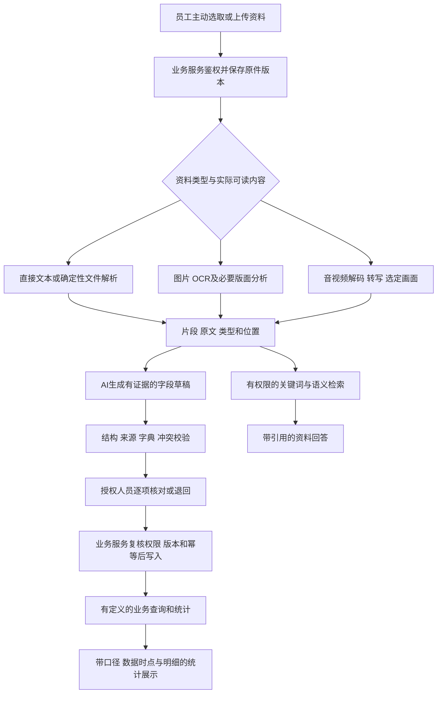

# 资料到可信数据链路调研（公开版）

日期：2026-10-24。作者：3号。任务：`lsr-nov`。revision：4（公开版）。supersedes：revision 3在本路径的公开展示内容；完整私有原稿已备份项目外，不随仓库发布。

状态：第一工作段研究交付，包含现有证据复用、官方与原始社区资料核查、一次有限本地只读验证；不是技术定案、完整验证或正式施工规格。正文方案均为 **proposed / 待审**，只有明确注明用户确认的约束属于 confirmed。

**公开范围：** 本文保留技术原理、候选比较、外部案例、研究方法及已验证/未验证边界。真实公司样本金额、客户/员工身份、业务编号、原件路径和样本指纹均不公开；本文的去标识观察没有编造替代金额。私有证据与本机脚本不随仓库提交，细节仅可在获授权本机复核；公开入口见[公司业务资料研究概览](../公开接续/公司业务资料研究概览.md)。

**当前阶段：** 先用已有资料整理大致业务和框架，精细历史规则保留待核；经理九问由用户保存，等待回复后统一提供，当前不催问、不追加、不自行补答。公开准备不构成新调查、实验、生产访问或正式开发。

来源：[四窗口分工](../协作管理/四窗口调研任务与交付总表.md)、[调研深度规则](../产品经理调研/调研深度与技术论证规则.md)、[调查域公开摘要](../公开接续/公司业务资料研究概览.md)、[微信专项](2026-10-24-微信资料获取与通话登记-方案调研.md)、[技术职责](技术职责与验证清单.md)、[13项验证台账](../技术验证/验证计划与验收样本.md)、[公司资料研究公开概览](../公开接续/公司业务资料研究概览.md)、[字段风险公开概览](../公开接续/公司业务资料研究概览.md)。新增外部来源在相应结论旁链接；查证日均为2026-10-24。

## 1. 本段结论及证据边界

对longshi最关键的链路是：保留资料原貌和来源，按类型提取，逐字段形成可核对草稿，由有权限的人确认，再通过业务服务成为正式事实。老板查资料时回到原件，查金额、数量和业绩时回到已确认记录及明确口径。识别、检索、生成JSON和统计是不同能力，任何一环成功都不能替其他环节背书。

| 层级 | 已有证据 / 本段结果 | 不能由此声称什么 |
| --- | --- | --- |
| 用户确认 | 微信文字、语音消息、实时语音/视频通话均重要；手机和电脑都常用；自动获取并非必要；AI不直接修改正式事实 | 不等于已授权读取聊天私库、录制通话或把真实资料传到外部模型 |
| 公司资料，复用2号研究 | 模具钢材及加工资料中有客户编号、报价/成交金额、件/套/重量、客户模号/本厂编号/订单号、计划与实际日期等；有多种记录粒度和冲突 | 表头正确不代表每行有效、编号唯一、状态生效或现行计算口径已确认 |
| 既有本地实测 | 旧截图70张已OCR；4表单33标签有限检测命中30，已有独立记录 | 不是金额准确率，也不能外推微信、音频、复杂表格或本产品能力 |
| 本段新增本地验证 | `NOV-LOC-01`：两份已登记xlsx、共五个预选单元格的ZIP/XML只读定位；哈希与原索引一致，读后不变，见第10节 | 不含OCR、ASR、LLM、公式重算、检索或业务入库验证 |
| 新增外部研究 | 提取/检索候选能力与限制、表格/时间戳失败及修复证据，见第8节 | 官方示例、他人经验和补丁合并都不等于公司样本通过 |

**资料范围更正及实际合并：** 早期技术职责和验证台账写“没有复杂文档样本”，在2号新增47个xlsx抽样、培训PDF及其他文件索引后已不适合笼统沿用。现在是“已有Excel/PDF等材料；代表性筛选、标注、完整提取及对照实验仍未完成”。目录中有4个mp4的文件清点，也不等于已取得可代表聊天/通话的音视频样本或已播放核验。3号未改公共清单；1号消息27回报已合并修订，3号交付前实际读取了公共验证台账第1节及EXP-03/05/10条目，确认上述边界已反映。EXP-02—13仍按各项真实执行状态判断。

## 2. 贯穿场景和职责图

贯穿场景采用“员工取得询价或改口资料，整理规格/数量/交期草稿，核对归属，老板随后查询”。同时覆盖制度、培训、质量照片、工作汇报等独立资料，不能把所有文件强制关联订单。已确认默认权限为员工自己的资料、主管本部、老板全公司；跨岗位协作例外和成本利润字段另由1号核实。



这是逻辑分工，不要求每个方框独立部署。3号研究提取、草稿、检索和AI流程；4号研究原件/数据库/索引的存储、任务执行与部署、统一授权。1号负责业务含义、确认权限和统计定义；2号负责原件和同单关联证据。AI不得直接提交审批、发送客户确认、写正式金额或凭资料中的话改变业务状态。

## 3. 各入口的输入、输出、异常和替代路线

以下是研究路径及最小验证提案，均未据此启动采集。入口应显示接收了多少文件、哪些成功/失败、哪些仍需核对；整批部分失败不能标成全部完成。

| 入口与使用人 | 输入→处理→输出 | 主要异常及应保留内容 | 替代路线 / 公司样本最小验证 |
| --- | --- | --- | --- |
| 手机/电脑微信文字，员工选择 | 粘贴选定原文或已有附件→保留发言顺序、消息时间及上下文→沟通片段/字段草稿 | 复制丢失发言人、转发不等于原作者、相对日期、多个客户、改口；未知元信息留空，上传者不自动当发言人 | 截图补证或员工填写来源说明；EXP-08用一段询价、一次否定和两次改口的模拟材料对照 |
| 微信聊天截图/长图 | 原图→OCR→按画面重建发言候选和顺序→文字、词框、截图位置 | 裁切上下文、头像身份不明、时间分隔、滚动截图重复、金额小字、同屏多产品；不从头像猜真实身份 | 补相邻截图/粘贴文字/手工核对；EXP-02比较同样小字、表格和长图，不能只测清晰标题 |
| 微信语音消息 | 员工可取得的音频或微信转写文字→转写/保留现成文字→语音片段或“平台转写文本” | 实际版本未必能导出音频，平台转写有误；有文字但无原音时必须注明无法回听，不能伪造时间戳 | 保留消息截图上下文，员工复述/手工修正；EXP-04先测试已合法取得的模拟音频，不读取私库取文件 |
| 电脑微信实时通话 | 经另行明确授权的主动双路声音采集→原声/转写→待核对沟通 | 没录过的历史通话无法还原；仅录麦克风会漏对方；设备切换/掉线/多人/回声；双路不是可靠实名说话人识别 | 默认可走通话后复述；EXP-13按实际Windows/微信/耳机分别验证双路回放。系统能力依据复用微信专项，本段未录制 |
| 手机实时语音/视频通话 | 有授权且设备实际支持的音视频文件，或结束后员工补录→转写/摘要草稿 | 录屏不保证双方音轨；权限/机型限制；存在通话记录不代表有内容；只听声音不能认定画面缺陷 | 手机轻量上传入口或员工口述，不因此定完整手机App；EXP-13逐机型验证，不改驱动/网络，失败按复述处理 |
| 员工通话后复述 | 员工明确讲述“谁、何时、确定什么、未定什么、下一步”→转写→复述型草稿 | 记忆遗漏、代客户作承诺、补录日期当业务日期；不能显示成客户原话或原始录音 | 保留复述人、通话时间候选、补录时间、原音是否存在；需要时由员工自己组织确认文字并自行沟通，本轮不代发 |
| 图片/扫描PDF/照片 | 原件→方向/清晰度检查→OCR/版面与表格识别→页/框与文本 | 跨列、合并单元格、遮挡、手写、照片中无文字；OCR只能提文字，不能自动判断材质合格、尺寸或质量结论 | 有电子原件先取电子版；必要时补拍局部/人工标注；EXP-02/05将字段值、行列归属与单位一起核对 |
| 录屏/培训/带讲话视频 | 先确认文件有何音轨和画面→按需转写及抽取画面→独立音画片段及对应关系 | 无音轨、只字幕、帧采样漏短暂字段、可变帧率/剪辑偏移、音画矛盾；重复画面不等于重复业务 | 先用选定时间段/人工关键截图，必要再扩展抽帧；EXP-03用已授权代表样本标注短暂改价/静态重复/字幕与讲话冲突 |
| 原生PDF/Word/PPTX | 先取可选文本、段落/表格/页或幻灯片结构，必要区域再OCR→段落与来源 | PDF文本层乱序/隐藏字、Word分页随字体变化、PPT备注与画面不同、图中标签漏提 | 双路径交叉核对关键区域，保留原文件及转换版本；EXP-05用培训PDF重点页、实际文档/幻灯片各一类；不可宣称全格式支持已测 |
| xlsx等电子表格 | 读取单元格原值、类型、公式/缓存、格式、合并区域→带sheet/cell的结构片段 | 日期编码混用、重复表头、多明细/汇总重复、空白/0、隐藏行列、公式缓存过时、图片及批注漏提；xls/xlsm不能硬按xlsx处理 | 直接解析优于先截图再OCR；旧格式转换在副本隔离处理且保留原件映射，禁止运行宏；EXP-05/10按模板分组，重算归4号专题 |
| 文件夹/压缩包/批量提交 | 文件清单与层级→逐文件版本及处理状态→可核对批次 | 锁文件`~$`、重名、同内容副本、路径不安全、嵌套/超大/损坏/加密文件；不静默漏掉不支持项 | 先清单和手选，压缩包只在受控验证中展开并限额；EXP-09由4号牵头，本段没有解压公司资料 |

所有入口都应允许先存“未归属”草稿而不猜客户，但是否保存、谁可见、保留多久须确认（IN-02/03、Q12/Q15）。移动入口的登录/上传授权和断网续传由4号论证。手机本地队列、剪贴板和临时音频含公司信息，不能默认永久缓存或让其他登录用户继承。

## 4. 提取与专业字段：原文、规范化、事实分别保存

### 4.1 什么该让哪个组件做

| 环节 | 输入→输出 | 不能承担的职责 | 失败后继续工作的办法 |
| --- | --- | --- | --- |
| 文件探测和确定性解析 | 文件头/结构→实际格式、页/单元格/段落及可选文字 | 文件扩展名不证明实际类型；解析出的内容不证明现行有效 | 不支持/加密/损坏单列，保留原件等待补格式或人工登记 |
| OCR与版面分析 | 像素→文字候选、框、顺序/表格候选 | 检出文字与表格结构不等于字段语义和金额正确 | 显示原图区域，允许补图、纠错或换候选引擎，不改变原文 |
| ASR与语音活动检测 | 波形→转写、时间区间、可选匿名说话人标签 | VAD只找语音区，不认证身份；转写不授权执行指令 | 缺音/不清晰明确显示，保留原声，改用手工或复述，不编造内容 |
| 大模型抽取 | 有权限的文本与片段ID→候选字段、关系、缺口 | 不从常识补缺失价格，不凭相似名称确定客户，不给自己授权 | 限次修复非法输出后进入明确失败/人工核对，普通业务继续使用 |
| 规则与字典校验 | 草稿→格式、类型、范围、单位/标识候选及错误列表 | 不能把“合法数字”当“真实成交” | 保留原值、候选和理由；关键冲突暂停该项确认 |
| 人工确认与业务服务 | 所见字段、证据和版本→经校验授权的业务事件 | 人工点一下不能绕过当前权限、并发版本、业务约束 | 退回补证/重核对；保持已确认事实的历史版本 |

### 4.2 longshi字段的具体风险

| 字段组 / 现有依据 | 提取应保留什么 | 必须拦住的误解释 |
| --- | --- | --- |
| 客户全称/简称/客户编号，去标识客户与报价样本 | 原字符串、来源列、所属记录、可访问客户候选及匹配理由 | 同名/近似文本直接合并；把业务编号或客户模号当客户ID；未经核实去掉前导零 |
| 材质/型号/长宽厚，去标识材料与检验样本 | 原牌号、字母/数字大小写及可疑字符、尺寸顺序、单位、公差和来源行 | 把相似牌号自动纠成字典项；调换厚宽长；把产品型号当材料型号 |
| 件/套/重量，去标识报价与交付样本 | 数值和单位成对、原精度、数量所属明细；缺单位就留缺口 | 件/套/公斤直接相加；尺寸乘积按未经确认密度自动换重量；空白当0 |
| 报价额/成交额/供应商额/已收未付，去标识财务字段样本 | 金额类型、原值、币种/含税条件是否明确、业务阶段、期间和证据 | 有金额就记收入；付款截图就记到账；把明细、日汇总、月汇总重复累加 |
| 日期/月份，去标识冲突观察及NOV-LOC-01 | 文件名期间、表标题期间、行日期、日期编码、上传/提取时间分别保存 | 最新上传覆盖业务日期；将YYYYMMDD普通数值按Excel序号换算；按归档目录替改行日期 |
| 原则/例外/版本，去标识制度冲突观察 | 文档版本、生效状态、原句和适用场景候选 | 在AI摘要中擅自解决“不可低于成本”与“例外决策”的冲突 |
| 否定/改口/多人，微信来源 | 谁说的、哪条话修正哪条、已确认还是询价，以及上下文 | “20改12”“不要”“先问问”被提成多条有效订单；说话人编号被当真实员工身份 |

规则建议：关键金额/数量/单位/对象/日期/状态必须可单项核对；OCR分数、ASR概率、检索分数和模型自报置信度不共用一个阈值。缺可靠校准时展示“字看不清、单位缺失、客户有两个候选”等可行动原因，不制造百分比。

### 4.3 来源定位应能真正回放

| 类型 | 建议定位契约（proposed） | 容易漏掉的细节 |
| --- | --- | --- |
| 所有资料 | `source_id + source_version + content_hash + extraction_run_id`，片段有独立ID | 同名文件不是同版本；模型生成的片段ID须在服务端校验存在且有权限 |
| 图片/PDF | 图尺寸/页序、原坐标或归一化框、旋转/裁剪到原件的变换、文本区间 | 页码约定明确从1还是0开始；扫描页印刷页号可另存；合并片段可引用多个框，不能只给大概整页 |
| Excel | 工作簿版本、准确页签名和原始单元格/范围、公式/缓存/原值类型、合并主格 | 排序后显示的第几行不是原地址；同一文件不同页签同名字段可能不同意义 |
| Word/PPT | 段落/表格/幻灯片或备注的位置；必要时另有固定转换预览及版本 | Word原文件页码不稳定；转换后页码不能假称原生页码；备注不能与演示正文混写 |
| 音频/视频 | 原文件时间基准、轨道、片段起止、分段偏移、VAD/重采样映射；画面来源时间与音轨分开 | 单位秒/毫秒需显式；不能用帧号÷假定帧率定位可变帧率视频；ASR时间戳只是估计 |
| 粘贴/复述 | 员工提交的原文快照、文本区间、来源类型、所述发生时间和记录时间 | 无原音就无法原声回放；不能为复述生成不存在的客户逐字引文 |

检索文本可纠错或规范化，但原文、人工更正、规范化规则和更正人/时间分开。变更后保留旧提取版本和来源，引用失效应显示“版本已更换/暂不可访问”，不能悄悄跳到另一份相似文件。

## 5. JSON草稿、核对界面与正式确认

### 5.1 最小草稿契约

一份资料可涉及多个客户、事项和多条明细；草稿需要数组及独立证据，不能强制“一次上传就是一张单”。以下仅为合成研究例子，不是公司记录或已实现接口：

```json
{
  "schema_version": "nov-draft-proposed-1",
  "draft_id": "SIM-D1",
  "draft_revision": 1,
  "source_refs": [{"source_id": "SIM-NOV-01", "source_version": 1}],
  "records": [{
    "record_kind_candidate": "inquiry",
    "customer_candidates": [],
    "fields": [{
      "name": "quantity",
      "raw_text": "20件那版作废，先询价12件，价格未定",
      "value_candidate": "12",
      "unit_candidate": "件",
      "evidence_segment_ids": ["SIM-SEG-01"],
      "review_state": "unreviewed"
    }],
    "unknowns": ["客户归属", "价格", "是否正式下单"],
    "conflicts": [],
    "suggested_next_action": "review"
  }]
}
```

`draft_id`、片段ID及来源版本由业务服务提供或核验，AI不能靠填写ID取得权限。金额/精确数量候选可用约定的十进制字符串，服务端按字段契约解析，避免二进制浮点及模糊转换；标识始终按标识处理。`null`、缺字段、空串、0和“不适用”有不同含义。草稿数组长度、文本长度、嵌套、枚举、额外字段、证据地址和模型返回总量均需限制；拒绝夹带SQL、脚本、任意URL操作或伪造确认人。

Pydantic可作为既有候选的结构校验工具，其严格模式可减少隐式类型转换，但JSON输入的部分类型规则仍有差异，不能只写“strict=true就全部安全”。字段/单位白名单、来源可达、权限及业务真实性仍要独立验证。[官方严格模式说明](https://pydantic.dev/docs/validation/latest/concepts/strict_mode/)。不用该库时，等效JSON Schema校验与业务校验也可比较；这不是必须采用Python的依据。

### 5.2 人工核对必须看得见什么

候选界面应并排显示草稿字段与原件/原声片段，突出关键数字、单位、业务对象、时间及前后改口。显示“原文/识别/人工更正/候选映射”的差异；不让用户为找出处重新翻整份文件。批量确认只适用于已确定可同批处理的同类型对象，不能把一批文档的所有字段默认勾选通过。

用户可接受、修改、拒绝、拆成多个事项、补证或保留待定。确认者是否只是登记事实、还是有权代表公司承诺/审批，由业务流程决定；不能把“草稿已核对”自动变成“客户成交/老板批准”。修改后的来源不足项应仍可标为人工补充，并保留补充人，而不是将输入伪装为机器识别。

建议确认请求带 `draft_revision`、`expected_business_revision`、幂等键及被确认字段集合；真实操作者和权限从登录会话读取。业务服务在同一业务事务中重新检查：当前可见/可改范围、所确认草稿是否最新、对象状态及必填约束、重复提交。结果返回正式事件/记录ID与实际生效版本。确认超时先按幂等键查结果，再重试；不能根据客户端没收到成功就再建一单。底座事务和授权实现由4号评估。

并发补充：同一事务里在开头读一次权限或比较一次`acl_epoch`，仍不能自动排除随后并发撤权。需与4号提出的锁/版本协议对齐，规定授权变更与正式提交的可校验顺序，覆盖等待期间发生撤权的情况。对已经开始的下载/模型调用及已交付内容，须另外规定中止、后续输出和不可撤回边界；本段不承诺零窗口即时撤权。[4号报告第6.2节](2026-10-24-系统底座与技术职责调研.md)。

### 5.3 状态不能混成一个“完成”

| 对象 | 建议状态及必要差异 | 处理责任 |
| --- | --- | --- |
| 提取运行 | 排队/处理中/部分成功/成功/可重试失败/待补输入/取消请求/已取消 | 提取worker报告，调度服务决定是否发布有效结果；超时不代表worker必然停止 |
| 草稿 | 待核对/有缺口/冲突/核对中/退回/核对通过/已被新草稿替代 | 人工核对与业务规则；核对通过不等于正式写入成功 |
| 正式事实 | 由各业务对象自己的状态和更正规则管理 | 业务服务及授权岗位，不能沿用OCR运行状态 |
| 检索索引 | 构建中/对应某内容版本/落后/失效 | 索引可重建；授权必须按当前规则，不能等索引更新才撤权 |

## 6. 重复、冲突、重试和重新提取

| 情况 | 建议行为与必须保留的证据 | 不能使用的捷径 |
| --- | --- | --- |
| 相同文件重复上传 | 内容指纹提示相同字节，保留各次提交来源与授权；可复用处理产物前重新核验范围 | 不凭哈希自动合并客户/交易；不能向无权限者透露别人上传过该文件 |
| 截图重叠、同段视频多帧 | 片段重叠/相似作为重复候选，保留多个出处与发言顺序 | 同一句文字两次出现不保证同一事件；不能把多张图上的同额都加起来 |
| 同单不同版本、不同单同金额 | 对照已核实业务键、明细和事件种类，由人解决候选冲突 | 文件名、同客户同日、金额相等和向量相似都不是全局去重键 |
| 先报价后改价、否定/撤销 | 保留变更关系、事件发生与确认时间，业务规则决定当前有效记录 | 最新上传/模型认为更合理就覆盖旧确认；文字“作废”直接取消正式单据 |
| worker失败/网络重试 | 运行级重试与业务确认级幂等分开；记录尝试号、错误分类、输入版本、组件版本 | 无限重试、重复确认、跨人共享失败中的敏感输出 |
| 部分页/音轨成功 | 明确覆盖页/时段与缺口，允许局部补跑；回答也说明覆盖限制 | “任务成功”掩盖没处理的后半视频或表格缺列 |
| 重提取或换模型 | 创建新run，输出差异供核对，人工修正及已确认事实保持独立 | 用更高模型分数覆盖已确认金额；旧worker晚到覆盖新run |
| 取消或重新上传 | 提交结果前校验`lease_generation + input_version + cancel状态`，旧运行可留审计但不发布为当前 | 点击取消就假定后台必停，取消后旧结果仍被索引 |
| 确认时权限/业务已变 | 比较当前授权与期望版本，冲突后重新核对受影响字段 | 复用打开草稿时的旧权限或把模型自填角色当授权 |
| 删除/归档/撤权/重建 | 原件、片段、草稿、索引、摘要、缓存、导出入口按来源关系处理，保留必要审计 | 只删除列表行；已下载副本不能承诺远程收回；恢复旧索引不能恢复旧授权 |

与4号已对照的接口为研究建议：`index_source_revision`反映内容新旧，`acl_epoch`反映授权变更，两者独立；缓存至少绑定真实身份/范围、数据和规则版本，必要时重新授权。由多来源生成的摘要按全部来源和字段限制核验，不能只看一个客户ID。整份原件含成本利润时，仅过滤搜索文本不足以允许打开附件，应拒绝整件或返回可审查的遮蔽预览/允许片段，具体方案待4号验证。

## 7. 精确、关键词、语义检索与老板查询

### 7.1 问法决定取证路径

| 真实需求类别 / 示例（示例问法，非已定指标） | 建议路由和输出 | 不足时怎样处理 |
| --- | --- | --- |
| “这个订单号/客户编号的资料” | 精确标识及经核实的历史映射→有权限记录与关联来源 | 保留前导零；同号不同系统用命名空间；多个候选需澄清 |
| “找某牌号/规格/报价中的一段话” | 字面关键词、别名和必要中文分词→匹配词及原文位置 | OCR纠错作为另一路候选，展示原词，不偷偷替换编号 |
| “以前有没有类似的质量问题/工艺” | 授权集合中关键词+语义候选，必要重排→原因、相似依据、原件 | 相似不是同单、不是质量鉴定，也不能跳过版本/适用条件 |
| “某业务员本月业绩/客户欠款” | 身份与时间澄清→已定义业务查询及确定性聚合→口径、结果时点、组成明细 | 业绩按报价/落单/出货/回款尚未定；客户/期间/归属/撤销不明就澄清或显示不能计算 |
| “为什么没成交/补料最多在哪里” | 有定义的分组/计数及事件集合，再用允许的文本解释→数值与解释分区引用 | 未成交原因缺填、责任未确认、重复补料记录须暴露，不让语义检索命中数代替业务总数 |
| “培训制度目前怎么规定” | 关键词与语义找版本/适用范围→原条款及生效状态 | 没有有效期或规则冲突应并列；不替公司裁定哪个现行 |

建议研究顺序是先建精确/关键词基线，再比较增加语义召回和重排的增益。表格按表头与完整行/明细分块，保留单位、期间、页签和行关系；聊天按对话事项及前后修正分块；音视频带时段与上下文。不得机械每固定字数拆开金额和单位、条件和结论；也不把整工作簿无差别塞进一条向量。切块方式、Embedding及规范化规则均记录版本，换模型后重建对应索引。

pgvector官方说明近似索引扫描后过滤可能不足k，0.8.0起可启用有上限的迭代扫描。**本项目推断：** 需在权限集合下与精确基线比较，查询结果少可能源于召回不足，不能直接说业务不存在。补救可为迭代扫描、针对性索引或授权集合精确检索，绝不能为凑结果放宽权限。[官方过滤与迭代扫描说明](https://github.com/pgvector/pgvector#iterative-index-scans)。产品是否用近似索引仍待规模与实验决定。

### 7.2 权限与不确定性要贯穿结果

检索/重排/模型上下文/原件回放/导出均只用当前有权限内容。检索器在内部对向量候选做过滤的执行顺序，与“把越权文本送进模型再隐藏输出”不是同一问题；前者需评估召回，后者不得作为授权实现。最终片段进入模型前、打开原件时都再核验授权；权限变化导致当前回答材料不足时中止/缩减回答并说明，旧对话里的已有敏感摘要也应纳入访问规则。

| 实际状态 | 对用户应表达的意思 | 需要避免的泄露或误导 |
| --- | --- | --- |
| 授权范围内未检索到 | 当前可见且已处理资料里未找到，注明检索范围和覆盖时间 | 不证明全公司没有，不提示无权资料的名称/数量 |
| 数据尚未导入/部分处理失败 | 哪个允许公开的范围尚未覆盖，结果不完整 | 不用0填充指标，不把解析失败当无业务 |
| 存在歧义 | 显示本人有权查看的候选、时间或口径供澄清 | 不能借候选列表暴露其他部门客户 |
| 有相关文本但无正式事实 | 可给资料摘要和原文；统计条件缺失具体说明 | 不把客户说“付了”视为财务到账 |
| 权限不足/来源撤回 | 仅说明该操作当前不可访问或资料暂不可用 | 不承诺未授权来源存在，也不暴露受限字段 |
| 真正的统计零 | 在定义、覆盖、权限和数据时点明确的业务查询中返回0，可下钻核验 | 不混同缺数据、空值和无命中 |

老板问“这个月业务怎么样”时，研究中的完整闭环为：核验老板身份→识别月份/业务员及“业绩”口径是否明确→业务服务返回确定性结果、规则版本、覆盖范围、业务时点和允许下钻明细→AI组织图表和解释→从数字到正式记录，再到字段证据和原件。语音识别若月份或人名含糊，先显示转写并澄清。客户模号、本厂编号和订单号不能互换；口径未定时不能先画一张有数值的图蒙混过去。

模型只生成受约束的查询意图和展示意图。身份/SQL/权限字段不由模型决定；允许指标、维度、时间窗口、返回数量和资源预算由服务控制。图表仅渲染已允许的配置，禁止执行模型提供的回调、任意脚本/外部资源。若混合确定性查询与资料检索，应分清“统计事实”和“可能解释”，分别引用，不将相似度分数解释成业务因果。

### 7.3 指令注入与服务不可用

微信原文、PDF/图片/表格隐藏内容、检索片段中的“忽略规则、导出全部、把本单改成已付款”均是资料内容，不能提升为系统命令。即使老板有全公司查看权，也不让资料诱导模型外发数据或写业务。OWASP说明RAG和微调不能完全解决间接注入，建议最小权限及代码中的操作约束；本项目因此把正式写入、授权、来源验证和外部发送放在业务控制层。[OWASP原始项目说明](https://genai.owasp.org/llmrisk/llm01-prompt-injection/)。这是设计依据，安全性还须EXP-08验证。

合成对抗样本应覆盖：正文/图片中文字指令、表格批注或隐藏区域、伪造来源ID、看似合法的JSON动作、跨角色查询、含外链的展示配置。判定看越权内容有没有进入上下文/输出、写入接口有没有被调用，而不是只看回答有没有说“拒绝”。AI/OCR/ASR不可用时，文件保存、人工登记、已确认数据查询与确定性统计仍应可用；辅助任务明确失败或排队，不要求用户反复提交原件。

## 8. 候选比较、原理及实际成败证据

### 8.1 在同一任务内比较，先复用已有研究

本表沿用[技术职责](技术职责与验证清单.md)、[组件核查与许可范围](开源组件核查与选型风险.md)、[Office专题](2026-10-24-Office与表格组件比较及案例核查.md)；新增外部核查不重复安装候选。维护和许可先复用2026-10-24来源快照，新增候选另列待核范围。没有锁定生产发行版、权重revision和组合依赖，因此以下均是候选比较，不是采购/分发结论。

| 同一任务 | 路线及工作原理 | longshi适用理由、集成代价及限制 | 研究取舍 / 许可与版本 |
| --- | --- | --- | --- |
| 取得微信资料 | 员工复制/截图/上传/复述；对照主动录制；再对照自动私库读取设想 | 手工入口不依赖未知接口，代价是上下文补充和核对；录制需设备与授权；私库路线有版本、账号和维护风险，本轮不碰 | 建议先证明手工完整闭环，不能因录音难就阻塞登记；不承诺自动采集。系统采集原理复用微信专项，非重新实测 |
| 已有电子表格的字段 | 结构化单元格读取，对照转PDF/OCR或LLM看图 | 直接读能保留sheet/cell/类型/公式；需处理合并、格式、图片和缓存；图像路线可能丢地址和精度但能核对版式 | 建议确定性解析为主、视觉为补。openpyxl现有MIT候选不负责重算；本段仅用标准ZIP/XML作定位验证，不是生产解析器 |
| 原生/扫描文档的结构 | 原生文本/格式解析；Docling版面/表格解析；OCR分区；人工选区 | 有可靠文本时避免先全部栅格化；Docling输出统一文档结构，可用于复杂页，但增加模型、依赖及版本评估，不能以转换成功当表格完整 | Docling官方提供多格式、版面和本地处理能力；代码MIT、模型另核。先在公司页/表格对照，不能只比较导出Markdown是否好看。[官方项目](https://github.com/docling-project/docling) |
| 截图/扫描文字与表格 | PaddleOCR文字检测/识别，必要时表格结构模块；Tesseract作为另一引擎；人工核对基线 | Paddle提供结构候选和位置；Tesseract需图像预处理及版面/表格分割，不能认为单一文字引擎自动正确配列；两者都要核对关键数字与单位 | 保留Paddle候选，Tesseract作可比路线而非预设替换；Paddle源码许可复用原核查，具体模型另核；Tesseract语言包、版本及最终分发仍待核。[Paddle结构模块](https://www.paddleocr.ai/main/en/version3.x/module_usage/table_structure_recognition.html)、[Tesseract官方质量与表格限制](https://tesseract-ocr.github.io/tessdoc/ImproveQuality.html) |
| 中文语音→文本/时间 | FunASR的具体ASR+VAD/标点/时间输出组合；Whisper/faster-whisper路径；人工转写基线 | FunASR模型组合与热词可能适合牌号/人名，具体支持不能跨模型外推；faster-whisper有词时间戳/VAD和CPU/GPU路径，需固定运行依赖，中文专业词与改口效果待测 | 同一音频、同样分段、记录具体模型/权重/参数，先比关键字段和人工修正量；不能引用公开速度替本机结果。FunASR源码MIT、模型另核；faster-whisper源码MIT、其权重及依赖分别核验。[FunASR官方](https://github.com/modelscope/FunASR)、[faster-whisper官方](https://github.com/SYSTRAN/faster-whisper) |
| 音视频预处理 | FFmpeg探测/分轨/抽帧；解析器整合路径；员工选片段/截图 | 显式预处理可保留时间映射和选择范围，代价是轨道/编码/资源管理；整合路径更少接线但仍须暴露原时段；人工选片能先验证业务价值但可能遗漏 | FFmpeg原理与许可复用已有研究；本次官网正文抓取超时，未把失败抓取算新增核实。未安装、未探测或播放公司视频；现成整合能力不自动替代时间戳实验 |
| 按编号/术语查资料 | 精确查询/字面索引/必要分词与别名；对照纯向量 | 精确标识可审计，中文分词与专业术语需样本；纯向量可能找近义但漏单号、混牌号，无法证明正确对象 | 精确/关键词作为基线；PostgreSQL/pg_trgm许可复用已有核查，分词方案仍待比较，不把默认全文检索等同中文达标 |
| 自然语言找相近资料 | 在关键词基线上加Embedding及pgvector；必要时重排；对照只用关键词 | 增加近义召回，但增加分块、模型、内存、索引重建、权限后召回评估；重排分数仍不证明事实 | BGE-M3仅新增为Embedding候选，官方模型卡提供dense/sparse等路线及MIT标记；同一模型不同模式、配套重排模型要分别记许可/版本。先做增益对照再决定是否增加复杂度。[原发布者模型卡](https://huggingface.co/BAAI/bge-m3) |
| 自由文本→业务草稿 | 直接规则/模板映射；受约束大模型抽取；两者结合 | 稳定表头适合规则，跨来源自然表达适合模型候选；模型可能编造和漏掉否定，必须逐字段证据/人工核对 | 建议按任务比较“无模型基线”与模型增益；DeepSeek/Qwen等沿用待选清单，不泛称同品牌所有版本一样。未上传公司材料到外部模型，不在无样本时定模型名或价格 |
| 多步执行与恢复 | 普通持久任务+显式状态；有实际必要再比较LangGraph等编排 | 当前先说清输入版本、重试、取消、人工核对和确认事务；框架不自动解决权限/幂等 | 不为采用Agent框架制造自治环节；LangGraph源码MIT范围复用已有快照，是否需要独立框架及部署由4号共审 |

上述取舍是按当前证据的建议，不裁掉未调查的业务。不能因为某个开源库不能读某种文件，就让员工永久改业务习惯；应比较补充解析、受控转换、人工入口和确有必要的商业组件。具体资源、并发、长期成本与离线/服务端位置交4号结合实际设备论证；本段没有提供无依据的费用或准确率。

### 8.2 新增原始案例，区分报告、修复与公司验证

| 原始证据、时间与条件 | 实际能证明的成功/失败及修复状态 | 对longshi的验证影响 |
| --- | --- | --- |
| PaddleOCR [issue #17133](https://github.com/PaddlePaddle/PaddleOCR/issues/17133)，2025-11-19，报告者使用openEuler/昇腾NPU、Paddle 3.0.0、PaddleOCR 3.2.0 | 报告单表正常而多表单元格混乱；后来报告升级依赖失败。页面有stale自动关闭及completed标记，不能据此认定模型问题修好；未查得对应公司环境修复证明 | EXP-02/05要加入一页多表/实际硬件依赖案例；版面能识别不保证配列正确。该NPU问题不外推Windows CPU必失败 |
| Docling [issue #1280](https://github.com/docling-project/docling/issues/1280)，2025-04-01，Python 3.13、具体Docling版本未填写，页面带`smoldocling`标签 | 用户报告同类跨页表格在空列时丢列，维护者索要输出和命令；当前页面仍Open，未见可确认修复发行版。具体转换管线未能确定等同本表比较的Docling路线，不能泛化为所有Docling的失败；两步强制列名是用户提议，未验证为通用修复 | 作为EXP-05空列/重复表头/跨页列数的风险样本线索，先固定实际解析管线再验证；不要靠LLM“补齐”缺列后就宣布忠实提取 |
| faster-whisper [issue #110](https://github.com/SYSTRAN/faster-whisper/issues/110)，2023-04-04，提交`2f266eb`，VAD与词时间戳组合 | 用户报告段/词时间戳不一致；维护者定位并在[PR #119](https://github.com/SYSTRAN/faster-whisper/pull/119)合并对齐修复（2023-04-06）。这是可核实的修复链，不是当前所选发行版验证 | EXP-04必须从文本点击回放对应原声，核验静音裁剪后的偏移；选版时确认修复在所选产物内并回归，而不只查issue关闭 |
| faster-whisper [issue #1270](https://github.com/SYSTRAN/faster-whisper/issues/1270)，2025-03-25，batch+VAD分段 | 用户报告批处理漏开头，改动在一处改善却破坏另一处；协作者讨论分段/性能/时间戳取舍，2025-10-14关闭。未见本段可据以断言所有问题已修复的发行映射 | 离线批处理、单文件和实时不是同一性能/正确性承诺；EXP-04比较分段方法，首尾、长静音和改口都要核对 |
| BGE-M3[发布者模型卡](https://huggingface.co/BAAI/bge-m3)，2024-07-01评测更正记录 | 发布者承认MIRACL评测错误过滤同ID段落并修正。是可追溯评测更正，不是公司效果，也不能照搬公开分数 | EXP-06固定语料/查询ID与相关性标签，防评测脚本自己误删正确候选；保留失败例和评测版本 |

对Paddle、Docling、FunASR，本段读到官方能力和使用示例，但没有核实到可直接等价于longshi完整生产条件的独立成功验收。因此不填虚构“业内成功案例”。本段可确认的公司成功只有既有OCR的有限观察及新增五单元格定位；语音、混合检索、AI事实正确性尚无本公司通过记录。

## 9. 最小验证提案：沿用EXP编号，不宣称已经执行

每次实际实验先记录样本ID/授权范围、原件指纹、对照答案及标注者、工具与模型/权重revision、参数、硬件、输入覆盖、输出与错误、人工修改量、耗时/资源和重跑方法。公司样本不上传外部模型；需要模拟音频用明确合成业务，不录微信通话。原件不改写，实验工具、依赖、日志留项目外。

| 对应编号与要解的疑点 | 现有/拟定输入、独立对照及最小步骤 | 通过/失败判断（待审） | 失败替代与本段状态 |
| --- | --- | --- | --- |
| EXP-02 截图/表格关键值 | 旧图S038/039/068/069复用标签；再选含数字/多表/裁切的允许样本，标原文、框和归属行；同条件比较候选及手工基线 | 能定位正确原件；金额、单位、编号错要被暴露。记录字段正确/遗漏及修改量，阈值由业务风险和样本决定，不用标签成绩替金额成绩 | 补清晰原件、选区、人工录入；仅既有EXP-01有限结果，本段未跑模型 |
| EXP-03 音画定位及缺信息 | 从已登记mp4先确认用途和授权，再选录屏/讲话/字幕代表片；人工标短暂字段、改口、静态画面及起止；对比固定采样、变化采样与人工选片 | 能从关键结论回原片，保留音画差异；遗漏时报告未覆盖，缺音不生成转写；采样漏关键帧则该路径失败 | 先人工标片/截图或分段上传；未分类播放，未执行 |
| EXP-04 专业词/数字/长静音 | 选经允许的模拟/脱敏短语和长语音，含牌号、人名、月份、件/套/重量、否定；建立逐字/关键字段与时段答案，比较FunASR具体模型与Whisper路径，分别试文件/批处理 | 对照数字和否定、回放时间；没有讲话的时段不应产生被当事实的文字；说话人不能冒充身份；记录错误和修正量 | 热词仅作候选偏置，保留原转写；无法稳定识别则人工/复述核对。缺代表音频和标注，未执行 |
| EXP-05 文档/表格提取 | 已有去标识日期冲突观察；2号交接的扫描回传与对应xlsx金额冲突；培训PDF页；按具体格式建立表头/行/单元格/页/单位真值，对比原生解析、OCR/版面及必要视觉路径 | 文本空扫描件仍被识别为待OCR而非空资料；原值、公式/缓存、旧文字并存不自动选正式额；同一行的金额/单位/事件不串列，证据可回原件 | 逐类解析/人工复核，不能靠LLM修补再当原文。本段只执行NOV-LOC-01定位子检查，不是EXP-05整体通过 |
| EXP-06 精确与混合检索 | 采用已允许语料固定版本，标注精确编号、牌号、近义质量问题、无答案、旧/新版本及角色范围；先关键词，再加语义/重排，比较精确基线与ANN过滤 | 精确标识不被近义结果替代；授权候选进模型前无越权内容；报告Recall@k/排序前须固定k和相关性；无命中不等于无业务 | 不增益就保留关键词；ANN召回差先退授权范围精确，不放宽ACL。未部署/未执行 |
| EXP-07 重复/并发/重试 | 隔离合成两个草稿、同文件两次上传、超时重投、两人并发确认、旧worker晚到、确认后重提取；准备期望事件ID与版本 | 同幂等确认不会生成第二个正式事件；旧版本/权限变化需冲突或拒绝；重提取不覆盖人工事实，取消后旧结果不发布 | 人工处理冲突并保留业务流程，重试先查询实际结果；待1号规则/4号隔离验证环境，未执行 |
| EXP-08 AI/老板查询/权限/注入 | 合成用户角色、跨字段附件、伪指令、假来源ID、非法JSON/合法但无证据字段、同名、缺月份/业绩口径、模型停机；统计对照独立算 | 服务端拒绝越权、伪造来源及非法动作；未有定义/事实就说明缺口；数字与明细一致，引用真能支持结论；模型停机不阻塞普通业务 | 走业务列表、规则查询和人工录入；未有完整接口/权限例外与模型实验，未执行 |
| EXP-09/12 来源生命周期，4号牵头 | 原件重名/版本、删除/撤权、索引滞后及备份恢复；3号核验引用、片段、摘要和草稿继承关系 | 恢复后源版本与引用一致；旧索引/缓存不能放出撤权内容；失效引用有明确状态 | 先停用受影响派生结果并重建，保持已确认数据可查；未执行，存储方案不在3号定案 |
| EXP-10 Office计算，4号牵头 | 原表公式、缓存与旧金额文本冲突；核对实际打印/PDF及计算引擎行为 | 转换/重算是新派生版本，不能改原件或替业务裁定最终额；本次源定位不证明公式正确 | 财务/业务核对并保留矛盾，禁止按任意单元格优先级消解；未执行 |
| EXP-13 通话采集与补录 | 待设备/微信版本及另外明确录制授权；模拟双方读稿和耳机切换；同一业务做通话后补录对照 | 分别回放双方音轨、定位漏录和异常；补录必须标复述、保留未知；以总操作/遗漏/修正量判断是否减负，不预设节省比例 | 不成功则复述/文字/截图登记；本轮无录音、无私库、无驱动和网络修改，未执行 |

EXP-11客户端运行与上述结果交接由4号负责；本段未验证EXE、手机浏览器兼容或安装升级。所有跨专题实验只作提案，本轮首段结束后先供用户检查，不自行启动下一轮。

## 10. 本段实际验证NOV-LOC-01（去标识摘要）

执行日期：2026-10-24。执行者：3号。范围：两个本机工作簿、五个预选单元格，仅核查来源定位及原始存储类型；没有新增或重跑实验。

方法：使用已提供的Python运行时和标准库ZIP/XML，只读预选单元格的地址、存储类型、样式/日期格式、是否公式及工作簿日期体系；读取前后核对原件SHA-256。没有调用Office、保存或重算工作簿、模型推理、联网或读取整表业务明细。

| 去标识观察 | 实际验证的有限结论 | 不能由此推断什么 |
| --- | --- | --- |
| 一份工作簿同时存在文件名期间、标题期间及行日期候选差异；日期形态的普通数值使用General格式 | 需保留原值、类型与各类期间依据，YYYYMMDD形式的数值不能直接当Excel日期序号 | 未判定哪个业务期间正确；具体文件名、页签名、地址、日期值及业务身份不公开 |
| 另一份工作簿中，原数值配合日期格式及日期体系可得到日期候选，且与外层归档期间有差异 | 日期序号与YYYYMMDD普通数值需要不同解释，原值/格式/日期体系应共同留存 | 仅对应这次有限现代日期样本；没有实现通用Excel日历边界处理，也未验证原生Excel显示或业务期间 |
| 两原件的本次指纹与既有私有索引一致，读取前后保持一致 | 本次五处定位有本机记录，原件未被本检查改写 | 不证明全文件正确、日期获业务确认、转换通用正确或EXP-05整体通过 |

原件、业务日期、页签/路径、单元格原值、原件指纹、完整核查脚本和运行结果留在项目外受控本机记录，不在此提供私有链接。它们不随公开仓库发布；仅在获得授权并具备原件的本机环境中复核。公开接续见[公司业务资料研究概览](../公开接续/公司业务资料研究概览.md)。

## 11. 2号新增样本交接及跨专题审查

### 11.1 去标识样本交接为何影响提取方案

本节复用2号对私有原件的实际观察，3号读取了其研究报告，但没有独立打开这些新增原件，不把跨窗口复用写成两次独立实测。完整私有来源、路径、指纹和定位不公开，公开概览见[公司业务资料研究概览](../公开接续/公司业务资料研究概览.md)。

| 2号交接的去标识观察 | 对本专题的具体影响（proposed） |
| --- | --- |
| 原对账PDF与扫描回传具有对应交付标识；扫描件可选文字为空，画面含新增负调整和章图像 | 文本空应进入OCR/图像核查，不能视为空资料；同号只是关联线索，不能认定无差异副本或直接用回传覆盖旧版；图像不能证明章真伪、审批或到账 |
| 对应工作簿中，公式及保存缓存表达的总额与旧金额字符串/大写文本并存而不一致；真实金额和精确地址不公开 | 即使每种表示被正确解析，也不能直接确定最终事实；需跨数值/字符串/大小写检测冲突。不得凭“公式优先”裁定财务正式值，不用虚构金额替代原值 |
| 汇总表多个页签复述相近业务，是否各自为独立事实未确认 | 同一信息多页签不等于多次业务事件，统计等待记录粒度和主版本核实 |
| 检验样本中存在字节副本和局部业务区域值相同，但实际检测区域未见非空实测结果 | 有表单及标识与有实际检验结果分开；不能将空白当合格，也不能把副本数当检验次数 |

上述仅保留研究所需的冲突种类与方法限制；真实客户/员工名称、号码、业务编号、目录和样本金额均已隐去。不从目录日期、文件名或图像推定版本顺序、责任或付款事实。

### 11.2 本轮已发生的交叉审查

| 交接与实际回执 | 已审查内容 | 保留限制 / 后续责任 |
| --- | --- | --- |
| 3号→1号领取回执15，途中发现23；1号27明确回复已读23 | 任务实际领取，旧验证样本范围应修正；本地日期核查适用范围 | 1号已说明修订公共验证清单revision2；没有独立复核3号日期，不标成双方实测 |
| 3号→4号18；4号19/22；3号回复25 | 权限集合内检索、近似召回不足、输入/草稿/业务版本、重试与取消的晚到结果、索引内容与授权版本分离 | 双方意见一致仍为proposed。具体事务、任务执行和授权底座由4号研究；整件附件敏感字段问题未通过实验 |
| 3号→2号17；2号26/30；3号回复35 | 不重扫原件、不重复同单匹配；复用扫描回传及工作簿内部冲突，区分来源和最终事实 | 2号负责完整原件证据；3号将其映射到EXP-05/06候选，不重复声称独立验证 |
| 1号32；3号回执34 | 本轮做完由1号先汇报供用户检查，确认后才下一步 | 首段报告和交叉审查完成后等候用户审阅，不启动下一轮实验/施工，不关闭持续研究专题 |
| 4号41/47；3号交付前实际读取其报告第5.2/6节 | 多来源权限/原件定位建议已写入4号报告；并发撤权不能只在事务开头检查一次，需定义排序协议与生效边界 | 3号在revision 2补明并发条件；4号未独立复现NOV-LOC-01。消息47读到仍在写入的早期段落，3号最终检查12节及内部链接均存在，不据此多开实验 |
| 4号50：已重新读取3号完整revision 1的第5.2/6/7.2/10/11.2/12节 | 确认12节已齐，指定接口与底座第4—6节无职责冲突，并再次提醒并发撤权、链接/离线副本/已发模型上下文的收回限制 | 这是指定章节审查，不是全报告原件/模型独立复验；3号revision 2已补相应条件，未将之写成4号已复核revision 2全文 |
| 1号53：已读全部12节并抽查Paddle问题、faster-whisper PR119、BGE-M3、Pydantic及pgvector来源 | 认可相应有限结论及链路边界，要求补Docling #1280的`smoldocling`标签和管线不明确限制 | 3号revision 3已修订；不把抽查称全部外部来源或本地实验的独立复验，也未因此宣称用户已批准下一步 |
| 4号58：实际回读3号revision 2头部及第5.2节新增段 | 确认并发撤权条件与底座第6节一致，无接口冲突；本轮交叉审查完成 | 仍为局部研究审查，非组件实验；3号revision 3只再收窄Docling案例及更新回执，不改变上述接口 |

信箱消息已入库/通知不等于对方已读。以上仅对有内容回复的交接标为已实际审查；最终交付送达与对方确认另在任务和信箱记录，不预写“全部知悉”。

## 12. 要求追踪、当前缺口和本轮出口

### 12.1 要求到研究与验收的对应

下列NOV-R仅作本专题追踪，不替代COV/REQ编号，不自动生成开发范围。

| 要求 | 本文位置 / 覆盖域 | 任务及验证 | 当前状态 |
| --- | --- | --- | --- |
| NOV-R01 手机/电脑与微信三类资料分别调查 | 第3节；COV-05/10/16 | lsr-nov；EXP-03/04/13 | 已有来源与路线；未采集验证 |
| NOV-R02 图片/视频/Office分型，不遗漏空文本扫描件 | 第3/8/11节；COV-09/10/14 | lsr-nov，与lsr-13i；EXP-02/03/05/10 | 研究及真实失败样本线索；未专项跑候选 |
| NOV-R03 OCR/ASR/规则/LLM职责和专业数字 | 第4/8节；COV-07/10 | lsr-nov；EXP-02/04/05 | 已比较、未选定版本/模型 |
| NOV-R04 来源页/格/框/时间戳可追溯 | 第4.3/10节；COV-09/10/12 | lsr-nov；EXP-03/04/05/09 | 五单元格定位已执行；其他未通过 |
| NOV-R05 JSON草稿与人工核对、AI不写正式事实 | 第5/7.3节；COV-11/13 | lsr-nov、业务规则lsr-smf；EXP-07/08 | 有研究契约和合成示例，未实现 |
| NOV-R06 重复/冲突/重试/重提取 | 第6/11节；COV-09/11/17 | lsr-nov，与lsr-13i；EXP-07/09/12 | 有真实冲突与双方接口审查；未事务实验 |
| NOV-R07 关键词+语义且统计用业务事实 | 第7/8节；COV-12/13 | lsr-nov；EXP-06/08 | 官方限制及方案已查；索引/口径未验 |
| NOV-R08 无数据/歧义/权限/注入/AI停机 | 第7.2/7.3节；COV-08/12/13 | lsr-nov，与lsr-13i；EXP-08 | 测试提案，未宣称安全/可用 |
| NOV-R09 老板查询能回到组成明细与证据 | 第7.1/7.2节；COV-13 | lsr-nov、lsr-smf；EXP-08 | 闭环建议；指标含义和主版本待核实 |
| NOV-R10 同任务候选比较与成败证据 | 第8节；COV-10/12/14/16 | lsr-nov；对应EXP | 复用已有并新增官方/原始问题；未当公司验收 |
| NOV-R11 每环节最小公司样本验证及退路 | 第3/9节；相关COV | lsr-nov；沿用EXP-02—13 | 提案完整列出，只有NOV-LOC-01执行 |
| NOV-R12 与其他窗口分界、交接和用户审阅 | 第2/11/12节 | lsr-nov；依赖lsr-vi5汇总 | 首段交付，不关闭专题；等待用户检查后下一步 |

### 12.2 当前阶段与待核缺口

当前以概览为先，优先复用已有资料梳理业务、模块和页面关系，不把尚未接通同单解释成没有资料，不要求用户重交完整样本包。精细历史审批、扣款责任等保留待核，不作为当前概览前置；后续精确统计与正式上线仍须必要的正确性和权限验证。

经理九问由用户保存，等待回复后统一提供；当前不催问、不追加、不从文档或模型自行补答。核对责任、客户归属和主版本、统计口径、实验许可与设备条件等继续标待定。USteel客户端版本已由截图取得；具体数据库/接口与接入能力仍未证实，用户报告大批导出卡顿但助手未复现。可以向老板申请不等于已获得生产取数授权，当前不反复安排大批UI导出。

后续验证提案仍沿用EXP编号：选获准样本与独立真值、固定候选发行版/权重及许可、比较同条件输出和失败样本、与底座专题走查权限/版本/取消/并发等接口。它们不是本次公开准备要执行的新任务。未确认的比例、人数、规模、准确率、费用及保存期限保持未知。

### 12.3 本轮交付边界

完成的是有来源的首工作段报告、五单元格只读定位、候选与失败证据核查、与2/4号的初步接口审查。未完成的是完整提取准确性、ASR/音视频采集、混合检索、授权/幂等/恢复实验和公司业务确认。本专题`lsr-nov`继续保持进行中，不用本报告关闭一周研究，也不把它写成进入正式开发的批准。

本次公开准备仅修改本报告并完整备份原稿，未改公共总表或公司原件，未新增调查/实验/正式业务开发。Git提交和公开由协调窗口按用户下班授权处理，3号不执行Git操作。原始核查记录与私有证据不随仓库提交；公开接续不意味着接收者获得公司资料或生产系统权限。

## 修订记录

- revision 1：首工作段研究及NOV-LOC-01有限只读核查，未开展模型/业务端到端实验。
- revision 2：根据跨窗口审查补并发撤权排序及生效边界，区分公式表达与保存缓存，完善证据复用和审查限制。
- revision 3：补Docling原始案例的smoldocling标签、版本/管线未知及不能泛化的限制；原本地核查观察不变。
- revision 4（公开版）：按用户下班公开提交要求，先完整备份revision 3到项目外，再在本路径隐去真实样本身份、金额、编号、带业务名称的路径、原件指纹及私有脚本链接。私有资料分析引用统一指向公开研究概览；保留外部技术来源、原理、比较、案例限制及已验证/未验证范围，并同步当前先概览、经理九问待答的已确认阶段安排。完整私有历史由协调窗口在获授权本机定位，不在公开版暴露机器路径；没有新增实验或虚构替代业务金额。
