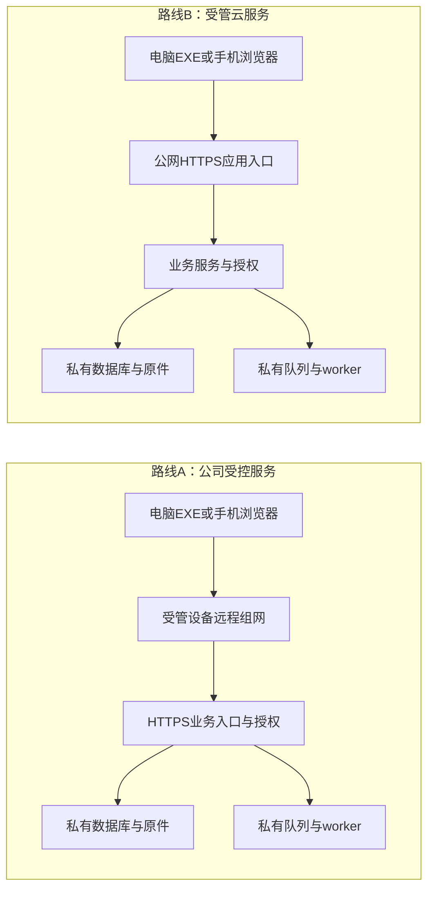

# 公司内外访问与部署路线比较

revision: r1；日期：2026-10-26；作者：4号；持续任务：lsr-13i；技术结论：proposed／待确认。

## 1. 要求与复用边界

来源：1号本日转交用户新要求——未来公司内外均可使用，包括外出或家里；共同Memory索引`longshi/requirements/公司内外访问-2026-10-26`r1已实际读取。这是confirmed用户使用方向，不等于批准云采购、生产接入或原件上传。当前公司网络、维护人员、设备及资料出域条件未知。

复用[底座r2](2026-10-24-系统底座与技术职责调研.md)§7、10和[权限一致性稿](2026-10-26-订单进度权限与一致性职责补查.md)§6：共享业务服务负责正式结果，客户端负责操作；断线草稿不冒充已提交。旧稿“内外可达待调查”由本次要求补充，物理部署仍未选定。

## 2. 两条候选路线及位置

| 项目 | 公司受控服务＋远程接入 | 受管云服务＋HTTPS入口 |
|---|---|---|
| 访问 | 公司内经受控网络；外出电脑、Android/iOS设备先获准加入组网，再访问同一业务入口。手机仍需适配网页，不是运行EXE。 | 公司、家中、移动网络经域名和HTTPS访问同一服务；普通业务入口可不安装VPN。浏览器和EXE使用相同业务权限。 |
| 组件 | 业务、数据库、原件、队列及worker放公司专用受控主机／虚机与存储；不依赖员工电脑持续开机。组网控制面可另放受控公网主机，位置单列。 | 业务与worker在获准地域的云应用／任务环境，数据库、原件和队列在私有网络或私有存储；网页不携带数据库凭据。模型处理位置另按原件授权决定。 |
| 维护 | 公司承担电源、硬件、网络、证书、系统补丁、组网和业务升级、监控及恢复；需有人实际值守。 | PaaS可转移部分主机／系统维护，应用、账号权限、密钥、配置和恢复验收仍需负责；仅租云虚机不是全托管。持续费用含算力、存储、备份、流量及运维，未报价。 |
| 故障 | 公司停电／主机故障影响内外；公司出口故障阻断外部，局部内网是否仍可用取决于认证等依赖；控制面／中继故障另测，不承诺会话永续。 | 公司出口故障不必拖垮外部用户，但各设备仍需可达云；云区域、入口、身份服务故障可影响全部用户。可用区、备份和容灾须具体购买配置，不能由“上云”推定。 |

业务公网只开放HTTPS应用入口，不直露数据库、队列、裸文件或管理控制台；原件经鉴权接口按版本／片段读取，下载及导出仍核权。组网控制／可选中继的公网端口属于另外的网络服务面，须独立审定，不能借此开放公司整段内网。

## 3. 远程组网的实际开源范围

已核实际仓库juanfont/headscale与tailscale/tailscale，所查标签根许可均为BSD-3-Clause，分发须保留声明、遵守不背书条件；依赖和发行包不据此一概判定。查阅时GitHub Latest分别v0.29.6（页面10月24日）、v1.104.2（10月21日），存在近期补丁发布；不代表公司适配或服务承诺。

Headscale是社区维护的可自托管控制面，目标范围为单tailnet；Tailscale开源核心含守护进程／CLI，商业托管控制面仍为专有服务，Windows、macOS/iOS图形包装并非全部开源。选Headscale不等于复制商业托管服务的全部能力，也不自动免除客户端条款或运维成本。

官方限制：Headscale要求受支持Linux/BSD服务器、公网IP、HTTPS，推荐443；示例按系统服务和SQLite配置。v0.29.6声明客户端最低v1.80.0，最低版本不保证所有未来版本兼容。官方列Windows、Android、iOS可接入，但需按平台额外配置。该标签默认DERP列表指向Tailscale，故自托管控制面不等于没有第三方中继依赖；若要求全部受控，要另审中继部署、端口与维护。

VPN只提供网络通路。设备可入网不等于人员可读订单、成本或附件；应用仍逐请求核身份、对象、字段、动作及当前授权。客户端遗失、离职和账号撤销需同时考虑设备组网、业务会话及缓存；已下载明文不能承诺远程收回。

## 4. 有条件建议与验收缺口

proposed：把两条路线保留在图纸中。若资料允许放获准云地域、目标网络可达且有预算及运维责任人，优先验证受管云HTTPS路线，减少每台手机的组网配置；若资料须留公司且公司具备稳定供电、出口和维护能力，验证公司服务＋受控远程接入。现无条件证明哪条适合公司，不默认采用Headscale或购买Tailscale。

后续获准验证时，覆盖公司／家庭／移动网络的电脑及手机登录、上传／下载、长任务；丢网重连按原操作查询不重复确认；撤权后原件／查询拒绝；入口、worker、数据库分别故障时明确状态；核查备份恢复、可接受丢失量及恢复时间。还需核实际系统／客户端版本、安装权限及现用VPN冲突。模型故障保留获准普通业务读取。追踪：本次内外访问要求→§2—4→COV-16／lsr-13i→EXP-11/12；研究完成、运行未验证，不把“能连通”算业务验收。

已完成官方资料和标签核查，未安装、运行、配置网络或接生产；未评估实际带宽、费用、供应商条款、地域和恢复指标，也未上传公司资料。以上缺口影响部署定稿，不阻塞继续画候选图。

## 5. 原始来源表

查证日均为2026-10-26；外部文档会变化，版本事实以指定标签为界。

| 来源 | 原始链接 | 读取／支持范围 |
|---|---|---|
| Headscale实际项目及许可 | [仓库README](https://github.com/juanfont/headscale)；[v0.29.6许可](https://github.com/juanfont/headscale/blob/v0.29.6/LICENSE) | 单tailnet控制面、社区目标与BSD-3-Clause |
| Headscale发行 | [v0.29.6](https://github.com/juanfont/headscale/releases/tag/v0.29.6) | Latest、近期补丁、最低客户端版本；非本机兼容测试 |
| Headscale部署限制 | [官方要求](https://headscale.net/stable/setup/requirements/)；[标签示例配置](https://github.com/juanfont/headscale/blob/v0.29.6/config-example.yaml) | 公网IP、HTTPS、系统服务；读取数据库及DERP相关配置片段 |
| 各平台接入 | [官方客户端支持表](https://headscale.net/stable/about/clients/) | Windows、Android、iOS等；平台配置仍待实际验证 |
| Tailscale项目与发行 | [实际仓库README](https://github.com/tailscale/tailscale)；[v1.104.2](https://github.com/tailscale/tailscale/releases/tag/v1.104.2)；[标签许可](https://github.com/tailscale/tailscale/blob/v1.104.2/LICENSE) | 核心代码／GUI边界、近期发行、BSD-3-Clause |
| 商业服务边界 | [官方开源范围](https://tailscale.com/opensource) | 托管控制面专有、Headscale独立维护；未据宣传推定公司可用性 |
| 云责任分工 | [Microsoft官方说明](https://learn.microsoft.com/en-us/azure/security/fundamentals/shared-responsibility) | IaaS/PaaS职责差异及账号、数据、配置责任；不构成选定Azure |
| 应用授权 | [OWASP授权指引](https://cheatsheetseries.owasp.org/cheatsheets/Authorization_Cheat_Sheet.html) | 默认拒绝、逐请求授权、静态资源检查；非业务规则来源 |

桌面安装与手机分工仅转引底座§7的Tauri Windows安装、WPF仅Windows及手机网页比较，本次没有重选桌面栈或复测安装。
