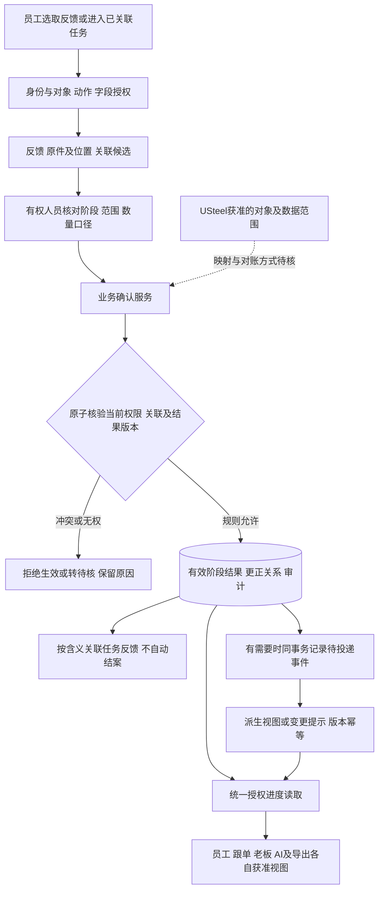

# 订单进度权限与一致性职责补查

日期：2026-10-26（Asia/Shanghai）。作者：4号 / `window4-01a16ca7`。任务：`lsr-13i`。revision：1。supersedes：无；补充10月24日底座研究，不修改该冻结稿。

状态：本轮独立研究工作段，所有实现、角色矩阵、数据契约及更正规则均为 **proposed / 待审**。用户表达的需求、设计偏好、现状线索与公司制度分别记录。只查既有研究、静态图和公开官方/原作者资料；没有业务程序、数据库/模型安装、实验或生产接入。

范围来源：1号本轮用户要求恢复原四窗口同时工作；信箱117明确“订单进度确认、查看与更正的系统职责补查”，已实际读取并回传校验码及范围。唯一写入文件为本文。公共表及10月24日冻结报告由各原负责人按约定维护，本段不改。

## 1. 本段结论：少填一次，需要先说清复用的是哪件事实

05号图可以继续作为轻量交互候选，但“一次确认、多处复用”目前只适合表示：**同一条有明确订单/明细/批次、阶段、数量口径、来源与确认权限的有效结果，供获准入口引用。** 它不意味着一次点击同时完成任务验收、检验合格、订单结案或USteel同步。

本段新增的判断和对longshi的影响如下；均未实施或通过实验：

| 新增判断 | 对longshi的具体影响 | 证据与尚未解决的条件 |
| --- | --- | --- |
| 任务反馈与阶段结果可以关联，但不一定是同一个确认动作 | 加工岗位确认阶段完成，不必再让跟单抄一份；如果任务还需主管验收，则任务仍可处于待验收，不能被自动关掉 | 05图及订单进度报告把任务/阶段复用作为候选；哪些动作含义和权限相同需业务核实 |
| 防重不能只靠文件哈希、请求幂等键或“数量没超计划” | 同一批的累计反馈、补记、更正、返工次数不能重复累加；不同幂等键也可能描述同一件事 | 公司样本的副本/重复表示问题沿用旧研究，不重读原件；当前具体事件身份、数量口径未定 |
| 更正旧记录与实际发生返工是不同事件 | 录错数量要留更正关系；实际返工应保留此前真实完成及后续返工事实。不能统一成删旧结果或把进度倒回一个百分比 | 源版本、历史更正及业务生命周期建议，正式岗位/完成规则未知 |
| 刷新快、消息已推送与现场信息新鲜是三件事 | 老板应看到来源、确认状态、实际发生/录入时间和覆盖范围；未获更新不是“未开工” | 05图、1号报告及本轮通知机制官方核查；“实时”时限与现场更新能力未测 |
| 进度、依据、附件、成本字段分别授权 | 获准看“本批加工完成”的人未必能打开包含利润的整张表，也未必可更正这条结果 | 复用旧底座统一授权，并将其具体化到批次/节点/来源；公司例外权限未定 |

## 2. 已实际读取什么，哪些仍只是线索

| 来源 | 本轮读取范围与可以使用的内容 | 不能据此声称什么 |
| --- | --- | --- |
| [AGENTS](../../AGENTS.md)、[接续说明](../../接续工作说明.md)、[调研总表](../调研总表.md)及[核实安排r4](../产品经理调研/2026-10-26-业务核实转发清单.md) | 最新原话/偏好/岗位确认分层；整套9/12/8题已撤回，先自查再必要单点核实 | 不能沿用旧报告“等整套九问齐了再继续”的解释；减少打扰不等于跳过高影响验证 |
| [订单进度报告r4](../产品经理调研/2026-10-26-订单进度查看功能调研.md)，重点§4/5/8—12 | OP-01有权限看进度的需求；混合维护、轻量记录等用户偏好；六类节点仍候选；阶段/批次/整单分开 | “关键岗位确认、跟单查漏”不是公司负责人已批准的岗位制度；不证明ERP现有实时过程能力 |
| [员工上报走查r3](../产品经理调研/2026-10-26-员工上报流程走查.md)，重点UP-01—04及§2/6/9 | 默认先上传可预选，按类别决定上报触发；沟通记录/询价草稿双输出；只补关键过程 | 不能把上传、提取、上报、批准、阶段生效串成所有资料共用的强制流程 |
| [05号静态图](../产品经理调研/页面草图/05-订单进度轻量记录.png) | 本轮实际打开查看：左侧虚构订单/明细/批次确认，右侧获准查看；全单10件、本批4件、其余未获更新、检验/出货未获确认 | 图片按钮不能操作；没有权限、并发、ERP、性能或员工耗时实测 |
| [10月24日底座公开版r2](2026-10-24-系统底座与技术职责调研.md)，重点§3/4/6/8/12 | 原件/运行/草稿/事实/索引分层，幂等、版本、撤权和主版本边界；本轮核对冻结稿哈希未变 | 不重新选全部技术栈；原稿中的旧阶段、问卷安排以本轮最新规则为准 |
| [公开公司资料概览](../公开接续/公司业务资料研究概览.md)及1号既有资料复用结论 | 作为已有业务对象/字段/样本差异的研究入口 | 本轮未独立读公司原件；公开摘要不是可重跑的详细证据，不上传原件至外部 |
| [2号本轮关联补查摘要r1](../公开接续/2026-10-26-订单关联补查摘要.md)，全文 | 本轮实际读取其有限核验结论：同一订单号多规格行、计划/实际空值、生产合并/检验交付/材质炉批等粒度不同 | 是2号对指定区域的观察，本窗口未重读原件；尚无稳定明细映射或新增完整同单闭环，不能推断公司全貌或ERP能力 |
| [3号可信链路补查r2](2026-10-26-关键反馈到订单进度的可信链路补查.md)，§2/4.2/5.1及KF-02/04/05/08 | 本轮实际交叉阅读：可靠上下文或有依据人工对单、数量/时间分层、跨节点兼容与同节点冲突、确认及权限接口 | 仅为研究文本接口核对，不是全稿审计、公司事实复核或实现通过 |
| 第11节公开官方资料 | 条件更新、事务/锁、幂等重试、双写断点、通知与授权机制 | 官方机制和外部经验不等于公司可用；未运行其中示例 |

用户关于“ERP里是结果、过程靠人员/微信群”的转述继续保留为**待岗位核实线索**，不推断ERP完整功能或公司制度。UP/OP中的未来选择保留为**用户偏好**，不自行撤销，也不冒充业务负责人批准。

## 3. 05图的一次确认需要满足的六个条件

下表是实现前提，不新增六次员工填写。能从已获授权且可靠的上下文带出的字段应复用；员工只核对本次实际变化及必要差异。

| 条件 | 底座/业务服务要核实什么 | 条件不满足时应怎样继续 |
| --- | --- | --- |
| 对得上 | 内部订单ID、明细/批次/工作包、阶段、源系统键和映射版本明确；任务中的关联也须校验 | 保存未关联反馈或候选，不推进任何被猜中的订单。不能凭客户同名、规格相似对单 |
| 说的是同一动作 | 任务反馈、岗位阶段结果、检验/交付/审批的业务含义相容；若不同，只共享来源和引用 | 阶段结果可生效而任务仍待验收；提交报告可成功而质量结果仍待确认 |
| 有权确认 | 当前操作者被授权对该对象、批次、阶段和动作确认；特殊更正权另查 | 只能提交反馈/申请确认；不能因已分配任务而取得全单或其他岗位更新权 |
| 数量和范围明确 | 单位、实际范围、数量是本次新增还是累计、是否包含同件返工及已有结果 | 留数量口径冲突；不把计划批量直接当实际完成，不把累计量当新增量再加 |
| 写入可判定 | 同一操作可识别重试，正式版本可比较，关联/权限/状态变化可冲突返回 | 返回可查询的操作结果或明确未成功；网络超时不由客户端猜成功/失败 |
| 多处读取可追溯 | 员工、跟单、老板、AI和导出引用同一有效结果或可说明水位的派生视图 | 允许内容延迟并显式标记；撤权/作废不能依赖旧索引慢慢同步才生效 |

### 3.1 数量口径是新增的高风险断点

仅有“本批完成数量”一个数字不足以决定怎样更新。以下全部是沿05图形成的**合成反例**，不是公司记录，也不替代私有样本：

- 首次确认本批4件，响应丢失后重试，应返回同一次确认，不再加4件。
- 随后说“累计已经4件”，即使换了文件或幂等键，也不能再加4；它与“本次又完成4件”含义不同。
- 原来4件实际录错、授权更正为3件，是替代原结果的更正，不是新增3件，也不是另发生了返工。
- 实际确有已加工的4件后来需返工，应新增返工/复核事实及适用状态，保留原加工事实；不能抹去原记录假装从未加工。
- 同一实物可经过加工、检验、出货多个阶段；各阶段数量不是互不重叠的订单份额，不能跨阶段相加。分支、批次拆合、废料/补料/超产/单位换算是否存在，须依业务核实，不能统一拿“总数不超过10件”充当正确性规则。

“业务事件是否同一”和“请求是否重试”是两层防重：前者靠对象/作业范围、来源与业务规则，后者靠操作ID/幂等契约。对单和事件身份未明时，系统只能提示重复候选，不能自动合并或销毁反馈。

2号本轮摘要进一步提示，“批次”不能只有一个未分类型的字符串：合并生产、按批检验/分批出货、材料炉批可能表示不同范围。候选模型须保留范围类型和归属关系；材质炉批相同不证明同一订单或同一次阶段完成。本窗口只读其摘要，没有独立复核原件，也尚未取得这些范围间的稳定映射。

## 4. 最小职责与数据流候选

这是逻辑职责图，可在同一个业务服务与数据库中落实，并不要求微服务、消息中间件或全量事件溯源。旧底座的文件、文本、索引职责不在此重画；本段新增的是**岗位阶段结果与各入口复用之间的边界**。

| 逻辑对象/职责 | 最小语义，字段名仅作研究契约 | 不能合并掉的差别 |
| --- | --- | --- |
| 订单映射与范围 | 内部订单/明细/批次ID、来源命名空间/源键、映射版本、适用阶段、工作包或拆分关系 | 任务ID、订单号、加工单号、客户模号不能互换；是否允许自动带出必须有可靠关联 |
| 来源反馈 | `feedback_id/revision`、原件版本/片段或复述、提交者、所述发生时间、原消息时间（如有）、归属候选 | 有反馈不等于已核实；谁提交/谁说的/谁确认可为不同人；无原消息时不伪造消息时间 |
| 当前有效阶段结果 | `result_id/effective_revision`、阶段/范围、单位及数量口径、适用确认状态、确认人、源引用 | 当前有效值不等于删除旧版本；“加工完成”不等于任务验收、检验合格或整单完成 |
| 历史及更正关系 | 原结果、替代结果、原因、申请/批准/生效身份及时点、受影响引用 | 事实录错的更正、业务后续变化、资料提取纠错、订单映射修正分别处理 |
| 操作去重与并发 | `operation_id`、请求摘要、对象范围、期望结果/映射版本、实际处理结果 | 同幂等键内容变化须冲突；不同键仍可能是相同事件；版本比较不能只在前端做 |
| 任务与提醒 | 任务/反馈/验收状态、关联结果ID、通知投递及已读状态 | 结果已确认不证明老板已阅或任务已验收；提醒次数不改变业务事实 |
| 进度读模型 | 当前依据、结果版本、汇总规则/覆盖范围、映射版本、派生水位、读取时点 | 索引/看板缓存不是事实库；不同权限可见字段不同，不应强求所有人逐字相同 |

如果后续证明岗位业务已有一个合适的确认记录，可让进度引用它，而不再创建含义相同的“第二次确认”。但只有人工上传一份文件或一段群消息时，仍不能虚构不存在的业务确认。

原图缺单号不等于一律不能关联：可靠且仍有效的订单/任务上下文，或有依据且在授权内的人工对单可复用；需要标明关联来自哪里，不能伪装成图中文字。单纯预选、客户同名或模型置信度不能补足依据。此处与3号r2的KF-02接口一致。

## 5. 谁可以做什么：按对象、动作和字段讨论

用户默认可见方向仍保留；进度是跨岗位事项，具体授权例外尚未由公司批准。下表是**需要落到策略的维度，不是已经授予的权限表**。

| 使用方/情境 | 可研究的最小必要能力 | 必须另行明确或阻止的扩大 |
| --- | --- | --- |
| 被分配某项工作的人员 | 提交该事项反馈；在明确授权后确认自己负责的阶段/批次 | 有任务不代表可改原订单、其他工序、正式交期、其他人的结果或看利润 |
| 跟单查漏补缺 | 在获准范围看缺更新、补记有来源反馈、请求相应岗位核对 | 用户偏好的混合分工不是“跟单可覆盖所有岗位已确认事实”；代确认/更正/代理必须有规则 |
| 对应阶段确认/更正责任人 | 对明确对象/阶段执行允许动作，比较版本并留依据 | 同一人能提交不表示能审批本人更正；历史更正权不能由模型或普通管理员自填 |
| 老板/获准查看者 | 看其获准订单、节点、数量及来源说明，按必要层次下钻 | 查看、请求补证、批准、修改和整件下载是不同动作；老板全公司查看方向不自动等于所有操作权限 |
| AI/检索/索引worker | 处理允许的候选和读取结果；按白名单解释或生成草稿 | 无权将“做完了”变正式节点、替员工确认、下正式任务或审批；服务进程可处理原件不代表请求人可看全部输出 |
| 离职、调岗、任务转交后的历史读取 | 保留历史署名，按当前获准范围读取历史结果及依据 | 不因历史记录有本人姓名就默认仍可读整单，也不按当前部门重写历史责任 |

实施候选沿用“集中业务授权，必要时叠加数据库防御”。每次服务操作根据可信身份、对象关系、动作、字段及当前策略决定；不能只检查一个`is_manager`。数据库RLS可作为防御，原理与特权绕过限制沿用旧底座；本轮复查的[PG官方RLS说明](https://www.postgresql.org/docs/current/ddl-rowsecurity.html)并不替公司定义协作例外。

### 5.1 六个读取出口如何复用同一边界

| 出口 | 本段建议及失效时的行为 |
| --- | --- |
| 列表/详情/统计 | 先限制订单、节点及字段；总数、批次汇总和“无结果”提示同样避免暴露无权记录。不能先全量取数再只藏按钮 |
| 原文/附件/预览 | 结果可见不等于整件可见。反馈附件如混入成本利润，比较受控片段/脱敏派生件或拒绝整件；原件定位绑定版本，不指向“最新同名文件” |
| 搜索/语义重排 | 所有候选路径携带范围；片段给重排/模型前再检查当前授权及有效版本。索引内容滞后可降级，授权不能等索引重建 |
| AI与历史答案 | 事实数字来自获准业务查询；解释引用当前可见证据。新更正后旧答案注明依据版本/已过时，不能自动改写历史问答当成当时已知；再次打开/继续会话需重新检查来源访问 |
| 导出/报表 | 请求生成、后台生成、领取文件分别复核；记录条件、规则、水位、生成/数据时点和来源。导出仅包含该次获准字段；已下载明文无法靠服务端撤权收回 |
| 推送/缓存/离线副本 | 订阅建立不代表后续永远有权；撤权需终止后续推送、停止使用旧范围缓存并复核。离线及已交付内容的不可即时收回边界须明确，不承诺零窗口撤权 |

OWASP的官方建议包括最小权限、默认拒绝、每次请求授权及静态资源授权；本项目进一步把这些原则映射到上表，具体策略仍待业务确认。[Authorization Cheat Sheet](https://cheatsheetseries.owasp.org/cheatsheets/Authorization_Cheat_Sheet.html)。

## 6. 一次确认、重复、晚到与更正怎样保持可解释

### 6.1 提交和读取的最小契约候选

确认请求应表达：目标订单/明细/批次/阶段，动作（首次结果、追加范围、累计说明、更正申请等），实际数量/单位/口径及源引用，期望结果/映射版本和操作幂等键。身份、授权、确认人不能由模型或请求任意指定。上述动作全集与哪些可自动带出仍待核，不把它们全部变必填输入框。

业务服务须在可校验的事务协议内核对：当前身份/授权、订单及映射是否仍有效、阶段动作是否允许、数量语义/范围与相关约束、期望版本、该操作是否已处理；成功后记录结果/审计，必要时同时记录待投递事件。返回`operation_id、result_id、实际有效版本、处理状态`，供响应丢失后的结果查询。

如果任务反馈和进度只是引用同一个有效结果，最小路线是共用该结果身份，不另写两套可独立成功的事实。确需同时写入的同义业务记录，应在同一事务内一并成功或失败；若是异步派生视图，则明确区分“确认已提交”和“任务视图待更新”，保留可恢复的投递/对账状态，不能返回“两处已完成”。另需主管验收的任务按自己的规则处理，不能把一次确认的原子性扩大为自动验收承诺。这回答3号§5.1的一处成功/另一处失败问题，具体事务和恢复尚未实现。

幂等键需要绑定可信调用主体、操作种类与目标范围，不能凭猜中他人键查询其结果。重试查询同样受当前权限控制：撤权后可按规则返回受限状态，不能把首次缓存的敏感响应无条件重放；拒绝展示也不能再执行一次业务。原操作当时已产生的效果与此刻可见的结果分开，客户端不得因读不到详情就换键再建一笔。

有权提交者在等待锁/核对期间可能被撤权，或批次被拆分/任务被转交。仅在事务开始读一次权限并不足够；需要规定授权/范围变更与提交的排序点，比较相关版本并处理冲突。对已经提交成功后再撤权的历史事实，不能无条件回滚；后续访问按现行权限处理。此为待验证设计条件，不给未测的强一致承诺。

HTTP层若采用强ETag与`If-Match`表达期望版本，可减少丢失更新；[RFC 9110 §13.1.1](https://www.rfc-editor.org/rfc/rfc9110.html#name-if-match)规定不满足前提时不得执行相应方法，并允许以412表达失败。但它不自动保护数据库里的相关批次、权限与映射；后端仍须原子落实业务版本条件，不能前端比一下ETag就称解决并发。

### 6.2 对应05图的失败矩阵

| 触发/失效路径 | 应保留和检查的东西（proposed） | 结果怎样显示；不能做的捷径 |
| --- | --- | --- |
| 确认成功但响应丢失 | 同一操作键及请求摘要、已产生结果ID；查询操作结果后再决定重试 | 已处理返回可追溯结果，不第二次推进；当前更正后再次查询还应显示实际有效版本，不复活旧值 |
| 同键改了数量/对象 | 原请求摘要和本次摘要不一致 | 返回冲突，让用户明确是新操作还是更正；不能悄悄当首次确认 |
| 不同键重复描述同一批结果 | 业务对象/作业范围、源引用及当前有效结果；来源/角色差异 | 提示已存在/冲突候选，由规则或岗位处理；不能认为不同键必是新增事实 |
| 两人同时确认/更正同一结果 | 期望版本，冲突对象/范围；必要时批次级约束或锁 | 让一个有效提交、另一个重新核对，或按已批准的独立范围分别处理；不能最后写入覆盖前一人 |
| 旧反馈晚到、离线补记 | 所述实际发生时间、接收/确认时间、源版本及是否替代当前结果 | 可以补充历史但不因晚上传变“最新现场”；确属更正须走更正权限和版本，不能仅按时间排序 |
| 已完成后又报告异常/返工 | 分清质量待核反馈、已确认异常与实际返工及其范围，原确认仍可追溯 | 加工完成与质量待复核可并存；疑问不自动判返工，不删除原完成事实；是否影响整单状态由对应业务定义 |
| 上传/提取成功但无岗位确认 | 原件、候选、未确认状态 | 显示“有反馈待核”，不能显示正式加工/检验/出货完成 |
| 草稿形成后原件替换或归属改变 | 原件/提取/草稿/映射版本与现有结果 | 重新核对受影响部分，保留原关联审计；不能同名文件覆盖或静默换单 |
| worker或消息晚到 | 运行/输入版本、有效结果版本、消息ID及处理水位 | 旧派生结果不覆盖新结果；worker只能产生候选/视图，不能凭持久队列取得业务确认权 |
| 单据取消、拆批、人员交接并发 | 订单/批次/策略/任务关联版本 | 不再用旧页面上下文确认；取消不等于销毁历史，能否补记或更正由规则明确 |

同键防重还要约定保留窗口和过期后的行为。AWS原作者的幂等API经验讨论了晚到请求、资源生命周期及同token换参数；它给的是服务语义案例，不能把其保留时长或资源规则照搬成公司制度。[AWS Builders’ Library](https://aws.amazon.com/builders-library/making-retries-safe-with-idempotent-APIs/)。

只有同对象、节点、范围、业务时点及数量口径下相斥的主张，且不能以正常新事件、更正或范围差异解释，才按真正冲突核实；跨节点兼容信息不能只因文字不同就判冲突。与3号r2的KF-05一致，正式停发/处置及解除仍由业务规则和有权人员决定。

### 6.3 更正后的历史、下游和旧答案

建议“有效当前结果＋可追溯更正记录”先满足最小需求，比较两条实现路线：

| 路线 | 适用理由 | 代价及必须检查的条件 |
| --- | --- | --- |
| 受控当前结果＋同事务历史/审计 | 当前查询直观，较容易让任务与进度引用同一有效结果；不必先搭完整事件平台 | 不能只改当前行而漏历史；要留前后版本、理由、来源及操作者/授权，重试不得重复更正 |
| 追加结果/更正事件＋派生当前视图 | 便于回溯当时知道什么与当前有效什么，独立派生视图可重建 | 要维护事件身份/顺序/投影版本、回放与业务规则版本，复杂度更高；不是本轮决定采用全量Event Sourcing |

两条路线都不能自动替公司决定谁可更正、是否复核、何时生效或哪些既有事实要联动。当前不选择最终结构。

更正至少区分：原文识别纠错（只改候选）、阶段事实更正、订单/批次映射改错、实际后续返工/取消。将同一结果从一个批次改到另一个批次，影响两个范围及两边的历史可见性，不能当普通改备注。

沿05合成例子，若某有效加工数量后来由有权人员更正：

1. 保留原结果和更正关系，新有效版本由业务确认产生，待批更正不先覆盖当前值。
2. 任务/进度/统计引用需要失效或重新投影；若检验/出货引用了受影响数量或范围，标记依赖待复核，不能自动删除后续真实检验/交付记录。
3. 查明哪些是展示汇总、哪些是其他已确认业务事实。展示可按规则重算，业务事实变更须另有授权与依据；不自动改USteel、回款或利润。
4. 旧报表/AI答案保留当时条件和数据时点，当前查询提示已有更正。已导出副本无法自动替换，是否发更正通知由业务规则决定，不由AI擅自外发。

## 7. 过时反馈与“实时”的三个时钟

| 时点/版本 | 能回答什么 | 不能据此推断什么 |
| --- | --- | --- |
| 来源/事件时间 | 所述实际发生时间`occurred_at`、原消息发送时间（如存在）分别保留，并保留不确定原话与时区 | 消息发出不等于事件发生；客户端时间不一定准；晚补历史不代表当前现场状态；复述没有原消息时不补造时点 |
| 服务器接收/正式确认时间 | 何时收到，何时由谁核对并成为有效记录 | 接收不等于确认；确认时间不等于实际加工时点 |
| 读取/派生水位/最近核验 | 页面现在读到了哪个结果版本和截至哪次更新的范围 | 页面刚刷新、WebSocket在线、索引刚建好不证明现场刚更新 |

“最后核验多久算陈旧”须按阶段/岗位/现场频率确定，不能在本段指定统一几分钟。过时标记表示需要判断信息新鲜度，不自动把既有有效完成事实改回未完成；下一阶段没有记录显示“尚未获更新”，不是断言现场没开始。

读模型建议同时给结果版本、有效来源、已知范围、更新时间和不完整原因。遇到投影延迟，获准业务详情可以直接回有效结果核对；如果数据源本身没有更新，任何推送框架都不能补出现场变化。对AI问“现在怎么样”，来源陈旧时应解释覆盖限制或提示需要核实，不能把缓存答案当实时事实。

## 8. 多入口复用的实现路线：先比较同库读取，再考虑异步

| 路线 | 输入→处理→输出 | 对05图的适用性、失效与退路 |
| --- | --- | --- |
| 同一业务读取服务＋按需/有界轮询 | 有效结果→当前授权及投影→列表/详情/AI/导出 | 易验证同一结果身份和读取规则，设施较少；读取压力、刷新节奏和断网条件须测。数据没更新就显示截至时点，不能以轮询频率承诺现场实时 |
| 变更提示＋重新读取 | 提交成功→给获准连接发最小变更提示→重新鉴权读取 | 可少做无效轮询；消息是提示而非唯一事实，重连/漏消息须补读当前状态。不能把所有订单或敏感字段放广播payload |
| 持久事件＋独立读模型 | 同事务登记事件→投递/消费者→带版本水位的派生视图 | 对较多独立消费者可能有价值，但会有重复、顺序、延迟和重建问题；消费按消息/结果版本幂等，异常可回源。尚无规模证据要求引入这条路线 |

若业务事实与派生任务需要同时可靠发布，可复用旧底座outbox候选：同事务写结果和待投递记录，事务外发送、消费者幂等。AWS官方模式记录了数据库/消息双写一边成功造成的失配，并提示重复和顺序问题；它并不让整条业务链自动“恰好一次”。[Transactional outbox](https://docs.aws.amazon.com/prescriptive-guidance/latest/cloud-design-patterns/transactional-outbox.html)。

若选PG的LISTEN/NOTIFY作变更提示，官方说明监听在提交时生效、初次监听有竞态；NOTIFY受事务边界影响，同事务相同通道/载荷可合并，且通知可被数据库用户观察。**本项目推断：** 它不能直接充当逐条持久业务事件或面向员工的授权通道；普通客户端不直接连库，通知仅触发服务补读。连接恢复必须建立监听并核对状态/水位，不能假定断线期间所有事件会补送。[LISTEN](https://www.postgresql.org/docs/current/sql-listen.html)、[NOTIFY](https://www.postgresql.org/docs/current/sql-notify.html)。

对独立消费者，同一订单/批次的连续版本需要识别缺口：旧版本消息不回盖新版本，缺中间更正/映射版本不能盲目越过；应回源对账或重建该范围。跨订单无需为了方便强设全局串行；具体聚合粒度需与真实批次拆合规则一致。

## 9. USteel与新进度记录：先按事实种类划主版本

客户端`1.2.16.52`已知；数据库、接口、实时过程覆盖及获准取数能力未核实。用户对现状的描述不是厂商能力验证。当前仅使用已有研究，不反复要求卡顿客户端大批导出，也不实际申请/连接生产数据。

| 数据种类 | 本轮候选职责边界 | 若来源不同步/冲突怎样处理 |
| --- | --- | --- |
| ERP订单/明细身份和正式订单属性 | 在取得可靠授权数据后，明确字段主版本及映射；未取到前只作关联候选/合成走查 | 未找到源映射不新造正式ERP单号；源更正/拆合后重新核对受影响范围 |
| 新系统反馈及岗位阶段确认 | 若公司采纳，作为新系统产生的可追溯过程记录；是否与原岗位已有有效记录复用待核 | 不因ERP有最终结果就倒推全部历史阶段；也不因新系统有人反馈就认定ERP已同步 |
| 交期/数量/检验/出货等涉及两系统的事实 | 逐对象/字段/业务事件确定谁正式维护；“过程”不是可以随意写整单属性的理由 | 保留来源、取数时点、各自版本及冲突待核，不能按谁后上传就覆盖另一方 |
| 看板/AI/导出 | 从获准的有效记录生成视图，标时点与覆盖范围，不作另一套事实主版本 | 未确认的关联或差异说明不能参与正式精确汇总；不通过模糊文本补齐缺失 |

“一次确认”最多先减少新系统内部任务反馈与进度之间重复录入；能否减少USteel原有操作，必须核实其实际职责、授权接口和同步确认。未来如采用接口/分析副本，初始快照与增量、更正/取消、分页和失败对账分别设计；本段没有新增取数或承诺自动双向同步。

## 10. 要求追踪、失败走查提案及下一处必要单点

本表沿用EXP/COV，不新建任务或实验编号。只是可检查行为的研究提案，本轮一项也未运行。

| 要求/影响，关联 | 本文落点 | 后续最小对照和失败判据（未执行） |
| --- | --- | --- |
| OP-01获准看进度；COV-08/13，EXP-08 | §5/7/8 | 同一合成批次分员工/跟单/老板/撤权身份，分别查列表、详情、附件、AI、导出与订阅；任一无权片段进入上下文/下载或计数泄露即失败 |
| OP-02少填与细度平衡、OP-03混合分工（用户偏好） | §3/4/5 | 区分任务提交/验收和节点确认，检查一次确认复用是否有同一事实及授权；若实际仍需额外核对/ERP操作，如实记录，不能宣传零重复或几秒完成 |
| 明细/批次/阶段与数量不误合；COV-02/03/18，EXP-07 | §3.1/6 | 05合成10件/批4件，加入累计再报、换键重复、部分更正、返工和两批重叠；不能变成整单完成、跨阶段相加或默删冲突 |
| 正式确认与并发更正；COV-11，EXP-07/08 | §6 | 响应丢失、同键换参、双人同版本、映射/授权变更与确认并发；应有唯一可解释结果或冲突，不静默盖写 |
| 旧反馈/旧投影/旧答案；COV-09/12/13，EXP-06/07/08 | §6—8 | 故意乱序及缺失消息、断线重连、晚补历史、旧worker迟到；若旧状态盖新或把缺更新当现场未动即失败，按范围回源 |
| 历史更正与依赖；COV-03/06/11/17，EXP-07/12 | §6.3/9 | 加工结果更正后，任务引用、统计、检验/出货依赖、AI及导出分别核对；不能自动删真实下游或改ERP/财务事实 |
| UP-01—04与按类别上报 | §2/4/6 | 文件成功、待核反馈、上报、正式阶段确认分别表达；无确认依据时不得推进节点，知识归档不被强塞订单审批流程 |

建议先以真实的可靠对单和确认含义收敛契约，再在获准隔离环境用合成/脱敏对照验证；当前禁做实验，本文不把提案当下一步已获执行批准。原EXP台账与公共优先级由1号合并，本段不改。

### 10.1 当前仍影响定稿的断点

| 断点 | 现有证据能支持什么 | 不补核会影响什么 |
| --- | --- | --- |
| 同一订单/明细/批次的稳定关联 | 已有字段/关系线索、05中合成上下文 | 真实任务/检验/出货怎样复用、事件身份和更正影响范围；这是相关设计定稿前高风险点 |
| 阶段完成和任务验收是否同义 | 05明确批次完成不等全单；已有岗位样本可找动作线索 | 是否可同次确认、谁可确认、部分数量与下游依赖；不能让技术框架替岗位决定 |
| 哪些人有确认/更正/查看范围 | 默认方向及混合分工偏好已知，例外未定 | 当前权限矩阵、交接/离职、更正审查与附件出口；开放真实数据前须有决定权的人确认 |
| “实时”可承诺到什么程度 | 可以记录来源/确认/读取时点，尚无现场时效测量 | 显示陈旧和漏更新、提醒责任、可验收时限；不影响目前用明确候选继续画图 |

**下一处必要单点候选，仅交1号筛选：** 若现有资料及2号本轮证据仍不能解决关联，择机请实际跟单/ERP经手者指出“现有加工、检验、出货记录用哪个标识对回同一张订单/明细；分批时怎样区分”。优先看一个现成记录/既有操作，不让同事整理整单包或写报告。此处不是要求用户现在转发，也不恢复旧问卷；如2号已有可靠答案直接复用，不重复问。阶段完成与授权等其他问题按到达相应设计门槛再单点安排。

## 11. 本轮新增外部证据及适用限制

查阅日期：2026-10-26。下表区分资料类型；页面可能更新，未锁定产品发行版，未运行示例。只用来论证机制与失败条件，不据此选最终技术栈。

| 来源与类型 | 实际查到的内容/失败情形 | 本项目能借鉴与不能外推的内容 |
| --- | --- | --- |
| [RFC 9110 §13.1.1](https://www.rfc-editor.org/rfc/rfc9110.html#name-if-match)，2022年HTTP标准 | 强比较的If-Match用于避免并发丢失更新，不满足前提不得执行相应方法 | 可表达对象版本前提；不是业务锁、授权、幂等保存或多对象事务的替代 |
| [PG事务隔离](https://www.postgresql.org/docs/current/transaction-iso.html)、[显式锁](https://www.postgresql.org/docs/current/explicit-locking.html)，官方，本轮页面PG18 | 不同隔离级别有并发异常差异；行锁/等待、死锁和事务重试有明确语义 | 候选原子核验与并发控制需要正确事务范围/锁顺序/重试；不证明longshi批次规则或实现已正确 |
| [AWS Builders’ Library幂等API经验](https://aws.amazon.com/builders-library/making-retries-safe-with-idempotent-APIs/)，原作者工程说明 | 用EC2 RunInstances解释语义等价重试；讨论资源删除后晚到请求、请求标识寿命、同标识参数变化 | 是可核查的外部服务机制与边缘案例；本公司保留期、确认规则和客户端行为仍待定，未复现EC2案例 |
| [AWS Transactional outbox](https://docs.aws.amazon.com/prescriptive-guidance/latest/cloud-design-patterns/transactional-outbox.html)，官方模式说明 | 数据库写成功/通知失败或反过来的双写断点；同事务outbox与消费者重复/顺序问题 | 可作为持久投递研究路线，不表示必须用AWS或新增消息中间件，也不保证端到端恰好一次 |
| [PG LISTEN](https://www.postgresql.org/docs/current/sql-listen.html)、[NOTIFY](https://www.postgresql.org/docs/current/sql-notify.html)，官方，本轮页面PG18 | 提交生效、监听初始竞态、事务影响、相同载荷合并及通知可见性 | 仅比较“变更提示＋回源”；不是离线事件补送或员工授权机制；未进行掉线实验 |
| [OWASP Authorization](https://cheatsheetseries.owasp.org/cheatsheets/Authorization_Cheat_Sheet.html)，原始项目建议 | 最小权限、默认拒绝、每请求及静态资源授权；框架默认不能替需求决定权限 | 支持分对象/动作/字段统一检查的建议；公司岗位权限和策略实现仍未知 |
| [PG RLS](https://www.postgresql.org/docs/current/ddl-rowsecurity.html)，官方复查 | 行级策略、特权绕过和策略并发注意项 | 复用原底座防御结论，不重做产品比较；不能给AI所有者权限后仅靠RLS或提示词保证边界 |

本轮没有找到与longshi真实批次、岗位授权、任务验收及USteel版本组合等价的独立生产成功案例；没有公司并发/权限/消息/纠错通过记录。上述官方机制、原作者经验和本文件的工程推断不能互相冒充。

## 12. 工作段交付与接续

- 已完成：实际阅读05静态图及相应报告，复用旧底座并核对冻结稿哈希；公开资料核查；形成确认/查看/更正的最小职责、数量口径、版本/授权/时点和失效路径候选。本文只含公开研究及明确合成例子，没有真实客户、人员、单号、金额或原件路径。
- 待验证：可靠订单/明细/批次映射，岗位确认/更正规则，数量口径和依赖，实时验收时限；以及全部后端、身份/字段授权、幂等/并发、投递/重建、AI/导出和现场操作负担。没有安装组件、运行实验或编写业务代码。
- 交接：消息119已回传117号信内校验并接受唯一文件范围；消息123向1号提供阶段与任务验收复用、数量口径、更正/返工的初步风险。本段最终文件及回执另以实际信箱结果确认，不能由入库推断全部知悉。
- 局部交叉核对：实际阅读3号r2的§2/4.2/5.1及KF-02/04/05/08，未发现上述接口冲突；本文补明确可靠上下文的关联来源、兼容信息与冲突的区别，以及同一结果引用/同事务写入/异步派生三种一致性边界。没有宣称3号已审本文全稿或实现通过。
- 范围：`lsr-13i`仍进行中；本文完成不关闭整个技术专题。公共README/总表/规则、05图、其他专题及10月24日冻结稿均未改。不推送GitHub、不新建聊天或代理。下一工作段按1号协调，不把本段提案自行变成执行指令。
