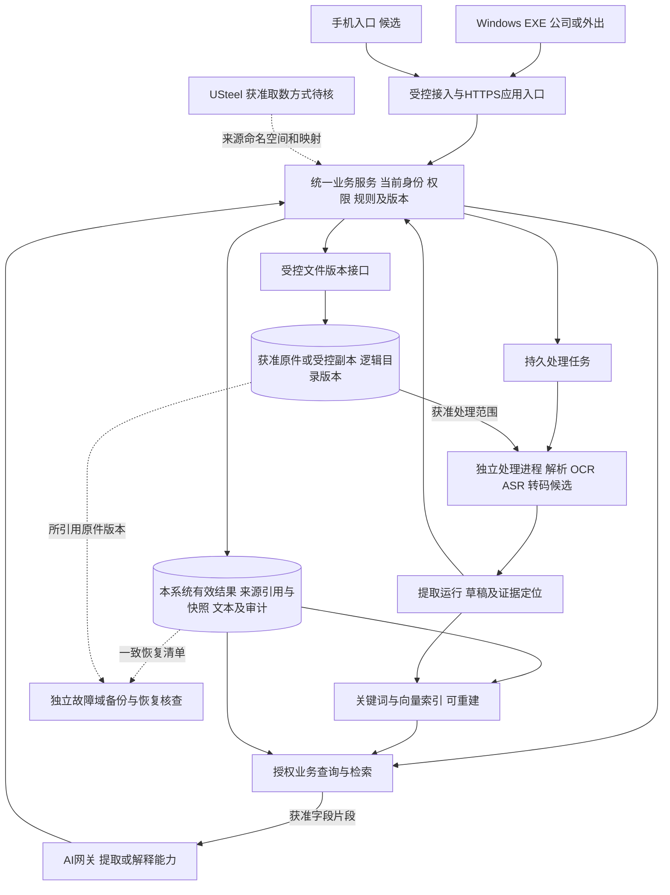
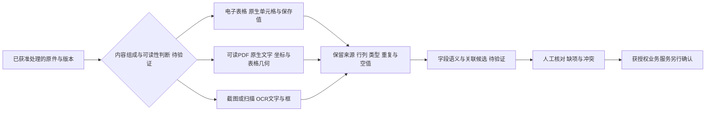

# 运行部署图与技术职责候选

日期：2026-10-26。整理：1号。revision：9。supersedes：revision 8之后补EXP-07有限PG确认机制、细阶段缺口与预期纠错；r8保全项目外。此前revision 7之后接入[系统设计总图](../../软件开发计划+施工清单/技术与部署方案/系统设计总图.md)，本稿保留组件、物理部署和技术证据明细；总图集中模块交接、要求映射及门槛，不新增实测或锁定候选。r7项目外保全，原用户设想及全部有限证据边界保留。状态：proposed／部署与组件职责图纸，非批准技术栈、采购或实施。

本轮已补局部实测、提取路由及统一证据图，见第7/8节；不改变整体部署、权限、接口及业务链尚未验证的状态。下文r1/r2/r3回执只证明各自原审阅范围，不自动覆盖本r9。

承接[核心流程设计r2](../产品经理调研/2026-10-26-关键反馈到老板查询设计草案.md)、[底座研究](2026-10-24-系统底座与技术职责调研.md)和[技术职责清单](技术职责与验证清单.md)。本稿将已有比较落到运行位置、调用方向及验证门槛，不重列整套产品百科。

## 先看这一页

用户本轮明确未来要“公司内外都能用，包括外出或家里”。这是设计方向，不证明目前网络、服务器或ERP已有远程能力，也不等于已经批准上云或外送原件。

建议研究基线是：**员工电脑安装EXE；手机通过待定轻量入口使用；大家访问同一套受控业务服务。正式记录与原件集中维护，AI帮助整理和查询。** 服务放公司还是云上，继续按资料边界、网络、维护与费用比较。

跨窗口原话补充：用户在2号提出共享文本业务资料统一云端主版本、大素材云存储、客户端按需下载/缓存、安装包不带完整业务库，开头明确“具体还是想看你的分析”。1号已实际回读该人类消息。故优先分析此云端共享主本设想，同时保留公司受控服务路线作为资料许可/运维条件下的对照，不把设想记成公司已批准的地域、采购或生产部署。本地Office随客户端的想法仍按格式、许可、包体/运行依赖及打印另论证，不能未经验证规定每机携带整套引擎。

| 放在哪里 | 主要负责什么 | 暂不预定什么 |
| --- | --- | --- |
| 员工Windows电脑 | 登录、上传、核对、任务操作、预览、按权限查看；必要的本地采集/预处理另核 | 不默认每台安装数据库、Office服务器和大模型，不放服务端数据库或模型供应商密钥 |
| 手机入口 | 提交选取的关键资料、补记及获准查看；与电脑共用业务规则 | 轻量浏览器入口是候选，原生App和具体采集能力未定；Windows EXE不能直接当手机端 |
| 共享服务环境 | 身份/授权、业务确认、统计、资料访问、异步处理调度与审计 | 公司受控环境或云服务待选；图中模块不代表每块一台机器或一个微服务 |
| 受控数据区 | 正式记录、来源版本、原件与备份；文本/索引按职责管理 | 不向员工设备直接开放数据库和裸文件目录；检索索引不是正式事实主版本 |
| 模型执行位置 | 按获准任务读取必要输入，返回提取草稿或解释 | 云端接口、自托管或混合仍需选择；远程使用系统不自动许可原件进入外部模型 |

## 1. 物理边界及调用方向

新系统所负责正式记录的写入，只能经业务服务和有权人的明确操作；模型不持该能力。ERP负责字段仍由已核维护方及其授权流程变更，当前不赋予新服务通用ERP写入能力。处理进程只写提取/草稿等限定对象，不能用读文件的服务身份代替员工的业务确认。EXE、手机、搜索、AI、附件、导出都遵守当前授权；远程组网或HTTPS只解决部分接入问题。

本系统维护记录与获准外部来源的引用/快照分开；源版本不因复制入库就成为新系统主版本。原件区只保管获准保存的原件/副本，外部受控引用在元数据中保留来源及版本；不是把全部ERP附件迁走，源生成与保管责任仍待核。具体10类维护边界与同字段冲突例见[2号候选表](../公开接续/2026-10-26-新旧系统记录维护边界候选表.md)。

图示不代表整件原件都进入模型；先做类型识别、已有文本提取及授权片段选择。后台处理范围、用户可见范围、外送范围分别核定。图中逻辑箭头不决定是否同进程或同库。

## 2. 组件分工与条件性候选

下表复用已有候选比较，未形成选型锁定。既有许可快照不等于本次完整依赖和分发审核，实际采用前仍固定版本复核。

| 职责 | 继续评估的候选／对照路线 | 输入→输出及选择门槛 |
| --- | --- | --- |
| Windows界面 | Tauri 2＋Web UI；对照.NET WPF | 用户操作→业务API及展示；核目标Windows、普通用户、文件/语音设备、打印及干净机器安装。Tauri的WebView2模式影响首次安装，WPF仅Windows，手机另有入口 |
| 业务服务与校验 | FastAPI/Pydantic或.NET等服务框架；具体框架比较仍待补 | 已鉴别身份/请求→规则核验、事务确认/受控读取及审计；框架本身不提供公司授权和业务规则，不接受模型任意SQL/动作直达正式库 |
| 共享记录与文本 | PostgreSQL；既有小型单服务SQLite及已有受管库作对照 | 正式事实、来源/草稿及文本元数据→可靠查询/版本/关系；不把共享盘数据库文件交各客户端直接写。容量、并发、备份与维护能力待测 |
| 编号、关键词及语义检索 | 参数化精确查询；PG字面/全文/pg_trgm＋pgvector；独立OpenSearch作对照 | 精确编号、中文术语或自然语言→获准对象/片段及出处；Embedding单独选，中文切词/别名/专业词和过滤召回须测，不能以相似度正式对单 |
| 文件、文件夹和版本 | 服务端受控文件目录＋元数据；SeaweedFS等自托管对象接口或托管对象服务作对照 | 字节及目录清单→原件身份/版本/访问与恢复；逻辑目录、空目录、显示名与存储键分开，采用哪条路线取决于大文件、规模和恢复验证；不默认旧MinIO候选 |
| 文件解析、OCR/ASR、Office | 既有解析/OCR/语音/Office专项候选；根据格式选任务而非统一万能引擎 | 文件类型/获准内容→带定位文本/字段或另存输出；普通文本先读现有文本，扫描再OCR，音轨/画面按用途处理。公式缓存不当业务真值、宏/外链不自动执行 |
| 长任务 | 持久任务记录＋处理进程；与Celery等成熟执行框架作对照 | 提取/转码任务→版本化结果及明确错误；核租约、重投递、取消、资源隔离和服务端OS，客户端关机不等任务完成；不能把队列重试当可重复业务确认 |
| 任务、审批及实际执行 | 先画显式转换表；django-fsm-2/Frappe按既有比较条件评估 | 人工事项和授权操作→各自结果与引用；不把状态库当完整人工任务产品，不把批准当已执行，详[状态机制比较](2026-10-26-任务审批状态机制开源借鉴比较.md) |
| AI与仪表展示 | 受控模型网关和查询工具；Web图表组件等沿既有研究 | 提取返回草稿，正式数值先由有口径的获准业务查询返回，模型解释、图表展示；供应商/权重/外送/预算及可切换条件待核，不用搜索片段相加算正式业绩 |

本轮定点回读官方[PG全文配置](https://www.postgresql.org/docs/current/textsearch-intro.html)、[pgvector混合与过滤](https://github.com/pgvector/pgvector)、[Tauri安装模式](https://v2.tauri.app/distribute/windows-installer/)及[WPF概览](https://learn.microsoft.com/en-us/dotnet/desktop/wpf/overview/)。官方机制支持这些职责候选，不证明longshi中文召回、安装、权限或性能达标；其余条目主要复用旧报告，未重新审查全部上游。

## 3. 内外访问的两种部署路线

| 路线 | 运行位置与便利性（候选） | 必须证明的条件及代价 |
| --- | --- | --- |
| 公司共享服务＋受控远程接入 | 正式记录/原件及相应处理进程在受控公司环境，外出电脑/手机经获准接入访问应用 | 公司设备持续运行、供电/出口上行/维护和恢复；手机接入可操作、远程设备可收回访问。是否允许中继/协调服务及其数据边界另核 |
| 云上共享服务＋HTTPS应用入口 | 应用服务/数据库/原件可在受管云私有网络内，电脑/手机访问应用入口 | 公司对资料位置、供应商访问、地域和备份的要求；运维责任仍需落实，费用含存储、处理、请求、流量及备份；云端不保证公司网络无故障 |

两者都须通过业务身份/对象/动作/字段授权，不直接公开数据库或原件路径；均不能说明USteel可以远程直连。若按对象分设公司与云端，需再论证跨环境传输、版本/授权和恢复依赖，当前不默认采用更复杂的混合拓扑。

当前只研究这两条路线，不配置网络、购买资源或上传公司原件。实际候选、许可及原始限制见已交的[4号路线比较r1](2026-10-26-公司内外访问与部署路线比较.md)：Headscale/Tailscale的控制面、客户端及托管服务范围不相同，自托管控制面也须审默认中继依赖。仅在资料允许获准云地域、目标网络可达、预算及维护责任成立时，优先验证云上HTTPS入口以减少手机组网配置；若资料须留公司且现场保障成立，验证公司服务＋受控远程接入。这是有条件验证顺序，不是已决定上云或采用组网产品。

## 4. 故障怎样表现，哪些不受AI牵连

下列继续能力都以相应业务、文件及当前授权底座仍可用为前提；逻辑独立不表示故障已物理隔离。详细能力矩阵及EXP-06/08/09三张纸面验证卡复用[3号降级职责](2026-10-26-资料搜索与AI故障降级职责.md)，均未运行。

| 故障 | 建议继续能力及提示 | 恢复需要核什么 |
| --- | --- | --- |
| AI/提取不可用 | 已保管资料仍可找回；允许的人工核对/业务操作继续，提取显示失败或排队，类别上报另按规则 | 按源/草稿版本重试，晚到不盖新人工核对，不多生成业务结果 |
| 向量/关键词部分故障 | 明确只用了哪些可用检索；精确业务记录若可读则走正式查询，不把降级空结果写成无业务 | 模型/索引代次和内容水位匹配；当前权限不能等索引重建才更新 |
| 客户端离线或业务服务不可达 | 不能正式确认/审批或获取当前进度；若采纳本地暂存，仅明示未提交，缓存另核保密与有效期 | 联网重核当前身份/关联/业务版本，查询不确定操作，不换标识重复执行 |
| 原件/存储不可用 | 已有记录显示依据暂不可读；新上传不得假报成功，不凭缺附件抹已确认结果 | 核引用原件版本和恢复清单，逐文件明确失败与重试 |
| 数据源过时或异步视图迟到 | 显示确认时点/来源和覆盖缺口，必要时回有效记录；不称现场刚更新 | 对账来源及版本；过时提示不把既有真实完成改成未完成 |
| 权限撤销或当前核权不可用 | 按生效规则停止不能完成当前核权的新增读取、处理/AI外送、结果发布及下载；不以旧会话、受限缓存或备用搜索绕过 | 恢复先核当前授权及源版本；已下载/已发送副本不承诺即时收回；离线授权和缓存若另需支持须单独论证 |

本表是逻辑预期，尚未测断网、性能或恢复。现有许可/平台风险及失败案例继续复用底座报告；不将多窗口工具的连通试验当未来业务系统可靠性。

## 5. 下一批验证按“任务和判据”准备

沿用[EXP台账](../技术验证/验证计划与验收样本.md)，不另建实验编号。以下为早先完整链路验证卡；接续部分组件实验已执行，具体范围集中见第8节及台账，不把局部证据扩大为整卡通过。

| 复用编号 | 最小验证范围与期望 | 不通过的判据／仍缺什么 |
| --- | --- | --- |
| EXP-06/08 | 固定同一中文/单号/别名语料和获准身份，精确、关键词、向量分别与有权集合对照；含索引落后及撤权 | 无权片段进入重排/模型、缺数据写0、中文关键术语找不到却声称完整即失败；可靠相关性标注及候选版本待定 |
| EXP-07/08 | 合成同一结果并发、撤权、更正及响应丢失；正式结果只产生可解释的一笔或冲突，重试核当前权 | 双记数量、旧结果覆盖新核对、撤权后生效或返回敏感缓存即失败；业务口径与隔离实现尚未批准 |
| EXP-09/12 | 中文重名/空目录/多版本/部分上传失败；隔离恢复数据库与被引用原件，核当前账号/引用/权限 | 缺文件却称恢复成功、复活旧权限或误发外部动作即失败；目标存储/保留期、RPO/RTO待核 |
| EXP-11 | 干净目标Windows、普通用户、首次无运行时/弱网安装与升级中断；公司/家庭/移动网络的电脑及手机入口登录、上传/下载、断线重连及撤权；核客户端与服务契约兼容 | 只在开发机能跑、外网手机不可操作、重连重复确认、安装后暴露服务密钥或换旧EXE却毁数据即失败；目标OS/架构、客户端版本、现用VPN冲突、签名及试验环境待定 |

验证产物应有输入/对照答案、固定组件版本、环境/授权、步骤、实际结果/错误、原件未改检查及限制。只读资料提取库已做的局部检查不能替代上表；低风险纯合成验证可先研究具体执行方案，安装/运行范围按相应授权推进。

## 6. 当前交付和未决事项

当前完成候选运行边界、职责/替代路线、故障表现及验证判据。服务位置、运维人、现场网络/设备、数据量、资料外送范围、可容忍停机/丢失时间、ERP主版本与接入未核；预算与采购未定。它们按相关设计/验证门槛补核，不阻塞继续画候选，不填成公司事实。

2026-10-26回原件增量：已有标记规则、工序去向、品质维护/验证关闭分工及五份固定字段样本已实际核出，见[核查结果与样本](../公开接续/2026-10-26-已有资料核查结果与可用样本.md)。验证不再笼统等待用户重交样本；资料/图示与组件实测分别推进。未知已收窄为具体跨源记录对应、当前适用和账号动作权限等，不把所有岗位/完成定义一律列未知。本r3未运行组件，也未对此前r1指定章节重复全审。

2号221交对象维护边界r1、3号222交搜索/AI降级r1、4号225交内外访问方案r1，1号均已实际全文读取。2号227审r1第1/2节接口，建议明确维护权不因集中存储转移；3号228审第1/4节及相关验证卡，建议补当前授权不可用行为和故障继续前提；4号229审第1/2/3节及安装恢复判据，建议补公司/家庭/移动网络和实际VPN冲突条件。本r2已合入。

1号另定点回读Headscale标签许可、官方部署要求及默认DERP配置、Tailscale官方托管控制面边界；其他发行、客户端/GUI和云责任等条目按4号来源账复用，不冒称全部独立审查。三方回执仅为r1指定范围纸面核对，不是r2独立复审、全稿安全审计、公司制度核实或运行验证。原件不外发、不改写；无正式业务代码、产品组件安装、生产连接、网络改动或Git推送。

## 7. 将本轮实测落到提取职责

[固定资料组件对照](../技术验证/2026-10-26-固定资料提取组件对照实测.md)已实际运行；此前本稿“未运行组件”只指当时的r3。以下是据此细化的候选分工，不是已实现的上传服务或自动分类器。

| 图中职责 | 本轮实际证据 | 仍需满足的门槛 |
| --- | --- | --- |
| 电子表格读取 | 两份表指定13项/21格与原XML及固定答案一致，重复和两类空值保留 | 新模板、公式缓存/重算、合并格和字段映射分别测；保存值不等于公司认可值 |
| 可读PDF读取 | pypdf默认标题失序、layout改善；接续pdfplumber默认取得本页表格几何，两条明细及目标空白经人工映射/视觉核对支持 | 一个版式的几何检测不等通用字段语义；合并格null和空字符串需保留，图片格无文字不等视觉空白 |
| 图片OCR | 同三图双倍率，显式v5 mobile候选指定区域优于现有Windows基线 | 其他模板/低清/裁切与数字单位；标签/提示语/值分开，开关状态不能仅凭文字推定 |
| 字段草稿与正式确认 | 本轮只有原生文字/框/单元格和限定对照，没有运行完整业务JSON或写入 | 按字段契约保留来源、不确定与未关联状态，授权核对及正式确认独立实现和验收 |

原生读取和OCR都只负责取得证据，不负责认定当前客户/订单、品质合格、进度完成或审批通过。处理进程内的模型/库可以替换；带版本的来源定位和业务确认边界应保留。尚未自动判断是否为扫描、自动切换或合并多路线输出，也未验证队列、隔离、重试、外网访问或部署。

同一工作簿/PDF可混有原生文字、表格和嵌图，图中分支可以并行处理不同内容，不能只凭文件扩展名选一路然后宣称读完。提取层须保留有图但无原生文字、合并覆盖位置、独立空白格等不同证据；字段层另区分标签、提示语、已填内容和控件显示状态。本段据有限实测提出，尚未实现自动路由或角色识别。

本节实际回读：2号264、3号265、4号266，均确认所读职责及有限验证边界，未报实质冲突。仅本节与组件对照r3第5节，不是r4整稿复审、部署验证或公司规则批准。

## 8. 现有证据集中看：哪些部件有依据，哪些还不能定稿

本节proposed，汇总既有报告，不新增运行或宣称完整链路通过。旧回执不覆盖本r9；新增上传/恢复证据见本节对应行。

| 技术职责 | 已有实际依据 | 仍未解除的门槛 |
| --- | --- | --- |
| 原件提取 | [固定对照](../技术验证/2026-10-26-固定资料提取组件对照实测.md)与[跨版式](../技术验证/2026-10-26-跨版式提取与字段归属验证.md)：限定图片/原生表格/PDF已跑，错误、图片格及合并异值已留证 | 通用字段角色、订单明细关联、低质资料拒识及人工核对尚未整链验证 |
| 精确与相似搜索 | [检索实测](../技术验证/2026-10-26-合成语料关键词与语义检索实测.md)：限定SQL、三个BGE排名探针及重排已运行 | 中文索引在当前构建两配置仍有负结果；原员工Q、混合检索、完整授权和真实问句路由未验 |
| 对象/片段授权 | [权限实测](../技术验证/2026-10-26-合成权限与AI资料边界实测.md)：冻结profile的226内核决策及八类边界 | 真实认证、公司角色/字段、级联规则、跨进程同步和竞态未验；既发文本不能声称召回 |
| 受控结果与图表 | [一致性实测](../技术验证/2026-10-26-查询结果到图表的数据一致性实测.md)：24提案、107适用输出对照及两个实际合格导出到ECharts SVG | 可信查询包的真实产生、公司指标/覆盖、自由解释语义、字体/交互/正式界面未验；图表能画不等数据正确 |
| 正式业务确认与防重 | [确认机制实测](../技术验证/2026-10-26-确认防重并发超时与更正合成实测.md)：最小PG事务的重复/并发/应用超时、回滚、更正及弱实现反例有证据 | 非正式系统；额外细阶段未采齐，NC旧契约错误及r2后置纠正保留。真实完成/数量/映射/权限、崩溃和副作用仍未验 |
| 原件保管与恢复 | [合成实测](../技术验证/2026-10-26-资料上传版本与备份恢复合成实测.md)：六类上传/最小登记及三类静止集合恢复；T01竞态不足、Windows整树恢复失败与各自复测保留 | 非公司整链；并发/崩溃原子性、在线跨存储、生产PG、当前权及未完传输恢复未验；存储/保留/恢复目标待定 |
| EXE、手机及内外接入 | 已比较运行位置和远程路线；现有工具的基础检查范围独立登记 | 正式客户端打包/升级、目标机器、手机及实际网络、维护和部署尚未联验 |

当前建议分工保持：提取器给证据和草稿，检索给候选，业务服务负责对象/权限/规则/有效记录与统计，AI提取或解释，图表绑定受控结果。以上不等于锁定所有组件，也不默认每个逻辑模块独立部署。

保管/恢复契约r5与限定合成实测已接续完成，下一段收敛模块、数据流、状态与验收门槛；真实运行的并发/崩溃一致性继续列缺口，同时把稳定明细关联、实际完成及确认权、关键统计定义列为相应设计定稿门槛。已有资料先查，不发整套问卷；真实规则缺口不能由合成实验代答。不以实验数或到期代替可实施方案及用户正式开发确认。
