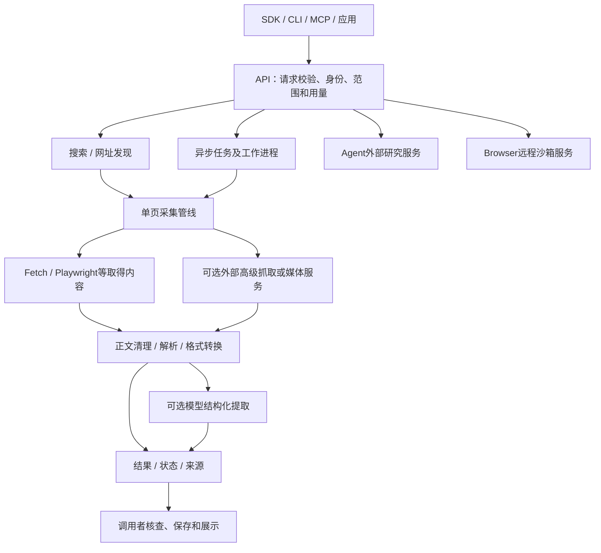

# Firecrawl 功能全景与 REA 静态核查

2026-10-30，revision 1。来源：用户先要求借助已学习的REA研究Firecrawl并优化，随后明确选择“先完整研究Firecrawl的功能，再决定改什么”。本轮按此后续指示完成主要功能层面的研究、固定源码核对和有限静态运行，不开展功能修改或部署。

## 先看结论

Firecrawl已经有公开源码，不需要先用逆向工具把它“变成开源”。官方仓库根许可证为AGPL-3.0；REA自身为MIT。源码许可、云服务使用资格和各第三方服务费用分别处理，不能把两者统一当成MIT或全部免费。

Firecrawl更接近一套“网页发现、获取、解析、交互及数据交付服务”，既不是只有正文提取，也不是包含全部云端能力的可直接打包Windows浏览器。适合学习其能力分层、异步任务、输出格式及来源记录；是否采用自部署、云API或局部借鉴，应在明确优化目标后决定。

对运营项目尤其关键：默认自部署核心并不包含完整的Agent、Browser、Interact及高级浏览器服务。自己跑起来可以控制基础设施，但不能据此承诺复刻完整Firecrawl Cloud、零费用全网研究或稳定取得所有短视频评论。

## 本次实际做了什么

- 先查技术学习库，回读2026-10-26的REA原报告；旧结论是已学习、未安装，并非此前已接通工具。
- 获取Firecrawl与REA的仓库元数据、固定提交及目录树；保存所选源码、许可证、官方说明与字节SHA256。
- 在项目外隔离安装`rea-agents@6.8.0`，使用现有Node 24.22.1。安装使用`--ignore-scripts`，未执行安装脚本、全局setup或注册MCP。
- 实际运行REA版本、doctor及`analyze-javascript-application`。静态分析退出码0：17个相关文件，其中16个源码文件完成解析，未报告解析失败；1161项findings是工具观察项，**不是1161个漏洞或已验证功能**。
- REA明确报告图覆盖不完整、动态关系未知、静态关系不证明运行。分析对象只是所选源码副本，不是整个仓库、完整部署或云端服务器。
- doctor退出码1：Node和Windows宿主可用，但原生分析器与客户端注册未配置。本任务的JS/TS静态分析实际成功，不据此补装Ghidra、IDA等无关工具，也不宣称REA全能力就绪。
- 回读全部已取得专题说明的主要功能、使用条件和限制，并对Agent外部服务、Browser外部服务、Playwright适配和视频外部服务作人工源码定位。

本轮没有启动Firecrawl服务、调用自主Agent研究任务、上传公司文件、接入真实账号、修改运营素材库、发布仓库或配置定时任务。安装的只有隔离REA及其依赖；不能写成“没有任何新安装”。

## 版本与来源身份

| 对象 | 本次固定身份 | 含义 |
|---|---|---|
| Firecrawl主仓库 | `b4f23178e7f3121fa39ce20c11fc30165d0ce631` | API查询未归档，最近push 2026-10-30；不是部署验收 |
| REA参考源码 | `317bf3fe235e655b2d752d3be261cc0da7d00f2b` | 未归档，package声明6.8.0 |
| 实际运行REA | npm `rea-agents@6.8.0`，pnpm锁文件 | 以发布包运行，不声称包内每字节等于当前主分支；锁文件保留来源完整性字段 |
| 自部署官方示例 | 文档固定`v2.11.162` | 不把它与本次主分支快照当相同版本，也未在本机执行 |
| 官方网页 | 本轮下载的Markdown快照 | 网页会更新；证据清单保存获取内容哈希 |

官方入口：[Firecrawl源码](https://github.com/firecrawl/firecrawl)、[REA源码](https://github.com/morluto/rea)、[Firecrawl能力表](https://docs.firecrawl.dev/capabilities)、[自部署说明](https://docs.firecrawl.dev/contributing/self-host)。

## 功能全景与使用边界

这里的“全景”覆盖主要产品能力类别和接入方式，不表示穷尽每个API参数、语言SDK、企业套餐或第三方数据提供商。文档支持、源码位置和本机运行分别标记。

| 能力 | 输入与产出 | 重要条件／容易误解之处 | 本轮证据 |
|---|---|---|---|
| Search搜索 | 查询词→网址、标题、摘要／相关片段；可附正文 | 搜索发现不等于读完来源；附抓取会增加费用；不同搜索类别和提供商有差异 | 官方Search及控制器 |
| Scrape单页 | URL→Markdown、HTML、链接、元数据等 | 检查目标页面statusCode；接口success不证明目标页成功，更不证明正文完整 | 官方Scrape及控制器／引擎 |
| Map网址发现 | 站点→候选URL清单 | 站点地图、索引等共同发现；只列URL不等于已读正文，也不保证站内所有页面 | 官方Map及控制器 |
| Crawl递归采集 | 起点、范围、深度、条数→异步采集结果 | 只能覆盖实际可发现可读取范围；显式设limit，不直接使用大默认值 | 官方Crawl、路由 |
| Batch Scrape批量 | 指定URL列表→一批结果 | 不负责无限发现；需处理任务ID、分页、错误及取消 | 官方Batch |
| 结构化提取 | 单页＋字段schema／说明→JSON | LLM模式要模型或云端能力；字段齐全不证明事实正确，允许缺失项 | 官方JSON mode、llmExtract源码 |
| Agent自主研究 | 目标＋可选URL／schema→多来源研究结果 | 支持未知URL起步；默认自部署无完整后端；需核预算、来源及停止状态 | 官方Agent、agent.ts |
| Interact页面交互 | 已抓页面／URL＋提示或代码→动作与结果 | 云端会话，可点击、填写、滚动；不等于本地Windows窗口或任意账号权限 | 官方Interact、scrape-browser.ts |
| Browser Sandbox | 创建会话→远程浏览器、CDP、实时查看和执行结果 | 云端独立沙箱，与Interact入口分清；会话须关闭，不能当本地内置浏览器已实现 | 官方Browser、browser.ts和hangar.ts |
| 登录会话Profile | 指定profile→恢复／按许可保存浏览器状态 | 需要目标站正常登录；同一profile写会话限制；不复制本机浏览器就自动生效 | 官方能力表与Interact |
| Parse文档解析 | 文件上传／公开文档URL→正文、PDF分页／布局、结构化输出 | 需检查实际页数与总页数；上传是外发；复杂表格与OCR质量应另验 | 官方Parse、parse.ts |
| 音视频相关格式 | 支持页面／媒体→音视频资源等专门输出 | 源码调用外部媒体服务；签名链接可能过期；资源提取不等于看懂视频、读完评论或核对工艺 | Scrape格式说明、video.ts |
| Change Tracking变化比较 | 当前页与历史快照→新建／相同／变化及diff | 单次对比原语，不等于已经安排定时；需比较基准和范围 | 官方Change Tracking |
| Monitor持续监测 | URL／站点／搜索目标＋周期→检查记录和通知 | 页面、站点、搜索三类；自部署运行还需认证、数据库和调度依赖；本轮未创建 | 官方Monitoring、monitor.ts |
| Webhook | 异步事件→外部接收端 | 验签、重复事件和乱序须处理；收到通知不直接等于业务入库完成 | 官方Webhook及安全说明 |
| 缓存与时效 | maxAge等→复用缓存／取得更新内容 | “快”可能来自缓存；要区分抓取时间、页面更新时间及缓存年龄 | 官方Fast Scraping与Scrape |
| Alexandria数据工具 | 搜索发现提供商→读契约／价格→返回结构化记录 | 不是普通网页抓取；提供商覆盖、权限、费用和结果来源分开检查 | 官方Alexandria；本轮未执行提供商 |
| 专题搜索 | 开发者、研究等专门检索 | 来源库与字段不完全相同；源码有未来research类别切换提示，不能提前当当前已生效 | 官方Research、search.ts提示 |
| 企业控制 | 数据保留、SSO、访问／密钥／威胁控制、审计等 | 依产品／套餐／部署配置，不从核心开源仓库推导为全部可用 | 官方Security与能力表 |
| SDK／CLI／MCP | 同一服务向程序或助手提供调用入口 | 安装客户端不等于部署后端；MCP主机实际工具列表可能少于完整API | 官方MCP及SDK说明 |

专题依据：[Search](https://docs.firecrawl.dev/features/search)、[Scrape](https://docs.firecrawl.dev/features/scrape)、[Map](https://docs.firecrawl.dev/features/map)、[Crawl](https://docs.firecrawl.dev/features/crawl)、[Batch](https://docs.firecrawl.dev/features/batch-scrape)、[JSON](https://docs.firecrawl.dev/features/llm-extract)、[Agent](https://docs.firecrawl.dev/features/agent)、[Interact](https://docs.firecrawl.dev/features/interact)、[Browser](https://docs.firecrawl.dev/features/browser)、[Parse](https://docs.firecrawl.dev/features/parse)、[Monitoring](https://docs.firecrawl.dev/features/monitoring)、[Alexandria](https://docs.firecrawl.dev/features/alexandria)。

## 架构与源码核对

本次Compose快照涉及API、Playwright、Redis、RabbitMQ、PostgreSQL，以及实验性的可选FoundationDB路径。Compose中的资源限额是配置，不是已验证最低配置。未启动这些服务或挪用本机实验数据库。

关键定位（均相对固定Firecrawl仓库）：

1. `apps/api/src/routes/v2.ts`列出API入口。路由存在只说明对外接口，不能单独证明底层服务随仓库完整提供。
2. `controllers/v2/agent.ts`在未配置`EXTRACT_V3_BETA_URL`时拒绝，随后将研究请求交给该地址。不能把这个控制器称为完整自主研究引擎。
3. `lib/hangar.ts`在未配置`HANGAR_URL`时返回503，并通过HTTP调用浏览器服务。本文件是额外取得、人工阅读的证据，**不属于先前REA所分析的16个源码文件**。
4. `scraper/scrapeURL/engines/playwright/index.ts`调用`PLAYWRIGHT_MICROSERVICE_URL`；`fire-engine/available.ts`依据配置判断高级引擎可用性。两种引擎不能互相冒充。
5. `scraper/scrapeURL/transformers/video.ts`调用`AVGRAB_SERVICE_URL`进行媒体发现等操作。有这段适配器不等于该媒体服务已在本机运行或支持所有平台。

因此更准确的学习对象包括：公开核心实现、外部服务适配层、云产品契约，以及需要我们自己完成的业务流程。REA帮助记录静态结构和证据，不能从适配层恢复未公开远端服务。

## 云服务、自部署与成本

| 路线 | 得到什么 | 仍需承担什么 |
|---|---|---|
| 使用云服务 | 托管核心和相应云能力 | 套餐／积分、会话时间、提供商费用、数据流及目标站限制 |
| 自部署核心 | 源码与基础设施控制，核心抓取管线 | 多服务维护、存储、升级、备份、搜索／AI等依赖；默认不等同云功能 |
| 源码借鉴／局部适配 | 能针对现有软件少量集成 | 逐文件／依赖许可、上游更新和行为回归；不是复制品牌与云账号体系 |

官方账单按接口与选项计费，不存在“每调用一次都统一扣一点”的可靠估算。普通单页、搜索结果、PDF页数、模型格式、浏览器分钟和提供商能力分别计量。云端接口返回了错误页面的文档也可能收费，所以还应核目标statusCode和正文质量；不能只检查HTTP200。

本轮未读取账户账单、申请额度或购买服务。专家聊天中的“每月1000免费”未被核实，不能作为预算依据。自部署也不能理解成服务器、模型、维护与网络都免费。

来源：[Billing](https://docs.firecrawl.dev/billing)、[Rate limits](https://docs.firecrawl.dev/rate-limits)、[Open Source vs Cloud](https://docs.firecrawl.dev/contributing/open-source-or-cloud)。

## 已见失败记录与需防止的误判

- 旧Issue [#2139](https://github.com/firecrawl/firecrawl/issues/2139)报告v2.1.0自部署搜索返回空结果，而crawl/scrape仍工作。本轮回读Issue元数据与原文，状态已关闭；这只是特定旧版本的外部失败记录，不证明当前快照存在同一故障或本机已修复。
- 本次两条猜测文档路径404，已通过实际链接补取`contributing/guide.md`与`features/alexandria.md`，旧失败保留在清单。404不证明产品没有相应功能。
- 本聊天较早有一次Firecrawl插件Transport closed；后续开发者检索已成功。连接故障与采集内容质量分开，没有为凑成功反复访问受限平台。
- REA的doctor非零与特定静态命令成功分开记录；“安装成功”不等于原生provider、MCP注册和所有工具就绪。
- 研究辅助脚本最初导入采集脚本时重复获取一轮公开证据，已改为无该导入副作用；不是Firecrawl产品缺陷，也不计作产品性能证据。

## 对运营项目的适用性与尚未选择的优化方向

Firecrawl适合作为“来源发现／网页取得／结构化交付”的候选能力，不能自动补出不存在的客户处理结果。短视频评论、账号会话、回复关系及视频工况仍需专门样本验证。Cloud Browser是远程沙箱，与已讨论的本地Windows工作台可集成但不是同一个东西。

以下只列候选，不据“研究完整功能”指示进入修改：

| 候选方向 | 可能价值 | 真正要比较的验收 |
|---|---|---|
| 能力与依赖预检查 | 提前知道哪些接口依赖云／模型／浏览器服务 | 缺依赖时准确说明，不把空结果当没资料 |
| 成本与时效可见 | 明确缓存、本次预算、失败扣费和会话存活 | 对照实际用量；不能只增加一个进度动画 |
| 原文与业务判断分离 | 保留原话、来源、范围与未取得结果 | 回原出处抽核，不跨事件拼成功故事 |
| 故障分类与续跑 | 已取得内容不丢，重试不重复整理 | 中断、超时、部分成功、重新启动分别实测 |
| 按内容选择后端 | 正文、浏览器、媒体工具各取所长 | 同一组真实样本比较质量、耗时、费用与失败 |

这些方向有些Firecrawl本身已有部分能力，后续先核现有API和客户端支持，避免重复实现。未决定修改核心、增加外层适配还是只改运营应用。

## 需求与证据追踪

| 用户要求 | 本轮落点 | 状态 |
|---|---|---|
| 找回REA学习并使用 | 回读旧报告、隔离6.8.0、版本／doctor／静态输出 | 有限静态实际运行 |
| 先完整研究主要功能 | 功能全景、接口边界、云／本地差异与专题原文 | 主要能力类别完成资料核查；非逐参数或逐模块穷尽 |
| 判断源码能否复用 | 固定提交、LICENSE、架构和外部依赖定位 | 已核公开证据；非完整分发许可审计 |
| 然后再决定优化 | 候选价值与验收对照 | 尚未选择和实现 |
| 为实际项目减少试错 | 保留原素材库和新浏览器方向，指出可复用与待验路径 | 分析建议；未集成、未产品验收 |

## 后续验证清单与证据目录

资料研究之后仍需逐项运行：固定版本自部署基本抓取；公开静态／JS／PDF样本；搜索空结果与后端依赖；缓存时效；队列取消与恢复；当前模型JSON缺项与证据；浏览器会话及正常关闭；目标平台少量真实评论及父子关系；使用费用与相同样本对照。未执行项不能写成通过，也不能从公开源码静态图反推出云服务性能。

项目外证据根：`E:/AI-Tools/longshi-components-20261026/outputs/firecrawl-study-20261030/`。

- `repo-index.json`、两个仓库metadata/commit/tree：固定来源。
- `source-manifest.json`、`extra-manifest.json`：下载结果、失败、文件SHA256。
- `official-docs/`、`official-docs-extra/`：专题正文快照；没有下载视频或遍历真实平台。
- `firecrawl--firecrawl/source/`：REA使用的部分源码容器；`source-extra/`是后续人工补读，未混入原Evidence。
- `rea-runtime/`：隔离发布包、package.json与pnpm-lock；`pnpm-store/`为本任务依赖缓存。
- `rea-run-index.json`、`rea-version.stdout`、`rea-doctor.stdout`、`rea-static-api.stdout`及stderr：实际执行结果与限制。

本报告是研究成果，不是已优化的软件或可部署安装包。当前不发布、不推送、不变更其他聊天的代码和任务。
