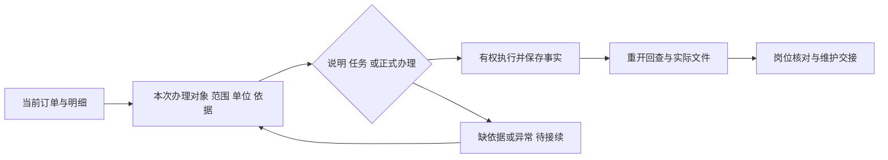

# 十二家公司系统逐项解读：流程、好设计与适用取舍

2026-10-31（Asia/Shanghai），revision 1；任务lsr-voe，components-research-1026。用户要求“都看一下，把它们的系统项目解读一下，看看哪些方面好，值得我们去学习”。承接[十二家案例初筛r2](2026-10-31-新增十二家公司已落地系统案例与借鉴.md)，本稿增加逐家流程重建、理由、代价和对应检验，而非再次列软件名称。

**结论：值得学的是业务对象清楚、员工输入少、结果有依据、异常能接着办、重复工作可复用，以及有人维护。** 钢材业务设计优先参考Array Metal/科林；系统分工参考创想三维；模板与客户跟进参考Udawat；研究浏览器参考Musixmatch/Bordr；协作组织参考视源/Huel；资料服务参考Jung von Matt。下面“建议/检验”均为研究候选，未新增业务功能或改变原聊天施工。

## 0. 实际读到哪里，以及一处补充

- 复用并回读上一轮12家公司公开案例正文；补读Udawat与Parikh实施商完整业务正文，增加9页官方机制/实施资料。原24页证据仍按原哈希保留，本轮新增快照另存项目外。
- 实看Bordr生成文件流程图、Musixmatch工作流片段，以及科林/创想三维公开案例整页截图；对创想CRM图、异常/MES图和科林安灯图作三处放大查看。图的主链和可辨节点用于核对，模糊小字不当作已核字段。
- 六个简道云图片直链返回403；没有伪装登录/绕过验证。改用可公开访问的原文章正常渲染截图，取得两页图文；不能声称其余四张直链已看。页面内视频未播放、未转写，本轮不是新增视频学习。
- 所有“业务链”是按案例材料重建的逻辑示意，不是取得了客户数据库、接口契约或实际部署拓扑。没有进入12家公司私有后台或检查生产日志。
- **Udawat范围补充：**2026-07-31实施商文章（页面标修改2026-08-05）称报价、Product Templates及Field Marketing已上线，仍在最后培训；财务仍用Tally。模板/外勤是定制应用。故收紧原初筛为“已有上线应用/仍在培训”，不当作整套ERP长期稳定运行证明。原r1字节保留，初筛r2已更正。[实施商原文](https://www.girmantech.com/blog/grain-milling-machinery-manufacturer-automates-quotations-with-erpnext-in-tamil-nadu)

## 1. Array Metal：按物料和订单的实际流动组织系统

**系统与链条。** 金属制造企业采用ERPNext；按案例重建为：客户订单→库存/采购准备→工单或外协→检验与材料消耗→分批交货→应收与对账。案例同时提到多仓、卷材重量、单位换算、废料和岗位工单。

**好在哪里。** 同一业务在销售、仓库、生产和财务之间有连续记录，能区分货在哪、哪批已交、哪些材料送外协；这比只维护一个“完成百分比”更有业务价值。实施商描述先清数据，再分模块导入，配培训和上线支持，说明落地工作不止开发页面。

**我们可学。** 订单概况提供“已知已办/仍待办/异常/依据”的入口；明细保留实际范围、数量单位和相关材料，不把计划、实际出货和客户收货合并。沿用现有订单/任务/资料关系设计，不能据别人的模块反向决定隆实首批范围。

**不能直接照搬。** 官方UOM机制按转换系数把交易数量换成库存数量；这不证明客户为每块不等重钢材的实际重量解决了问题。件数、尺寸、理论重量、实重、计价重量仍需分清，系数/精度/舍入要有公司依据。库存维度能按属性看数量，官方文档又明确不维护维度级估价；“按属性查库存”不等于“按订单算真实利润”。

**建议检验，未执行。** 一笔虚构单分两次出货，件数和重量分别记录；另留外协未回范围。每次列表与原单读回一致，未知余量不自动补零；改计量规则不悄悄重算旧单。公司G01/G04仍待依据，不借案例填默认。

来源：[客户案例](https://frappe.io/stories/Array%20Metal%20(M)%20SDN.%20BERHAD)、[实施过程](https://www.matiyas.com/case-studies/array-metal-digital-transformation-erp/)、[官方UOM机制](https://docs.frappe.io/erpnext/Selling-in-different-UOM)、[库存维度及估价限制](https://docs.frappe.io/erpnext/inventory_dimension)。ERP文档用于解释当前通用机制，不证明客户当时版本/定制实现。

## 2. Udawat：模板复用，加上报价后的跟进

**系统与链条。** ERPNext Selling负责标准客户/报价；Frappe定制Product Template与Field Marketing负责设备组合、拜访/费用/情报。链条为：询价→选常用设备配置→带出明细并人工调整→选择报价展示格式→记录报价状态/下次跟进→外勤拜访补反馈。

**好在哪里。** 它把反复劳动从“每次重新写一份报价”改成“复用已整理的配置，核这次差异”。同一报价支持逐项或分组展示，无须为客户不同格式重建业务数据。外勤情报也有落点，竞争对手设备、客户反馈不会只留在个人记忆中。

**我们可学。** 钢种/规格/加工要求/交货条件可逐步形成有来源的常用模板；客户本次差异必须可检查。运营采集到的痛点和证据可经人工筛选形成市场情报，关联后续客户需求，不能把匿名网友自动登记为客户。

**不能直接照搬。** 这是已上线但仍培训的销售/外勤范围，财务仍在Tally；不存在“免费装ERPNext就得到该整套定制”的证据。GPS、费用、地图与现场数据都有额外维护和权限成本，当前不因案例新增这些功能。

**建议检验，未执行。** 相同虚构内容生成两种报价版式；调整模板后，旧报价及其已交文件保持原版，本次差异单独留存；未知单价不让AI补写。这是我们的候选校验，不声称Udawat已实现模板历史锁版。

来源：[Frappe案例](https://frappe.io/stories/Udawat%20Engineering%20Company)、[实施商模块与当前阶段](https://www.girmantech.com/blog/grain-milling-machinery-manufacturer-automates-quotations-with-erpnext-in-tamil-nadu)。

## 3. Parikh Power：把迁移当作业务交接

**系统与链条。** 由旧定制软件转到ERPNext，公开范围重在进出口、多币种、单据与财务。可重建为：客户/供应商及历史数据整理→交易单据办理→物流文件配套→结算与报表→岗位培训/支持。

**好在哪里。** 实施商把需求分析、数据迁移、培训和持续支持与配置一起列出，客户CEO也具名评价过渡过程。这是“有人能持续接着办”的案例，适合学习迁移组织。

**我们可学。** 每项旧功能记录保留/替代/暂缺，旧编号与新记录怎样查回、员工如何找历史附件都要讲清。现有36组迁移清单继续作为基础，不能只迁几个漂亮页面。

**不能直接照搬。** 公开原文没有足够迁移校验明细、失败处置或运行日志；“100%合规/效率提高”只是来源主张。它不是已经验证的车间MES，也不能将印度税务当隆实规则。

**建议检验，未执行。** 用已授权的合成旧单做字段/附件/状态对照，保留旧定位；重复导入不重建同一单，缺失字段有清单，失败后可停止/恢复；验收输出应由熟悉业务的人核。

来源：[客户案例](https://frappe.io/stories/Parikh%20Power%20Pvt%20Ltd)、[实施商原文，标2026-09-09](https://sawindia.com/case_studies/parikh-power-pvt-ltd)。原文迁移细节有限，所以该项主要参考组织方法。

## 4. 科林电气：先把生产事实记下来，才能改善

**系统与链条。** 品牌柜事业部的透明工厂、物料台账和安灯应用。链条为：扫码定位产品→登记工序动作/数量→按流程交接→统计耗时；发生质量/缺料/设备问题则进入对应处理分支，再反馈。

**好在哪里。** 现场员工只做与眼前工序相关的小动作，管理层从记录中看耗时、异常和余料。先快速做demo再多次迭代，发现真实操作负担后调整。公开安灯图有不同问题分支，说明异常不必都塞进普通备注里。

**我们可学。** “当前这单这行发生了什么、影响哪一范围、下一步谁接”应比让人填长日报容易。主管看待处理问题和依据，统计随业务积累；现阶段先把普通说明与正式加工结果区别落实。

**不能直接照搬。** 原文明确自动排产仍需基础数据，并非当时已经上线。现场扫码不证明工序合格，也不证明软件能联锁停机。案例把领料与完工数量差用来管理废料，隆实不能未经同单位、在制/余料/损耗规则核对，就据差额认定废料或员工责任。

**建议检验，未执行。** 一条说明、一个异常、一次正式局部结果分别走原授权流程；只影响明确范围。正常记录快填，异常可补证；缺依据时正式结果不生效。G04未核，不以二维码代替依据。

来源：[案例正文与公开安灯流程图](https://www.jiandaoyun.com/index/customer_case/13446)。已观察案例图，不是客户后台点击测试；事业部经验不外推集团。

## 5. 创想三维：前台好用，底座分工清楚，同步异常单独管

**系统与链条。** CRM/MES在简道云，ERP在SAP，分析在FineReport。公开CRM图显示客户/物料/价格等主数据与申请、报价合同、库存/回款等有不同流向；MES图显示SAP生产单下发、过站/测试、入库与报工回传。

**好在哪里。** 员工面对贴近岗位的入口，专业系统继续负责其原有工作；报表从业务数据产生。案例特意展示订单同步失败提醒，把“前台流程结束”与“另一系统已收到”之间的缺口暴露出来。

**我们可学。** 页面、业务事实、原件/报告各有明确负责方；将来获准接ERP时，以对象/原操作定位同步结果，不把两边都当可任意覆盖的总库。异常清单应能回到原订单、错误、责任与下一步；运营浏览器也区分搜到、读到、证据合格和文件已交。

**不能直接照搬。** 图只说明方向，不证明事务跨系统原子完成，或已经解决所有防重/撤权问题。定时提醒“测试位可释放”不等于产品实际测试合格；漂亮大屏也不能修正源数据。同步接口、生产访问与企业微信外发均须独立授权。

**建议检验，未执行。** “服务端已写、回执迟到”时查原结果；另一系统不可用时显示待同步而非成功；同次重试不生成第二单。复用已有虚构迟回实验，真正连接ERP仍待公司条件。

来源：[客户案例及CRM/MES架构图](https://www.jiandaoyun.com/index/customer_case/16795)。接口可靠性检验为我们的推导，不冒称客户已按此协议实现。

## 6. 视源股份：需求沟通与运维规范同样重要

**系统与链条。** 业务提需求→ITBP做可体验原型→岗位试用反馈→按规范交付/运维；海外业务另有总部出库→在途→收到/清关→库存引用→销售合同。

**好在哪里。** 用原型降低业务人员表达需求的门槛，同时有IT规范、培训、指导和案例分享。不是每个新需求都独立采购一套，也不是把业务人员会搭表当成不需要维护。

**我们可学。** 我负责把要求转成场景、图纸和检查项；实际岗位给真实判断，维护者接部署/恢复。用户只需审工作是否方便，不承担代码/制度全部验收。公司内外访问要连同岗位权限考虑。

**不能直接照搬。** 在途转库存的业务触发取决于该公司的贸易流程，隆实完成/收货定义不能套用。“一周上线”是个别人力应用，不是整套ERP工期；上百应用也会带来维护负担。

**建议检验，未执行。** 用一件完整员工工作检查页面、返回结果和交接；换角色看不到未授权资料，只有原型不能勾成上线。原1号工作卡r3已有方法落点，属于沿用，不计本轮新增实现。

来源：[ITBP与海外进销存案例](https://www.jiandaoyun.com/index/customer_case/13806)。

## 7. 柳钢相关厂区：手机是定位对象和交接证据的入口

**系统与链条。** 设备建档→扫码/报修选到具体对象→文字/照片/视频描述→派给维修人员→带着信息处理→汇总记录与看板。

**好在哪里。** 维修人员出发前有问题信息，管理者不必只靠电话追问；同一设备的记录可以积累，而不是每次重新解释。

**我们可学。** 给任务和资料带上明确订单/明细/问题归属，减少重复录上下文；接收人需要看的是能办理任务的必要内容。已有任务/资料关系继续收拢，而非新增第二套业务库。

**不能直接照搬。** 二维码可复制，不能据静态码保证巡检到场；附件要按当前权读取，不能通过关联意外开放整单。原文集团/子公司叫法混用，不将某厂区应用规模外推。安全监测不能被普通提醒软件替代。

**建议检验，未执行。** 虚构任务带一份有权资料，接收人能看必要内容；换对象不串图/串记录，撤权后重读受控。沿用当前项目的精确引用和迟回要求。

来源：[维修/巡检案例](https://www.jiandaoyun.com/index/customer_case/11712)；本轮未声称直链被拒的维修图已实际查看。

## 8. Musixmatch：把复杂能力藏在员工会用的任务后面

**系统与链条。** 员工从模块库选任务→调已封装内部API→按条件处理→返回结果/通知。已看工作流片段：先判断歌词是否存在，分别走分析更新与补取资料分支；它并非一个模型包办全部动作。

**好在哪里。** 业务人员不用理解内部数据结构；工程团队把难点做成模块，多任务复用。内部/生产环境及团队项目分开组织，可逐步迭代。

**我们可学。** 运营入口可以是“找某钢种某故障案例”“整理当前页”“按模板导出”，用户改少量参数；固定程序做读取/定位/导出，模型做受约束判断。企业系统未来查询同样可基于明确动作提供服务。

**不能直接照搬。** 图中存在分析节点，不代表实现开放式自主Agent，更没披露模型算法。原案例Agent是后续方向；当前0.2.5的配方是执行快照/可复制指令，不等于已拥有完整可视化模块市场或导入运行器。

**建议检验，未执行。** 同一任务换钢种不残留旧参数；完整案例/缺结果/跨事件样本分别判；Excel和原文对应。先验证已有配方，不为复用思路换浏览器或安装n8n。

来源：[客户案例与工作流片段](https://n8n.io/case-studies/musixmatch/)。

## 9. Bordr：稳定的文件交付由一串可检查步骤完成

**系统与链条。** 订单表单→登记/分派→按条件选择文件模板→文档服务生成→保存文件→更新订单记录→交付/状态通知。已看PDF图中可辨的Airtable触发、批处理、模板分支、HTTP请求、S3、回写和等待节点。

**好在哪里。** 标准内容复用模板，变化内容按字段填入；订单、文件和请求有记录。生成、存好、发给客户是不同步骤，失败点可以定位。

**我们可学。** 报价、日排单或研究报告采用固定模板/数据绑定；业务事实和版式分别负责。把文件名/版本、所属单、生成状态及实际打开检查放进交付，而非每次让模型从头排版。

**不能直接照搬。** 图可见固定等待5秒，但不能据此推出第三方生成永远完成；多个服务间也没有自动获得事务一致性。等待时间、重试不等于防重复。我们已有文件快速通道有限计时，不把案例当作新的本机加速证据。

**建议检验，未执行。** 同份数据两次生成可定位原操作；文件生成失败不显示已交付，正文/中文/页码及实际PDF内容核对；业务单已存但PDF失败允许查原再补产物，不另建重复单。没有外发授权时仅生成本机文件。

来源：[客户案例与PDF生成图](https://n8n.io/case-studies/bordr/)、[官方错误处理](https://docs.n8n.io/build/flow-logic/handle-errors-gracefully)、[官方重试/节流](https://docs.n8n.io/integrations/builtin/handle-rate-limits)。防重复等为我们的检验建议，并非从工作流图证明已具备。

## 10. Huel：AI能力要有维护和培训，才能从个人用走向团队用

**系统与链条。** 先挑少数任务评估→中心团队支持复杂应用和治理→部门骨干参与构建→培训/展示→监控实际使用和问题。

**好在哪里。** 给不熟悉技术的员工一个可以求助的承接组织，同时从重复工作的价值入手，逐步扩大；不以“人人都能聊天”当作流程已经改善。

**我们可学。** 维护一份可用任务清单，写清输入、结果、缺失怎么处理；用户不必认识每个插件。出现问题有定位记录，改动后用旧失败例和独立样本核验。企业与运营的维护/模型资源分别记录。

**不能直接照搬。** 案例包含n8n企业版、Airtable、外部AI和全职团队，成本/功能不等于免费社区版本。继续收紧项目角色在文中属计划，不说其权限已完全解决；不因为员工会搭流程就默认可以公开Webhook或外送资料。

**建议检验，未执行。** 一个未参与开发的人按一页说明完成一个授权任务；记录卡住处和人工改动，检查产物合格率与总耗时，不能用搭出的流程数量替代价值。培训和支持不默认落到实习生。

来源：[CTO案例](https://n8n.io/case-studies/huel/)。

## 11. Delivery Hero：批准和执行分工，避免重复人工搬运

**系统与链条。** 账号恢复申请→直属经理核准→程序调Okta/Google/Jira执行→返回办理结果。

**好在哪里。** 人集中判断是否应当办理，程序重复执行已确定的动作，减少人在系统之间搬运信息。它解释了自动化不必一开始就是Agent。

**我们可学。** 对确有正式办理条件的动作，展示当前对象/范围/依据后由有权者决定，程序按规则执行并给原操作回执；普通补记不因这个案例增加审批。AI整理说明不等于正式业务事实生效。

**不能直接照搬。** 案例未公开完整身份核验与接口防重设计，不能拿它当安全规范。所谓节省200小时主要是员工等待减少，不能当IT工时或我们项目收益。

**建议检验，未执行。** 有权人在核准前后发生对象/内容变化，服务器应按适用规则重核；超时查原，而非再次执行。此类检验须按当前授权范围做，现有数据库顺序/等锁探针不等于所有跨系统场景已验。

来源：[IT账号恢复案例](https://n8n.io/case-studies/delivery-hero/)。

## 12. Jung von Matt：文件服务保持稳定，再渐进迁移

**系统与链条。** 集中文件服务→按需同步/访问→在线协作/分享→已有项目/沟通工具继续使用；分用户组和项目迁移，配培训。

**好在哪里。** 保留有价值的现有工具，减少依赖，把核心文件环境做稳。围绕真实的大型创意文件测客户端和远程体验，而非只测上传一个小文本。

**我们可学。** 原件/固定版与业务引用分开保管，用户清楚本地、已同步、冲突/待处理状态；按真实类型文件逐步验Windows/手机与公司内外访问。当前固定版本资料读取已有有限片段，不重新计功。

**不能直接照搬。** 老Nextcloud使用多年，不代表新实例已有多年效果。当前官方桌面说明在本地/远端同时改文件时生成冲突副本，并需人工核并；“有同步软件”不等于自动正确合并。已下到本地的副本与服务器撤权是不同边界。macOS/200TB集群经验不直接外推我们的设备或费用。

**建议检验，未执行。** 同一原件v1被业务引用、之后出现v2，仍可按权找回v1；离线和冲突不悄悄覆盖正确版本，恢复时原件与元数据配套核对。真实样本/远程网络/部署仍按原授权。

来源：[客户案例](https://nextcloud.com/customers/jung-von-matt-nextcloud-macos-collaboration/)、[官方同步状态](https://docs.nextcloud.com/server/stable/user_manual/en/desktop/usage.html)、[冲突处理](https://docs.nextcloud.com/server/stable/user_manual/en/desktop/conflicts.html)。官方页显示Nextcloud 35用户手册，不证明客户正在用35版。

## 13. 汇总为六条候选，不新增六套系统

| 候选方法 | 依据 | 对应我们现有位置 | 当前判断/下次看什么 |
| --- | --- | --- | --- |
| 一单之下区分范围/单位/计划/事实/依据 | Array、科林、创想 | 企业订单工作单、明细/局部进度与首次结果卡 | 既有方向沿用；真实计量/完成口径未核，不自动换算或放行全单完成 |
| 面向岗位的简短操作与异常入口 | 科林、柳钢 | 当前任务/反馈/资料关系，后续岗位工作台 | 先复用现有原型；异常是否能定位并接续，比大屏数量重要 |
| 明确每个系统负责什么及交付回执 | 创想、Delivery Hero | 企业当前后端/存储职责；未来ERP接入；浏览器各阶段结果 | 迟回/查原已有局部证据；外部接口、真实权和同版完整交付仍待验 |
| 模板/任务配方复用，差异可检查 | Udawat、Musixmatch、Bordr | 既有文件快速通道、浏览器0.2.5配方、企业未来报价/固定输出 | 文件/配方已有对应片段；本轮未新增代码。不可把新执行快照当以前所有步骤同版证明 |
| 业务预期先固定，输出独立核对 | 全部案例结合我们的实际失败 | 原1号r3工作卡及运营独立样本/实际Excel验收 | 方法已接过；本轮提出12项候选检验，均未新运行，不倒算产品功能 |
| 有熟悉业务的核对者与维护承接 | Parikh、视源、Huel、JvM | 岗位说明、试用/恢复/升级交接候选 | 不要求实习生猜制度；维护方/真实权限等暂缺集中，不另发问卷 |

建议顺序是先沿现有卡片收拢“同单看明白、问题接着办、文件能核对”，然后在有依据的场景验证模板/配方，最后再评估自动排产或广泛Agent化。系统采购/整栈替换、扩真实权限、增加生产连接等均不由本轮研究自动批准。

下面是我们的**候选业务工作视图**，不是12家共有的实际数据库或当前已完成功能：

## 14. 官方机制核查对解读的修正

1. **单位不是只换显示文字。** UOM会改变库存数量及可能的价格政策；不能把源案例“自动换算”泛化成不等重材料的正确计量。
2. **多加维度不等于成本口径完成。** ERPNext库存维度文档保留维度估价/盘点限制；从“能按货架看数量”不能推出逐单利润。
3. **角色名不等于对象权限配置。** 官方User Permissions还按公司/客户等关联字段限制，严格模式/忽略字段等会影响边界。只看到客户案例有角色，不足以证明隆实权限可以直接沿用。[官方说明](https://docs.frappe.io/erpnext/user-permissions)
4. **执行错误不等于业务错误。** n8n错误工作流处理执行失败；内容不合格但HTTP成功，需要业务检查明确拒绝/暂停。自动重试与限流设置也不自动防重复办理。
5. **同步不等于无冲突。** Nextcloud官方保留人工处理冲突的路径，不能据文件协作案例承诺任意离线改动自动合并。

以上只作机制与风险解释。没有安装/运行这些候选平台，没有发公司资料、改公共施工计划或业务源码、联系客户、推Git。更正初筛与保存候选是本轮实际变更。

## 15. 证据与学习库接续

新增文字快照、检索记录、两页公开渲染截图/三处细看、两个流程图、六个图片直链403、原文SHA256与阅读范围，保存在项目外工具箱outputs/company-deployments-deepread-20261031。旧12案原文引用outputs/company-deployments-additional-20261031/source-index.json，保留来源链与初筛r1字节，不改写客户原文。

先按主题查学习库，再回读本稿及当时实际项目状态。索引不代表全部客户后台已经验证；同一方法已有位置时沿用，不新增平台来凑“使用学习成果”。
