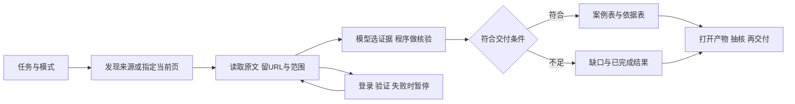

# 两个项目怎样更有把握地落地：案例与工作流对照

2026-10-31（Asia/Shanghai），revision 2，专题任务 `lsr-hi4`。本轮研究与视频指定范围核读完成；supersedes r1开稿／转写进行中的状态，r1初稿字节留项目外report-initial-draft.md。属于外部案例研究与实施建议，不是改栈决定、公司业务规则确认或新开发任务批准。

**先看结论。** 1号现有“基础业务独立可办、完整规划、分批试用、Agent后接”的方向有实际案例支持；正在做的订单—任务—资料整段和恢复验证有价值。现在要增加的把握，是用有依据的业务样本验收一段员工工作、确定维护承接，并完成现有底座路线的同场景取舍。运营浏览器则应继续采用可见、可暂停、能回查来源的工作台，把固定步骤、模型判断和结果验收分别负责。

这些是本轮综合建议。不能由“同行用ERPNext成功”直接推出隆实应换ERPNext；不能由浏览器产品有Windows安装包推出它已经适配当前WebView2与4B本地模型。

**1．这次对照的是你当前的两个项目**

| 项目 | 本轮实际回读的状态 | 本轮主要要回答的问题 |
| --- | --- | --- |
| 1号企业系统 | [README](../../README.md)、[一页用途](../../软件开发计划+施工清单/需求与范围/一页看懂-谁用系统办什么事.md)、[最小试用清单r23](../../软件开发计划+施工清单/施工与验收/首批最小可试用清单.md)及1号当前聊天。已有虚构新单接明细、原话、任务反馈、固定版资料及有限恢复；首次有效加工结果、真实授权、维护、整版交付仍各有缺口 | 标准平台能省哪些工作？如何让实际岗位接着办？怎样验收才不是只看演示？ |
| 运营浏览器 | [接续入口](../网络运营调研/2026-10-31-浏览器助手接续入口.md)、[三段案例设计r2](../网络运营调研/2026-10-31-浏览器助手三段案例流程设计与验收.md)及运营当前聊天。0.2.3编码修复后，0.2.4在做“问题—实际措施—已发生结果”；WebView2＋本地Qwen3-4B，评论采集尚未接入 | 怎样更可靠地发现、读懂、筛选、交出资料？哪些任务可以固化，哪里需要模型与人工接管？ |

技术学习库及已有[底座路线比较r3](2026-10-27-基础系统实现路线比较与验证门槛.md)、[浏览器宿主／执行器复核](2026-10-30-通用任务浏览器宿主与执行器复核.md)均已回读。它们早已考虑Frappe／ERPNext、组件组合、Odoo及NocoBase许可限制；本轮补真实实施经历、生产复盘与视频证据，不把旧建议重复包装成新发现。两聊天仍在推进，以上是本轮阅读时点，不冒称接管或持续监控。

**2．企业系统：最值得对照的实际经历**

下列“已用／上线”均按所列来源当时的报告理解。具名客户访谈、用户自述、供应商案例与独立现场验收有区别；本轮没有进入对方生产后台，也未独立审计其经营结果。旧案例用于研究实施方法，不证明2026年仍用相同版本。

| 实际案例与日期 | 原来遇到什么 | 怎么做、报道中用到哪里 | 对隆实最有用的部分／限制 |
| --- | --- | --- | --- |
| **Rohit Cutting Tools，2018-06-14**；Frappe对具名负责人访谈 | 订单靠纸在人手之间传，查待交订单要两三天；尝试定制软件也未成功 | 先建立订单数据管理习惯，再以ERPNext替代分散工具，使用Excel导入及共享Web入口 | 与我们“快速找到在途单”接近。先检查待交清单能否被业务真正使用；该文没有披露本公司所需的钢材计价、权限和分批完成实现。[原访谈](https://frappe.io/blog/customer-success-stories/erpnext-at-rohit-cutting-tools) |
| **Multicolor Steels，2022-05-24**；Frappe具名客户访谈 | 钢结构项目涉及采购、销售、制造和核算，原SAP定制适应慢 | 先数月试验，再与SAP并行一年；报道时已用采购、销售、会计、制造，HR／CRM等仍是后续 | 参考“标准业务复用＋有限定制＋可退出迁移”。企业规模与我们不同，不建议照抄一年双录，更不能把其未来模块算作当时已上线。[原访谈](https://frappe.io/blog/customer-success-stories/multicolor-steels-switched-from-sap-to-erpnext-to-power-their-growth) |
| **Banaraswala Wire Mesh，2022-08-08**；钢丝网制造商负责人访谈 | CRM和ERP断在报价／订单之间，库存另有多地点Excel；长度和批次信息难保持一致 | 从一个分支试用，扩展批次拆分，逐步使用销售、采购、库存、制造、会计 | 最接近我们的“业务对象和交接必须接起来”。批次拆分有真实需求，但不能据此要求每块钢都编号，也不能替公司确定单位和完成口径。[原访谈](https://frappe.io/blog/customer-success-stories/40-year-old-manufacturing-business-moves-to-erpnext-from-tcs-ion) |
| **Bakriya钢铁集团，2024-11-13**；Odoo具名客户案例 | 多家公司及大量定制钢制品，Excel和孤立系统难以衔接 | 案例列60名Odoo用户，衔接生产、库存、质量、销售与财务，注明实施咨询方 | 看“客户定制项目→物料→生产／质量→成本”关系。案例未说明所有能力属于免费Community版；录入正确是其计算可信的前提，不能照搬其利润公式。[原案例](https://www.odoo.com/blog/customer-reviews-6/revolutionizing-steel-production-bakriya-group-s-journey-with-odoo-erp-1505) |
| **江苏兰之天**；NocoBase供应商访谈，2026-10-31读取 | 制造业系统定制理解偏差、开发及交付成本高 | 将可复用业务模块放在平台上；文章称近10家客户使用基于NocoBase的系统 | 可学平台化与模块复用；“2000余家”是服务商历史客户规模，不能当NocoBase安装数；效率提升是案例方陈述，未给独立项目明细。[原案例](https://www.nocobase.com/zh-CN/customers/Orchisky/) |
| **墨西哥家族企业使用者，2025-11原帖**；本人公开自述 | 外包未交付可用系统、纸和Excel难关联 | 自述用旧电脑部署NocoBase，已运行六个多月；以数据结构、界面、流程、权限为基础，在生产副本中学习新版 | 很适合看“拿到源代码”和“能持续使用”之间的差距。公司未具名，稳定时长／低错误率未获独立核验，不照抄其“免费满足所有需求”结论。[本人原帖](https://forum.nocobase.com/t/mi-erp-sonado-gracias-a-nocobase/8326)、[中文整理](https://www.nocobase.com/zh-CN/customers/an-erp-built-with-nocobase/) |

**3．别人怎样组织交付：哪些方法可以直接借鉴**

**小团队先把业务与数据关系讲清，再复用公共能力。** 深圳创联云的具名访谈描述了样品拍照系统：先定义数据模型和接口，后台／App按接口协作，定制内容按项目插件隔离。文章所称两周交付是该项目经历，不能当隆实工期；线上可配置也仍需变更记录、验证和回退。[访谈原文](https://www.nocobase.com/zh-CN/customers/shenzhen-chuanglianyun-tech-development-methodology/)

**让AI面对独立的对照答案。** PostHog工程师在2026-06-24的SQL解析器复盘中，用原解析器作对照，持续生成差异案例、缩小失败样本、修复后回归，再在生产影子运行中比对后切换。这是作者的一手工程报告，不是本轮复现实验；性能数字不能外推我们的系统。我们可借“先定义正确结果，再让AI修差异”的方法。[原复盘](https://posthog.com/blog/sql-parser)

**按阶段给AI当前有效的上下文，让它检查实际交付物。** PostHog另一篇生产工具复盘指出，旧版一次性改代码不会判断成功，嵌入代码的文档又会过时；新版把当前文档、示例、分阶段任务和构建检查接起来。它还暴露过“开发机装了依赖，导致漏打包却没发现”的问题。对应隆实，要核干净目标环境和同版产物，不能仅以开发机通过结项。[原复盘](https://posthog.com/blog/correct-llm-code-generation)

Frappe早期实施方法文也把测试阶段的销售／采购／制造试点与正式上线的主数据、期初、用户权限分开；页面年代为2016年，只参考组织方法，不执行旧清库命令或沿用旧版安装步骤。[方法原文](https://frappe.io/blog/erpnext-implementation/the-new-paradigm-rapid-erp-implementation)

**4．浏览器项目：生产经验与产品参考分别看**

| 项目／证据类型 | 实际工作流或机制 | 可以借到当前工作台的点 | 当前不能直接作出的承诺 |
| --- | --- | --- | --- |
| **Browser Use**：2026-05生产架构与首位工程师亲历复盘 | 接受任务后异步执行，每步保状态和产物；工作进程中断后从检查点续接；失败有次数上限，持续失败交工程师看 | 一个任务ID贯穿计划、读取、筛选、导出和续跑；每个任务隔离目录；可查看卡在哪一步 | AWS队列／Lambda架构不必照搬到单机；本地MIT库不等于完整云服务，检查点也不自动解决外站写操作防重复。[架构](https://browser-use.com/posts/production-architecture-browser-use)、[失败复盘](https://browser-use.com/posts/everything-i-got-wrong) |
| **Stagehand**：维护者的重复流程与缓存说明、当前v4文档 | 对明确动作使用act／observe／extract；重复步骤可在页面匹配检查后复用先前解析 | 稳定页面和已知操作优先程序执行，变化处再用模型；动作成功与资料合格分开验 | 旧文缓存位于Browserbase服务端；高加速比是特定顺序重复动作的测量，不能当本机免费缓存或全网速度保证。v4本地文档以Chrome为例，当前WebView2组合未验。[机制](https://www.browserbase.com/blog/stagehand-caching)、[v4入口](https://docs.stagehand.dev/v4/first-steps/quickstart) |
| **BrowserOS／neo**：公开源码、Windows产品入口及文档 | 本地供Agent使用的独立浏览器、任务看板、按步回放、任务页分组；neo与带内置Agent的BrowserOS是不同入口 | 让用户看到正在用哪一页、已做什么、何时接手；结果卡可回到步骤和原文 | 本轮未安装运行、未核具名制造业客户案例；它是完整Chromium产品，不能当WebView2可直接装的轻量组件。记录留本地与所接模型的数据流分别看。[仓库](https://github.com/browseros-ai/BrowserOS)、[隐私与模型边界](https://docs.browseros.com/neo/privacy) |
| **Nanobrowser**：公开Chrome／Edge扩展与功能说明 | 侧栏聊天、任务页分组、保存常用提示、结果文件、站点许可和人工接手 | 把反复任务保存成有参数的“工作配方”；找资料、当前页整理和平台采集保持不同流程 | 文档要求模型支持工具调用，本地小模型适用任务受限；Chrome／Edge支持不等于当前WebView2兼容；未核到我们钢材案例的实际成功率。[仓库](https://github.com/nanobrowser/nanobrowser) |

补查了Midscene及Skyvern的当前仓库／许可。前者可作UI动作与测试技术参考，后者可作工作流产品参考；本轮未取得足够贴近我们业务的具名用户实施证据，因此没有把它们升成已验证主选，更不同时安装多套执行器。

**5．对两个现项目的具体判断**

长任务的验收尤其要看交出的文件。CMU与Browser Use的Odysseys2公开总结（2026-10-27）区分了“完成全部检查”和“平均步骤得分”，还展示同一批任务在不同评判器下分数差异很大。其评判器尚未用可靠人工标准校准，因此本稿不拿榜单分数预测我们的成功率；可借鉴的是将文件内容、来源和全部交付条件纳入检查。[原始总结与数据入口](https://browser-use.com/posts/odysseys2-long-horizon-web-agent-benchmark)

| 现有做法 | 本轮判断 | 值得补的下一份证据 |
| --- | --- | --- |
| 企业系统以在途单、任务、资料先串起来 | 有同行经历支持，继续保留。无须为平台菜单扩大首批 | 用一张授权样本或明确脱敏副本，让实际岗位核“现在轮到谁、需要什么、输出给谁”；暂缺制度集中，不能让实习生猜 |
| 小样做权限、迟回、保稿和恢复 | 有必要，已有成果可复用；内部检查数不换算成业务完成率 | 一套发行物内完成普通操作，换目标环境重开及恢复；真实岗位／账号与支持承接分别落实 |
| 尚未最终采用平台 | 既有Frappe独立应用／组件组合的同场景比较仍有效 | 只针对真正会改变选择的缺口对照，记录配置、扩展、排错和维护成本；不要不断增加候选百科 |
| 浏览器本地模型选原文ID，由程序回填 | 适合当前已发现的反转／造参数问题，继续保留 | “原句没改”之外，再核同事件、完整措施、实际结果和来源可信度；现0.2.4已经在补这些，不重复计新功能 |
| 搜索网页、读当前页、三段案例各有入口 | 适合用任务配方逐步稳定 | 每种模式明确输入、结束条件、缺失处理和输出；不能把某一钢种关键词规则套成全领域判断 |
| 短视频评论仍未接 | 作为独立来源适配推进，保留通用浏览器目标 | 先验证同一可见会话与合法可读范围、楼中楼／分页、出处和断点；网页文章成功不能替代评论验收 |

建议的业务交付路线如下；这是综合案例后的候选方法，不把图中的每步都说成当前已实现：

建议的浏览器资料任务路线：

通用网页操作、技术参考摘录、三段案例与未来评论采集可以共享宿主、会话及检查点，但各自有结束条件；不是把所有事情强塞成同一固定脚本。模型可处理开放判断，已知动作与精确数值交给程序，用户在确需本人介入时接手。

**6．能试的新思路，按收益与改动大小排序**

1. **一份工作卡驱动AI交付。** 每段只写清：谁要做什么、已知输入、正确输出、两三个易错例、交出的同一版本和剩余缺口。我负责转成设计、实现和检查；你看业务是否办成，不承担代码审查或替岗位定制度。已有任务卡可收拢，避免另起一套表。
2. **用保留案例做独立验收。** 软件不能自己选来源、自己改判据、最后再宣布成功。浏览器先由人工保留一小组完整案例、缺结果文章和跨事件陷阱作对照；企业系统用有依据的订单／单据预期。具体样本数和真实资料使用仍按相应授权，不在本轮启动采集或产品实验。
3. **把一条成功路线保存成可复用配方。** 例如“找H13压铸模开裂实际改善案例”“把当前页整理成三段”。配方保存任务、来源选择、字段、排除规则、产物和版本；改钢种／问题是参数，变化大的网页重新核对。搜索结果缓存与动作复用分别管理。
4. **异常队列与业务时间线优先。** 在既有有权数据上，让主管先看到迟交、无负责人、缺依据或待反馈事项；点进去看要求、变化、任务与资料。它是工作视图建议，复用已有跟进清单方向，不新增未经核定的审批和消息轰炸。
5. **新规则先对照运行。** 先拿副本／固定样本比较输出，不影响正式结果。PostHog影子验证值得借鉴；不要求员工长期在两套系统重复登记，也不把未知完成口径交AI决定。

另一个后置方向是“业务系统保留正式对象，专门工具办理外围工作，再把结果关联回来”。工厂采访约50—52分钟展示ERPNext经Webhook连接Power Automate、合同签署及存档，再经REST API将文件链接回到原单。可学的是有身份和回执的连接方式；微软云及签署服务的收费、外送和适用条件不随案例获得批准，不把HR签署加入当前首批。

这些方法的目标是减少返工和人工补改。是否有效要比较“合格产物、无证据内容、人工修正用时、任务总耗时、资源消耗”，不以生成字数、点击数或测试数量排名。

**7．版本、许可与维护：本轮实际核到哪里**

2026-10-31通过GitHub公开API取得10仓库的元数据、默认分支实际提交及完整根许可，保存SHA256。默认分支快照只用于本轮观察，不等于推荐部署开发分支；此前路线稿的固定发行仍保留。NocoBase与Odoo的API均给NOASSERTION，已读许可正文，未凭徽标下结论。

| 项目 | 本轮固定提交缩写／提交日期UTC | 根许可核读与适用限制 |
| --- | --- | --- |
| Frappe | 249b5f0f／10-30 | MIT框架；不等于ERP业务和部署已经具备。[仓库](https://github.com/frappe/frappe) |
| ERPNext | 90370c5e／10-30 | GPLv3应用；与框架许可分别看，实际采用沿固定兼容版本核。[仓库](https://github.com/frappe/erpnext) |
| Odoo | 98f53af0／10-30 | 根正文LGPLv3，附带库／模块另核；客户故事不能当Community功能清单。[固定许可](https://github.com/odoo/odoo/blob/98f53af0148cd4801de7c1342657573ddd005dac/LICENSE) |
| NocoBase | 1e96dc59／10-29 | 2026-02-24版协议包含Apache-2.0及优先适用的补充条款，包括界面标识和特定平台服务限制；商业插件另查。既有路线稿已因此列备选，本轮不是首次发现或纯Apache推荐。[固定许可](https://github.com/nocobase/nocobase/blob/1e96dc5946a9e7fee4cb3a55f7c79b3dc318b22a/LICENSE.txt) |
| Browser Use | b49a68e4／10-30 | MIT库，托管服务能力／费用另论。[仓库](https://github.com/browser-use/browser-use) |
| Stagehand | b7a4b899／10-30 | MIT，当前主线v4；旧视频接口及v3缓存文不能当现有WebView2验证。[仓库](https://github.com/browserbase/stagehand) |
| BrowserOS | b4c3bbe2／10-30 | AGPLv3，完整浏览器产品，需承担相应维护与分发核对。[仓库](https://github.com/browseros-ai/BrowserOS) |
| Nanobrowser | 19dc8e8a／10-24 | 根许可Apache-2.0，不能沿用不明旧摘要的AGPL结论。[固定许可](https://github.com/nanobrowser/nanobrowser/blob/19dc8e8a9be6ed06c0ef9ec7de8d84bf6a88c458/LICENSE) |
| Midscene | 1527e33d／10-30 | MIT；本轮仅元数据、许可及部分文档线索，不是本机动作测试。[仓库](https://github.com/web-infra-dev/midscene) |
| Skyvern | ff5b8785／10-30 | AGPLv3；未取得足够贴近本任务的具名实施证据，不因通用功能宣传改为主选。[仓库](https://github.com/Skyvern-AI/skyvern) |

根许可摘述不是完整法律意见，也不能覆盖所有依赖和素材；正式采用按固定版本、所需插件和实际交付范围继续核。当前活跃提交不证明无缺陷或本公司适用。

**8．视频观看入口与已检查范围**

其中最值得你先看的，是工厂实施者分享的26—44分钟：实际困境是操作不熟后回用旧办法，再补录造成数据失真；应对涉及操作手册、关键用户和按业务场景查报表。38—44分钟还强调需要了解业务、能推动协调的负责人；不能把这项职责默认交给刚入职的实习生。画面26分钟写“项目已实施十个月”，包含调研／试运行，不作为十个月正式生产运行证明。相关观点是案例方经验，不将其“成熟ERP都能覆盖”或流程改动主张当隆实的事实。

官方工单教程展示的两个设计值得小范围比较：约5分钟将“指派成功”与“通知发送”分开，约16分钟把特定办理动作从通用编辑权限中分离。对我们的启发是动作、通知和正式结果各有判定；专门入口仍要检查当前人对当前事项的服务端权限。本轮未安全审计教程实现，不能仅凭按钮或自定义工作流说明就放行真实业务。

| 视频 | 核到的实际时长／作者 | 用来了解什么 | 当前范围 |
| --- | --- | --- | --- |
| [00后接班人EN选型与实施实战分享](https://www.bilibili.com/video/BV1wdJrzREKw/) | 57分49秒，erpnext_yuzelin，2025-09发布；画面演讲日期2025-09-16 | 工厂实施者亲历、选型、人员与流程落地 | 整段音轨CPU ASR完成2119段；重点核读0—3、5—7、12—15.5、18—22及24—结束。29张120秒采样帧联系表已看，另读26／30／38／42／52分钟原帧；不等逐帧观看或人工听完所有音频 |
| [NocoBase工单教程第六章：工作流](https://www.bilibili.com/video/BV1diXHBQEJX/) | 27分钟，NocoBase，2026-03发布 | 工单触发、条件、完成时间及流程调试 | 整段音轨CPU ASR完成611段，分段核读；14张120秒采样帧联系表及16／24／26分钟原帧已看。属于教程，不当客户生产实例 |
| [ERPNext快速跑通进销存、生产、应收应付](https://www.bilibili.com/video/BV1ck6XY4EhX/) | 当前所列单P为32分46秒；标题写“2小时” | 直观看业务单据如何前后衔接 | 仅核标题／简介／页号及单P时长，未核全课或完整操作；不能按标题写已看2小时 |
| [ERPNext权限机制与经典案例](https://www.bilibili.com/video/BV1nj411P7wv/) | 61分50秒，erpnext_yuzelin，2023-02发布 | 业务员与客户／订单可见范围 | 元数据／简介，未观看；旧版机制须按当前所选版本另核 |
| [AI浏览器自动化测评：Midscene／Stagehand／Shortest](https://www.bilibili.com/video/BV1fc6EYxEVE/) | 51分26秒，Koala聊开源，2024-12发布 | 比较动作自动化的失败及工具差异 | 元数据／简介，未完整观看；不能按旧测评排名选择当前v4 |

抖音也做了定向检索，命中多为介绍、聚合或导流，未找到比上述客户原访谈／实施复盘更完整的证据，因此没有为凑平台覆盖列入强推荐；“没找到足够证据”不等于平台没有好案例。

ASR将ERPNext、异步、字段等词多次识别错，相关结论已结合画面和官方原文核对，不拿机器转写逐字作准确引语。工单教程末段约25—26分钟还演示执行历史和复制到新版本再启用；可参考其可追溯配置方法，具体版本切换、失败和授权仍需本项目验证。

**9．如何判断接下来有没有更有把握**

企业系统：继续沿当前范围收拢，把一段工作的输入、岗位交接、输出、失败查回和同版恢复放在一起看。对应真实岗位的“完成依据、授权、维护承接”仍要落实；不恢复整套问卷，也不因某一暂缺停掉其他可做的事。开源平台比较重点是能减少多少通用实现及长期维护，不能按菜单数选。

下一份值得形成的证据，是在既有路线比较第6节的同一代表场景下，补齐“标准配置可做／需业务扩展／须改核心／不满足／待验证”与实际维护成本。先选真正能区分路线的在途接续、独立任务、固定版资料和同版输出／恢复，不重新制造整套问卷或把已有小样重跑算新进展。此处是比较建议，未启动新平台安装或业务站点。

浏览器：保留现在的本地／免费通道和三段证据方向，先把既有流程的合格率测清；开放式研究与重复任务分工。模型能够选原句还不代表同一事件、完整方案和结果正确；最终应打开Excel与依据页，核真的交出了所需内容。

我可以承担把这些标准写进每次任务、组织来源与反例、检查实际产物、解释取舍和报告剩余缺口的工作。岗位事实和真实上线授权仍由相应负责人决定，不把你变成必须懂全部技术或替全公司验收的人。

证据在项目外 `E:/AI-Tools/longshi-components-20261026/outputs/deployed-workflows-20261031/`：source-index.json、所选页面正文、10仓库提交／根许可及hash、6视频元数据、两部合法公开访问媒体和本地转写／抽帧。两视频转写进程已正常退出；未播放或录音。检索和读取成功不等于被调研产品运行通过；本轮未安装候选、修改两个项目源码、访问公司生产或网站账号、导入真实资料、调用GPU、推送Git或安排后台定时任务。
