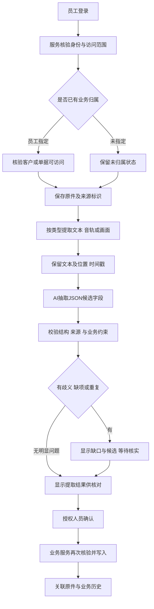
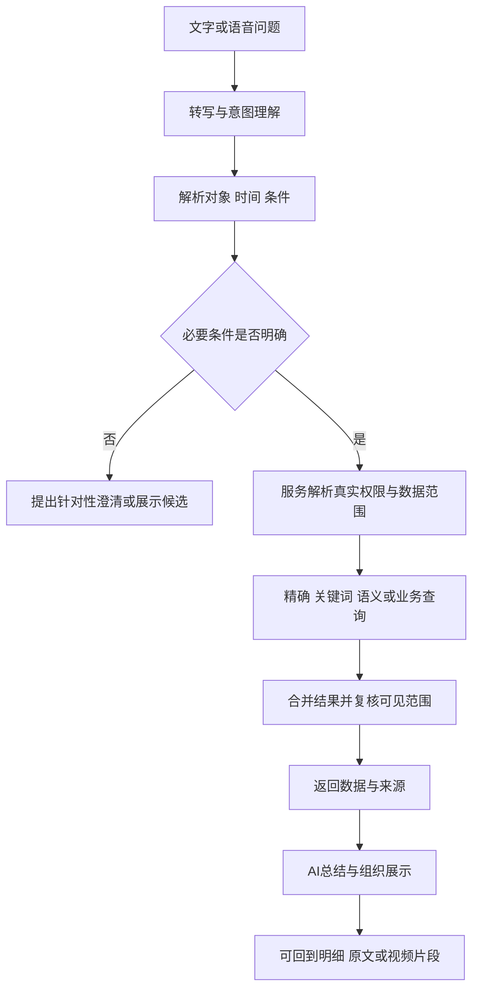

# 数据流与关联设计草案

日期：2026-10-24。  
状态：依据已明确方向提出的设计建议；不是正式数据库结构、接口协议或已经实现的功能。  
依据：[系统方向（公开摘要）](../公开接续/公司业务资料研究概览.md)、[旧业务结构（公开摘要）](../公开接续/公司业务资料研究概览.md)、[关键字段校对（公开摘要）](../公开接续/公司业务资料研究概览.md)、[技术职责](技术职责与验证清单.md)。

## 1. 已明确与仍待回答

已明确：Windows软件；原件与提取文本存储；关键词及向量检索；老板与员工不同权限；AI读取、总结、分析、展示和JSON交互；仪表可按需扩展；正式业务变更不由AI直接执行。

未明确：主要录入渠道、上传前是否选客户、提取后优先形成什么记录、是否自动保存草稿、具体岗位权限、数据量和部署条件。以下设计同时容纳这些问题，不将其中一种路径当作用户已经选定。

## 2. 数据中心需要连接的对象

下表是概念对象，不是要求部署同样数量的数据表或服务。

| 概念对象 | 保存什么 | 主要关联 |
| --- | --- | --- |
| 账号与授权上下文 | 真实登录身份、有效角色和数据范围 | 约束上传、查询、确认、导出和下载 |
| 原始文件 | 原件、内容指纹、类型、大小、上传者和上传时间 | 可关联客户、业务记录、文件夹及多个提取运行 |
| 文件夹与文件版本 | 目录关系、展示名称、版本和状态 | 文件移动改名与业务关联分开，不以文件名充当唯一身份 |
| 提取运行 | 输入版本、组件与模型版本、处理状态、时间和错误 | 同一原件可重处理；新运行不覆盖旧结果 |
| 文本片段与位置 | 识别原文、页码、截图文字框、音视频起止时间 | 搜索命中、字段证据和原件预览 |
| 待核实字段或草稿 | 识别到的客户、联系人、数量、金额、日期等及来源 | 可以有未知项或多个候选；保存策略待核实 |
| 业务对象与事件 | 客户、人员、产品、报价/合同、送货等已确认事实 | 时间、状态、负责人、明细、原件与审计 |
| 检索索引 | 关键词索引、文本向量、模型与分块版本 | 派生自有效资料，可重建；不能独立决定访问权限 |
| 查询与展示结果 | 本次查询条件、统计定义、结果、来源和数据版本 | AI摘要、动态图表、明细回溯、导出 |
| 操作与处理记录 | 谁做了什么、何时、基于何种版本与权限、结果如何 | 录入确认、更正、审批、权限、数据处理和查询 |

客户主体、联系人、业务员和部门分别考虑；截图中客户类别、分类、级别先保留原名。具体实体关系和必填项仍要与公司核实。

## 3. 上传、提取与正式录入

处理过程由系统服务创建任务和结果，不等于AI获得数据库写权限。是否自动持久保存待确认草稿、未归属资料的可见范围及保留期限，仍待用户回答。

需要研究的异常：上传中断、文件不支持、视频过长、内容加密、识别失败、找不到客户、多个候选客户、资料跨多个事项、重复上传、部分字段来源冲突、确认时权限变化、重复点击与并发确认。

技术建议：原始提取文本与人工更正文分开；来源指纹用于发现重复内容，不能让不同权限的上传者因此互相看到文件存在或内容。业务发生时间、录入时间和处理时间单独保留。

## 4. 关键词、语义与业务查询

检索权限要在检索与读取来源的过程中执行，不能先把全公司内容送给模型后再隐藏答案。关键词、向量、原件下载、缓存和导出应使用一致的授权依据。

不同查询采用不同证据路径：

- 查客户编号或合同号：优先精确匹配和已核实的历史编号映射。
- 查某个术语、材质牌号或文字片段：关键词与必要的字面相似匹配。
- 查意思相近的技术资料或沟通记录：语义检索并提供原文来源。
- 查某人的某月经营情况：使用已定义的业务查询和统计条件；不能简单相加搜索命中的文本片段。

以上是路由建议，不是先固定所有问法。中文、别名、OCR错误、单位和混合排序的实际效果需要样本检验。检索没有结果、权限不足和处理尚未完成，应表达不同状态。

## 5. 动态仪表与AI分析

用户希望仪表保持可扩展。建议把“询问意图、获取数据、计算、选择展示形式”分工，而不预置一套封闭的旧仪表清单。

新的分析可以组合已有授权字段、时间和计算方式；若缺少事实、定义或必要字段，先说明缺口或核实，不编造数字。事实统计与AI解释分别保留。

JSON拟分为提取结果、查询意图、展示意图三类，各自定义字段、版本和限制。身份由登录会话决定；模型输出中的角色、自填用户ID、SQL、Python或其他代码不作为授权或执行依据。图表配置中的回调、脚本和外部资源也不能直接执行。

统计查询应能记录筛选条件、所用规则、数据时点和来源记录，支持复核。时间范围不明、多人同名、业务员代码不一致及“业绩”等含义不明，都是需要进一步核实的场景。

## 6. 更新、删除、权限与备份的关联

| 变化 | 需要一起考虑的内容 |
| --- | --- |
| 文件替换或更正 | 原件版本、提取结果、文本分块、向量索引、业务引用和既有报告 |
| 客户资料合并 | 原ID映射、关联单据、来源证据、归属历史和查询去重；不能自动覆盖 |
| 员工离职或调岗 | 登录状态、当前访问、客户/任务交接、历史署名与统计归属分别处理 |
| 权限撤回 | 业务API、检索、缓存、文件下载和报告访问一并处理；已导出副本的管理规则需另定 |
| 数据删除或作废 | 逻辑状态、审计保留、检索失效、文件引用和备份保留规则，避免孤儿文件与旧片段泄露 |
| 备份恢复 | 数据库、原件及版本对应同一恢复点；派生索引可按确定版本重建，恢复后再核对权限与引用 |

## 7. 部署职责候选

桌面端候选职责：登录和展示、上传、资料预览、语音入口，以及确有需要的本地Office处理。服务端候选职责：正式数据库、统一权限、原件访问接口、持久任务、共享检索、统计与模型接入。

本地还是服务端执行OCR、ASR、文档解析和向量化，要根据样本量、电脑配置、网络、数据出域边界和维护能力决定；暂不强制每台员工电脑安装所有模型或每项能力独立部署。

## 8. 尚未决定的事项

上传归属方式、草稿是否保存、人员及字段权限、统计定义、中文检索方案、存储品牌、组件发行版本、模型、执行位置、部署容量和第一版范围均未在本轮定稿。本文用于下一轮核实和技术验证，不能当成已获批准的实现规格。
