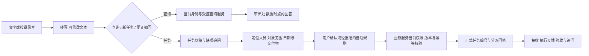

# 老板口头查询与任务回系统：接入准备

2026-10-26，用户提出：老板直接与AI沟通查询，之后可能口头下达任务，再自动回到企业系统下发；目前先准备思路，不安装正式系统能力。状态proposed，未批准生产访问、自动派单或业务规则。

复用已有[系统关系图与贯穿场景](../../产品经理调研/2026-10-26-系统关系图与贯穿场景走查.md)及[业务流程与系统记录对照](../../产品经理调研/2026-10-26-业务流程与系统记录对照.md)：AI整理草稿，业务服务按当前权限确认；任务/通知不等于节点完成，反馈/验收分别授权。这里不另起一套业务对象和强制状态。

## 建议的体验

老板说“看看订单A现在到哪一步了”→转写与意图解析→受控查询服务按老板当前权限返回阶段、来源和更新时间→AI用口语总结；没有更新就说未知，不把推测当进度。

老板说“让示例负责人甲周五之前把订单A的样品情况汇总给我”→AI提取草稿→定位人员唯一ID、订单/明细范围与具体日期→显示或读回“由谁、做什么、到什么时候、交付什么”→缺关键项再问。老板明确说“确认下发”后，业务服务检验当前权限和必填项，生成正式任务编号、保存并分派→AI报告编号及下发回执。

“自动回系统”建议指自动传递已确认结构化任务，不把每段语音都自动变成正式指令。后续可为低风险任务配置明确的自动下发策略；这需要业务方确认任务类别、人员范围和审计规则，不由模型自己判定。老板说话不天然证明操作者就是老板，不以声纹替代登录授权。

## 先保留的接口边界（候选）

| 接口 | AI能提交什么 | 系统必须负责什么 |
| --- | --- | --- |
| query_business | 意图、对象候选和时间范围 | 当前授权、获准字段、口径、数据时点、出处 |
| resolve_people/object | 姓名/简称和候选上下文 | 唯一ID、同名消歧、停用/离职/跨部门权限 |
| create_task_draft | 原话引用、任务标题/内容/负责人候选/期限/交付要求 | 草稿版本、来源与未决字段，不发正式通知 |
| confirm_task | 草稿ID与版本、确认事件、幂等键 | 当前身份/权限、并发版本、落库与任务号、适用审批 |
| get_dispatch_result | 幂等键或任务号 | 是否已保存/已分派/投递失败，不能把超时当未执行 |
| query_task_progress | 任务号及查询范围 | 接收/反馈/验收等实际记录；与订单阶段事实区分 |

草稿至少保留：request_id、来源会话/消息、可选音频引用及用户改过的转写、intent、title、description、assignee_candidates/assignee_id、due_at与timezone、related_object_candidates/resolved_ids、deliverable、missing_fields、draft_revision、confirmation_state。身份由已登录会话提供，模型JSON里的“我是老板”不授予权限。字段是接口建议，不是正式数据库表。

## 需要准备的异常

- 同名、简称、“他/刚才那个客户”、方言或噪声导致的转写错误：关键人/对象不凭概率静默选定。
- “下周五、尽快、下班前”：显示绝对日期和时区；具体公司下班时间未确认，不硬编码。
- 一句话多人多任务、补充一句“改成周四”、撤销刚才任务：定位原草稿或任务版本；更正不重复新增，不直接删除正式历史。
- 网络超时/重复点确认/录音重发：同一意图有稳定幂等键；先查回执，再决定是否重试，不换键强行新建。
- 分派成功但通知失败、已读但未接受、员工报告完成但未验收：分开回报，不说“事情已经办好”。
- 手机和电脑接续、程序关闭、语音误唤醒：先考虑手动按键录音与文字等价入口；常驻监听、移动端和离线自动派单另作方案。

## 现在可做的准备

当前小隆语音先只转到输入框，用户校对后发送；本机计划/确认卡与会话上下文可验证“草稿→明确决定→执行回执”的通用交互。未来增加EnterpriseGateway适配器，替换独立样本查询/任务草稿接收端；当前不连接ERP，不自动给员工发消息。

后续最小验证使用虚构人员与订单：查询/任务正确分流、同名追问、日期读回、否定与改期、重复确认一次落库、超时先查结果、权限变化拒绝、分派与通知回执分开。语音识别率和模型提取率分开统计；用户纠正后的最终文本是确认依据。没有执行这些业务测试，不将纸面方案写成已验收。
