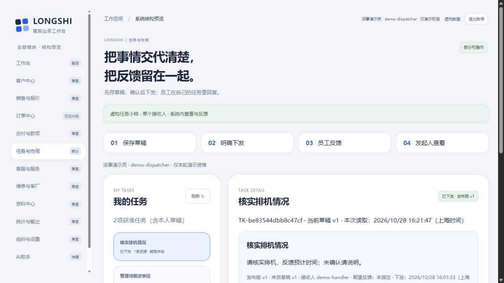
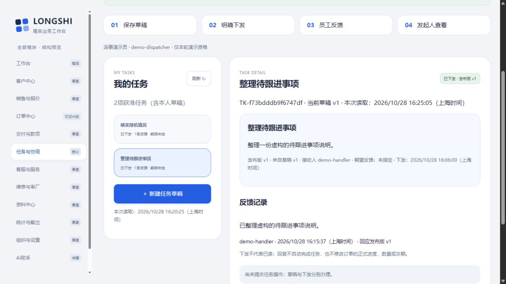

# 任务草稿、明确下发与本人反馈：隔离小样实测

2026-10-28；revision 1。用户“好，开始吧”承接这条任务小流程，明确授权本次项目外虚构小样实现与运行；不等正式业务开发、真实账号或上线批准。原完整36B／19P及首批候选保持。

## 先看能做什么

现在“任务与协同”已有一条不依赖AI的可操作路径：**发起人保存草稿 → 明确下发已保存版 → 员工查看必要正文并反馈 → 发起人重开查看同一反馈。** 可以关联原有整单文字跟进，也可以是不关联订单／附件的独立事项。

查看副本：[http://127.0.0.1:52965/#m-collaboration](http://127.0.0.1:52965/#m-collaboration)。约16:27启动，本机回环、最长一小时，约17:27（上海时间）正常到期；端口只是本轮入口，后续先核项目外`review-pointer.json`和对应status。原55934/view-04及本轮测试服务都已正常结束，不能用旧S已停指针接管当前服务。查看副本没有人工迟回。

可选演示账号为`demo-dispatcher`（派事演示员）和`demo-handler`（员工演示员）；页面预填的是本样机公开演示口令，勿输入真实账号。当前已准备两条任务和各一条反馈，先浏览即可，无需重新录入。

## 两个固定例子和真实增量

| 例子 | 输入及关联 | 实际结果 |
| --- | --- | --- |
| 关联任务甲 | “核实排机情况”；“请核实排机，反馈预计时间；未确认请说明。”；引用原甲跟进v1；期限未知 | 草稿1版、明确下发1版、1个接收关系；员工反馈“已联系，等待对方回复预计时间。”1条；发起人重开读回 |
| 独立事项丙 | “整理待跟进事项”；“整理一份虚构的待跟进事项说明。”；无订单／跟进引用／附件；期限未知 | 草稿1版、明确下发1版、1个接收关系；员工反馈“已整理虚构的待跟进事项说明。”1条；没有造一张订单 |

普通界面库实际总增量为2任务／2草稿版／2发布版／2接收关系／2回复／6任务操作凭据。查回没有重复新增。接口库另有版本和权限负例草稿，不能混入界面“两个任务”的数量。

原界面库2订单／4跟进／6旧操作、接口库2订单／3跟进／5旧操作，均在HTTP及界面工作后逐字段对照相等。任务和回复不改变正式数量、交期、进展或旧跟进，也不自动完成任务。

## 权限、版本和失败怎样实际验证

- 草稿只给发起人看：普通浏览器切到员工后无草稿清单、标题或编号残留；接口直查草稿中性404。发起人重开原草稿后才明确下发。
- 下发固定所见草稿版、必要正文和单个获准接收人；旧版新写冲突，草稿编辑留历史版。已发内容本小样不可修订、转交或撤销，不额外添加主管审批。
- 员工只看到必要任务正文和本人反馈，没有原跟进／订单引用投影；实际切到订单中心是合法空范围，接口直接读订单或旧跟进也被拒。正文由发起人明确填写，本小样不能自动判断任意自由文字是否可分享，真实G03规则未核。
- 回复人取当前服务会话，不能由JSON指定别人；回复绑定发布ID／版本。错误版本冲突、额外actor字段拒绝，无关人不能读写；没有已读／接受／验收／完成事件。
- 任务操作凭据独立于原订单／文字跟进；绑定可信账号、动作、目标、原规范输入和所见版。同键原内容查回同一结果，同键换动作／目标／内容冲突；猜他人凭据不能取得结果。
- 真正撤回接收关系的**顺序测试夹具**通过：旧详情、原凭据、原内容重试和换内容试探均中性拒绝，原回复历史保留。仅测试管理员改active标记；不是已做好公司权限管理页面或同时撤权证明。
- 人工撤销操作表写入权限，在发布快照／接收关系／任务状态写入后触发实际500，前后六张任务表快照一致，原合法草稿保留。故障段finally恢复夹具权限。未观察全部未提交中间行，不称生产故障覆盖。
- 服务端**提交后故意迟回1.5秒**，前端等候1.2秒后进入“结果未明”；HTTP反馈和普通浏览器的下发／回复分别实测。刷新恢复原下发操作，按原键查回；未明不当失败，也不换键重复派事。查看副本无此延迟。

## 发现并改掉的问题，按方法分开看证据

| 工作段 | 实际结果与限制 |
| --- | --- |
| T1 | 接口库与界面库的虚构ID不相同，首个引用404；修正按各自DEMO-A原记录映射。失败整轮保留、正常退出，不算通过 |
| T2 | 故障500符合注入预期，但测试辅助误把普通500当JSON解析而中断；修正测试辅助。该轮不算回滚验证完成 |
| T3 | 47项HTTP／DB检查通过；普通切号发现旧标题／编号残留，3号发现刷新失败／范围变化仍展示旧投影及冲突先于读权核验；先正常停再修。该轮没有完整CUA任务链结论；旧源码只另存5份及其余hash，未声称全量原件归档 |
| T4 | 修后51项HTTP／DB断言通过，加GUI结束后原业务全字段相等共52项；**普通CUA另外走完上面两例和超时／刷新查回**。结束HTTP／PG／T映射均正常释放，11源hash相符并原样归档。内部检查数不是功能数 |
| T5 | 只补runner收尾：client分别close、故障REVOKE整个段finally恢复、启动未捕PID时核本目录／真实PID后停、hash异常保status并判失败。独立重跑51项HTTP／DB，正常退出；业务源码与T4相同，没有重做GUI或真实注入启动失败 |
| 前端模拟 | 新8项最小假DOM／可控请求检查覆盖切号旧回、读失败暂停、全匹配失权隐藏、本地输入、历史回查保新稿、切任务守卫、refresh不偷升所见版；旧22迟回＋11输入守卫在新app.js通过。它们不是浏览器或服务授权测试 |

3号只读核实现及修点，4号只读核runner／已保存快照和收尾；2号在读新代码／结果前冻结5条业务预期。跨窗审阅不当成他们各自运行了本机服务。源码、DB、失败日志和信箱在项目外；项目只存这份说明及虚构截图。

## 学到的东西用在哪里

先查技术学习库“任务／发布／草稿／反馈”，回读任务状态机制比较，再选少量明确服务动作和事务；没有为两状态引入Frappe或新工作流引擎。现有已装FastAPI／PostgreSQL／Python组件复用，不新增依赖。

UI延续用户认可的Bento：任务列表与正文分卡，保存／明确下发分按钮，草稿／已下发／有反馈分状态，必要提示靠近动作，长限制折叠。回读oil-ui视频学习记录所讲的对象／动作拆清与截图／行为分验，未安装oil-ui或把别窗视频阅读说成本窗重新观看。当前1265×712视口实际检查，未称所有手机／宽度或完整无障碍通过。

## 尚未完成和下一段

本片段不包括多人分发、外部通知、已读／接受／完成制度、审批、重派／取消／发布修订、附件上传、真实身份、公司岗位权限、并发撤权、负载／灾备、远程或EXE。未提交输入仍不保证跨刷新、退出或关页；结果未明的原操作按账号单独保留。

下一段沿既有W11把资料与订单／任务的关系和最少人工归档操作接上，先复用原资料研究与学习库；不因本轮任务小样自动放行上传原件或新组件。G01／G04／G06及真实G03继续集中暂缺，不发新问卷。W10／W14只增加这个有限片段的证据，不勾整包完成。

本机复核入口（非换机安装包）：`C:/Users/华硕/.codex/tools/longshi-collaboration-lab/work/business-01a16bce/task-prototype-20261028/`，关键为`run-t4/`、`run-t5/`、`task-ui-vm-checks.json`、`demo-task-view-01/status.json`。没有推Git或关机。
