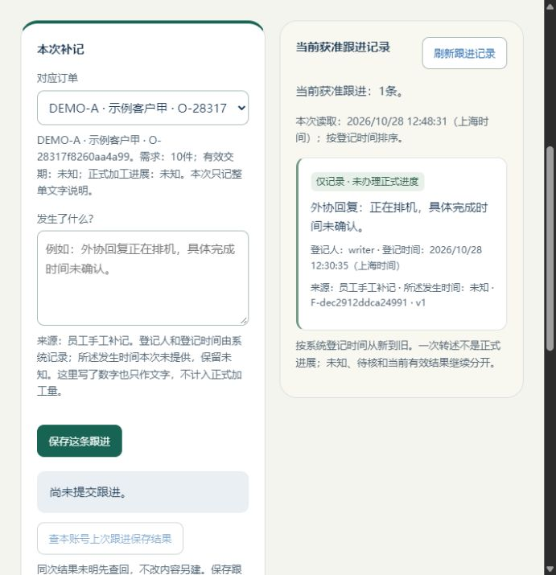
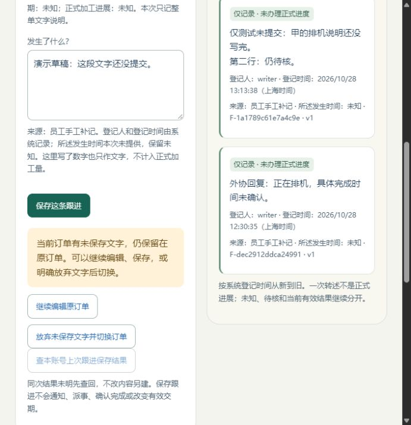
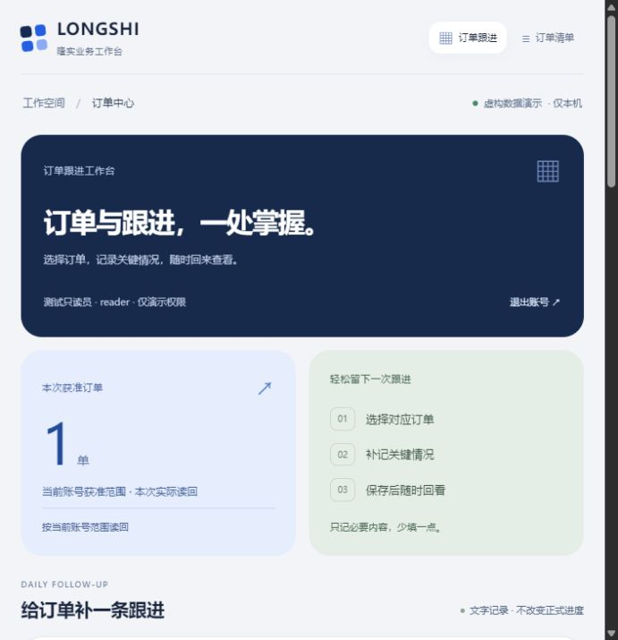
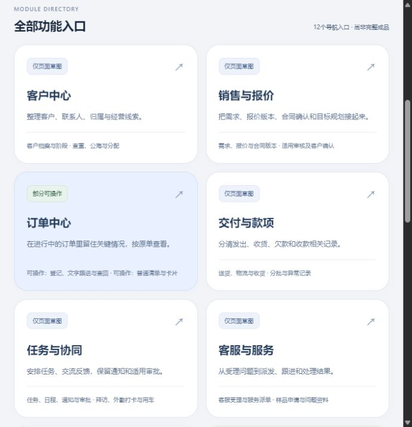

# 文字跟进小样与学习应用实测

2026-10-28；revision 5；supersedes r4，原稿逐字保留项目外。最新系统骨架见第9节；旧时点按各版记录。最新Bento视觉重排见第8节，先前实测仍按各版解释。用户随后要求再做半小时，最新结果见第7节；一小时结束回执保留当时时点。用户明确继续整单文字跟进隔离小样，要求先查最近学习，再自行连续工作一小时。本轮从北京时间12:01:09连续推进至13:01:31，已完成这一小时安排；工作包括限定实现／复验、故障补测、显示改进、衔接设计和接续核对。

**给使用者看：现在能打开虚构订单，写一句关键情况，保存后再找到。保存回复没收到，刷新后可以查回原来那条。写“希望提前交付”只留下记录，不会偷偷改交期。全过程不调用AI。**

本机临时演示：[文字跟进工作台](http://127.0.0.1:55934/#m-home)。演示口令Longshi-Local-Demo-20261028；writer可补记，reader仅读甲。数据全为虚构，当前view-04约14:20启动，最长一小时；view-03/54115及旧65088/view-02已正常结束。地址不是永久部署，关闭／到期后须由助手核旧副本已停，再建新的唯一查看副本；当前脚本不覆盖已用目录。真实账号、资料和密码不要输入此演示。

## 两分钟怎样看

最新小修可这样试：在甲写一段虚构文字，再尝试选乙，页面应让你明确选择继续编辑或放弃。只有明确保存才新增记录。

先看甲已有“正在排机”的记录，再切乙看“希望提前交付”与原有效交期并存。如果要试补记，用虚构文字保存后刷新，看原记录是否仍能找到；不用提供公司原件或替公司回答制度问题。演示地址只在原机临时服务存活时可用。

## 1. 实际做成和怎样检查

| 工作 | 取得的证据 | 限定 |
| --- | --- | --- |
| 整单人工文字跟进 | 服务生成记录ID、登记人／时间；保存／重开／按订单读回；UI甲乙各一条，主记录字段前后完全一致 | 两张订单由准备API明确预给，跟进从空开始；不是本轮GUI首次建单或整套订单模块 |
| 回复未获后查回 | 乙注入提交后延迟，界面进入待查、刷新恢复原内容、查回同一FID；乙列表仍一条 | 是可信服务测试夹具；不是任意断电／网络故障或全离线承诺 |
| 当前权及普通失败 | HTTP检查服务端读／补记权限、身份伪造／字段拒绝、同键换内容／对象／动作、顺序撤权后查原结果；F1普通界面只读／读取失败及恢复 | 测试账号资格，不是公司岗位矩阵；没有并发撤权或生产安全验收 |
| 原错与前端状态 | 22项Node VM模拟迟回；实际UI核切单后不冒旧单成功；回执带原订单 | VM是假DOM／可控回复，和真实浏览器证据分别保留 |
| 写入中断回滚 | Q1先触及跟进INSERT，再令操作凭据INSERT失败，HTTP500；三张业务表前后相同，失败键查回404 | AFTER INSERT非事务序列只证明到达触发点，不冒称看过未提交行正文；清理是该次正常路径 |
| 同次不同正文相撞 | Q1锁门闩确实观察两个HTTP工作线程在DB等待，释放后200／409，只一条记录及一份凭据 | 人工制造重叠，不是自然负载压测或所有竞态通过 |
| 特殊文字保真 | Q1原文含尖括号、两处换行、引号及反斜线，HTTP／DB／读回一致；另用停止后的副本看实际显示 | 显示的是API已建记录；不是又一次GUI录入，也不是完整XSS检测 |

F1最终91项内部检查、Q1为29项、修正后F2为93项；包含环境／回归／清理，**不是213个产品功能或产品完成率**。22项VM另列，不与GUI、HTTP或另一版本混为同一验收。F2覆盖原登记及跟进基本行为和新增Cookie别名检查；Q1故障探针跑在Cookie修正前冻结源码，未声称修正后重跑全部Q1。

F2普通UI甲FID F-dec2912ddca24991、乙FID F-8c3c858e734e4d83；乙有效交期2030-05-10始终保持，甲需求10件及两单全部主字段前后相等。来源仅manual_note／员工手工补记，所述发生时间本次仅未知；原作者／转述分类、发生时间填写、说明修订和明细关联仍是设计，不冒称已做完。

## 2. 发现的问题及修正

1. 审查发现旧保存成功若不标原订单，可能误认当前单已保存；已把回执带原单，切单清提示，并保留旧例与回归。
2. F1固定提示写了全局“两个虚构订单”，不能用于严格说明只读账号完全不知其他数量。停止F1后冻结原版，改为中性说明，实际只读页复查只显示甲；不追改F1结果称它当时已通过。
3. 实际同时开两个本机演示，旧固定Cookie名令第二次登录覆盖第一次会话。修正为每实例统一Cookie名，登录设置、九处服务读取和退出删除一致；不读旧固定名作兼容。F2检查实例名和仅携旧名请求被拒。

Cookie修正后的实际同浏览器复验：主实例65088登录writer；副64329登录reader只见甲、保存禁用；主刷新仍writer两单；副退出并刷新仍登录页；主再刷新仍writer。保存AX和截图，不读取／输出Cookie令牌。Cookie以主机而非端口共享的背景可见[RFC6265](https://www.rfc-editor.org/rfc/rfc6265#section-8.5)。命名只解决此次演示意外干扰，不构成同主机恶意应用隔离或生产认证／HTTPS方案。

## 3. 最近学到的东西实际用在哪

| 学习方法 | 本轮具体落点 | 尚未证明 |
| --- | --- | --- |
| 固定小任务和行为预期 | 沿原W08／W12／W14只做文字记录；2号在读实现和结果前冻结独立预期，再比实际证据 | 不是重新看完原视频，也不按测试输出改答案 |
| 交付与代码分别审、旧错复验 | 3号审服务／前端归属、4号审运行与停止；原错／F1／Q1／F2源码分别冻结，真实UI另取证 | 不是三人各自跑全套产品 |
| Bento层级、间距和主次 | 把补记和记录作为主区；旧登记工具折叠，保存／待查／只读／失败分开；短文字和未知保留 | 当前691px视口实际截图，不是所有手机、缩放或无障碍通过 |
| 用途变量与界面审查 | 复用已有按钮／状态样式，成功明确原单、切单不误导；实际截图回看长中文 | 未安装／调用Figma、Impeccable或Variable Visualizer |
| 组合现有工具、最小验证 | 复用已装FastAPI／PostgreSQL／Node和CUA；用事务失败、锁等待及实际界面补不同证据 | 已装及局部成功不代表正式栈选定或生产恢复完成 |

开工前确实检索学习库并回读交付流程、后台UI／Refactoring UI及应用清单；本轮授权与学习原文哈希项目外留存。不是仅登记“学习过”，也不编造应用百分比或节省工时。

## 4. 保管、收尾与下一段

源码、冻结版本、运行参数、数据库、轨迹、独立预期及旧稿全部留在项目外followup-prototype-20261028。F1／Q1／F2各自HTTP／PG正常结束、所属映射收好；旧首次接续R查看副本也已正常退出。Cookie复验T副本正常结束；**供用户查看的S主副本仍运行**，不能把测试停完说成全机服务已关。

本轮只是独立研究小样，不是正式软件、员工试用、EXE或完整W08。首批r12、数据r9、固定卡和旧两份HTML保持字节；报价舍入、完成依据、维护等暂缺仍集中。没有新依赖、生产访问、公司原件、公开发布或Git推送。

下一段沿原W10／W11先补“从跟进记录发起任务、引用具体资料版”的操作衔接，见[操作稿第7节](../../软件开发计划+施工清单/页面与原型/订单详情与人工跟进操作稿.md)。当前只收拢设计，尚无任务发布／资料上传／正式数量或交期更改。任务内容和文件各核自己的当前权，不因为能看某条备注就获得整单或整件下载权限。

## 5. 最后一轮可读性与使用边界

截图回看后，只把新跟进区的登记／读取两处时间改成清楚标注的上海时间，显示到秒；后台原始时区和精细时间、排序、API及数据库未动。原F2源码和93项结果仍冻结；后续app.js单独留修改前后版，22项已有VM反例重新通过，另有普通浏览器实际时间和截图，不追称F2当时已用新显示。旧登记区时间尚未统一；其他设备／完整响应式仍未验。

还有两个实际限制：尚未提交的文字目前不保证跨切单／关页保存，待查的已提交原内容另有恢复；正文会去首尾空白，1—1200字符只是小样输入约束，不是公司全部备注容量或原件逐字保存制度。Q1保真的例子是规范化后这段正文，原件保管仍走资料版本设计。

## 6. 下一段怎样少造轮子

本小时后半段查库“任务 通知 权限”（69命中／取2）并回读现有[任务审批机制比较](../技术调研/2026-10-26-任务审批状态机制开源借鉴比较.md)、[原件保管契约](../技术调研/2026-10-26-原件保管版本与失败恢复契约草案.md)及数据r9／权限候选对应段。复用10月26日已经查过的固定版本、许可／依赖／Issue和机制，不冒称本轮重新核过上游最新版本或跑过这些组件。

| 下一段需要什么 | 先复用什么／为什么 | 实施前仍需什么 |
| --- | --- | --- |
| 从补记发起一件任务 | 原W10显式状态和独立操作凭据；保留既有Frappe整平台及django-fsm-2的比较，不为了小样换框架 | 明确本片段草稿／发布／接收范围与演示资格；状态库不是派单／通知／验收全产品 |
| 通知接收人 | 业务已发布、投递和本人已读分开；沿既有事务内待投递事件思路 | 可靠保存／恢复和重投递实测，不能只把提交后回调当必达；当前未做 |
| 引用文件与以后上传 | 先引用获准具体版；复用已有tus续传／原件版本／逐件状态与匹配恢复研究 | 上传片段再核组件版本、许可、保管完成点／权限和当前部署；本轮没有安装或启动上传器 |

不在这张表锁正式技术栈或把开源比较写成采用。当前接下去最小可审片段是“由记录进入任务草稿、明确发布和本人反馈的正常／失败结果”；具体运行仍沿对应明确范围执行，真实开放先补相关授权／维护依据。无需再把已经回答过的整套问题发给同事。

下一小段的输入先在项目外next-task-slice-candidate.json固定为两例：由甲的跟进发起“核实排机”，及无订单／附件的独立事项丙；拟验草稿、明确发布、本人反馈及失败查回。JSON只是假设明确的后续夹具，不是已执行API、公司制度、新W编号或新增运行批准，未创建任何任务／账号／通知。

## 一小时结束回执

已完成：文字跟进小样／故障与迟回复验／Cookie干扰修正／时间显示改善，以及任务与资料的操作衔接设计。已验证：本报告逐项列出的API、DB、普通CUA或VM条件；没有把这些合并为产品验收。待验证／待依据：完整任务／上传、真实资格／完成定义／维护，以及设备部署／正式发行物。

原2／3／4回执按指定范围保留：2号独立预期及保存结果；3号指定源／衔接稿／时间函数；4号运行证据及清理。841时间函数只读静态，不冒称3号实际操作或重跑VM。最终原16任务正文和六份受审输入保持；5份主要新说明的凭据模式检查未发现命中，禁用工具目录未落到项目内，这些都不当公开发布审核或正式安全验收。

测试服务已各自正常收尾。用户查看副本65088仍限本机、约13:37到期，当前保留；它与测试已停止是不同实例。没有Git推送、关机或后台定时任务。下一工作段按本报告第6节及操作稿第7节接任务／资料，保持明确范围，不再从头发整套问卷。

## 7. 追加半小时：未提交文字保护

用户“再做半小时”后从北京时间13:05:37继续至13:36:26，已完成追加半小时。本段仍是同一文字小样的修复和后续设计，不新做任务发布或上传。开工先查库“UI 状态 未保存”，回读已有后台UI方法的状态、按钮主次及标签段；不是重新看完全部视频。

实际修了三处：

- **切单丢字：**旧版已在普通页面复现，甲写了一半切乙就清空。现在仍留甲及原文，显示“继续编辑原订单／放弃未保存文字并切换订单”，明确选择后才切。下拉和列表详情共用这段守卫，切换意图绑定当前账号代次及原编辑单。
- **范围刷新串字：**源码检查发现原单不再在当前清单时，默认选择另一单可能保留旧输入。现在不自动转到别单，清未提交字并明确提示。这条只有源码和VM分支证据，不冒称本轮在真实权限系统复现了撤权。
- **查历史清新稿：**3号844指出同单查询上次成功会清刚新写的文字。只在确实匹配本次待查提交及其原内容时清输入；历史查询／重复旧成功保留后来新稿，并说明“当前编辑框仍有未提交文字，尚未保存”。

实际CUA＋主查看副本DB：先冻结两行D／新正文E／新稿H及甲乙ID。尝试切乙仍甲+D；继续后D仅存甲F-1a1789c61e7a4c9e；新H查询上次保存仍保留；明确放弃H后乙空框，E仅存乙F-e7cfa187e6ea4acd。主副本2单／2跟进／4操作变为2单／4跟进／6操作；两原订单所有字段及原2跟进／4操作不变，无H记录。最终快照不是每个点击都独立取DB，零请求等细节另以模拟及实际可见行为说明。

独立T副本注入乙提交后1.5秒延迟，UI700ms回复未获；选择／文字锁住、没有放弃按钮，从列表点甲仍保留待查乙，查回同一F-0d142adc8eaf4e4d。这个副本单独从2跟进到3、4操作到5，不能加进主副本4跟进。延迟是明确测试夹具，未冒称所有真实网络故障。T已正常停止HTTP／PG／映射。

原22项VM回归和11项新守卫检查分别通过；后者覆盖继续／放弃、待查、原单范围变化、切号／原目标变更、守卫中保存归原单及两条历史回执反例。是假的DOM及可控Promise，非真实浏览器竞态或产品功能数。后台app.py／schema.sql／API未改，不重复宣称跑了F2的93项新全测。最终JS SHA a83f65374d084db2e8cc36370b5ed58d7e1faf95fdc0ce218c592e0cdfbedb70，HTML及修改前源码、VM和CUA／DB留half-hour-1305。

2号843事前冻结独立3条预期，849回读主副本AX／DB、850补待查副本；3号842给边界、844发现历史回查问题、847读修正；4号848只比主前后DB。均按实际范围，不把对方读保存证据称其亲自点过页面。

本段改善的是当前页切单保护；**刷新／关页仍不承诺未提交草稿持久保存**，明确失去原单当前范围会清未提交文字，不迁到其他对象。已提交结果待查仍保留原内容／操作查回。没有修改正式进展、交期或公司权限制度。

主view-02已正常停止，保留其4条跟进；新view-03从该停止副本复制，当前地址54115，约14:20到期。原F1／Q1／F2证据不改，旧65088不能再当当前入口。任务／资料下一段仍沿操作稿§7：草稿、发布与本人反馈分别有版本和结果；拟发内容或接收人变化不能发布旧所见内容，不将旧版回复冒作新要求已答。真实适用规则／G03／G04／G06仍待相应依据。

半小时结束回执：当前页草稿保护和原失败回归已完成，任务草稿／发布／回复的后续逻辑输入输出已收拢；其余正式模块及实际制度仍按原边界。当前演示54115/view-03已在普通浏览器确认可登录、保留甲乙记录并复查切单保护，测试副本和旧查看副本正常结束；临时主查看仍运行到约14:20。源码及状态索引在项目外review-pointer.json／README-review.md，不推送Git或关机。

## 8. 用户反馈后的Bento视觉重排

用户指出原界面杂乱、Bento主题不明显，要求尽量排版好看。本轮直接重排当前运行小样，不只改一层圆角：深蓝主卡＋浅蓝获准数量卡＋浅绿操作步骤卡，统一蓝色主操作；增加实际可用的跟进／清单锚点导航，桌面候选侧栏与窄窗口顶栏分开。规划模块仅作标记说明，没有假装新功能已经实现。

实际691×715窗口下，原本拥挤的录入／记录双栏改成上下排列，字段占满可用宽度；深色主卡、非对称总览和多组留白形成层级。长说明收进“录入说明与保存异常／关于当前演示”，已保存／未提交／待查、只读范围及查回入口继续保留，重要业务含义未为视觉简洁删掉。字号、元信息对比度和按钮主次另做一轮修整。

[录入区实际截图](2026-10-28-Bento主题重排-录入.png)。当前用户选择reader演示号，页面实际显示甲1单、甲2条跟进，保存禁用；不能为美观补成全局2单或虚构经营指标。读回范围与布局风格是不同事情。

本轮只改HTML／CSS，49个原ID及表单控制属性保留，增加1个清单标题锚点，无重复ID、HTML标签配平；JS、后台和数据库结构未改。普通页面已看主卡／录入，实际点击导航及列表／卡片切换仍正确；当前虚构viewer业务表与先前保存快照全字段一致（2订单／4跟进／6操作）。没有因CSS修改重宣称跑过F2全套。

开工查学习库“Bento UI 层级 间距”（57命中／取2）并回读已有后台UI／Refactoring UI方法；实际应用分组、间距／字号层级、按钮主次、用途变量和状态保留。七组声明前景背景比值4.58—15.53，仅所测组合，不代表整页无障碍通过。实际只验当前窄视口；桌面断点有源设计，宽屏、全部设备及缩放未视觉验收。本轮没有安装Figma、Impeccable或UI依赖，也没有新增任务／上传、真实资料／公网、Git提交或关机。

修改前后HTML／CSS、结构检查、声明色组合、当前业务快照对照及截图留项目外bento-visual-20261028，review-pointer更新源指纹；仍使用54115/view-03临时服务，约14:20到期。用户尚未审阅新版外观，不能把助手完成截图核对当成用户审美已确认。

## 9. 从单个小样进入整套导航骨架

用户明确批准开始完整导航／模块骨架。已把现有订单小样归到订单中心，新增12个导航入口及草图／待建设说明；36组旧功能、19组候选页面都有归属，非全部已经实现。见[导航与模块骨架说明](../../软件开发计划+施工清单/页面与原型/系统导航与模块骨架.md)。

保留Bento方向，首页优先给模块卡片，关系主线放后；各草图有用途、表头、代表顺序和可跳转的相关模块。没有新业务提交表单；原订单DOM及JS保留，切模块不重建输入，实际未提交字切走再回仍在。全局退出与登录门实际核，当前仍reader；静态全导航不代真实菜单授权。

原50ID／表单属性、JS／后台／schema保持；实际导航、前进后退、客户至目标规划及原单可见范围另存CUA，2订单／4跟进／6操作与旧样本全字段一致。源码/锚点/归属检查与UI证据分开，没有把编号齐全当业务或产品验收。实际691×715视口，其他设备未视觉验。临时服务更新为55934/view-04，约15:20到期；旧54115已正常到期，后续不要误用旧指针。

本轮按dev-planning沿已有图纸执行已确认骨架，查库“导航 模块 UI”（66命中／取2）并复用后台UI工作流及两UI学习记录的页面／组件／状态方法；未重看全部视频或调用新插件。2号851核分组，3号852核指定导航边界，均非独立真实UI全验。下一片段仍为任务草稿／发布／本人反馈，尚未做后台。
