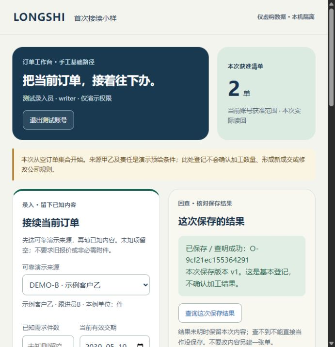

# 首次接续隔离小样：实际验证记录

2026-10-28；revision 1；supersedes执行中r0，r0逐字保留项目外。用户在任务包r16第14节具体提议后回复“开始”，授权本次项目外虚构小样实现／运行；随后要求Bento风格并继续调试。首批r12仍待验收，正式业务开发、真实员工试用及公网开放没有因此批准。

## 给用户看的结果

当前小样已改成Bento布局，并用实际表单从空数据库登记两张虚构订单，保存、重开、原操作查回和普通清单已经跑通。没有AI参与基础办理。测试环境已正常关闭，记录保留。

这是691像素宽浏览器窗口的实际截图：左上说明当前任务，右上只显示当前账号本次实际读回数量；下方分录入／结果卡，跟进清单占完整一行。不是完整软件、手机验收或全19页改版。

## 三类证据分别看

| 证据 | 实际做了什么 | 能支持的结论与限制 |
| --- | --- | --- |
| HTTP与数据库 | 最终R6有55项内部检查匹配预期；含空库创建、同键并发只一笔、换内容冲突、重复来源拒绝、真实HTTP超时后查回、顺序读写撤权、合法空／拒绝／核权读取故障 | 只对本次固定夹具和入口成立；55项含环境检查，不是55项产品功能或所有安全分支 |
| 普通界面 | CUA实际登录、表单登记甲乙、乙回复超时、重开原内容并查回、表／卡切换、顺序换四账号、核权读取故障与恢复；11份AX记录分别留存 | 是实际界面及后端路径，不是API结果代点击；只在所用窗口／操作序列观察，没有员工试用或完整目标设备验证 |
| 前端迟到回复 | 真实app.js在Node VM最小假DOM及可控fetch下11项检查；旧账号清单／详情／保存／回查、清单倒序、同账号旧A回复不清新B线索等 | 测试直接切换上下文、模拟回查完成，不是浏览器真实登录／网络交叠全过程；不是全部竞态或产品安全通过 |

最终R6的API库与UI库彼此独立，各自从空订单／操作集合开始；仅预给测试账号、可靠演示来源、单位和演示权限。数据库不预置甲乙订单，不能以API建好后页面读到冒称普通表单首次创建。运行器的ui_verified仍为false，普通入口证据在上述独立CUA记录中说明。

## 固定两单实际结果

| 普通入口输入 | 最终持久记录与读回 |
| --- | --- |
| 甲：DEMO-A，需求10件，交期留空 | O-09e9e9795efd4737，v1；需求10，交期null，当前加工／累计显示未知 |
| 乙：DEMO-B，需求留空，交期2030-05-10 | O-9cf21ec155364291，v1；需求null，交期2030-05-10，当前加工／累计显示未知 |

UI库最终恰2张订单、2个创建操作，回执均为basic_registration_only。UI自由备注和随机操作键与API固定正文／键不同，不称逐字提交API预期。原卡的有据4／待核3没有作为首次登记产生；未办理正式进度、原4→3更正或交期变更。

乙保存由**服务侧测试夹具在COMMIT后延迟1.5秒**，普通界面700毫秒中止等待，实际显示结果未明并保留原内容。重开后用同一操作查回原乙单，没有第三单。这是人为注入延迟的真实HTTP／界面结果，不代表覆盖各种真实断网／进程故障。

普通界面切换结果：writer可见2单；reader仅甲1单、不能保存且不带乙信息；empty合法空为0单；denied为“未取得／不是合法空结果”。可信夹具撤去应用角色对演示授权表的SELECT后，刷新显示未取得而不是0；恢复SELECT后仍为原2单。公司真实权限矩阵尚未给定，测试账号不是公司账号。

## 调试中实际发现并修了什么

| 轮次／发现 | 修正与后续证据 |
| --- | --- |
| R1：终端stdin关闭，停止命令无法投递；4号指出收尾异常会跳过清理、路径归属复核和最终失败判定不足 | 保留失败和冻结源码；核对专属进程命令行／监听后仅终止本次API Python，**不是优雅API退出**；本次PG正常停止，端口和R映射收好。R1整体失败保留，未擦掉 |
| R2：实际顺序切账号时，旧清单／时点可能短暂保留 | 先清空账号工作区、明确加载，再展示本账号结果；实际R6四账号顺序检查通过 |
| R3：乙保存结果未明时仍留甲详情，容易误认 | 新提交先收起并清除旧详情，R4／R6实际界面复核，超时不再留上笔详情 |
| 原3／4号静态发现：旧账号异步回复可能晚到、重新画回；原3号另指出卡片漏来源编号 | R5增加会话代次／主体和资源请求序号，存储按原主体；卡片补source_ref；Node VM反例及R6卡片／顺序切号核对。该交叠风险来自静态分析，未冒称在真实浏览器已复现 |
| 原3号静态发现：同一账号旧A保存迟到，可能清掉新B待核线索 | R6增加本次操作归属检查；旧成功／失败均不得改变新操作提示／存储；新增两项VM检查，原3号804按同一快照回读关闭该项 |

每轮独立目录和数据库，先停再改、旧源码与结果保留。R2—R6运行器均记录自身服务正常停／端口闭／R映射解除、源文件未改和收尾错误为空；这些是运行器／正常收尾结果，**不表示每轮UI没有问题或全部故障退出路径已验**。R5恢复标记被停止优先处理，未称恢复执行；最终R6禁用与恢复两夹具均确实处理。

## 用户问的视频方法，用在哪里

本轮回读已有学习记录，没有重新看完全部原视频。5部相关UI视频的内容按下面6类方法落地；不计算“应用百分比”，也不声称Refactoring UI二十条全部用完。

| 方法与原学习定位 | 当前实际落点 |
| --- | --- |
| 后台工作流：先代表页、业务与视觉分别核（约5:26、8:26） | 同一登记／查回／清单片段先做普通版，再改Bento；保留前版和甲乙同类输入，不为好看增加业务指标 |
| Refactoring UI：层级与分组、组内／组间距（约1:32、3:29） | 非对称任务／数量卡，录入和结果分组；标签靠近字段，标题、说明和结果分层，中文不缩成难读小字 |
| Refactoring UI：按钮主次与明确状态（约2:27、5:46、7:32） | 保存为绿色主按钮，刷新／查询为次按钮；未知、加载、结果未明、合法0与不可用分别有文字，不只换颜色 |
| 设计系统EP02：用途变量、布局关系（约0:55、3:18） | CSS用主操作／普通链接／辅助文字各自用途，统一卡片圆角和两级间距；窄屏设重排规则，实际只核本次窗口，尚未验手机／各缩放 |
| oil欧呦：结合截图提出具体修改（约15:35—20:30） | 实际截图看表单、结果和卡片，发现甲详情残留后修改并复验；不是只做自动打分 |
| Gary／Impeccable：任务优先、克制、量身调整（约2:15—7:13、8:41—13:01） | 留来源、单位、当前范围及未知；没有用假经营数字／装饰图表填满Bento，颜色和卡片服务当前操作 |

本次没有安装或调用Impeccable、Figma、Variable Visualizer；采用的是学习中可用的方法。原静态HTML的本地预览拒绝继续保留，未搬路径绕过；本次新独立实现的小样由CUA实际成功访问，与旧HTML分别记证据。旧HTML保持字节不变。

学习依据：[后台／Refactoring UI记录](../技术调研/2026-10-27-后台UI工作流与RefactoringUI视频学习.md)、[EP02记录](../技术调研/2026-10-27-设计系统EP02视频学习与应用方法.md)、[应用清单](../技术调研/2026-10-28-学习成果适用性与应用清单.md)；另两部原记录在项目外工具箱outputs/ui-learning-20261027，包含来源和时间定位。

## 交付边界与下一段

完成的是限定虚构小样：基础手工登记、持久化、原操作查回和普通清单，无AI也能运行。尚无正式阶段确认／更正、任务发布反馈、资料上传、真实导出、EXE安装包、公司真实账号权限或完整发行物／恢复接手验收。当前版本没有旧版新写修订入口，不能给它补“版本冲突通过”的成绩。

首批r12、数据r9、固定卡r4、两份静态HTML保持；36组基础范围和既有任务编号不变。G01舍入、G04完成依据、G06维护尚缺及G03真实授权，继续集中暂存，不催用户猜答。

下一段沿原W07／W14核最少源身份／当前要求的真实规则与输入契约，准备实际公司依据与隔离样例的对应，随后按原任务／资料顺序推进。当前小样不直接复制为正式系统；下一次扩大运行／真实资料访问或正式开发须对应明确范围，不凭本次“开始”扩张。Bento先作为本片段候选风格保留，其他模块按实际任务逐步映射。

## 本机证据索引

源码、依赖、PG数据、会话／数据库私有参数、轨迹、冻结前版、独立检查卡和失败均留项目外，不提交仓库。1号根：C:/Users/华硕/.codex/tools/longshi-collaboration-lab/work/business-01a16bce/first-create-prototype-20261028/；final-evidence.json关联R6 result、11份CUA AX、前端VM结果与源码指纹。

- 最终app.js SHA256：02909a6be1c1175eaf1f6ad15b75bcaa2ea309c3826c4080da7aa30f8e9c1315。
- 原3号797只审app/schema；799—800发现会话竞态／漏来源；802—804核操作槽位及R6限定修复；均非亲自浏览器运行。
- 原4号794／798审收尾，801读R2产物支持正常收尾／独立UI库；不是所有退出故障或视觉独立复验。
- 原4号806另读R6结果／轨迹尾／冻结／UI空集和停止日志，确认所读正常收尾记录及11项VM结果与源码指纹对应；未现场OS检查或独立浏览器操作，不将其回执写成全UI验收。
- 原2号792冻结独立预期；795／796核指定预期与runner读取版本；805确认原expected未改及R2快照。其未独立观察R6界面，不把互审称产品验收。

当前轮完成后，1号另查最终3监听端口均无监听、subst仅剩工具箱L映射；R映射已撤。临时浏览器页关闭。未安装新依赖，未碰公司原件／生产，未公网开放、推送GitHub或执行关机。此前一页PDF是本次小样之前的设计准备快照，未默改内容。
