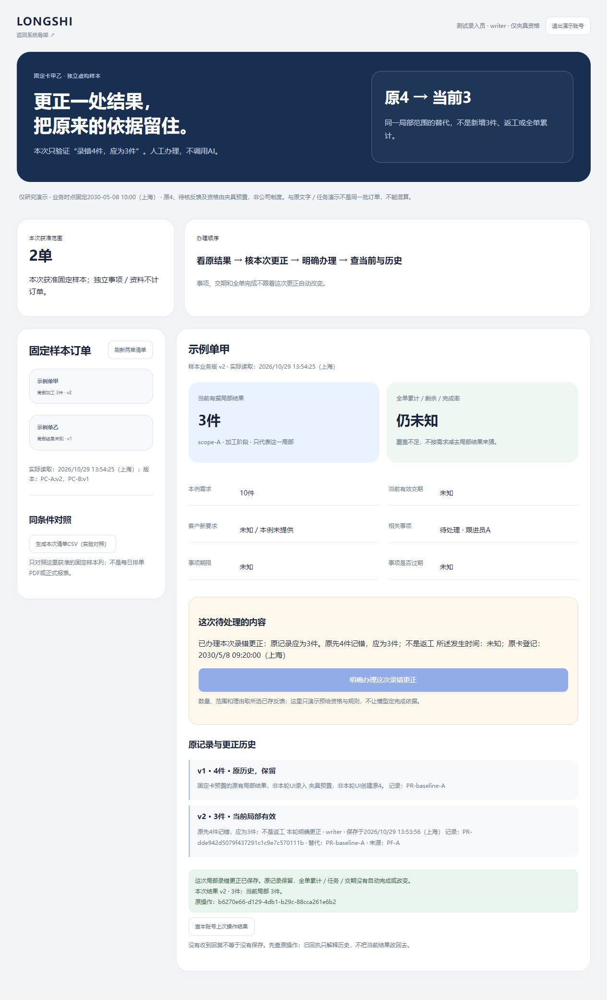

# 局部结果普通更正与历史回查实测

2026-10-29 · revision 1。承接用户“继续”和[最小清单r5§3](../../软件开发计划+施工清单/施工与验收/首批最小可试用清单.md)的项目外隔离虚构验证。**本段实际运行，不是公司真实完成制度、正式业务开发或员工试用验收。**

## 1. 大白话：这次补上了什么

一张示例订单只知道某一局部原来记了4件，后来反馈“记错，应为3件”。这次从普通页面明确办理后，当前显示3件；旧4件、谁更正、依据及替代关系都能查。没有加成7件，没有把整单算完，也没有替员工把任务完成。

浏览器提交后故意收不到及时回复，先显示待查；查原操作或按原内容重试后取回同一次结果，不再生成一笔更正。页面、实际下载的CSV与数据库按同范围逐项核对。全部路径人工办理，不调用AI。

## 2. 输入、复用与独立边界

- 原[固定卡r4](../../软件开发计划+施工清单/施工与验收/首批代表场景与验证卡.md)保持原字节。甲需求10，只有scope-A／加工／件的原4；整单累计、剩余、完成率及甲有效交期未知。已有“原4应为3，录错非返工”的反馈，发生时间未知、卡内登记09:20。
- 乙有效交期2030-05-10、新要求05-09待处理；加工结果未知不能当未开工。固定业务时点2030-05-08 10:00上海；乙事项期限09:00，过期的是该事项，不等订单延期。甲期限未知，过期判断也未知。独立事项丙和资料丁不增加订单行数。
- **SQL夹具预置原4、待核反馈、示例资格／适用规则及原4历史凭据。原4不是本轮普通UI创建。** 普通UI实际执行的是4→3更正；未验证公司首次确认机制。
- 复用[早期HTTP更正研究](2026-10-27-首节点HTTP更正回查与清单合成实测.md)的原操作／当前投影分离，以及已有Cookie演示身份和正常停副本机制。未重装组件、未复制外部未知代码。
- 新`formal_test`、`progress_api`及`progress_*`表独立于原文字／任务样本，不把原两单接续的followup v1当本例正式结果版本。当前只是一单一个局部范围的夹具，不是多工序通用引擎。

## 3. 实际观察与方法分别看

| 要核的行为 | 实际结果与方法 |
| --- | --- |
| 普通明确办理、重开 | H1普通页面原4→查回当前3，刷新重开仍3；H2原账号恢复未明原操作后按原内容重试仍同一3/v2；H3最终版本普通更正、查回、列表及重新读取有观察。每轮是独立复位样本，不合称同一条连续运行 |
| 未明结果不误报 | 提交已落库后由夹具延迟回复1.6秒，前端1秒中止等待；原键／原内容保留。H2/H3醒目标明数量是所列读取时刻的快照，待查时不能另办。不是自然公网丢包／断电实验 |
| 原历史与当前 | API读预置原4凭据得到historical=4、current=3；普通页保原4和本轮3及来源PF-A、替代ID。旧回执不恢复旧指针；已办反馈显示applied，不再装成待核 |
| 原内容重试／拒绝 | 成功原键原内容带旧所见版可取回原成功；同键换内容、新键旧版、重复消费已办反馈被拒；未知规则、跨范围、只读、额外注入数量／身份不改正式结果。API／DB核验，与普通点击分开 |
| 当前资格 | 普通顺序切writer／reader／empty／denied，空范围0与无资格未取得分开；H3顺序撤甲读权并刷新后只乙、清甲详情及旧CSV入口。API另验失写权仍可按读权查回、失读不可查、他人操作键不可借用；POST原重试仍需当前办理权，GET只读查回可用 |
| 实际CSV | H1/H2/H3均通过普通下载控件取得2行15列CSV；甲局部3/v2、累计和过期未知，乙v1、05-10有效／05-09请求并列。产物是固定卡机械对照，**不是日排单PDF或正式报表** |

H3 runner共37项内部检查（32项HTTP／数据行为及5项终态保护），本轮所列均通过；不是37个功能、全权限或整版验收。普通浏览器观察及下载另存，不用内部检查数量代替UI证据。

CSV 426字节，SHA256 `7e71ad395c18671eb0933d224aec733b11f75f51af5c49ae7f791394cc974057`。范围PC-A/PC-B、版本2/1；生成时间、固定业务时点、列清单及内容摘要随产物保存。未知输出“未知”，不填0。仅比较夹具所给范围，不能推公司总量。

## 4. 发现的问题和修正，按版本保留

1. **H1跨账号残留上一读取时间。** 业务行／详情已清，但时间没清；H2修清理链，最终H3无资格账号时间为空、详情／领取链接隐藏，未把H1追写成全投影原已通过。
2. **原操作跨目标／跨动作冲突前未核原范围。** 3号957静态发现；1号在H2实际HTTP复现，撤甲读权后借原甲键请求乙或导出先回409冲突。H3先按旧操作真实case／原export范围核当前资格，再比动作／目标／内容；三类定点反例回中性不可用，合法旧版重试顺序保留。3号959只读确认差异，不冒称其亲自重跑。
3. **H2范围收缩后旧CSV链接还显示。** 领取端会核当前权限，但界面仍残留旧入口；H3清单重读先清产物入口／href。普通撤权刷新后只见乙且链接、甲详情均清；后台资格仍在生成／查回／领取时核。

H1/H2既有runner绿项未覆盖后来发现的问题；原截图／复现／源文件均保留，不用H3结果反认旧轮无问题。没有开展并发撤权验证，资格行读取未加生产级撤权协议，不能据顺序测试称所有竞争时序安全。

## 5. 数据、资源与原件保护

源为正常结束的任务桥`run-c9`，没有复制正在看的U/49961库。每轮有冻结源码、初始夹具、前后快照、HTTP trace及普通UI证据；正常停自己HTTP／PG／T，H1—H3均记录无清理错误，未强杀其他服务。

继承5库各22张public表前后相同；新formal_test继承的原17业务表不变。原76对象逐项哈希保持，新测试库各18份复制与原命名空间分开，非新增上传。正式局部更正只新增结果／凭据／审计、推进甲指针与版本、标已办反馈；旧4整行、乙、事项及资料丁保留。此为列明副本保护，不是成套灾难恢复演练。

源码、数据库、日志和CSV留项目外`C:/Users/华硕/.codex/tools/longshi-collaboration-lab/work/business-01a16bce/progress-prototype-20261029/`。业务项目只留本说明、合成截图及施工追踪；六受审原文件／原16W与36B行另校，不改原件。

原4号958核H1冻结、快照和实际CSV字节，961增量核H3冻结23文件、5库各22表、原76对象及实际112文件、CSV／版本和撤恢复检查点；均为保存证据只读复核，未亲手重跑或核所有OS退出路径。3号957/959分别发现及定点回读权限顺序。H3前三类权限反例中两类核404及中性正文相同，第三类只断言404，不冒称其正文／时间侧信道已验。各自方法分开，不并称三方全产品验收。

## 6. 仍未完成与下一段

真实G03授权／G04完成更正依据仍待核；整单覆盖、返工、多工序、任意反馈办理、真实审批、EXE、公司内外入口、生产级撤权、成套恢复和维护支持未因此完成。H3与任务桥／资料片段尚未组合成同版交付；原W08/W09/W12/W13/W14整包不勾完成。

下一重点是[人工日排单首段验证卡](../../软件开发计划+施工清单/施工与验收/人工日排单首段隔离验证卡.md)：草稿不生效、明确采用、订单回查和一种实际PDF对账。目前只备具体卡，未实现排单或PDF。继续完整基础功能迁移，AI仅后续增强。

独立查看副本：`demo-progress-view-01`／V，地址[局部更正查看](http://127.0.0.1:57129/progress-review)，本日约14:57上海到期。来自正常停H3副本，当前3是已办结果，不是留在运行的测试库；未设置故意迟回。原U查看不改。该临时网址过期后应查项目外`review-pointer.json`与status，不当固定产品入口。
