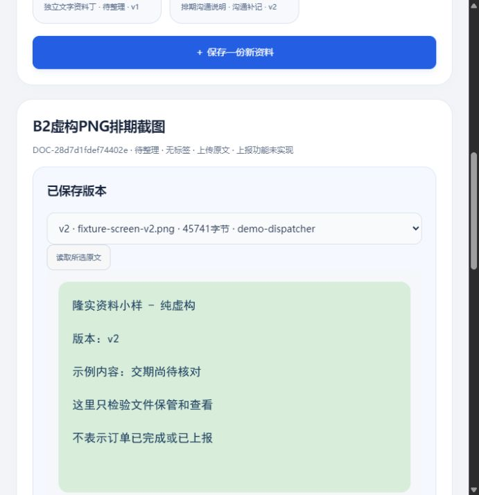
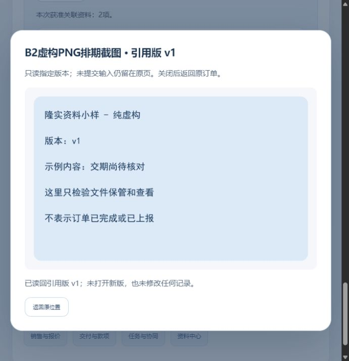
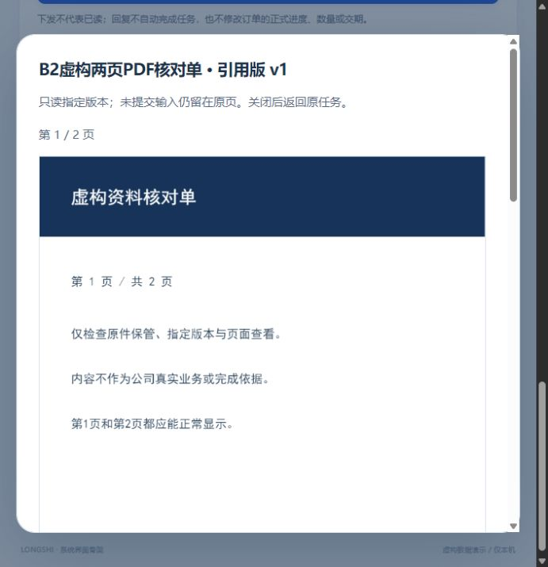

# 截图与PDF保管、指定版查看：限定小样实测

2026-10-29 · revision 1。用户“下一步”承接最小清单r2§5的项目外虚构执行卡。**本次确有新增有限运行；没有正式员工软件、真实公司账号／原件或生产接入。** 源码、依赖、数据库、日志和测试文件留项目外binary-prototype-20261029；项目只存本报告、追踪和虚构截图。

## 先看结果

**现在小样能人工保管PNG、JPG和PDF，读回原字节，在资料中心或订单／任务中查看指定版；补交新版不会盖掉旧引用。** 两页合成PDF已在浏览器画出两页，任务回复草稿在查看返回后仍保留。基础路径未调用AI。

| 实际做过什么 | 看到的结果 | 限制 |
| --- | --- | --- |
| 普通文件选择器上传真编码PNG、JPG和两页PDF | 三种文件均保管／读回并显示；PNG45664B、JPG44392B、PDF16984B | 仅这组小型合成样本，不是全部格式／实际公司附件验收 |
| PNG保存回复超时，查同次原操作 | 页面对结果未明给提示，查回原成功，不新建第二份 | 命名fixture的响应在SQL提交后人为延迟1.6秒，不代表所有网络中断／任意崩溃 |
| PNG明确补交v2，订单仍引用v1 | 资料页能看绿色v2，订单仍看蓝色v1；旧版字节未换 | v2文件名不同但明确作为同一资料新版；API还另验了同名补交路径 |
| 虚构任务接收者开PDF再返回 | 指定v1两页可读，未提交回复仍在；测试者最后清空草稿，未提交新回复 | 只对本次新PDF增加测试只读grant，旧原件权未变；不是公司G03确认 |
| 顺序撤新PDF读权后刷新相关区 | PDF不再列出；任务正文及回复草稿仍可见，恢复假资格后可重新列出 | 是已关闭预览后的顺序刷新，不是并发撤权／已打开画面立即清除证明 |
| PDF查看模块首次不可用再恢复 | B1复现重复读取仍失败；B2修后同页再点读取即可显示两页，无整页刷新 | 只核主模块受控不可用；未单独注入worker失败或穷举竞态 |

### 可以直接看

[本机临时查看副本](http://127.0.0.1:59330/#m-files)，2026-10-29 **12:44（上海时间）到期**。只用虚构资料；在派事演示员下可选PNG v2、JPG或PDF，订单中相应引用仍读PNG v1。地址过期不代表文件丢失，先核项目外review-pointer及status。仅本机，不能作公司／家里远程入口。

该副本是demo-binary-view-01／U，由正常停止且经离线对账的B2 PG及objects复制后独立启动；B1／B2测试自身均已正常停，不用其停止记录接管当前U。命名文件fixture-screen.png的创建仍保留1.6秒提交后迟回复实验，其余关联无人工迟回；请仅使用提供的虚构文件。

## 1. 本次怎样做，复用了什么

从已正常停止的RD2合成样本复制独立集群及原件，服务只监听127.0.0.1；源码不搬入业务项目。复用原资料版本／引用／原操作及目标核权，不把改扩展名白名单等同支持新文件。

- 按后缀和实际编码用已装Pillow／pypdf解析有限样本；调用已有托管Python作短进程探针，未在业务项目安装依赖。服务原env-core没有Pillow，先查已有托管运行时，未混装。
- 本实验文件上限512KiB、图片至多400万像素、PDF至多8页；**都只是实验约束，不是公司产品限额**。实际PDF只验证2页。
- 原字节不可变保管；按所读版本文件名返回image/png、image/jpeg或application/pdf，保留no-store、nosniff及当前测试身份核对，检查size／SHA256后才返回。
- 使用工具箱已装PDF.js 6.4.299（Apache-2.0）按[官方示例](https://mozilla.github.io/pdf.js/examples/)的文档→页→canvas方式逐页渲染；未用iframe展示PDF或新增Office平台。固定模块／worker和许可证副本在项目外，未选为正式产品依赖。
- 预览异步回包核账号代次、资料／引用／目标与读序；切版／切号清预览并撤回blob URL，返回先核原目标资格，保原页输入。退出时普通DOM观察到图片、canvas和引用正文均清空。

学习库先查，实际采用普通文件轻量解析、按明确页渲染、真实文件选择器及同产物／失败查回方法；没有调用OCR／Docling／AI，也没有把File-Fast包装入口说成本轮实际调用。两页PDF由已装ReportLab生成、PDFium两页渲染并目视核过；PNG/JPG原图亦逐一查看。组件存在／教程示例不是产品验收，本段实际证据另列下方。

## 2. 发现、修正和未掩盖的失败

### B1：PDF模块拒绝结果被永久缓存

首次动态加载PDF模块失败后，旧预览把已拒绝Promise一直留着。同页重读仍失败，刷新整页才恢复。本轮暂移本机pdf.mjs、读取失败、恢复同一原字节后重读仍失败，最后刷新两页显示，普通过程及JSON／截图均保留。

B1正常停HTTP／PG并撤自己T映射、留source-used后才修改：加载失败按请求归属清缓存；后续模块／worker使用新的本机查询身份，避免浏览器记住原失败模块；渲染失败可再次读取。B2在新独立来源上重做受控不可用→恢复→**不reload同页读取两页成功**。源码回读928与普通证据分开，不能据此说所有worker／网络问题解决。

B1表单仍残留“txt／64KiB”提示，B2同时改正为实际实验格式和512KiB；界面提示修正不算新增另一套业务功能。

### 收尾检查与检查脚本自身的问题

4号925发现client.close若异常会跳过stop；B2改为逐个记错且finally必调用拥有的资源清理。另用假client／假runtime验证首个close报错后仍关闭第二个并调用stop；**不是实际PG关闭故障注入**。两轮真实服务正常退出分别有status、pg-stop及映射结果。

B2终态检查脚本错误地把界面选择的“核实排机”任务，和API按首行选择的“整理待跟进”任务当同一目标，发生AssertionError，runner退出1。**原failure.txt／status及退出结果保留，不能称整轮全绿。** UI实际选择有过程记录，两张目标在各自旧发布快照存在。

停后另写只读audit_b2_result.py，依据各自原选择分别对账：逐个新原件真实字节／size／hash与fixture、每资料版本集合、create／version／link输入摘要、回执和版本／引用绑定，以及允许的新集合。离线对账通过；**没有改DB、改失败状态或重跑HTTP／UI**。4号930另用内存只读解析独立复算这些原始数据，补足先前仅行数／表内摘要不足的证明；不把passed字段本身当证明。

## 3. 证据分层和数据保护

| 证据 | 实际范围 | 不能替代什么 |
| --- | --- | --- |
| B1／B2 API及字节检查 | 各34项所列有限检查：三类型原字节／MIME、合法同次查回、换内容冲突、假文件拒绝、精确引用、顺序撤权及缺／坏PDF等 | 不是34项产品功能、普通UI、全安全或并发证明 |
| 普通CUA | B1/B2均实际三类选择器和预览；B2重验模块同页恢复、任务复合资格与草稿返回／顺序刷新、PNG旧引用与退出清画面 | 未提交普通业务进度或任务新回复，不冒称真实用户试用 |
| B2终态及离线补证 | 17张具名业务／资料表和对应原件／intent；未操作prototype_api精确不变，其余库旧行／旧字节保持，新集合按预期检查 | 不覆盖session表或所有DB对象；原runner失败仍在 |
| 原6份受审文档及W/B行 | 继续核原字节／原任务行，实验源码／DB在项目外 | 文档指纹不是业务完成或规则已批 |

B2 API专用库新增4资料／5版本／2引用／7操作，普通UI库新增3资料／4版本／2引用／6操作；旧订单／跟进／任务表保持，全新样本允许增长。新增grant仅新合成PDF给现有虚构接收人只读，明确不是扩大真实生产权限。原件和intent真实文件也逐项对账，不能只看数据库声明的hash。原夹具、失败、快照、原子操作结果及源码hash留项目外，可定位方法。

3号926/927发现模块缓存问题，928只定点核修源码；931只读B2观察记录及单张任务PDF截图／离线报告，并未亲手重做CUA。4号925/929审方法、930独立只读复算限定17表及原件结果。相互回读不是公司岗位制度或完整产品认证。

## 4. 尚未实现／验证的部分

没有OCR、扫描PDF全文搜索、语音／视频、文件夹、全Office在线编辑、大文件、类别上报、生产账号、EXE、公网或真实内外环境。PDF本轮为只读canvas，没有验证文档批注／签章／表单／全部加密／所有恶意与资源耗尽情况。当前权的静态／顺序例不等全部并发撤权。

本次没有新增日排单后台、正式阶段确认／更正或来源跟进直接派事桥；完整基础功能范围和暂缺集中规则不变。小型图片／PDF片段通过不代表整份最小试用清单已完成。

下一具体衔接仍沿W10：由可靠源跟进带对象与版打开任务草稿，**不自动保存或发布**，沿既有服务端核来源；这条桥目前未实现。本段新执行只覆盖图片／PDF，不顺势开正式业务或生产。

关联：[最小试用清单](../../软件开发计划+施工清单/施工与验收/首批最小可试用清单.md)、[资料归档操作稿](../../软件开发计划+施工清单/页面与原型/资料中心人工归档与业务引用操作稿.md)、[任务追踪](../../软件开发计划+施工清单/施工与验收/首批开发任务包与规则依据.md)。
