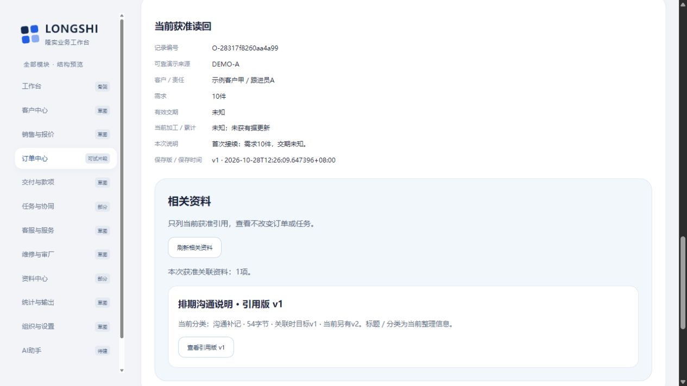
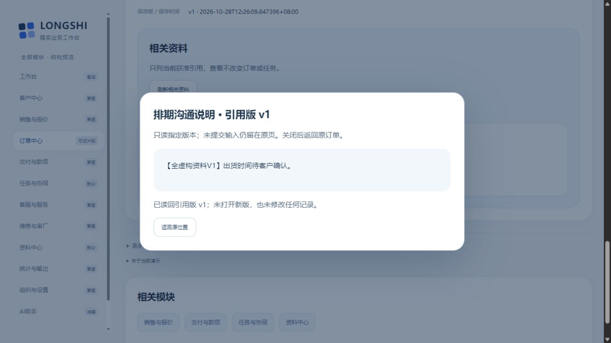

# 从订单和任务查看相关资料：固定版本只读与返回实测

2026-10-29；revision 1。用户“下一步、”承接关联入口设计r1§4执行卡，授权本次项目外隔离虚构只读小样。正式公司软件／真实账号及资料未获批准；不扩大为新业务办理。

## 先看结果

**订单和已发布任务现在都能直接列出本人获准的相关资料，点开当时引用的v1原文，再回到原位置。** 即使已有v2，也不会偷偷替换旧依据；基础功能不用AI。为保留未提交输入，采用**原页只读弹窗**，不把员工带去资料中心的编辑表单。

当前[打开演示](http://127.0.0.1:54428/#m-orders)，选派事演示员→登录→订单清单“查看记录”→“相关资料”。只在本机可用，独立`demo-related-view-01`／U，约09:18启动，**10:18（北京时间）到期正常退出**。原62833查看没有被接管，沿原09:39到期；每次续用先查各项目外review-pointer与status，不用旧测试状态操作别的映射。

## 1. 普通界面实际走了什么

| 实际操作 | 观察结果 | 证据边界 |
| --- | --- | --- |
| 派事演示员打开甲单，点相关资料 | 只列本单的获准引用，标“引用版v1／当前另有v2”、当前整理分类 | 不用q字串搜索，不把全库元数据交前端筛 |
| 打开引用v1，再返回原位置 | 读到“出货时间待客户确认”旧原文，留在原订单；任务上相同操作留在原任务 | 新视图只发GET；未上传／新关联／发布或修改业务 |
| 在原页“本次说明”留一段未提交文字，再查看／返回 | 原文字仍在，随后人工清掉，未提交 | 这是原登记表说明框；当前演示账号不能补写正式跟进，不冒称所有草稿都已验证 |
| 切handler打开其任务 | 原任务正文／本人旧反馈仍可读，相关区为“本次获准范围内暂无相关资料”，不泄未授权标题／隐藏数 | handler没有资料grant，未给它临时加权来凑正例 |
| handler留未提交回复，再刷新资料区 | 回复内容仍在，随后人工清掉，未提交 | 是相关区刷新保留输入；没有普通UI验证“同时有回复权和资料权者打开原文”的复合案例 |

新查看副本另实际重读甲单相关资料与v1，截图如上；它由**正常停止RD2的PG＋对应原件目录**复制，源／目标全objects相对路径hash清单核对相同。不是生产迁移／恢复验收。

## 2. 服务和数据：这次真正验证的风险

使用同一既有服务、PG及文件保管逻辑；没有新依赖／安装。新读接口先核当前目标权，精确kind＋id查原关系，再逐条过滤当前资料读权；只返回获准行数。具体原文按服务查到的reference_id→material_id＋material_version定位，URL不能指定另一资料版绕关联。当前仍是演示的粗粒度资料权，不等公司G03矩阵。

API故障实验在从UI模板克隆的**related_test专用库**及其独立objects里进行，普通界面用prototype_ui，原接口库prototype_api均分别留基线；不是把原API库ID套到界面。固定原单、两资料／三内容版／两个v1引用，实际54B原文hash仍为`6ea6b78e9d99639f6834b203ac590f6b503c2f3dd3729be12901d558b5f0e341`，保留末尾换行。

- 同标题里放目标编号但没有关联的资料，不进入精确相关列表；把任务引用ID拿到订单路径读取、中性未知引用均404。
- 专用夹具把目标当前版从v1设为v2：读列表仍是原reference_id、关联时目标v1和资料v1，原字节仍54B。正向资料详情里的旧引用也保留。finally恢复事前原值，不靠逆运算猜更新成功。当前业务小样没有一般订单修改流程，不能称公司升版办理已实现。
- 仅撤资料can_read时，相关列表不含该条、指定原文404，原任务仍200；仅撤订单读取权时，订单路径被拒，另有当前权的独立资料／任务路径保留。
- 仅撤资料模块can_view时，资料区404，但独立目标返回核权接口和原任务仍200；不能因此误判整单／任务失权。
- 指定v1字节临时移开，或改坏为同大小，均503、不回退v2，finally恢复。实际撤SELECT导致资料读取500，不报成功0项；任务正文仍可读。目标授权表读取500时，另有当前权的任务资料块仍可读。授权故障仅专用库，均finally恢复。
- RD2三库各**17个所列业务／资料／授权表**前后全字段相同；专用库的prototype_app／public表权限39项及objects中的8项blob／intent映射前后匹配。不是所有集群角色、序列、会话表或全部授权的审核。没有新增业务成功操作／订单／任务／引用／资料版。

## 3. 首错、审阅与修复保留

RD1接口先通过；普通界面发现新增脚本在head未defer、body尚空导致初始化失败，订单详情原来还藏在折叠旧工具内。实际首错日志和部分AX保留，未称该轮GUI通过。正常停、归档后才加defer，把订单详情移到清单下方；旧登记表仍折叠保留，不改办理逻辑。

3号887发现两项：①原返回误用包含资料资格的接口，资料模块权丢失会误清仍获准源页面／输入；②返回核权失败后，旧原文迟回复仍可能覆盖失败提示。已拆出只核目标当前权的GET，返回开始使原内容请求代次失效；只刷新资料块，不重调源表单show。3号889只读复核这两点闭合，不代其亲手测试或全部竞态。

4号888发现测试夹具finally不应无条件version-1，现改用事前原值；并补demo_grants及单独表权限前后对照。4号890只读终核RD2归档源码、快照、字节和正常退出；未亲手CUA，也只读新查看copy-check记录，没有独立重跑复制。

| 证据 | 实际范围 |
| --- | --- |
| RD1 | 23项API／DB断言＋收尾不变1项；部分GUI暴露首错，已正常停／保留 |
| RD2 | 25项API／DB断言＋普通界面后全表不变1项，共26通过；完整上述普通路径单列CUA记录；正常停，16源hash与冻结一致并归档 |
| Node VM | 8项测试闭包／假DOM／受控fetch；覆盖模块权丢失返回不清源、返回失败后旧内容迟到、切号／换目标、合法空与失败、待查阻开、确实目标失权、错账号回复。不是普通网络竞态或公司授权验收 |
| 新查看副本 | 当前源码普通浏览器重读指定v1；无人工迟回，独立活动约一小时，不称测试停后所有服务都停 |

RD2状态中的gui_scope是启动等待时点的pending，未事后篡改；实际CUA证据在`run-rd2/cua/result.json`及AX／截图，不靠该旧字段推断有或没有普通操作。

## 4. 仍未实现／未验及后续

本次没有“由此派事”跨页草稿桥、直接订单选任务、上传且关联、任务修订、上报／审批／通知、AI、图片视频或EXE；真实权限、加工完成依据、舍入和维护承接按原集中缺口保留。当前只是小txt／虚构资格，未验全部设备／无障碍、完整并发撤权、任意崩溃、同一人可回复并可读原件的普通UI复合案例或后台全部功能。

下一段先补订单跟进→任务草稿的最短操作设计：带可靠源跟进ID／版及其订单，只打开草稿，不自动下发；核对源候选标签不能只有前65字同文导致选错。已有相关资料小样先保留给用户看，不为延长工作再跑同一套检查。后续新办理仍按具体执行卡，原36组范围不缩。

实现、源码、样本／数据库、权限夹具、日志与私有凭据全留项目外`C:/Users/华硕/.codex/tools/longshi-collaboration-lab/work/business-01a16bce/related-prototype-20261029/`；业务项目只有研究／追踪和虚构截图。原2号886在未读新实现结果时冻结三条预期（01:04 UTC），不是声称早于作者全部编码；原三窗来源按消息号对应。复用已安装组件与学习方法，没有新开源组件选型，不把旧上游查证日期写成今日。无真实资料、生产、Git推送或关机。
