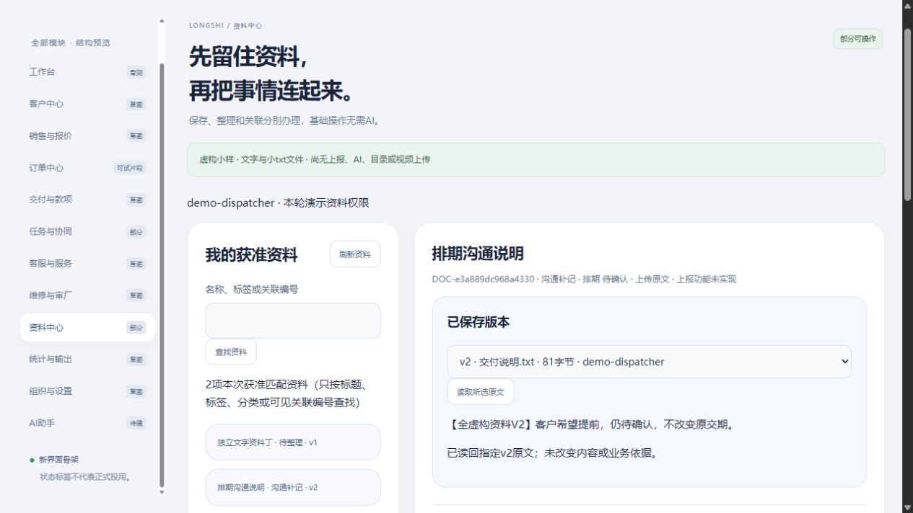

# 资料保存、人工分类与业务引用：限定小样实测

2026-10-29；revision 2；supersedes r1，r1原字节保留项目外route-design-20261029/docs-before；只更正任务关联措辞并增加后续设计指针，原运行记录不变；用户“好，那就下一步”承接资料操作稿r2§4的项目外隔离虚构执行。此报告记录新增有限运行，更新此前“尚未启动”的时点，不代表正式系统或公司试用已批准。

## 先看结果

**资料中心从草图变成了部分可操作的小样，不用AI也能保存文字／小txt、整理标题分类标签、引用到订单或已发布任务，并重新读回指定版本。** 同名新版不覆盖旧版；关联本身不改变订单进度、交期或任务正文。尚未具备图片／视频／文件夹上传、类别上报、AI提取或完整资料权限管理。

当前本机查看：[打开资料中心](http://127.0.0.1:62833/#m-files)。独立`demo-files-view-01`约08:39启动、**09:39（北京时间）到期正常退出**，无人工迟回；地址失效先查项目外`review-pointer.json`及对应`status.json`，不按旧S映射接管资源。入口只在本机，不能拿去当家里远程入口。

## 1. 实际操作与结果

| 普通界面实际办理 | 查到的结果 | 证据限制 |
| --- | --- | --- |
| 独立人工文字先保存，不选分类或业务 | 文字可重开；标人工补记，无假附件，发生时间未填写 | 只保存原输入，不是客户原话／OCR，也未上报 |
| 通过实际文件选择器上传合成txt，再补标题／分类／标签 | 标题“排期沟通说明”、分类“沟通补记”、标签“排期 待确认”；按标签找回同一资料 | 仅名称／标签／分类／可见关联编号查询，不是文件内文全文搜索 |
| 选资料v1，明确引用订单和已发布任务 | 两条引用仍指资料v1及当时目标版本；两次迟回复均查原操作成功 | 引用由资料页办理；尚无从订单／任务页反向展开附件清单 |
| 对同一资料明确补交同名v2，分别读取两版 | v1为54字节、v2为81字节；旧引用不变 | 没有按文件名自动合并；不含同名任意业务的自动去重 |
| 刷新、重登录并按权找回；切员工演示号 | 保存仍在；员工合法清单为0，无先前标题残留；其原获准任务／本人回复仍能读 | 只是预置虚构资格，不是公司实际权限矩阵 |

FS2界面库最终是2份资料、3个内容版本、3条整理修订、2条具体版引用、6次成功资料操作；其中独立文字72字节，只有两文件版存在原字节文件。原界面库2订单／4跟进／6旧操作，以及2任务／2草稿版／2发布／2接收关系／2回复／6任务操作逐字段不变。接口库有自己的固定对象及故障记录，数量不与界面库相加。

两个UTF-8无BOM文件来自事前固定输入：v1 SHA256 `6ea6b78e9d99639f6834b203ac590f6b503c2f3dd3729be12901d558b5f0e341`；v2 `ca184f76125dd479521280783e36d774465403b04115387f9cdc81361b7f61e2`。分别保留结尾换行，实际存储读取与大小／hash匹配。64KiB只是实验限额，不是公司产品要求。

## 2. 故障及权限：真正验到哪里

- 服务先核UTF-8、大小、文件名和实际字节，按主体／操作键固定独立位置；显示文件名不直接作为磁盘路径。通过JSON编码接收小文件，不是分块续传或大文件产品方案。
- 实际让SQL操作登记INSERT失败：返回500，资料／版本／整理／引用／原操作表均回滚，已落原字节留作待核；不会报保存成功。同键换内容409；同键原内容重试登记一次，沿用原字节。**文件与PG不是一个事务**，没有验证任意崩溃或自动清理孤立文件。
- 把指定v1字节临时移开，及实际改坏同大小字节，各返回503；不偷换v2。finally恢复原字节后，仍可读回原v1。
- 受控让关联SQL已提交、HTTP迟回复：客户端超时后按本主体原操作找回同一引用，原内容重试不重复。FS2普通页面实际经历迟回，并在刷新后查同次结果；正常查看副本没有该人工延迟。
- handler无资料授权时列表为合法0项，资料／具体字节／别人的原操作均中性404。顺序撤去owner资料读取权后，旧操作回执、原文及再整理不能绕权，拒绝过程不新增记录；随后恢复测试资格。不是并发撤权、公司角色或全部侧信道验证。
- 当前资料读取是粗粒度：同一演示读取资格允许看标题和读原文；尚无公司所需的标题／预览／下载细分矩阵。任务接收关系本身没有授予资料权。

## 3. 运行版本与修复分开记

| 轮次／方法 | 本轮实际范围 | 结果 |
| --- | --- | --- |
| FS1 | 初次HTTP／DB与部分普通界面，后续审阅发现前端竞态 | 正常停；保留初稿和日志，不称完整GUI通过 |
| FS2 | 32项HTTP／DB断言＋收尾旧业务不变1项；普通浏览器完整资料流程、实际文件选择器／刷新／切号 | 全部断言通过；普通界面记录另存，不把状态快照中的`gui_not_yet_verified`当GUI已核 |
| FS3 | 后续修复两处异步页面问题后的API-only回归 | 33项通过且正常停；界面资料表为空，不冒称FS3重做GUI |
| Node VM | 可控File.arrayBuffer／fetch＋假DOM共8项 | 覆盖准备中锁定、旧账号失败不串页、两个目标块独立失败、旧响应、稳定选择等；是模拟，不是浏览器／网络权限证明 |
| 新查看副本 | 最新JS、FS2停止库＋对应原字节成对复制 | 实际普通浏览器重读v1/v2、两条v1引用可见，刷新后保留当前仍合格任务选择；没有重复提交 |

3号874指出选文件异步准备可串标题、目标列表按索引错选及一块失败拖另一块；已锁准备输入、绑定账号／编辑代次、用稳定对象键并独立处理两个读取。877又发现刷新失败使旧准备锁不释放、读取开始时捕获旧选择可能覆盖等待中新选择；修为只释放本准备代次锁、响应应用时核当前选择，并新增两条反例。读取失败仅标当前块，切号清对应旧内容；这不等于所有UI竞态已解决。

## 4. 同伴回读、学习复用与资源

2号873在未读新实现／结果时固定三条预期卡，覆盖原文保管／固定版本引用／跨存储失败；其冻结时刻是2026-10-29 00:21 UTC，不冒称早于作者首跑。3号874／876／877分别只读前端和服务端代码给出限定意见；4号875读FS1失败证据，878终核FS2／FS3保存、字节和退出。3号879又只读复核两处修复及新增反例已收拢，没有亲自运行。4号没有亲手跑CUA，未验新查看副本复制。

本段先按dev-planning和学习库检索已有原件保管、PG恢复、状态及Bento方法，回读[资料传输职责复核](../技术调研/2026-10-28-资料中心传输与保管职责复核.md)。复用已有Python／FastAPI／PG，不装Uppy、tusd或新插件；已有开源比较保留原查证日期，不声称今日重新验证上游。页面延续分卡、清单／详情层次、明确保存状态和实际截图反馈，未重看全部视频或验证全部设备／无障碍。

源码、虚构数据、凭据、原操作输入、数据库快照、源hash及CUA完整记录全部在项目外：`C:/Users/华硕/.codex/tools/longshi-collaboration-lab/work/business-01a16bce/files-prototype-20261029/`。FS1／2／3自身HTTP／PG／映射均已正常退出；FS2／3各14源文件与冻结快照逐一匹配并归档。查看副本仍活动、最多一小时，不能写成所有服务已关闭。无真实公司原件、生产配置、新依赖、Git推送或关机。

## 5. 后续施工／验收怎么接

W11／W12／W14及W01必要片段只回填上述局部证据，不勾整包完成。下一段先收拢**订单跟进—任务—资料的整段使用走查**：哪些已有真实按钮、哪边只能单向关联、哪些仍草图，列清同一人如何少走页面；先做差距／页面方案，不新增反向API或假装已具备。之后才按授权做对应最小增量。真实G03、加工完成依据、舍入、类别上报及维护承接仍按集中缺口，不另抛问卷。

## 6. 已开始的整段走查：先把跳页和缺口画清楚

此段只据当前源码和前述普通操作整理，不新增服务写入或反向接口。

| 同一条虚构工作里的动作 | 当前能做到 | 下一处应补的页面行为（候选） |
| --- | --- | --- |
| 打开甲单，记一条沟通信息 | 订单中心能保存文字跟进；不是正式进度变更 | 从当前单进入派事／找资料时带可靠对象，不能只带客户名称猜单 |
| 派人核实排机，再收反馈 | 任务模块有独立草稿／下发／本人回复，当前通过所选跟进ID／版及其可靠订单关联 | 订单详情应有“相关任务”入口；任务不因回复就算验收完成 |
| 先留交付说明，晚些整理 | 资料中心能独立保存、分类标签、同名新版本 | 允许先留资料；任务有权而资料无权者仍只读必要正文 |
| 将所选v1挂到甲单和既有任务 | 资料页可办理；同名v2不改旧引用 | 业务详情应按当前权列对应引用及版本；暂未实现，不能把关系表当现成按钮 |
| 几天后老板追问依据 | 目前分别进订单／任务／资料查，资料页可按可见关联编号找 | 减少复制编号和反复导航；仍需分别提示“反馈／正式结果／资料保存”，不能一个绿色完成混为一谈 |

建议先设计订单／任务详情中的相关资料小区块，再决定最小运行增量；把已保存资料的引用与“上传且关联”拆清，避免一次点击悄悄新建／授权／发布。当前位置、权限和失败提示要先有定义，图片／视频与AI提取随后接入这条基础路径。

## r2措辞更正与下一段设计

本轮回查task.js／task_routes.py确认：任务草稿选的是源跟进ID／版，后台由跟进核订单，不能写成已有直接订单选择或“由此派事”桥。原§6已据此更正；它是描述更正，不是FS2新增实现或复测。下一段详见[关联入口与整段走查](../../软件开发计划+施工清单/页面与原型/订单任务资料关联入口与整段走查.md)：先补订单／任务相关资料只读区，固定引用版、返回原对象，当前仍设计。
