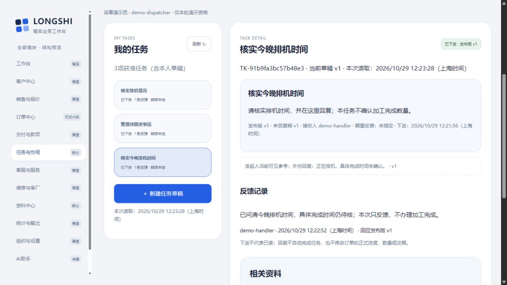
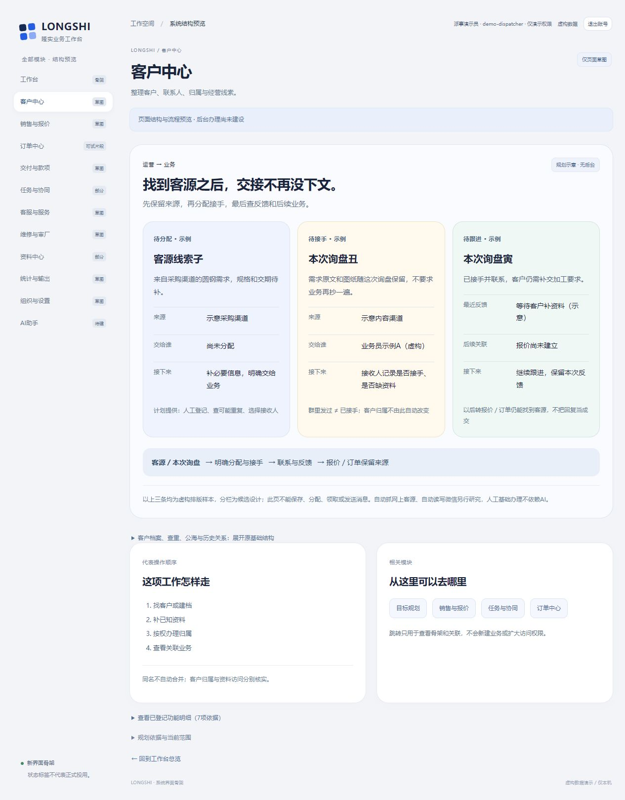
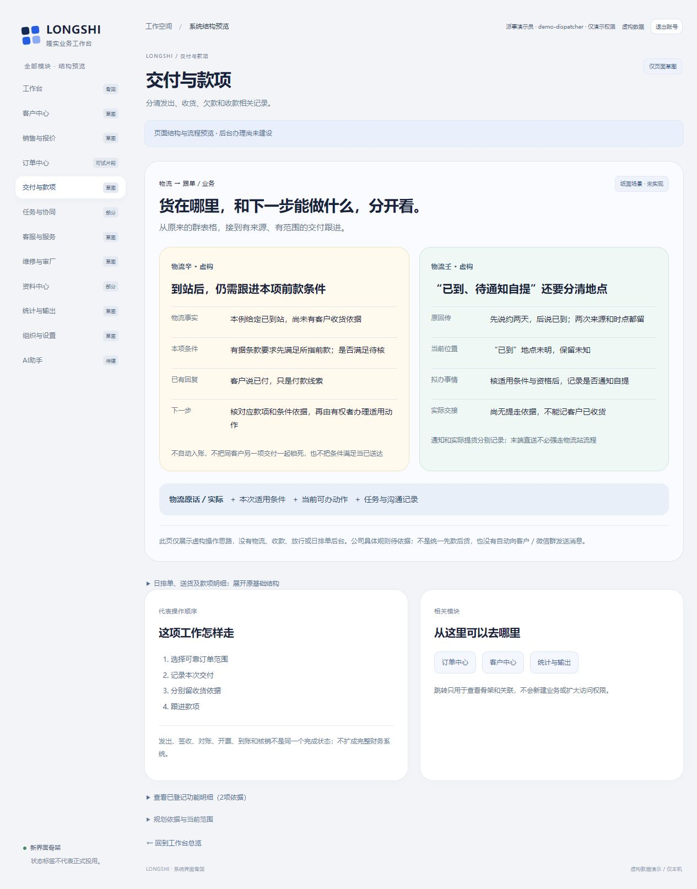

## 最新补充：刷新也要核本地尚未保存的引用

C8实际发现只刷新任务清单仍可残留旧源文；C9先补已存引用，3号949再指出本地新选而未保存的引用不在服务已存绑定里。C10改为刷新时重读当前来源目录，再分别约束已存和本地引用；实际复验保草稿／原绑定、源文占位及未提交回复。详见§7，各轮不混作当前完整产品通过。

# 从跟进准备任务草稿｜限定实测与失败修正

2026-10-29；revision 3；supersedes r2（r2原字节存final-refresh-docs-before），补刷新路径；以下前版：supersedes r1（r1原字节存business-preview-docs-before），只增本页UI附录。1号执行，原2/3/4限定协作。用户午饭前要求连续做一个半小时；本段在既有项目外虚构小样中复用任务命令，未进入正式业务开发。

## 先看结果

**员工不必再切到任务页、重新找一遍来源：有派事资格的人可以从已保存跟进准备本页草稿，自己写要求、选接收人，保存后再明确下发；对方回复，发起人可查回。** 打开不等于保存，下发不等于已读，回复不等于订单完成。

普通界面实际走通这一小段，并核了打开前后数据库、已撤来源读权、旧成功回执、新账号及迟回。它不等于完整任务、订单或真实岗位权限验收。运营网上获客、每日排单、物流／收款放行仍是设计，不能据本段冒称已实现。

## 1. 输入、实现和复用

- 数据取自已正常关闭的图片/PDF B2成套副本；B2原runner目标选错失败及停后独立补核仍保留。新桥复制在项目外 `task-bridge-prototype-20261029`，原B2源及其U查看不改。
- 复用现有PG、订单读权、任务草稿／下发／本人回复／原操作查回命令；未新增工作流平台、依赖或业务DDL，也未把源码搬到公司项目。
- 按学习库和原任务／关联入口资料，复用可靠ID＋具体版、当前权、草稿与发布分离、Bento主次区、未存输入守卫、原操作回查及按来源留证。没有为了“用插件”叠加新平台。
- 来源只能选已保存跟进，不拿未提交框内容代替。当前跟进schema只允许v1；任务草稿有自己的版本。不存在v2输入拒绝与真正源记录升版是两件事。
- 新页仅带固定跟进ID／版及所属单做重新核对。任务标题、正文、接收人和期限不自动确定；来源原文放获准的发起人参考区，接收人只见明确下发的标题及正文。
- 发起人自己已存的引用在来源暂不可读时仍保留不含原文／订单身份的绑定元数据；UI显示占位，不偷偷改独立任务或套用新来源。读取任务会更新当前来源候选，不能从登录时旧缓存复活被本次读取隐藏的原文。

## 2. 普通操作究竟验证了什么

| 证据 | 观察到的结果 | 限定 |
| --- | --- | --- |
| C3未存草稿→另条来源→继续编辑／明确放弃 | 继续编辑保原标题、正文、原引用；明确放弃后才准备新的空白任务；订单未提交框仍留原页 | C3后续发现另条候选缓存残留，未把这一轮称全通过；C4沿同守卫完成新链 |
| C4普通“由此准备任务草稿”＋前后快照 | 标题／正文／接收人／期限均空，只带F-dec…/v1；17张所追踪表全同，未新增任务／凭据 | 有源读权但无跟进写权的虚构派事员仍可在输入框留测试字；未将这段字保存或赋予跟进写权 |
| C4明确保存→明确下发→员工反馈→发起人重开 | UI仅新增1任务、1草稿、1发布、1接收关系、1回复、3操作凭据；发布取已存草稿v1，回复指相同发布ID/v1 | 单接收人、系统内接收清单；无外部消息、通知回执、完成／转交／取消或多接收人 |
| C4接收人查看 | 必要任务标题／正文可见；参考源文字为空，原订单未获读权，新建派事入口隐藏 | 虚构资格及当前片段，不代真实G03 |
| C4先撤来源读权，再重开本人草稿 | 任务标题／正文和原引用v1保留；来源区占位，候选无同单另fid旧原文 | 顺序撤权＋重读；不是已经打开页面后的瞬时推送清除或并发撤权证明 |
| C4从旧订单页面按钮再次准备 | 服务重读当前上下文后拒绝准备；原任务输入保留，没有另派任务；相邻快照任务六表全同 | 原订单页面未刷新前仍是旧投影，不能据此声称全站即时撤权；写及准备均重核 |
| C4回复未存切任务／查旧成功回执 | 继续编辑保留本人回复；上次下发成功回执不覆盖下一条新草稿 | 不是跨关页／浏览器崩溃草稿恢复 |
| C5来源候选单次503 | 任务正文、已有反馈和原绑定仍在；来源原文／候选暂停，提示故障而非0项 | 测试包装层只让task-context一次失败，非真实外网故障 |
| C5旧派事员上下文响应控延3.5秒，其间退出并登入员工 | trace顺序为held→员工登录→released；响应释放后员工页无旧标题／正文／源文，派事表单隐藏 | 真实普通cookie登录＋本机响应控延，不是公网丢包、跨设备、所有并发组合 |
| C6故障恢复提示定点复验 | 来源恢复后改为重新读取成功提示，旧失败警告不继续挂着；任务和来源正常显示 | 只改这一处提示分支；C4完整链与C5迟回按各自版本证据保留，未称C6重跑全部 |

C4 UI前后对账与C5/C6所追踪表均排除会话表；登录会话变化不是业务记录增量。数字是本轮样本／内部检查数，不是功能数量、完成率或真实公司验收。

## 3. 失败必须一起看

| 轮次 | 实际发生 | 如何处理 |
| --- | --- | --- |
| C1 | 测试代码试图把跟进version加到2，被`followups_version_check`拒绝；runner退出失败，尚未普通UI | 保留failure/status，正常停；不改约束来凑通过。后续改测不存在版输入被拒绝，不冒称源实际升版已验 |
| C2 | 接口及旧记录检查结束；普通界面只登录看来源，3号源码审阅指出旧来源缓存和自动标题带出源片段 | 保存ui-not-executed原因，停后修。status的execution_passed仅脚本内部检查，不代普通桥接通过 |
| C3 | 普通打开／保存／未存守卫及当前bound源隐藏有观察；实际发现同撤权单的另一fid仍在旧候选 | 保留JSON/截图，恢复夹具并正常停；C4改为当前来源目录重读，失败只暂停该来源区 |
| C4 | 完成指定普通链及来源权限反例；57内部断言均真并正常停 | 3号回读源码／保存观察，4号独立复算快照／对象，均未亲手复跑普通UI；不称三方现场验收 |
| C5 | 单块失败及迟回切号有效；恢复后旧警告仍显示 | 保留实际恢复JSON；C6只修提示，并做故障→恢复普通复验 |
| C6 | 来源与提示恢复，8项所追踪保护检查真，包装脚本前后hash一致，正常停 | 这是受影响分支复验，不将不同版本检查数相加或称当前整版产品通过 |

## 4. 对账、原件和退出

C4的四个明确追踪库为prototype_api、prototype_ui、binary_test、bridge_test，每库17业务／资料／任务／资格表。前两旧旁路库整表相同；UI和专用接口夹具原行保留，新增对象分库核对。UI只新增上述一套任务链；接口夹具另有1任务／2草稿／1发布／1接收关系／1回复／4凭据，不与UI混算。

4号940独立逐行对比，并重算清单中的68个原对象SHA256，字节及文件数未变；核UI草稿／发布／回复／凭据目标链。objects内另有related_test目录不在该四库清单，不能扩称所有继承库／全盘保护证明。C5/C6各自四库17表及列入的对象前后全同；没有新业务写入。无需以绕过旧库只读边界或修改公司原件来验证。

C1—C6均记录HTTP、PG及T映射正常收尾，源码hash与各轮冻结相符；C6测试包装源码另保存hash。测试停止不等于旧U查看已停，查看到期需另读status。新查看副本如后续建立，另记地址和期限，不把测试端口当长期入口。

内部完整输入、源码、快照、trace、凭据和失败文件留项目外；本项目只存研究、追踪和虚构截图。未上传公司资料、未装组件、未推GitHub、未关机。

## 5. 需求与下一步的边界

本段补W10/W14及已有订单—任务关联入口的局部证据；不勾整包完成，不改原六受审文件、16W或36B原行。客户／运营获客、正式明细结果办理、每日排单和同源实际产物、真实岗位权限、安装打包、公司内外目标环境、接手维护及成套恢复仍需对应工作。

最新运营图支持“获客登记→分配接手→反馈→报价／订单保来源”的基础方向；物流图支持人工回传、补漏和有据收款条件对应交付动作。两项仍按各自[运营补证](../产品经理调研/2026-10-29-运营获客与线索分配-需求补证.md)和[物流补证](../产品经理调研/2026-10-29-物流回传与收款放行-需求补证.md)设计，不把任务小样当它们的后台实现。G01舍入、G03真实权限、G04完成依据、G06维护等暂缺继续集中，不让实习生猜答案。

## 6. 后续UI-7：新业务资料成为可浏览示意（仅HTML/CSS）

为了方便用户讨论功能，将运营获客交接的子／丑／寅三样本及物流辛／壬两例放入独立演示的客户／交付款项两页。原客户档案、公海及日排单等结构可展开，模块范围不删。页面明显标规划／未实现，没有新增记录、分派、收款或物流接口；子丑寅分栏不是客户分类或实际状态转换。

普通CUA看了默认1280×720视口、展开两页原结构、从导航返回已有任务读相同发布版反馈；截图如下。一次语义role选择器找不到summary，改点可见标题后正常展开，属于选择器定位差异，未绕过界面调用。刚切页的一张观察处于原有平滑滚动中段，后续DOM和截图确认标题回到顶部附近，未据中间帧乱改导航。未缩放视口美化截图；全页截图再以本地图查看，未称窄屏／全部设备或无障碍通过。

UI-7只改index.html及app.css，业务命令JS／路由／模型hash与C6相同；四库所追踪17表和列入对象前后全同，无业务增量，HTTP／PG／T正常停。这是布局／普通导航证据，不是两个模块功能完成。旧B2查看U亦已另按status正常到期，不和UI-7测试混为同一资源。

后续查看副本应从UI-7正常停止成套复制，地址和期限另读项目外review-pointer/status；不复用已停测试端口。

## 7. C8—C10：仅刷新清单与本地未保存引用的补漏

**C8实际反例：**已发布任务原参考可见，顺序撤去源订单读权，再只点“刷新任务清单”。列表已新读，但旧实现只更新任务动作资格，没有同步来源投影，原文仍留。`ui-after-refresh-revoked.json`保留这次失败；runner的8个表／字节保护断言真不等这条UI行为正确，未修改失败记录。

**C9先修已存引用：**普通刷新后清已不可读原文／候选，任务正文、已有反馈及原ID/v1保留；恢复源读权后刷新重显。员工未提交回复刷新仍保留，未保存新任务。3号949随后静态指出：若保存的原任务是独立草稿，本地新选来源A但未保存，服务fresh没有已存binding，仍可能用旧catalog回显A。这是新找到的具体遗漏，C9已发布路径通过不能覆盖它。

**C10最终定点修正：**任务清单读回后另读当前task-context，每个await核账号／世代／本次读取序号。当前目录替换旧缓存，失败只暂停来源回显；已存任务本次reference:null对其源仍优先。保留本地bound ID/version，渲染占位不改成独立，也不调用show整张任务来清输入。明确无任务资格才暂停相应任务区，不报0项；来源读不到不擅自清其他可靠任务正文或重新授权写入。

为了实际覆盖949，在独立副本**基线之前用SQL预置**1个独立草稿`TK-refresh-fixture`：1task＋1draft、无来源、无任务操作凭据。保留source-before-seed及fixture-seed标识；它不是UI建草稿，也不计成又一条任务办理成功。普通操作随后：打开该草稿→修改未存标题／正文→新选F-dec…v1但不保存→撤源权→点刷新。实际title/body/binding完全保留，参考变占位／无原文，发布仍disabled；恢复源权后原文重显而未存输入不变。同行又核已发布引用刷新撤权，以及员工未提交回复刷新保留。

C10源快照到基线仅新增上述两条夹具行，原行保留；基线到收尾四库17表全同，列入原对象无增量。4号952独立逐表复核并重算列入的68原对象SHA256，未审其他继承库、未OS复测或亲手GUI。3号951只静态核当前刷新措施，不等现场运行。C8/C9/C10 HTTP/PG/T均正常停、包装脚本hash不变；各种方法分列，未重跑C4完整保存／发布链、真公网、即时推送撤权或全部并发。

## 当前查看副本与后续边界

本机临时[客户中心草图](http://127.0.0.1:49961/#m-customers)至2026-10-29约14:14（上海时间），源数据来自正常停止的C9，不带C10额外SQL草稿，代码为当前C10来源刷新修正与UI-7草图。项目外指针`task-bridge-prototype-20261029/review-pointer.json`及相应status为准；当前副本浏览登录已确认，非真实员工环境或长期网址。只有命名PNG测试创建保留刻意1.6秒提交后迟回，任务无刻意迟回。

运营／交付款项两页仍只有候选布局；正式结果、排单和真实交付门槛不变。[最小试用清单r5](../../软件开发计划+施工清单/施工与验收/首批最小可试用清单.md)已将历史状态归档成当前六行表，945—947只核各自指定节，不是全文或产品验收。

