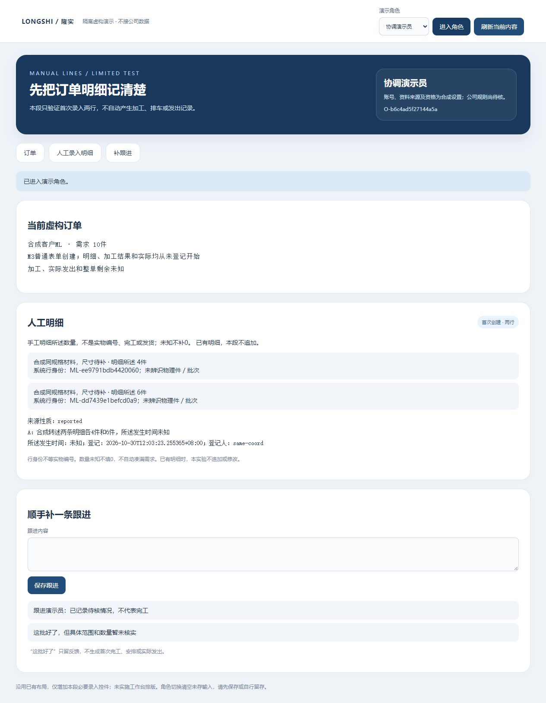
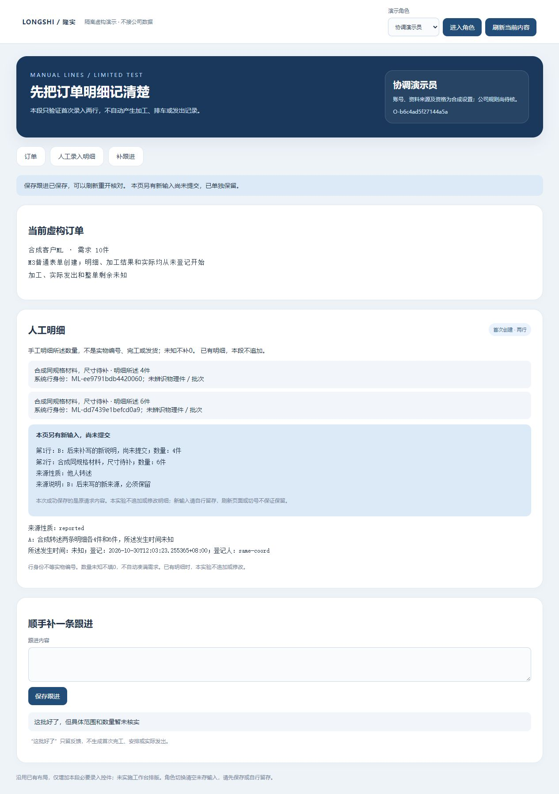
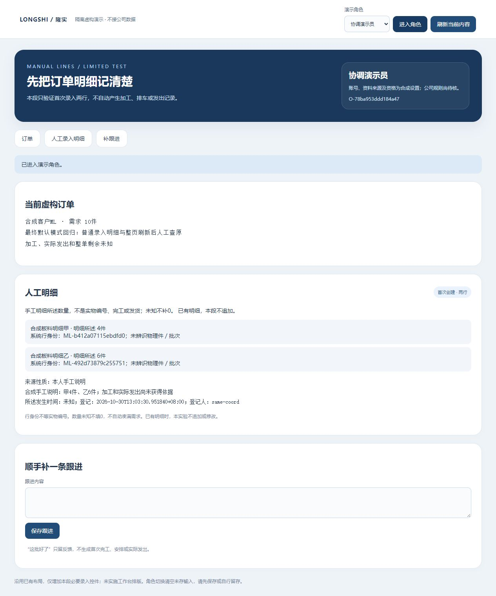

# 人工明细首次录入：保存、查回与新稿保护

2026-10-30 · revision 3 · supersedes r2，r2字节留项目外manual-lines-prototype-20261030/docs-before-final-handoff/1.md。本版补指定回读及正常查看交接；以下历史：supersedes r1，r1原字节留项目外manual-lines-prototype-20261030/docs-before-result/0.md。本版截至13:12的运行／补验证据已收拢；两小时工作仍在完成交接与下一段图纸。用户明确要求继续两个小时，承接[人工录入卡r2](../../软件开发计划+施工清单/施工与验收/人工明细与业务依据录入-下一段卡.md)第一段的项目外虚构执行。**人工明细首段及M4—M9限定补验均已正常收尾；仍是虚构功能实验，不是正式员工软件。** 正式业务、公司真实授权、首次加工确认／发出来源、部署及UI重排未扩大。

## 先给业务同事看的结果

普通页面新建一张虚构订单，然后手动录入两条同规格明细，数量分别4件、6件。保存、重开后还是这两条，来源及登记人／时间可查；系统没有因此记录完工、排车或发货。两条明细的系统行身份不同，**没有要求给每块钢材编号，也没有自动生成十个实物编号**。

输入有问题时，页面明确拒绝并保留已填内容；保存回复超时，可以查原操作找回成功结果。提交后后来新写的内容会单独标为“尚未提交”，不被旧回执清掉，也不冒充已经修改明细。

这是当前实验页面，不是已排好版的员工工作台。后续布局按用户要求后做；本页只是新增必要输入控件并沿用已有样式。

## 实际做了什么，哪些还只是预期

| 方法／版本 | 实际结果与限制 |
| --- | --- |
| M1启动／首反例 | 第一条异单反例因SELECT FOR SHARE所需权限不足返回失败；没有为此给应用角色扩大修改授权。保留失败、冻结源和正常停记录，不算通过 |
| M2接口及部分普通页面 | 改用各账号共用的稳定订单事务advisory guard；接口两账号不同键至多一套、原操作回查、空白／单位／资格反例与末写失败回滚已跑。GUI实际复现“原A因失权未写→恢复刷新→写B→原内容重试A成功却清B”，因此不是完整页面通过 |
| M3普通页面 | 从普通表单建订单和两行；顺序撤／恢复明细读权，原内容重试保存A而B在独立区域保留；普通模糊跟进不变完工。只读账号、跟进账号和空范围账号按所列动作观察，不代表公司真实岗位矩阵 |
| M3独立迟回复页面 | 普通空白来源被明确拒绝、其他字保留；补合法来源后，服务器提交后延迟1.8秒而浏览器900毫秒中止等待，页面待查；点查询原操作并重开，找回同一套两行。没有通过第二次新保存找回 |
| M3独立接口与停后快照 | 正常和迟回两库各一set、两条所述数量4／6、一个明细原操作；新单的physical pieces、结果、安排和actual均未生成。39继承库1419表快照与原字节保持；含新复制共951个原件对象未改 |
| M4确定等待／接续 | 两个不同账号请求实际在同一订单advisory guard等待，释放后仅一套成功；读不到未提交半套。同机正常停后副本重开，明细身份／来源／原回执保持。不是异机灾备或全部崩溃恢复验收 |

M3的146项是内部检查，不是146个功能；76份冻结源hash在正常停后保持。普通页面／独立接口／数据库快照／静态审阅各有自己的证据，不能互相冒充。来源／账号及资格仍是合成设置；本次仅“件”、两行首次创建，不包含追加、修改、删除、批量导入或正式首次进展。

## 为什么没有把数量变成一堆S编号

旧detail_lines只记行说明／单位，detail_pieces表达已明确区分的件。新实验在原行身份上补不可变的首次登记集合与行所述数量／来源，不向detail_pieces写入伪造实物。共同明细读取区分manual_declared与旧合成逐件来源；所述数量未知仍为null，不能按需求减出剩余。

实际首次写路径：可信账号与对象资格→原键是否已成功→新写按稳定订单取事务级保护→检查所见订单版与空明细→同事务保存集合／两行／数量元信息／原操作。原键合法查回先认原成功，不因现已存在两行反认失败；新键遇已有明细则拒绝。当前规则只覆盖此入口的创建协议，不称与所有将来写方或并发撤权共享协议已验。

应用角色只新增必要表的读／插入及detail_lines插入权，没有给orders、资格表或所有业务表任意UPDATE。本段读取当前资格与顺序撤权有证据；没有承诺“撤权和正在提交跨事务绝对原子”。

## 输入保护与问题修复

原3号静态审阅999指出旧回执无条件reset会清后来新稿；1000区分M1冻结行锁与当前稳定订单guard，1001只读确认新稿修订票据／成功原范围校验／接受后清pending的指定修法。1号M2普通页面复现及M3实际修复复验另存，不把这些回信称对方亲手运行。

M3另观察：撤明细读权刷新后，已存行／来源清空；本人未提交B、仍获准订单与普通跟进保留。切账号后本人旧稿清空。未承诺关页／页面刷新后的草稿持久化或全部登录交错通过。

## 保存与后续

源码、schema、数据库、运行日志、测试、原源快照均在项目外manual-lines-prototype-20261030。M1/M2/M3自己的HTTP、PG和T映射均已正常结束；旧其他查看副本按各自status，不借本轮已停去操作它们。项目仅保存本报告、合成截图与施工追踪。

真实G03/G04、维护承接、完整范围模型和其他已集中缺口仍待依据；不催用户或同事在午饭时补规则。下一段只先备具体明细的进展来源关联方案，尚未写新来源／结果API；无新安装、外发、Git推送或关机安排。

## 补验收拢：M4—M9各自证明什么

| 轮次 | 实际方法与结果 | 不能扩大成什么 |
| --- | --- | --- |
| M4 | 同机正常停后副本接续；原操作／权限可查；两个请求确实等待同一订单guard；末写未提交时读不到半套；失败登录清旧身份／投影 | 真实维护／异机恢复／所有并发撤权。登录失败后个别提示仍显示“核对中”，留待后续交互整理 |
| M5 | 新候选schema用set/order复合FK绑定items和operation；应用数据库角色直接拼另一单两反例均拒绝且事务回滚。普通新单4＋未知，来源文字一致，需求仍10 | 已发现API跨单漏洞，或旧47库已迁移。原unknown夹具仍沿用4＋6来源，原证据仅空值保护；M5另造一致新样例，不改写旧证据 |
| M6 | 测试ASGI层暂存真实已授权旧actor GET响应；普通页面切空范围账号再显式释放，旧行／来源不回显，恢复原号仍读原记录 | 所有异步组合／实时并发撤权协议；没有改浏览器或公司网络 |
| M7 | 本账号＋本订单的首明细原请求以原生sessionStorage暂存；普通整页reload后先换reader不恢复creator待查，再回creator并核权才提示人工GET查原；成功后再reload不残留 | 关页／断电／换机接续、未提交B持久草稿、所有业务动作都具此能力 |
| M8 | 3号1003发现clear失败可循环恢复旧A并盖B；修本页已核明key隔离及已有新稿保护。受控helper源码变体模拟仅删除失败，普通A404→恢复→B→原A成功，B保留、当前页不循环锁住；再整页reload可人工查原解除本页待查 | 真实浏览器政策／配额已经复现或永远清除标记。持续不能清理时，每次整页刷新可能仍需再查询，页面明确提示 |
| M9 | 最终默认helper，未启用删除失败变体；普通从空订单录4＋6，提交后迟回、整页reload、人工原GET、再reload不残留。仅一组两行／一条原操作，无自动POST重放 | M9重跑M3全部角色／M4全部并发；各轮证据按版本与方法沿原范围使用 |

M4/M5/M6/M7/M8/M9分别19/58/6/11/11/11项内部检查，冻结77/78/79/82/84/85份源；正常退出后各自hash匹配。数字不是功能数、员工验收数或完成率。M4旧45库除sessions的业务行及表ACL保持；M5旧47、M6旧48除sessions、M7旧48、M8旧49、M9旧50库按各记录保护，未迁移原库。所有轮次自己的HTTP／PG／T映射正常结束，查看服务另按review-pointer/status生命周期。

## 原操作跨整页刷新：复用什么、限制是什么

先查学习库的跨刷新／原操作缺口，再读[HTML Web Storage标准](https://html.spec.whatwg.org/multipage/webstorage.html)和[TanStack Query持久化mutation官方说明](https://tanstack.com/query/latest/docs/framework/react/guides/mutations#persisting-offline-mutations)。Query展示了状态持久化与恢复执行逻辑需要分别处理；其[MIT许可证](https://github.com/TanStack/query/blob/main/LICENSE)及本次main头69fcbad72bd745f891baae4b8ae44ea8cb1af90a（2026-10-30 01:38 UTC）有据，但本小样不引入React／Query，不执行上游代码，只借鉴保存状态与恢复动作分离的设计。

本轮只用浏览器原生sessionStorage暂存首明细原请求，不存密码、会话令牌或授权结论；按owner／OID隔离，反序列化检查字段与大小，固定本地GET回查路径。恢复必须先读到当前账号同一订单和获准context，不因缓存存在扩大权限，不自动重放POST。旧回执只清匹配旧key，不清其他key；损坏缓存／存储受限不自动变成业务事实。11条fake-storage VM检查是纯JS模拟，GUI方法另列，不能冒称真实配额／隐私设置验证。

这不是通用离线系统或正式客户端缓存政策；生产使用前仍需资料保密、保留、恢复与承接设计。来源原文与结构数量冲突时本轮未实现自动核对或AI识别，不能把人工录入成功当内容已核实。

## 当前下一步

第一段现在解决的是“人工明细主记录怎样可靠保存”，与原S2旧同单链是不同虚构O-ID；没有按名称把旧S01/S02结果／计划挂到新ML行。接下来先设计“把已存跟进明确关联到本单某条明细”，保固定原话／版本／人工指定来源；不自动变成完工、派事或发货。完整范围模型与G03/G04仍集中待核。

## 午间交接：回读与最终查看

原3号在本轮原生聊天只读审人工录入卡r4第7节，认为固定版来源、未明不关联、关系去重与同文反馈区分、权限不扩张及不生成正式结果的边界无实质冲突；这是六项纸面预期的指定静态审阅，不是新API运行。原4号另只读核M4—M9所列保存证据，未见新矛盾，明确保留M4旧unknown来源冲突、M5候选不迁旧库、M6指定迟回、M8受控helper变体和M9默认路径的各自限制；未重跑或操作服务。

最终独立查看demo-manual-view-02从正常停M9的manual_normalfinal和整套objects配对复制，已核复制业务行与保存快照一致、对象清单hash一致、85份功能源仍同M9。显式DELAY=0、REMOVE_FAIL=0，普通CUA读到同O-ID及两行4／6、原来源和未知加工／实际；截图见上方报告入口。仅为正常查看，不称新增全链验证。查看约14:23到期，当前状态以项目外review-pointer.json及该目录status.json为准，U映射只能由自己的生命周期正常回收。

此前view-01首次查看的收尾审计错误把demo_sessions算成业务表，因此“业务未变”标志为false；保留前后快照，复核只有登录会话表改变，其他表／ACL／对象保持。该副本已正常停、U已回收，view-02将实际会话表单列；未改写旧审计结果，也未修改M9功能代码。

本轮M1—M9全部正常停，M1历史反例失败仍保留；新链接及文件格式另作静态检查，不能代替产品测试。原六受审文件、原16W行和36B保护检查继续独立。下一来源关联只有卡r4图纸，未新写办理API；无真实资料、员工账号、生产、安装、Git推送或关机。
