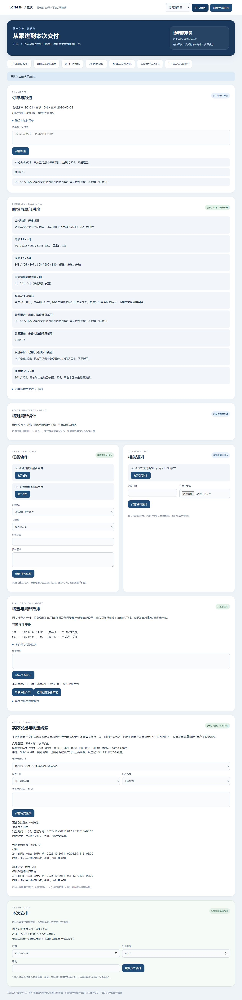

# 同一订单：实际发出登记与物流原话

2026-10-30 · revision 1 · 1号。用户“接着做”承接[实际发出/物流卡r1](../../软件开发计划+施工清单/施工与验收/同单实际发出与物流接续-下一段卡.md)。完成项目外虚构小样，普通基础操作不调用AI。**本轮是登记已有正面依据的实际事件，不是下达发货指令、判定真实放行或员工软件交付。**

## 1. 日常说法看结果

原计划仍是S01原车14:30、S02第二车18:00。普通页面核对“本次S02已客户发出”的合成来源后，明确登记一件实际；原计划和加工结果没有被改成全部完成。发生时间未知和系统登记时间分开。超时后查原操作，没有重复记一笔。

随后普通页面保存“预计两天到站”“已到”“待收款通知客户自提”三条原话：第一条是预计物流站，第二条地点仍未知，第三条只是沟通。实际一件不变，客户签收、整单发出总量/剩余、到账和放行不由这些文字生成。

## 2. 输入与本轮新做的动作

源为正常停止A3的plan_retry，同一O-f9415ef436b54622、当前计划v2/原v1、原首次安排、加工更正、任务及资料继承。**另预置客户交付目的、SH-SRC-01明确S02已发出的正面来源及角色资格；发生时间未知。** 这不是公司完成依据已核，也不是从计划推导实际。S01实际状态仍未知。

普通新写的是实际事件、逐件占用/防重、原事实转换留痕，以及物流原话记录。新shipment_*中留来源/用途/明确件/所指计划版/登记人时点；同事务把S02的order_plan_facts由本例未发→已发并升修订，prior_fact保原负面依据。没有删除起始证据、回写原计划各版或改变任务回复/加工结果。

本段只支持明确逐件的客户发出登记。送加工、客户交接签收、退货/撤销实际、多物流腿、重量换算和真实款项放行未实现，不能用“同一件不能重复客户发出”代所有复杂物流规则。

## 3. 按方法看实际验证

| 场景 | 实际证据 | 限制 |
| --- | --- | --- |
| 普通登记/重开 | S2普通核对来源并登记S02一件，重开仍一件且保来源/人/登记时间；发生时间明确未知 | 正面来源/角色是夹具，不当实际公司发货制度或首次来源采集已验 |
| 三类物流原话 | S2普通保存预计站点、地点未知到达原话、沟通三类，原文和各登记时间保留，数量不变 | 是人工线索，不是已核到达、自动ETA、客户签收或通知成功；不把“已到”补成客户地址 |
| 失权恢复 | S2填沟通原话后夹具撤物流读权，保存返回404，立即清旧实际/原话投影并保本人未存字；订单/计划仍可分别读。恢复后直接按原键原内容重试成功 | 顺序合成撤权，不是管理后台、所有并发撤权或刷新关页后未明请求持久化 |
| 提交后迟回 | 独立普通副本提交后故意迟回1.8秒，浏览器900毫秒Abort；实际区/改排条件先清旧投影，保原操作，普通查询原操作得同一次一件事件 | 不是自然公网断线、断电或PG提交回执未知 |
| 防重复和作用域 | API原键原内容查原成功；同键换内容、新键同来源、另一正面来源覆盖同客户发出件均拒；未知件/重复件/单位/目的/来源或事实版不符、额外身份均拒。两个HTTP线程两个键实际一200一409 | 只支持本例客户发出目的，不外推多腿或整单统计 |
| 当前权限 | 只读/接办不能登记；只失登记权仍可GET查原，POST拒。失读后原键换目标、原GET、未知GET均中性404。S2只读人及撤plan读但保shipment读时，来源/内部fact_revisions均空 | 不把物流读权变计划内部未登记件修订号读取权；不是全部侧信道验证 |
| 他单锁反例 | S2单条head JOIN原安排按两ID拿锁；接口专用他单head被另一事务持锁时，本单错绑请求仍409，不等他单锁 | 只是该指定错绑反例，不当全库锁性能或死锁证明 |
| 实际与改排 | 独立库先存改排草稿，再明确登记实际；旧草稿采用被拒。另一库先采用计划v3、设本件状态未知，再以正面来源登记实际并指回历史v2，当前计划仍v3 | 两个命名分支，夹具未知状态另列；实际依据可以补未知，但不复活旧计划，不等所有实际/计划竞态通过 |
| 原子保存 | 独立库故意让最后操作凭据INSERT抛错，HTTP500；事件/claims/来源状态/转换/事实全部回滚 | 测事务内末写失败，不是任意崩溃或完整恢复 |

## 4. 首轮与修正不混认

S1有普通实际登记/迟回查原及API三类原话证据，但context无条件回内部事实件号/修订，不应由物流只读权顺带取得。3号996/997提出权限/锁范围关注；S2只在can_record时回fact_revisions，并加只读/撤计划读的空返回反例。

头锁归属的早读d076字节在S1启动前已改成先核本单/安排，再拿头锁，3号998核S1冻结源确认，不能将早读缺口回套S1。S2进一步在同一SELECT JOIN绑定两ID、来源锁亦限本单/安排；上表持他单锁为S2独立运行证据。998只增量静态确认，不代其亲手运行或公司规则认证。

S1为122项内部断言，S2为125项，各70份冻结源保持；不是247功能/完成率。普通UI、接口反例、夹具及保存证据分别列。一次自动化选择器在表单异步读回前超时，读取新DOM后继续，未把它报成业务保存失败。

S2正常停后只改两处提示文字P1：原“未发出”明确为起始夹具，当前事实看逐件依据；原首次安排区的未知指整单总量，具体已登记事件另看。P1没有业务处理改动，差异和原字节保项目外presentation-p1；新查看是S2数据+P1提示，不称重新跑完S2。

## 5. 同单回查及数据保护

停后读取ship_ui保存快照做关系核对：同O-ID关联两任务/两资料引用；加工当前只记S01一件，原首次安排两件，当前计划S01/S02两行，实际只登记S02一件及三原话。它们含义不同，不能相加成完成量。所指计划v2、原安排、明确件与事件关联一致，S01当前计划整行等于原版；这是保存关系核对，不是从空库重跑整条普通链。

S1/S2各32个继承库全部public表前后相同。两个展示库原业务表除会话和本次S02的order_plan_facts外保持；原计划各版/头、首次安排、加工更正、任务、资料不变。S02新增一实际/一claim/一prior_fact转换，来源标已办，事实state/revision/source_label同事务更新；普通库另三条原话，迟回库无额外重复实际。原652对象及七库复制后的813对象逐字节保持，无新上传。

S1/S2自身HTTP、PG、T均正常结束，原源副本不回写。源码/私有配置/DB/对象/日志/冻结/快照在项目外same-shipment-prototype-20261030，业务项目只留研究与合成截图。原六受审/16W/36B不改，无Git或关机安排。

新demo-shipment-view-01/Y来自正常停S2的ship_ui，加P1两条提示，无人工迟回；约12:07上海到期，先核根review-pointer/status。旧X/W各按自身周期，不因测试已停操作其他查看服务。

## 6. 学习复用和下一段

已查学习库并回读物流补证、旧开源排单比较、原操作与事务研究。复用计划/实际分层、不可变来源、明确目的/范围、原键原内容、当前资格逐块核与一致读快照；没有采用库存过账、路线优化、物流API或新组件，更未复制外部业务源码。

下一先做同一入口的整段走查与可试用差距收敛，明确哪些步骤来自普通办理、哪些仍需预置，优先补会影响员工实际使用的入口/失败续办/规则缺口。物流核对、签收/异常、真实角色和部署仍待相应依据，不能仅靠同单样本证明首批已经交付。

保存证据独立核对：4号仅读70冻结源、32继承库1062份表快照、两个登记库的事件/claims/prior_fact与对应事实转换、原计划/加工/任务/资料及原652+新增复制161（共813）对象字节，指定范围无必要纠正。普通库三类原话与迟回库独立方法分别核；只核正常停记录，不称亲手重跑。S2提示歧义仍按P1显示补充，不当S2全链重验或回填S1权限覆盖。
