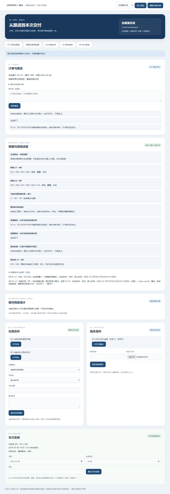

# 同一订单：局部误计更正与原操作查回

2026-10-30 · revision 1 · 1号。用户“好，接着往下吧”承接[办理卡r1](../../软件开发计划+施工清单/施工与验收/同单正式结果办理-下一段验证卡.md)，在项目外隔离虚构副本运行。**实际普通办理的是局部误计更正，不是首次确认加工、返工、真实生产或正式员工软件。无需AI。**

## 1. 大白话看结果

同一张订单原来记S01/S02两件，明确反馈说明S02误计。普通页面填写理由后办理，当前只记S01一件；旧两件、依据、谁办的和理由都能查。刷新重开仍是一件。原来排出的两件安排没有被偷偷改掉，只提示核对S02的当前依据；实际有没有发出、整单还剩多少，继续标未知。

提交已成功但浏览器没有及时收到回复时，显示“待查”，保留原操作，阻止再办。实际点击“查询原操作”取回同一结果，没有再加一版。不是拿另一库预置的v2冒充从页面更正。

## 2. 输入与动作分开

源为正常停止的D2，使用其detail_ui实际订单O-f9415ef436b54622、DEMO-SAME-01需求10件、L1/L2/逐件身份、原DR-01 v1及原S01/S02两件安排；旧跟进、任务、固定版资料保留。原2件仍是此前合成预置，本轮未从页面首次确认它。

另外预置FB-COR-01明确误计反馈、CS-01绑定本单/L1/加工/件/原v1/新S01的来源，以及演示办理资格与recording_error适用定义。预置不当公司G03/G04已核。普通页面只选取有权且明确的来源、核对对象和拟改件、填写理由、明确办理；不接受客户端自报身份或随意数量。六个新副本分别用于接口、普通页面、受控迟回、事务回滚、竞争写入和读取交错。

新增五张correction_*实验表。应用角色可插入新结果/审计/操作、推进对应结果头及来源已办状态，不获修改旧结果或删除历史的权限；其他业务对象不随之改完。权限只是本地实验角色配置，非生产最小权限或真实员工授权。

## 3. 实际验到什么

| 项目 | 方法与结果 | 限制 |
| --- | --- | --- |
| 普通更正、重开 | F2普通页面v1两件→v2一件；重开进入仍1，旧2及source/办理人/理由/录入时间/替代v1可查；来源显示已用于误计更正，不再显示普通未采用 | 仅明确逐件减少误计，不支持首次确认、加件、返工、多工序或混合单位 |
| 超时查原 | 事务提交后中间件故意迟回1.8秒，浏览器900毫秒Abort；待查清旧“当前2件”投影、隐藏办理来源并阻止再次写，保原键/请求；普通查原成功当前1，库内仅一新版本/一审计/一操作 | 应用提交后本机受控迟回，不是自然公网断线/断电；未保证刷新或关页后恢复未明请求 |
| 顺序防重与版本 | 原键/原内容/原所见v1重试查同一成功；同键换内容、新键旧版、重复来源不写；原成功凭据与读取时当前结果分别返回 | 同键重试不要求改新键；未测试所有竞争时序 |
| 适用性反例 | 他单、他明细/阶段、非件单位、未知/重复/不符件、额外身份、来源不符、未知版均拒；F2独立测实际line单位变kg、规则stage/unit错配、来源返工性质均不办理；返工来源不列误计候选 | 这些是异常实验配置反例，不称公司真实数据已发生过错误 |
| 原操作核权 | 按原操作真实订单/明细/阶段/单位先核当前办理资格，再比内容；只失办理权仍可按读权GET查回，POST拒绝。失读后旧键换目标、原GET、未知GET均404和中性正文；他人不能借键读取 | 顺序夹具撤权、合成账号；不是并发撤权或全部侧信道验证 |
| 角色页面 | 只读角色可见当前结果且无办理表单；接办角色有两任务但看不到本单明细/办理入口 | 非公司岗位认证，不以任务关系授整单权 |
| 一次事务 | 独立副本故意让最后一笔操作INSERT抛错，HTTP500；新结果/头/来源/审计/操作全回滚，无半截更正 | 测事务内最后写失败，不是任意崩溃/存储故障恢复 |
| 竞争更正 | 独立副本两HTTP线程以两个操作键同时改同结果，实际一200一409，仅一条新结果审计/当前v2 | 仅本例同结果头锁，不外推全部并发授权/排车/发货协议 |
| 一致读取 | F2只读事务先设REPEATABLE READ；受控在读完rows后停0.7秒，此时另HTTP实际提交更正；本次读仍一致返回旧v1/两件/来源未办，下一次读一致返回v2/一件/已办 | 读取是同一快照时点，不是所有页面块同一事务或即时撤权保证 |
| 原安排/未知 | 两个普通副本均保原两件安排整行，仅读取提示S02需核依据；任务、资料、订单需求/交期不动，未知不变0 | 不代交付放行、自动取消或实际发出 |

## 4. 首轮发现和修正不混为一版

F1已完成普通更正和迟回查回，但写端没有独立核实际明细单位；原页面待查时仍展示提交前“当前两件”。3号989指出单位/来源性质筛选，990条件性指出默认READ COMMITTED多步SELECT可能撕裂。1号核app连接确为默认隔离，故F2改明细只读为同一RR快照，并加指定交错运行。

规则自身stage/unit与grant/目标匹配在F1启动前已补；3号最初读到的是更早字节，991核F1冻结源后更正归属，不把这个缺漏回套F1。F2另加实际line单位核对、context排除返工来源、待查清旧结果。3号991仅增量静态确认指定修复，非其重跑F2。原F1源/截图/检查保留，不回填F2的额外反例或快照证据。

F2共107项内部接口/数据/保护断言，57源冻结hash保持；不是107功能或完整产品通过。普通浏览器观察和接口实验分别留证；原明细、资格和误计来源预置，明确办理/超时查回才是普通操作。未做新CSV/PDF或输出更新，不借此前独立产物证明本轮同版输出。

## 5. 保存和资源

20个继承数据库的全部public表前后相同。correct_ui/correct_timeout各自原非session行保留，明确除外的是结果头推进及新来源pending→applied；每库只追加一个v2/审计/操作，原两件结果及两件安排保留。原376对象保hash，显式六库复制后的514对象全程相同；无新上传。

F1/F2自身HTTP、PG与T映射均正常退出且无清理错误。源码/库/对象/私有启动配置/日志留项目外C:/Users/华硕/.codex/tools/longshi-collaboration-lab/work/business-01a16bce/same-result-prototype-20261030/。项目只留研究、合成截图与追踪，原六受审/16W/36B不改，不推Git。

另建demo-correction-view-01/W独立无迟回查看副本，来自正常停止F2的correct_ui；当前1是本轮已办结果。地址与约11:06上海到期以该根review-pointer.json/status核实。D2旧V及旧U分别按自身status管理，不能因F2已停操作它们。

## 6. 复用与下一段

先查学习库“更正 原操作 权限”，回读早期HTTP/H3及职责研究。实际复用原操作核原范围、服务端事务/版本、未知不填0和独立正常停副本机制；发现缺口后补本单单位/读取快照/旧投影保护。现有PG/FastAPI只作隔离实验组件，没有新安装或复制未知业务源码。

下一重点是把本单更正后的“安排需核查”变为明确的人工处置方案，分清保持原安排、仅改对应件与实际发出后的限制；先核既有改排证据和对象接缝，不能用加工结果一个字段自动裁决发货。首次加工确认、公司授权/完成依据及完整排车/物流/EXE仍未交付；暂缺集中，不让实习生猜制度。

下一具体方案已备：[同单更正后的安排核查与改排接续卡](../../软件开发计划+施工清单/施工与验收/同单更正后的安排核查与改排接续卡.md)，仅源结构核对/设计，未新运行核查或改排API。

保存后独立核对：4号限定只读57冻结文件、20继承库582份表快照、两个展示库的原行/各一次v2及凭据/审计，并逐字节对原376与新增138个复制对象（共514）；未报指定范围必改。只核保存退出记录，不称亲手重跑或核所有退出路径；迟回和交错仍是上述指定方法，107仅内部项。
