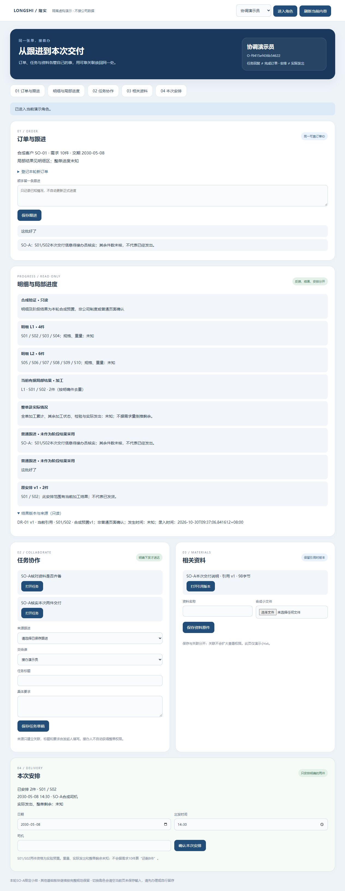
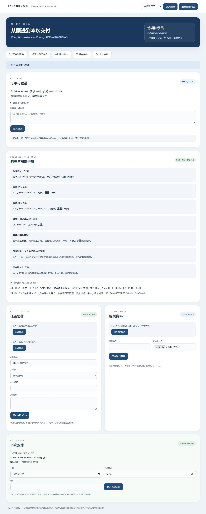

# 同一订单的明细与局部进度：限定只读实测

2026-10-30 · revision 1 · 1号。用户“好，下一步”承接接续卡r2；只在项目外虚构副本实现并验证读取，未开放阶段正式确认、更正或实际发货。基础系统不依赖AI。

## 1. 本轮实际结果

在同一张O-ID订单上，增加明细、明确件身份、局部加工结果、普通跟进及原安排的只读区。普通页面实际保存“这批好了”、刷新/重开后查回，该文字仍是普通跟进，原局部结果2件和原安排2件不变。

| 验收卡 | 实际方法和观察 | 限制 |
| --- | --- | --- |
| C1 同单读取 | D2普通浏览器进入，同单显示L1四件、L2六件及S01/S02加工2件；订单ID沿原S6实际生成记录 | 明细和结果为新夹具预置，非普通页面登记明细/确认加工 |
| C2 反馈不生效为结果 | D2普通页面保存原话、重开再进入；API独立保存与快照对照，结果/历史/安排不变 | 本轮没有新增任务回复流程或阶段确认规则；不把“未采用”叫公司审批未通过 |
| C3 范围和数量 | API专用库：同阶段重叠S02不重复计；L1加工2、L1检验2、L2加工1分组；错明细、未知件、重复件、错单位均拒绝。D2另测明细和结果同为kg、安排kg也拒绝 | 本段只支持明确逐件的“件”；没有重量换算、混合单位或整单累计功能。未得到依据的其余状态仍未知 |
| C4 结果/安排分离 | 两个隔离数据库分别预置当前结果v1两件、当前v2一件并留v1历史；普通页面查看后者仍有原两件安排，只提示核S02当前加工依据 | 版本状态来自夹具设置，不是从普通页面做了更正；不决定整单能否发货、不自动取消安排 |
| C5 当前资格 | 普通页面顺序撤销进度读权后刷新，仅进度块不可读，订单/资料/安排仍可分别读；接办人只有任务不见整单/明细，有明确资格的只读人能看且无办理表单 | 合成静态账号与顺序撤权，非公司G03认证、全部并发撤权或真实登录验收 |
| C6 保护及退出 | D2的16个继承数据库全部public表前后相同；两展示库全部旧非session行保留，结果/头版/原安排/恢复后的资格相同；原284对象字节保留，显式复制增加后的376对象全程不变。D1/D2各自HTTP/PG/映射正常退出 | 只在该隔离样本；不是完整恢复/崩溃/生产验收。新增普通跟进及会话另计，不宣称展示库整库未写 |

## 2. 预置、普通操作与只读的分界

源为同单run-s6正常停止副本，原可靠订单O-f9415ef436b54622、DEMO-SAME-01需求10件、已有跟进/两任务/固定版txt及S01/S02安排原样继承。另复制四库用于接口、普通页面、变化状态和异常输入，不能把四份副本当四张新公司订单。

新设L1=S01—S04、L2=S05—S10，规格/重量未知。加工结果DR-01 v1=S01/S02；另一库再预置v2=S01、当前头指v2。发生时间未知，录入时间为本轮夹具实际登记时间，两者页面分别显示。以上完成依据与角色资格全为合成设置，不借旧scope的eligible=true代公司加工依据。

新增detail_lines/pieces/results/heads/grants五表仅授实验应用角色SELECT；新增结果接口仅GET，POST返回405。既有人工跟进入口仍可保存文字，不新增正式结果写命令。读结果须同时有本单当前读权和明细读资格；读取安排另核安排读权，任务关联不授整单权。

结果按订单/明细/阶段/单位和明确件核对、同组集合去重，不用len(件ID)冒充kg。范围不合法回503/不可读，不能默当0。整单加工累计、剩余、检验和实际发出在当前展示夹具仍未知，不据需求10减2形成“8件未做”或20%整单进度。接口专用检验结果与加工结果分组，不套到普通页夹具。

## 3. 发现、修正与证据

D1已完成普通反馈/两状态查看/顺序失权，但版本区漏录入时间；3号987静态审查另指出明细和结果同为kg会按件ID数量误拼单位。D1源与失败/缺项原样留存，不补写为已覆盖。正常停止后修为D2：明确限定“件”、安排同样核单位/件身份；版本区分别显示发生和录入时间。3号988仅增量源码回读确认两处修到，不当亲手运行D2。

D2专用接口与收尾共84条内部断言，52个源文件冻结hash保持；数量不是84功能或完成率。普通浏览器观察单独保存，不把API夹具变更称UI正式更正，也未增加假DOM数量作为新功能。实测截图如下，全部虚构。

外部代码、数据库、对象、私有启动参数及日志留C:/Users/华硕/.codex/tools/longshi-collaboration-lab/work/business-01a16bce/detail-progress-prototype-20261030/；run-d1/run-d2各有冻结源、status、前后快照、接口输出、UI观察及截图。私有凭据不在本文或公开项目。

## 4. 学习应用与下一段

已先查询技术学习库“同版 订单 进度”，复用订单进度职责、可信反馈链和已有PG/FastAPI实验组件，不装新平台。实际应用当前资格逐块核、角色/读取批次丢弃旧响应、固定版历史和未知不计0；Bento沿既有页结构增加独立卡与锚点，没有借样式增加业务确认流程。外部设计研究和本轮实际证据分开。

下一段先准备同单正式结果办理的具体小卡：有据对象、阶段、范围、来源与授权，以及更正对既有安排的影响。可复用独立更正实验，但不能按名称硬并入本单或代公司G03/G04。真实完成依据暂缺集中，不催新问卷；当前无正式开发、生产、外发、Git或关机安排。

D1/D2测试均已正常停止。另开demo-detail-view-01独立查看副本，来源为正常停止D2数据/对象；本机临时入口和一小时到期见项目外review-pointer.json/status.json，以实际状态为准，不沿用旧S6或D2已停判断其服务状态。
