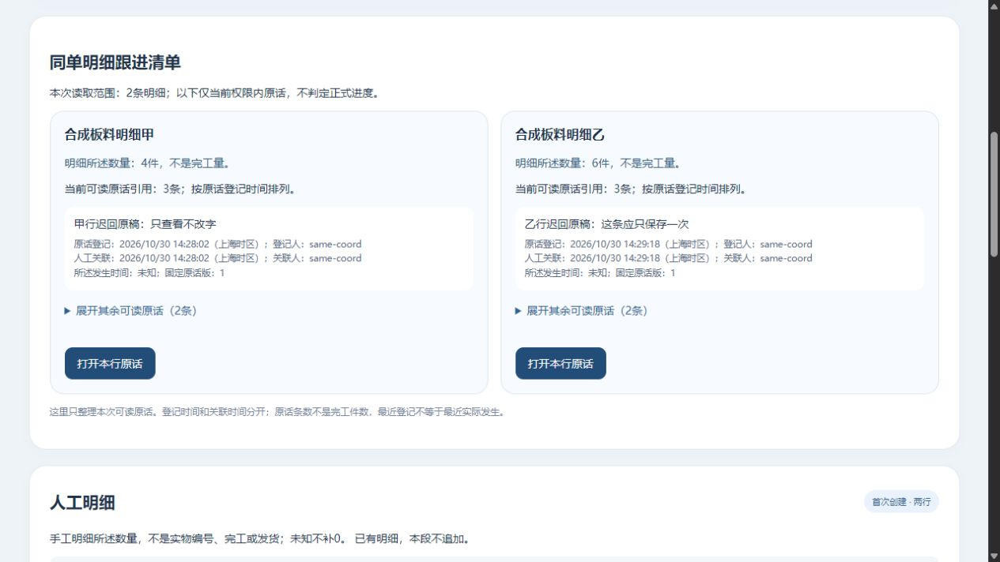

# 同单明细跟进只读清单｜限定实测

2026-10-30 · revision 1 · 1号。承接人工卡r6§11及用户“下一步”；仅项目外隔离虚构小样，无AI也能使用。源码、依赖、数据库、日志均不放业务项目；未开始正式员工开发或开放真实账号。

## 先看结果

同一订单的甲、乙明细各有一张跟进卡：看本行所述数量、近期可读原话，展开其余记录，返回对应行继续补记。原话登记、人工关联、所述发生时间分开；不知道的时间仍写未知。按可靠订单／行／集合身份分组，相同文字的不同原话仍保留。

**这是一张查原话的清单，不是加工完成表。** 甲行4件、3条原话不会变成完成3件；没显示原话不表示未开工或全局没有记录。未办理完工、出货、签收或款项。

当前本机查看：[同单明细跟进](http://127.0.0.1:60484/manual-review#line-overview)，约2026-10-30 16:14正常到期。使用虚构协调演示员；实际生命周期先核项目外review-pointer.json及对应status.json。不是公网地址。

## 怎样实现，复用了什么

复用已有按当前订单和模块资格读取的line-sources context，新增纯投影模型、视图和样式；仅增加三个静态文件GET路由，没有新schema或业务写接口。原直接补记／关联表单仍独立办理，需要各自资格；点击清单本身只选行和滚动。

父读取成功且身份／对象／请求轮次仍匹配才显示；刷新、失读或切号先清旧投影。打开本行原话再次核当前owner／OID／set／版，不能拿旧闭包正文复活旧视图。逐行草稿仍按本人、原单、行和集合隔离，普通整单备注也不被清单选行清掉。

开始前查询技术学习库并回读现有上下文、原操作和草稿规则。本次直接应用可靠身份分组、固定版引用、按当前资格清投影和分层Bento卡片；没有新装UI框架或插件。使用已有原生details/button和样式，不为只读投影加入新的表格平台。

## 运行证据与实际限制

| 版本／方法 | 实际结果 | 不能外推 |
| --- | --- | --- |
| LO1普通浏览器 | 甲乙各一张卡、各3条当前可读引用；展开历史、选行往返保本行草稿和普通备注；reader可读；受控模块失读清清单而不清其他可靠区 | 角色与授权为演示夹具，非公司G03；未验全部设备或断电草稿恢复 |
| LO1同文例普通浏览器 | 两条文字相同、feedback身份不同的引用同时保留 | 不等于实现原话修订服务 |
| LO1真实延迟读取 | 先执行有权coord的真实数据库读取，再缓冲GET响应；切empty后明确释放旧回复，旧卡未回来；再回coord正常读取 | 是指定读取迟回，非所有网络／多浏览器竞态 |
| LO1接口及保护核对 | 两库writer／reader有权读、empty拒读；全部55库业务表除登录sessions外前后相同，ACL一致，1181份原件hash一致 | 登录会话有正常变化；模块读权由夹具false→true且已恢复，不是业务页面改权 |
| LO1纯模型／假DOM | 原20项通过，但后来新增微秒反例实际失败，失败输出保留 | 不能称原版本排序完全正确或把20项当20功能 |
| 停后P1模型／假DOM | 改用UTC毫秒加余微秒比较，21项通过，含同毫秒不同微秒；未知和真正同刻稳定排序 | 没有把LO1完整GUI／权限迟回链重跑 |
| P1正常查看副本 | 从正常停LO1库及原件成对复制；普通浏览器读到甲乙清单并截图 | 仅当前普通路径／视口，不代完整产品验收 |

未知数量、无可见引用、格式拒绝、等价时区和旧callback等边界主要为模型／假DOM检查，不冒充普通浏览器逐项操作。LO1有10项内部收尾检查和98份冻结源；这些不是业务功能数。原DN1冻结93源未变。

### 微秒问题原理及修复边界

JavaScript Date.parse只保毫秒，同一毫秒内的两个PG微秒时间会退到ID排序，可能把较旧原话排前。用LO1冻结模型实际复现.000001与.000002顺序相反，记录在microsecond-counterexample-before-fix.json。LO1正常停后才改模型／检查文件；旧字节和旧20项结果另存before-microsecond-fix，post-lo1-microsecond-fix.json逐项记差异。P1以毫秒×1000加余微秒作BigInt比较，显示仍到秒，不声称界面增加微秒精度。

原3号先做指定源码静态回读，再单独核P1比较法；原4号核保存的LO1冻结源、截图、响应和前后保护证据，并区分P1未重跑全链。均不是公司岗位或完整产品验收，没有据静态意见抹去失败。

## 收尾与接续

LO1自身HTTP／PG／T映射均正常结束，无清理错误。当前X查看副本另由serve_line_overview.py管理，最长一小时、无人工迟回；前W副本按其约15:34生命周期，不接管其他窗口资源。

证据实体在项目外`line-overview-prototype-20261030/`：run-lo1/status.json、ui-observations.json、held-response.json、fixture-toggles.jsonl、inherited/acl/objects前后清单、source-used、overview-vm-results.json、微秒失败及P1差异记录。业务项目只收本报告／追踪和合成截图。

下一候选是从订单目录选择可靠订单，再进入这份清单；当前仍固定虚构单入口，未新增选单路由／运行。需分别核列表可见与明细／原话当前资格，切单清旧投影、保原对象本人稿，不按客户名／同规格拼单。首次有效进展依据、实际来源与旧S2逐件链仍未因本清单接通；G03/G04及维护等集中待核。无新问卷、生产、安装、外发、Git或关机。
