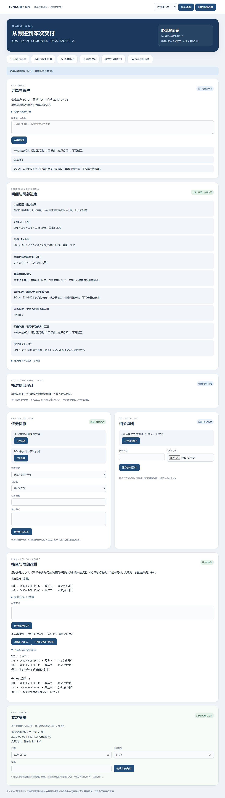

# 同一订单：核查意见、草稿与单件改排

2026-10-30 · revision 1 · 1号。用户“好，接着往下”承接[本单改排卡r1](../../软件开发计划+施工清单/施工与验收/同单更正后的安排核查与改排接续卡.md)，完成项目外虚构小样。基础操作不依赖AI；不是实际生产排车、发货放行或员工软件交付。

## 1. 这次实际补上什么

同一订单先留核查意见，原安排不变；只为S02保存改排草稿，当前安排仍不变；明确采用后，S01保持原车次14:30，S02变第二车18:00。原v1两件安排仍可查，任务、资料、加工更正结果没有被带着改完。

同一次采用回复故意迟到时，页面保留原操作供查回，当前安排区显示待查，查回后只产生一版采用结果。失权清旧服务器内容、保本人新字；恢复后原内容重试不会从已清上下文重新凑请求。原请求若已被明确拒绝且未提交，允许保输入重新核对，避免永远卡在待查。

## 2. 预置和普通动作分别看

源为正常停止F2的correct_ui，同一可靠O-f9415ef436b54622、原两件安排、加工结果更正v2、任务及固定版资料继承。新结构将原首次安排明确导入为计划v1，逐件身份由原安排带入，不凭名字拼PD-W/J旧独立案例。

**新增实验前提：仅S02有明确“尚未实际发出”和“允许调整安排”的合成依据/修订，以及演示角色资格。S01实际状态继续未知。** 不能把先前unknown当未发，也不能把加工结果当改排/发货资格；这不是首次普通实际登记或公司制度确认。

普通UI新做的是意见记录、本人改排草稿、明确采用和原操作查回。采用按命令选中件合并当前安排的未触行，不要求员工提交/重抄整张表。原same_arrangements约束version=1且整行不改；新增order_plan_*保当前头、不可变版本、本人草稿、意见、事实/可改依据及操作凭据。事实/资格本轮无业务编辑HTTP入口；应用UPDATE(revision)权限只供实验共享行锁，不当生产权限定案。

## 3. 运行方法与结果

| 场景 | 实际证据 | 限定 |
| --- | --- | --- |
| 意见不改计划 | A2普通保存核查意见；当前v1两件、事实和车次不变，意见标“不改计划/不等放行” | 不自动办理款项、放行、发货或通知 |
| 草稿与重开 | A2普通仅改S02，存草稿v1后当前仍v1；刷新重开、本人主动打开已存草稿，字段/理由回读 | 未存输入不承诺跨刷新/关页保存 |
| 失权与恢复 | A2打开已存A，改为本人B；夹具撤计划读权，直接存草稿收到404后立即清current/history/evidence和未触车次等，B保留；原键/请求保留。恢复后直接按原内容重试保存草稿v2，打开后明确采用 | 顺序夹具撤权，不是实际后台授权界面或全部并发撤权；待查时暂禁输入/再次写，不称支持待查中继续写B |
| 单件采用与历史 | A2普通采用计划v2；S01整行承接，S02改18:00第二车，原v1保留；已采用草稿明确标关联采用v2 | 只做两件、一个原安排、本日明确范围，不是全日多单自动排程 |
| 采用迟回查原 | A2独立副本提交成功后故意迟回1.8秒，浏览器900毫秒Abort；待查区不继续标旧安排为当前；普通查原取回同一次v2 | 本机受控提交后迟回，不是自然公网丢包/断电或数据库提交未知 |
| 未发出/可改重核 | API独立库：存草稿后将事实改为unknown或dispatched并升版，即使计划仍v1，采用409且不生成新计划；非件/未知件/未取得S01实际/旧计划/旧事实/旧资格等反例均不办理 | 变化由明确夹具设置，不当普通实际发货登记；未覆盖任意事实写方协议 |
| 防重、权限和事务 | 原键原内容重复取原采用；新键旧草稿不多采用；先核旧操作原订单/安排和原动作资格再比输入。只失改排权仍可读查回，失读后旧键换目标/原GET/未知GET均中性404。末笔操作INSERT受控失败全事务回滚；两线程两个采用键实际一200一409 | 不等全部竞态、真实角色或时间侧信道通过 |
| 版本变化后拒绝恢复 | A3独立普通分支：本地填C→撤读提交404未写→仅把eligibility升revision2并恢复→原内容重试409明确未提交→解除pending/启用角色选择且C和18:00保留→人明确重新准备→新草稿/采用一次v2 | A3没有重跑A2所有UI；这是明确拒绝后的新核对/新操作，不把超时未知请求偷偷改新键 |

## 4. 失败与修正保留

A1启动脚本漏dict_row导入，0条业务检查；已正常停并保留错误，未把它当业务通过。补导入后A2跑普通链。

3号992发现明确401/403/404的意见/草稿写失败和查原失败未立即清计划旧投影；A2补unavailable，区分服务器投影/未触自动字段与touched本人字，保pending。993仅静态核事务与范围；994增量核清理及原内容重试，并指出重试若明确版本冲突仍一律保pending，会有无法继续的潜在死路；A2未运行该反例，不能回填为已验。

A3保结构化error；仅422或明列计划/草稿/事实/范围的确定未提交409解除等待、保输入并重核。operation_content_conflict、网络/5xx及不可读仍保原键供查，不把成功绑定冲突当新请求失败。995仅静态回读该修复，A3普通定点路径另记。原版本冻结/观察都保留。

A2为102项内部接口/数据保护断言及62份冻结源；A3为接口回归和定点分支67项及65份冻结源。不是相加成169功能或完整产品验收，普通UI与API夹具方法分别记。没有新增PDF/CSV、真实物流接口、通知发送或实际发出功能。

## 5. 数据与资源

A2/A3各自26个继承数据库全部public表前后相同。A2两个展示库原业务表除会话外全字段相同，普通流程只写新order_plan_*；原两件安排/加工结果/任务/资料保留，新增事实/可改依据不变，原514对象保字节，七库复制后675对象全程不变。

A3定点库只有明确夹具eligibility revision1→2与读权撤/恢复；恢复后资格回原值，事实不改，原业务表保持。拒绝的原请求没有操作行，显式新核对后才存一草稿/一采用；原514对象及六库复制后的652对象保字节。对象manifest、库快照、冻结源、trace、UI观察和status分别在项目外same-plan-prototype-20261030/run-a2、run-a3。A1/A2/A3自身HTTP/PG/T均正常停，未强杀其他服务。

另开demo-plan-view-01/X，从正常停A3的plan_retry取独立副本，无故意迟回，约11:38上海到期，以根review-pointer.json/status为准。它展示A3重核后采用的v2，不当A2全链重跑；旧V/W按各自生命周期管理。源码/库/对象/私有配置/日志不进入业务项目，原六受审/16W/36B保持，无Git推送或关机安排。

## 6. 学习复用和下一处

先查学习库“改排 未触及 原操作”，回读旧改排组合接缝/P4—P5失败记录；实际用到局部命令合并未触行、草稿/采用分离、原键原内容、失权投影与本人字分界。只用现有PG/FastAPI，不新装组件或照搬外部业务源码；原开源比较继续作来源，不因此锁定生产栈。

下一段先明确实际发出与物流的入口：计划变更不等已发，送加工/客户发出/客户签收要分清；正面实际依据到达后再登记本次明确范围，原计划/历史不反写。付款和放行规则继续待实际依据，不把用户截图解释成所有客户统一先款后货。

保存证据独立核对：4号仅只读核A2/A3冻结归档、各26继承库798份表快照、指定新库35张原业务表及首次安排、S01保原/S02新v2，以及原514/各675和652对象逐字节；指定范围无必要纠正。观察记录支持各自UI方法，不逐HTTP重验404/409，也不称A3重跑所有A2界面。正常停仅核保存记录与PID文件消失。

下一具体方案：[本次实际发出与物流接续卡](../../软件开发计划+施工清单/施工与验收/同单实际发出与物流接续-下一段卡.md)，仅设计，未新增实际发出/物流运行。
