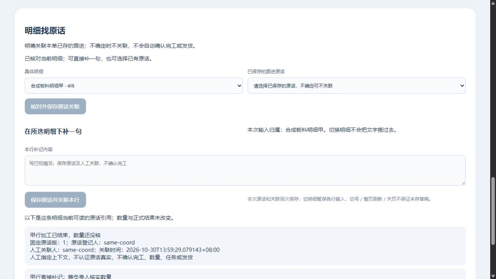

# 明细下补一句：原话与人工关联同次保存

2026-10-30 · revision 1。用户“下一步”承接人工卡r5§9。项目外隔离虚构DN1；继续无AI基础功能实验，不开放真实业务、不确认加工或发货。

## 给使用者看的结果

选一条当前明细，直接写一句，点“保存原话并关联本行”。不必先到普通跟进保存再回来选择。原话仍是同一个followups主记录，刷新普通跟进也能查到；关系保存明细和固定v1。甲4／乙6的所述数量与正式结果、计划、实际分别保留。

甲、乙未提交的输入各自保留，切行不会把甲的话搬到乙。成功只清掉对应行没再改过的原稿；后写内容及别行草稿保留。只在当前页面，切账号、整页刷新、关页或断电后的未存草稿／待查接续没有保证。

## 实际跑了哪些路径

| 方法 | 实际证据与边界 |
| --- | --- |
| 普通页面 | 甲A→乙空→写乙B→回甲A，分别正常保存；刷新普通跟进出现同一主原话；整页重开reader能看新甲原话，直接补记按钮不可办理。只用短人工文字和合成资格 |
| 普通迟回一 | 甲原稿提交后服务器提交再延迟1.8秒，浏览器900毫秒中止等待；只切乙再切回甲、不改字，GET原操作成功后甲原稿清空，不假装有新稿 |
| 普通迟回二 | 乙提交后写乙新B、切甲写甲新B；撤order读权后刷新清服务器投影，原key和本人字仍在；GET被拒仍保待查。恢复读权刷新再GET，原乙只存一次，甲／乙后写B均未清／未自动提交 |
| 接口 | 同键重试和两个并发同键只同一原话／关系／回执；同键改行冲突；空白／多余数量字段／旧集合版／错行拒绝；记录反馈权和关联权缺任何一项都拒绝。当前读权允许时GET不要求仍有写权；新旧动作查询路径互不混用 |
| 两处事务失败 | 分别在refs插入前、line_note_operations最后插入前注入触发器异常，返回500，主原话／关系／新操作均不留下；触发器正常移除。是受控边界，不是任意崩溃／断电恢复 |
| 提交前可见性 | 最后INSERT触发器等待一个实际被占的PG advisory锁，另一侧查询看不到新原话或关系；释放后主记录、关系及原回执一起可查。不是跨存储／所有隔离级别验收 |
| 13条fake DOM/fetch VM | 逐行草稿、旧回执只清原票据、仅切行不造修改、后写A2／当前B保留、失读保原key及独立GET路径。与普通浏览器证据分开，不当产品功能数量 |

普通UI相对LS2基线新增4套主原话／关系／line_note_operations：两次正常保存、两次迟回查回；后写B没进数据库，旧原话、旧关系／操作保持。接口库另外独立4套，不与UI样本混算。同文但明确新操作可代表另一条记录，不按全文hash吞掉；原请求应沿原key查回，不能靠不断换新key去“防重”。当前页忙碌保护及成功清原稿避免重复点提交。

DN1 139项内部检查、93份冻结源，正常停后hash相同；53继承库业务行／ACL及旧原件字节保持。新实验库只新增line_note_operations，原话／refs复用旧表，应用无新任意UPDATE授权。所列主明细／原操作／任务／资料／正式结果／计划／实际保护通过，内部项不是139个功能或整版员工验收。已成功记录能整页重开读取，不等未明操作跨整页可接续。

## 数据与复用职责

先查技术学习库并回读数据边界r9、上段固定版引用及人工卡，复用PG事务、按原对象当前权查原与逐行输入隔离，没有另装框架／插件或执行上游代码。

本动作先核当前order／manual-read／关联模块read、link和can_feedback，再核可靠同单line/set及所见版；同一个事务插入followups主记录、line_source_refs和line_note_operations。发生时间未知仍为null，登记人是系统当前操作者，不冒充微信原作者。新动作有含action的摘要与独立恢复路径，旧key先核原对象资格再比内容；不把两个旧HTTP调用假装原子。

3号1008基于早读前版指出“只切出切回也推进稿票据”，1009指定静态服务器范围无其他必改。DN1启动前改为恢复每稿原票据、真实input才更新；1010回读DN1冻结字节确认分界。13VM与上述普通迟回一另提供实际证据。前版按明确逆补丁重构后与1008哈希匹配，属于事后核回，不称运行前已另存或DN1曾跑该缺陷。静态回信不是对方重跑。

源码／数据库／日志／夹具留项目外line-note-prototype-20261030。DN1自己的HTTP、PG、T映射正常结束；新demo-direct-note-view-01/W从正常停DN1/direct_ui与objects配对复制，无迟回／故障注入，约15:34到期。先核该根review-pointer/status；旧V仍按自己15:04生命周期，没被本轮接管。

本段没有AI、OCR、跨单、修改原话／解绑／历史修订、阶段数量、工序确认、任务下发、排车、实际发出或签收，也没有正式账号、EXE或目标环境验收。真实G03/G04等仍集中，不发新问卷。

## 下一段候选

把同单各明细当前可读的原话集中成只读清单，让人少逐行翻找。列所述数量、原话登记时间／关联时间、出处与未知项；不把最近登记当最近实际发生，不把原话数当完工件数。这里只备具体图纸，尚未实现该清单。

交付前原4号只读指定保存物：目标单4条新主原话／4refs／4直接操作、甲乙各2次，原LS2关系保留、总关系6，后写B未入库；53旧库所列2195表快照及ACL、93冻结源、1135原对象与46复制件一致。两处回滚／末INSERT等待的保存轨迹与脚本相符。只按记录核对，未重跑、未改文件或操作服务，不作整产品认证。
