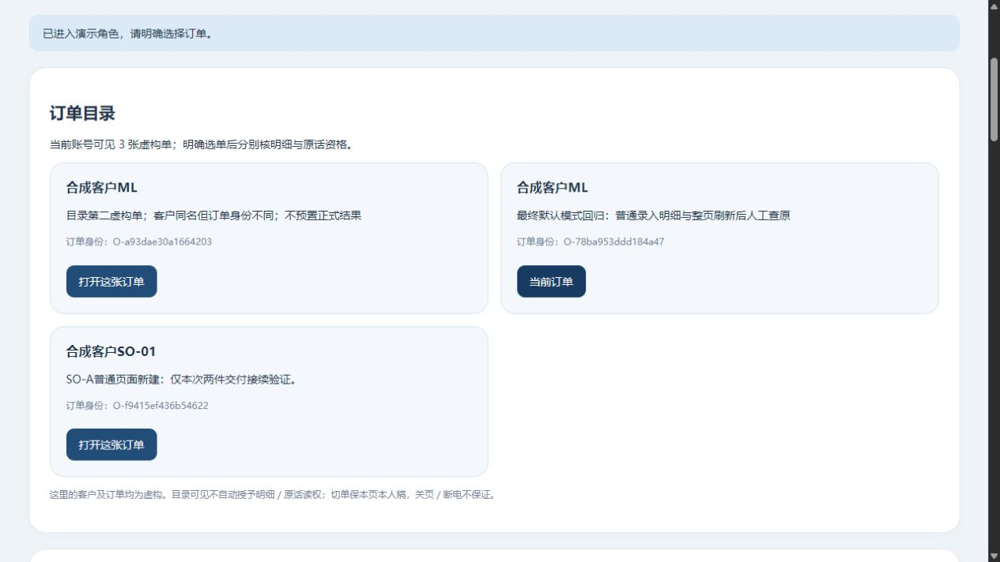
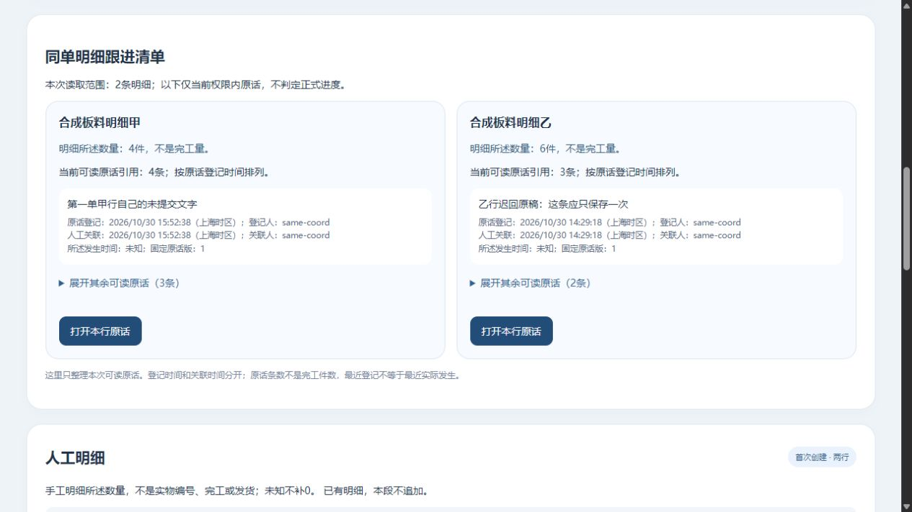
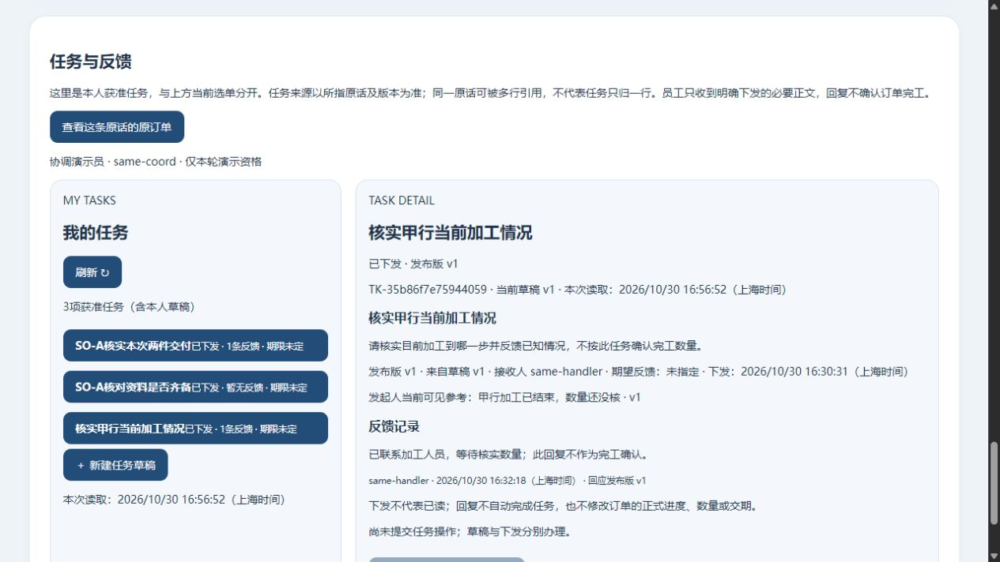

# 目录选单、原话派事与恢复接续｜限定实测

2026-10-30 · revision 2；supersedes r1，r1字节保留项目外line-task-handoff-prototype-20261030/docs-before-P2-observation/0.md · 1号。用户15:29授权自行安排两小时；截至16:50的已完成证据。仍为项目外隔离虚构小样，无AI、无正式员工部署、无生产或新安装。停后P1完成判定反例与P2修复、普通查看分别见下，不写成H3全链重跑。

## 先看使用结果

现在可从订单目录明确选单，查看每条明细的原话；从一条已存原话准备任务草稿，自己填写必要要求、明确接收人，先保存、再下发，员工回复，发起人重开同一任务读回。任务没有把原话自动发给员工，也没有把回复当成加工完成。

目录中同名客户的两张单按不同订单身份办理，各单本人的明细补记和整单备注往返不串。第二张单的数量为2／未知，未知没有补差额。第二单及其两行由普通API准备，第一单沿此前人工入口样本，不冒称本轮两张都从空库由员工完整录入。

正常目录仍按原权限列到一张继承旧S2单，实际可见3张；本轮新路线用两张，未把第三张旧逐件结果按客户名拼到新ML行。

## 三段证据分开读

| 段落／方法 | 实际做成什么 | 限制 |
| --- | --- | --- |
| OD2普通浏览器及受控读权变化 | 选单／往返保本页稿；父保存和明细补记待查分别撤读、恢复、沿原内容查清；后来输入保留；明细失读不隐藏仍获准整单备注 | 演示角色与权限夹具，不是公司G03；未承诺关页／断电草稿恢复 |
| OD2真实旧GET迟回 | 真正有权读出A的context后暂存响应，B已显示再明确释放，旧A没盖B | 指定请求及两个对象，不是所有网络竞态 |
| OD2接口／PG保护 | 55个继承库业务表除sessions、ACL及1181份原件保持；新UI库新增3条原话、2个引用及对应操作均为本次指定动作；迟回库无新业务行 | 内部检查和102冻结源不是102功能；16模型／假DOM另记 |
| H3普通组合 | 从ML原话准备草稿；员工看不到未下发草稿；明确下发后，无订单读权员工只收任务必要正文并反馈；发起人重开原单和同一任务；切空账号清两边旧投影 | 一位接收人、一个发布版；任务引用的是原话固定版，不认定任务独占某一明细 |
| H3独立迟回入口 | draft-create实际提交后1.5秒延迟，客户端1200ms等不到回复；目录失原单仍保原OID；GET原操作查回同次草稿，未再派一份 | 独立API样本库，不混成正常入口也注入迟回 |
| H3数据对账 | 正常库只增1任务／1草稿／1发布／1接收者／1回复和3操作；迟回库只增1草稿任务和1操作；三库原订单、明细、原话、计划／实际及原件保持，grant行恢复原值 | 18项对账与39项运行内部检查不是功能数量或公司验收数 |
| 停后P1/P2只读返回 | P1模型复现被作废的本次GET借旧order报成功；P1查看未普通操作即正常停。P2透传本次读取成功结果，18模型／假DOM通过；新正常页面B→原话来源A、接收人／空账号隐藏返回按钮有普通证据；三库除sessions及69对象保持 | 18项不是真实网络竞态；P2不回套H3任务整链已全重跑，查看脚本仅换输出名 |

原3号按指定源码版本查切号、父子锁、失读和固定引用；原2号回查业务价值及易误读说明；原4号核保存的恢复证据，后续H3证据回读另按实际结果记。静态／保存证据回读不代运行或实际岗位批准。

## 发现与修正

- **OD1实际失败：**原操作待查时，原订单从可读目录消失，父页清了selected；恢复后原回执又因OID不符被拒。普通页面和新加模型均复现，OD1正常停并保源后修。OD2保原OID、清旧业务显示，尊重子模块拒绝离单；不用新key解锁。
- **H1实际失败：**浏览B时，A来源任务草稿在全页刷新后仍显示旧A原话。保存完整AX后正常停，H2新增清来源投影／重新核任务context，保正文和本人稿；busy时全页重核暂锁，避免来源准备／命令旧回包反盖。
- **3号1016静态缺口：**目录内部离单和失OID分支还要叠任务pending，不能只禁按钮；H2没有运行此反例。H3补齐并实际验任务迟回、失目录读权、原GET查回。来源不可读只禁相关保存／下发，正文和引用选择仍可合法编辑或明确取消。
- **对账脚本误判：**首轮把内存datetime对象直接与JSON时间字符串比新行，导致新行分类错误；旧脚本／失败原因保留，按canonical比较修后18项通过，没有修改业务数据来消除失败。

## 恢复验证：完整性与重新开放分开

复用10月27日PG逻辑恢复研究及PG18.6。先在OD2静止业务、对象不可变条件下导出一致snapshot，pg_dump custom与130项清单打包（含102代码文件、23对象、数据见证和配置）；从包中dump恢复到**同一集群的template0新空库**。59表行值、544条约束及ACL按本次方法对应导出点。

恢复副本先清56条旧会话，并将can_*全部收紧，再按明确的恢复时演示策略只读开放coord两单／reader一单；这个策略由实验控制者给定，**不是从旧备份推得的最新公司授权**。实际旧token拒读，无权异单拒读，只读拒写；原成功操作用GET读回，不再POST。使用包内应用源码启动HTTP并普通浏览器读明细／原话。

原4号只读核：清单130项原文件字节仍匹配，102原源码和23对象与来源一致；资料版本／指定引用闭合。**启动时新增13个未入清单的__pycache__，所以不是整个包目录完全未变。** 资料权限入口未开放，本轮没有恢复后附件查看／下载证据。

缺件和同尺寸坏字节分别被package_ok检查器识别；没有实际尝试启动坏包，不能据business_open=false称已验证启动门禁。首跑restore-od2在备份前因httpx局部变量错误退出，空包／错误保留，不能称恢复失败；r2完成恢复并正常停自己HTTP。

后续H1—H3为减少复制55库，使用已装PG的initdb新建小隔离实例，从同一已核dump准备固定演示数据，重建所需本地演示角色、换本次随机凭据、清旧sessions，再运行当前组合程序。实际只有prototype_ui／handoff_ui／handoff_api三库。**这是新实例准备小样，不是最新公司授权恢复验收**；仍复用本机依赖、L盘及管理员工具，不是另一台电脑、可移植EXE、异地灾备、RPO/RTO或长期维护接手通过。G06仍待公司落实。

## 当前运行／接续

OD1／OD2、H1／H2／H3各自HTTP／PG／T均正常停止；对应冻结源和失败均保留。旧W、X查看副本也已核正常到期，不再用旧端口作当前入口。当前P2正常查看为[订单与任务](http://127.0.0.1:57485/manual-review#m-collaboration)，本机约17:53正常到期；view-02/Y由停H3库和全部objects配对复制，无迟回注入。先核review-pointer/status；P1 view-01已正常停且没有普通页面验证。

原始证据在项目外同级order-directory-prototype-20261030（OD1/OD2、restore-od2/r2）及line-task-handoff-prototype-20261030（H1—H3、业务对账和P1差异）；源码／数据库／私有连接资料不进入业务仓库。本项目只有研究、追踪和虚构截图，未推GitHub。

下一候选为把资料入口接到新人工单和这个任务：从当前获准对象查看固定引用版，保管／引用／上报分开；文字任务不强制附文件，关键截图等可选。旧资料片段已验不当新ML整链已合。先补这份短操作图纸和验证条件，不开始新上传运行，不代G03/G04／首次有效结果或实际来源规则。

## P2普通查看补记

原3号1018指出的“同OID旧读取被刷新作废后借缓存order报成功”已用实际fake-DOM反例复现，旧源码／失败留before-return-completion-fix。P2让readSelected／choose只返回本次仍有效读取的结果，open不以旧S.order兜底。正常页面已观测：当前浏览B，任务仍指A，按来源按钮重新核读后回A，任务正文／反馈不改；接收人及空账号不显示旧来源返回按钮。源业务前端仍为三文件变化，查看脚本另仅将输出目录view-01换view-02；没有schema／业务写接口变化。

5项查看后核对为三库各59表除sessions、全部69对象字节及106查看源保持；是只读返回观察，不是把H3的全部命令链在P2重跑。4号对H3冻结证据另核原行保留、11张授权／能力表恢复及任务增量闭合，不把静态回读叫现场重演。

新资料接入的差异已画成[短图纸](../../软件开发计划+施工清单/页面与原型/新人工单与任务资料入口接入差异.md)：现组件只支持order／已发布task，不能假称ML行专属附件，也不能据组件限制要求员工先下发再准备资料。另实际核到新根和恢复包code/vendor缺PDF模块／worker，工具箱6.4.299两文件存在；当前没有新资料查看／下载证明，不称完整页面依赖已打包。
