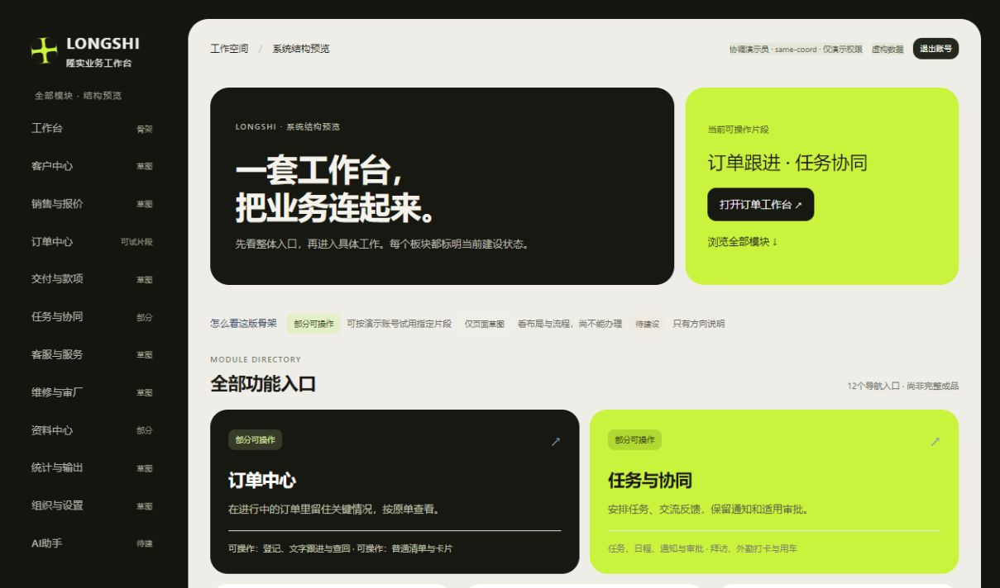
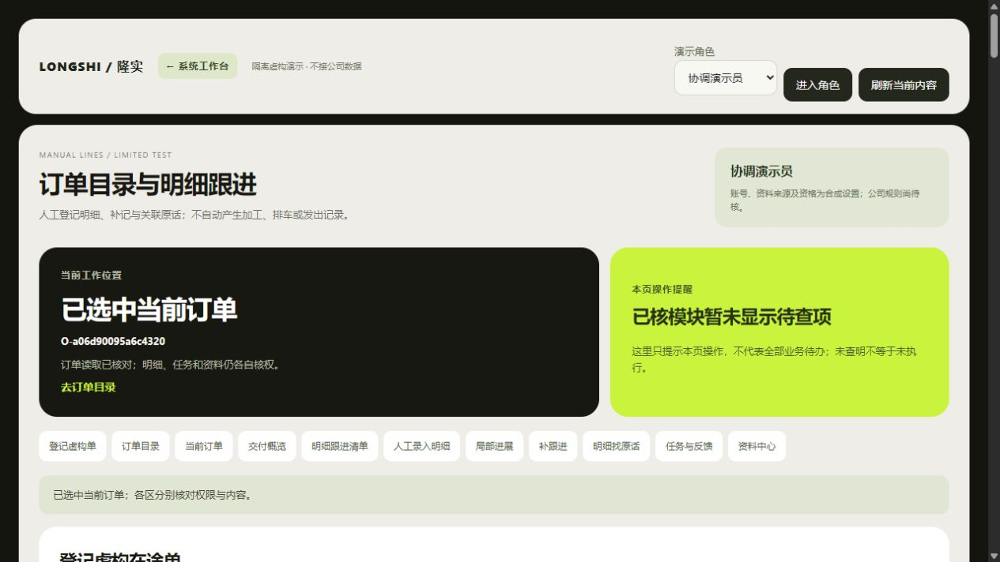

# Bento风格接入现有演示

2026-10-31 · revision 1 · 当前UI候选BT4，基于DO2的隔离虚构副本。

用户看过米白／黑色／荧光绿D样板后回复“好，我们接着做下一步吧”。本轮将该方向落实到现有可运行演示，未进入正式员工软件开发。原DO2源码和306项恢复包保留；新界面不是原包已经包含的内容。

## 这次改了什么

| 用户要求或问题 | 实际落点 | 核查结果 |
|---|---|---|
| 按参考图呈现Bento | 米白工作画布、黑色主卡、荧光绿重点、不等大模块卡、统一按钮与输入框 | 实际桌面画面已检查；未搬入样板的虚构财务指标 |
| 整体功能入口容易找 | 首页保留12个导航入口；订单与任务优先展示，其他模块保留草图／部分／待建状态 | 首页订单链接实际进入当前manual-review，订单页可返回系统工作台 |
| 办事页面保持可读 | 当前订单、操作提醒、目录、交付概览、任务、资料表单沿用统一配色与间距 | 修正资料表单标签与输入框错列；任务新建表单实际展开检查 |
| 手机上不挤成一团 | 单列卡片、可横向浏览导航、表格在本卡内滚动 | 390×844视口实际client375、页宽375；补记框269、交付区311像素。不是全设备验收 |
| 外观变化不损坏原有内容 | 保留表单控制属性、原ID及JavaScript／后台 | 两份HTML原151／184个ID顺序、全部表单控制属性一致；301份原根文件中仅app.css、index.html、manual_lines.html改变 |

## 实际操作与修正

BT1首次检查发现模块卡片排列留空、目录仍有浅蓝底，停后修到BT2。BT2普通点击首页→订单、进入协调演示角色、选AM单、查看任务与资料；发现资料整理表单沿用双列表格样式，标签和输入错位，停后修到BT3。

BT3检查资料表单单列标签、展开新任务草稿、填写未提交的跟进文字；打开订单所引资料v1，关闭后原稿仍在；切到SO单再切回AM单，原稿仍在。SO单交付概览仍区分三项安排各自的v2／v3／当前版未核，以及实际与物流原话。AM单数量未知仍显示未知，没有补0或增加完成率。未点保存、下发、上传或修改业务记录。

BT3在手机宽度检查首页、补记、资料只读弹窗和交付表格；视口已恢复。最后仅提高根画布背景选择器优先级，BT4实际桌面截图核对黑色外底，并普通点击返回系统工作台。BT4没有重复声称手机所有操作重做；手机证据属于BT3，最后一行CSS只改根背景。

四轮都从正常停止的DO2成对复制数据库与原件。每轮5个实验库中public及local_progress共314个表快照比较，排除登录会话后业务内容不变，原件字节不变；不是314个产品功能。HTTP、PG、本人V映射均正常收尾，标签页已关闭。没有当前长期网址。

## 实际画面

[首页全页图](图示/2026-10-31-Bento工作台全页BT4.jpg)

[资料表单修正](图示/2026-10-31-Bento资料表单BT3.jpg) · [任务草稿表单](图示/2026-10-31-Bento任务表单BT3.jpg) · [手机首页](图示/2026-10-31-Bento手机首页BT3.jpg) · [手机补记](图示/2026-10-31-Bento手机补记BT3.jpg) · [手机交付](图示/2026-10-31-Bento手机交付BT3.jpg)

## 学习落点与接续

先查技术学习库并回读oil-ui及Refactoring UI学习原文：已选方向直接深化、不再反复选款；用字重／分组／留白建立层级，保留标签、来源和未知；看实际截图后修正，而非只报生成成功。采用原生HTML/CSS，未安装oil-ui、Impeccable、Figma、新字体或其他依赖。

过程源码、样式、原始快照、运行日志和completion-receipt.json在项目外bento-ui-prototype-20261031，review-pointer.json指向BT4停止状态。项目只留说明和虚构截图。旧D样板属于选风格证据；BT4才是本轮接入现有演示的证据。未生成或验证新的BT4恢复发行包，原DO2包不能冒充BT4包。

本轮未验证保存／下发／上传的完整往返、全部权限、读屏／键盘全流程、所有屏幕与设备，亦未完成产品整体拼装、EXE或正式上线。下一业务段仍按既定顺序整理“本次哪一批货”和安排草稿的最少输入、来源、缺信息分支，再决定限定接入；不从加工2件推可发量，不强制每件编号。真实G03／G04／G06等继续集中待核，无新问卷、Git推送或关机授权。
