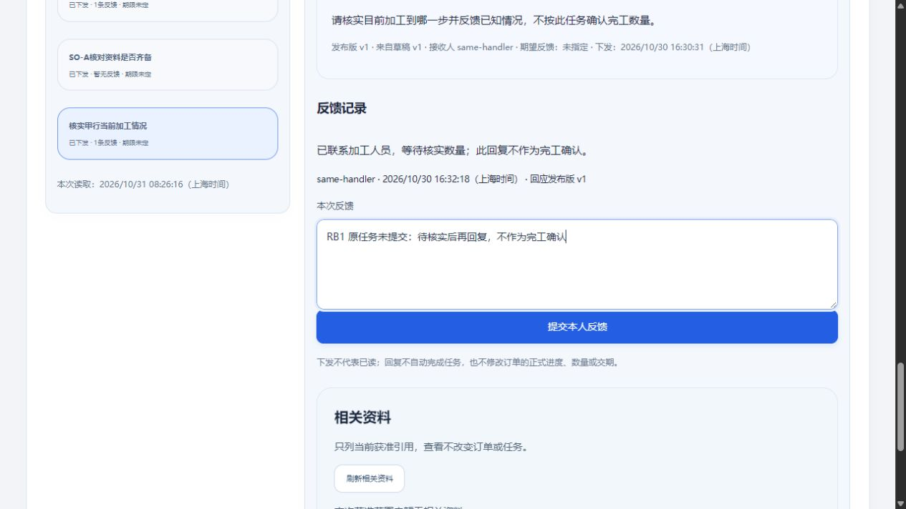

# 任务回复草稿：失权隐藏、恢复重开与范围隔离

2026-10-31 · revision 1。承接用户“好，下一步”和资料接续实测r1的最后缺口。仅项目外隔离虚构小样；不等正式员工试用、真实岗位授权或生产发布。

**本次结果：**在同一页面，员工写到一半的回复，任务暂不可读时不继续显示；重新取得同一任务／发布版的回复资格后，重开能找回原字。草稿不会自动提交，切换账号会清除。

## 原问题与改动

原task.js的suspendDetail隐藏任务并清selected，但show重开无条件清回复。先用原字节在假DOM闭包驱动中复现：期望DRAFT A T1，实际空串；expected counterexample保留。

仅在新实验副本修改task.js，复用已有明细逐对象保稿的思路，加入本页内存Map；键是当前账号、task-ID、publication-ID和publication-version的完整组合。正常输入逐次记录修订号；任务不可读时清可见回复框并保留原范围私稿，恢复后仅在can_reply仍成立时读回。未新增数据库表、服务器草稿接口、浏览器持久草稿或附件功能，没有为此安装库。

正常切换任务仍提示“继续编辑／明确放弃”；明确放弃删除当前范围草稿，避免后来复活。提交成功只在原操作、当前会话和任务相符，且草稿修订及内容仍对应本次提交时清理该稿；后来另写的内容保留。这部分成功／迟回只做模型检查，本次普通页面没有提交回复，不把它称新HTTP提交全链复测。

## 验证分层

| 证据 | 实际范围 |
| --- | --- |
| 原字节反例 | 单个模型明确复现恢复重开清稿；不是普通浏览器旧版复演 |
| 修后15个模型检查 | 同对象恢复、私稿标记、失权清可见字、不同任务／发布ID／版隔离、回复资格、明确放弃、成功清本稿、迟到成功不清后来稿、切号清除；假DOM／闭包驱动，不等真实网络或所有竞态 |
| RB1普通CUA | 员工打开既有任务，填“RB1 原任务未提交：待核实后再回复，不作为完工确认”；独立SQL仅暂改该虚构接收关系active=false，页面刷新后任务正文／回复框隐藏且DOM字清空；恢复同一关系active=true，刷新重开原任务，字逐字找回 |
| 普通切换 | 点另一任务出现未保存提示，点继续编辑保持原字；切空范围账号后回复框隐藏、原字为空。没声称所有新任务或所有页面保稿 |
| 数据保护 | 三库全部业务表除demo_sessions与起点逐值相同，包括接收关系恢复、回复与task_operations；76个对象文件哈希相同。未提交这段私稿。上游副本根文件哈希保持 |

RB1检查数量以项目外status为准，大部分是表级保护，不能叫同数量功能。源码冻结／实际清单及前后快照保留在项目外task-reply-buffer-prototype-20261031。该轮HTTP、PG和盘符已正常结束，cleanup_errors为空；没有遗留演示服务或新Git推送／关机。

浏览器起初复用上一轮已自动关闭的tab失败，库存确认无旧tab后新建临时页成功；这不是产品故障或绕过访问限制。输入、按钮、范围变化均实际页面操作；权限改变是受控SQL夹具，不是公司真实授权、自然撤权事件或员工能自行改权。

## 仍有的边界与下一步

本页内存保护不保证整页刷新、关页、断电或退出后保留；切号主动清除，不能承诺跨登录找回。当前发布流程不提供修订发布版，因此不同发布版隔离只是模型，不伪造真实v2变更。任务编辑草稿、任务回复结果待查的跨刷新持久性及多浏览器同步不由本轮覆盖。

下一优先把普通资料创建、明确引用到新人工单／已发布任务、从业务入口读回固定版放到同一条普通操作链，复用已有资料组件；不要继续只靠API预置资料。任务草稿附件仍另列，不为了适配现组件强制先下发；真实G03和维护承接仍待。

来源：[上一段资料接续及原缺口](2026-10-31-新人工单任务资料入口与PDF资源接续实测.md)、既有task.js及明细／原话逐对象草稿机制。原六受审文件、16W和36B不变；公司资料与项目外运行源码、工具、数据和私有日志不移入业务项目。
