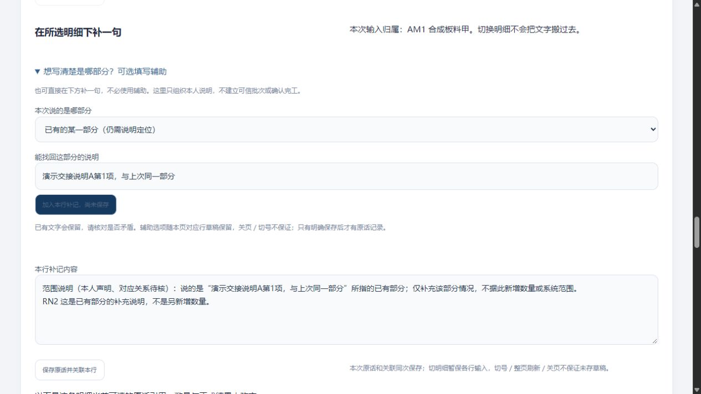

# 可选范围说明辅助：原话保存与同版恢复实测

2026-10-31 · revision 1。承接午间两小时任务及[限定卡](../../软件开发计划+施工清单/施工与验收/明细范围说明辅助-限定卡.md)。**项目外虚构小样有限运行，不是公司可信批次建立或正式员工使用。** 当前历史主链HR4、RN2新辅助及HR5额外范围测试分支分别留版本，不相互回套。

## 使用者现在多了什么

在“所选明细下补一句”里，有一个默认折叠的可选写法辅助：说明整行、已有某部分、尚未对应记录的一部分，或暂时说不清。它只经明确点击，把**本人声明**加入当前文字；旧文字保留，仍用原“保存原话并关联本行”按钮。可以完全不用辅助直接补记，没有固定增加审批或强制额外字段。

“已有部分”填写的是人能找回的定位说明，当前仍未核对成稳定系统范围；不能把新名字、原话或同数量当不重叠证据。暂时说不清可留原话，不默认整行或P01。辅助不是AI生成／识别，无scope／票据／正式结果写入。

## 1. 复用和发现

先查技术库、回读2号范围入口补查及现有line_sources.js和line-notes事务，选择复用原原话＋本行人工引用＋回执，不重写新业务引擎。只增加可选辅助及逐行草稿字段，原账号／订单／行／集合版归属沿用；过长时保原文、拒绝插入，不截断来源。

RN1普通生成、尚未保存时发现真实context没有返回unit，而模型假定有。辅助保守显示待核，未瞎补单位，但丢掉了可见已知数量的表达。核到unit实际在detail_lines：RN2只给原读取SELECT补l.unit，原保存、回查和资格函数用AST取源段字节hash对照相同，其他后端／schema相同。前端缺单位时也保已知数量并明确单位待核。RN1没有新增业务写，未通过“两次保存”预期，完整源／错误和正常停止记录保留。

## 2. RN2实际普通操作

1. 明确甲行，先写一条虚构原话，再展开辅助选“整行”。生成“本人声明／明细所述4件／不确认完工”，原文字仍在。**显式保存前计数检查点，原话／引用／回执及scope／basis／result均未增加。**
2. 点击原保存，提交后1.8秒实验延迟超过客户端900ms，出现待查。切乙行写自己的新稿，查询甲原操作后乙稿保留，甲成功原稿清理。首次普通查询没有解除待查；独立同actor HTTP原GET为200，随后再次同key普通查询成功，没有额外POST；未确定第一次未解除的原因，未声称已修。
3. 乙行选整行，显示所述数量未知，不填0、不带甲4件；保存后又写乙新稿，GET原次只查原，不清后写稿。
4. 回甲，旧成功对应文本及辅助选择已清；选择“已有部分”，空定位时仅辅助插入不可用，原直接补记仍可办理。填虚构交接说明后生成“本人声明／对应关系待核”，只生成未保存。一次离屏控件点击未插入，核可见启用状态后再点成功；原因未确证，不列成已修程序故障。
5. 甲乙切换，各自文本、辅助选择和定位保原行；切reader清旧个人稿、辅助及保存禁用。

最终新增**2条followup＋2条line_source_ref＋2条line_note_operation**；旧行逐值保留。P01仍2basis／1局部2件结果／6操作，scope／资格／规则／任务／资料／计划／实际及178原件字节均不变。不是生成两个新可信范围，也不加出4件或全单完成率。

测试乙原文保留“草稿，尚未提交”字样，后来已明确保存；系统保存状态以实际回执和记录为准，不能按原文词语猜状态。这不是状态字段或数据丢失，原文不为好看而改写。

18项辅助模型、原13项补记回归及普通页面／真实HTTP／前后DB分开；模型包含缺单位和超长原文，不称31个产品功能或全部设备／公司权限通过。

## 3. 该版自己的成套恢复

冻结RN2程序／读取字段修补／辅助、原规则／数据与44UI原件，303项包；新initdb空实例恢复67表、647约束及表／列／schema ACL与同点见证一致。旧会话清理后按明确虚构只读政策，普通查看甲4件声明和乙未知声明的原引用，辅助／保存禁用，P01结果2及本人局部历史6保持。API逐表／原件、普通页面分别记，使用后只有sessions变化。

它仍依赖本机Python／PG，不是EXE／新电脑／异地灾备。此次没有重复新的坏包注入，也未普通重播全部PDF功能；HR4缺buffer门禁／中文PDF按原版本证据读。RN2新辅助／单位读取不回套到正在进行的HR4只读长观察。

## 4. 审阅、收尾和下一步

原2号核辅助卡与业务建议，原3号静态核草稿归属／声明／只读字段修补；运行由1号完成，原4号保存物窄核的实际回执另记。RN1／RN2、RN2打包源／新恢复自身HTTP／PG／V均正常停，不强杀其他应用。另一根history/read-soak-01/U仍在原70分钟观察中，预计13:29结束，未提前写通过。

当前可评审的新组合候选为RN2及其303项包：继承本人局部历史与待查接续，补可选范围表达。HR4包是此前版本，HR5为额外测试范围分支。工具、源码、DB、口令和日志都在项目外`range-note-prototype-20261031/`；项目只存文稿和合成截图，无Git推送或关机。

真实范围建立／对应证据、G03/G04/G06、覆盖不重叠、更多单位与返工、更完整操作历史、首次未解除待查的可诊断性、Windows／内外使用和员工试用仍待。辅助补记在“明细找原话”查；“本单本人操作记录”当前只列局部进度相关成功操作，不能称全部模块日志已统一。

## 交叉复核的实际范围

4号对RN2整包恢复作保存证据的只读复核：303项文件／dump哈希／44原件、67表witness与两条声明对应，包内读取代码及六个原处理函数和RN2冻结版相同；清7旧会话后除会话不变，local_progress仍2依据／1结果／6操作。GUI展现与禁用依据已存观测，647约束和ACL按metadata与保存检查，4号未另连PG、重跑GUI或核浏览器待查迁移。原生回执2026-10-31、4号游标909b22cb-bc0e-4585-a238-2fadf5fb8866:15；不回套HR4长观察。

后续时点补充：独立[QG1查原等待保护](2026-10-31-查原读取超时保护与同版恢复实测.md)及其同版恢复已完成，作为更后候选；上文RN2当前候选描述保留r1时点。不回套旧异常根因或HR4长观察。

最终时点补充（约13:29）：HR4独立观察已自然结束4201.45秒／139样本，基线保持，HTTP／PG／U正常停，V亦无。前文“仍运行／待13:29”仅原记录时点；不把旧版只读观察回套本段新功能。最新继续入口是两小时推进记录和明细补记刷新查原限定卡。
