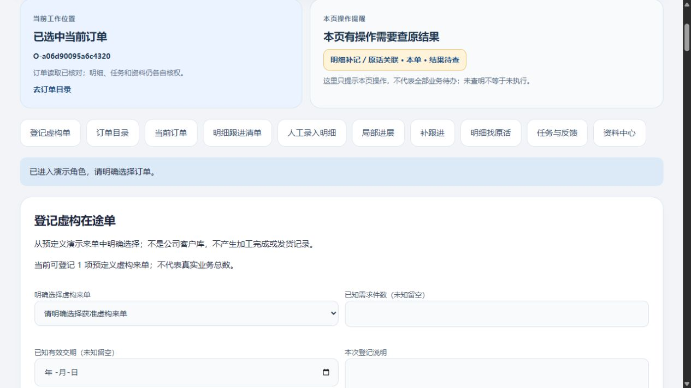
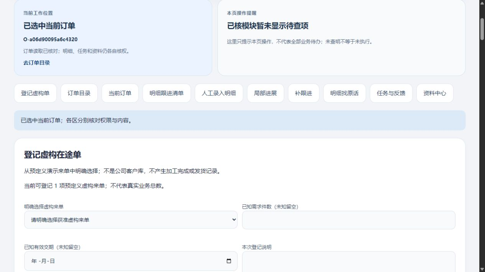
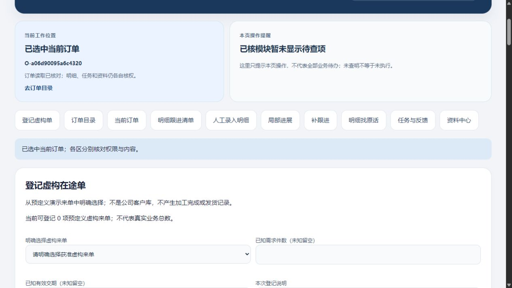

# 当前订单顶部提示与待查入口：限定实测

2026-10-31 · revision 1 · PC1初版／PC2修正版／PC2同版恢复分别记证。只用虚构资料，源码和运行数据留项目外。

## 一眼能看懂的结果

页面顶部新增两个Bento区：左边说明当前选了哪张订单、是否正在核对；右边提示本页哪些操作的结果还没查清。点提醒只带到原查询按钮，员工自己决定查询。任务和资料按独立操作显示，不因为页面选单就算成本单事项。

这是现有局部小样的找路和状态提示改进，**不是完整功能系统，也不是业务待办、订单异常或全单完成率**。基础操作无需AI。承接[下一段卡](../../软件开发计划+施工清单/施工与验收/当前页面待查入口-下一段卡.md)和[NR2实测](2026-10-31-明细补记特殊文字与刷新查原实测.md)。

## 实际改动与学习使用

复用既有控制器的本人、订单、pending和busy状态，仅增加只读状态快照；原查询／重试按钮及业务路由、表结构不改。顶部不显示原文、数量、操作键或资料标题。账号变化先清投影，目录／订单重新读取时不沿用旧“已选”状态；子区失败不代替订单本身的读取结果。

先查技术学习库的UI状态主题，回读[oil-ui取舍](../技术调研/2026-10-28-oil-ui视频学习与使用方法.md)与[后台UI／Refactoring UI](../技术调研/2026-10-27-后台UI工作流与RefactoringUI视频学习.md)：保持既有Bento方向，用分区、间距、标题层级及文字状态降低寻找成本；不靠红绿颜色表达权限，不把未知写0。本轮没有新看视频、安装UI插件或引入前端依赖。实际截图所示宽屏已观察，窄屏仅有源断点，尚未逐设备验收。

## 运行证据及修正

|版本／方法|实际结果|边界|
|---|---|---|
|PC1普通页面|登录不默认选单；受控延迟A读取期间改选B，A迟回不覆盖B；A明细补记提交后迟回，顶部出现待查，跳到原查询按钮|迟回为实验注入，不是自然网络故障；不是所有模块普通办理全测|
|PC1刷新／原GET|清演示会话后同标签页刷新、重登原账号选原单，顶部恢复原待查；明确点原GET后提醒消失|sessionStorage边界继承NR2；不保证换机／关页恢复|
|PC1读取失败|目录注入503时显示所选订单当前不可核，隐藏旧编号|不判断订单不存在，不认证公司授权制度|
|PC2普通页面|修正选单后的蓝色提示；注入登录503，账号切换失败后显示尚未进入角色，不一直“切换中”；再登录只读账号无旧待查投影|当前账号和权限为演示配置|
|模型检查|PC1归档30项；修正版32项，含局部待查而原单缺席、切号失败、独立任务／资料不贴本单、旧链接不能跳新操作|假DOM／fetch，非32项产品功能或全部普通GUI覆盖|

3号静态指出两处：指纹遗漏authChanging、原单缺席分支遗漏局部进展待查。PC1停止并保源后修成PC2；3号只读回核修正未见新增必改项，不代运行验收。第二项普通页面尚未单独制造局部待查＋原单缺席，只有模型与源层证据。新增模型第一次因测试桩缺recheckSources报错，旧输出保留；补桩后通过，不写成业务失败。

PC1点击提醒窗口总HTTP为48→49，新增仅GET /favicon.ico；原no_request=false保留。准确结论是**没有自动触发业务API查询或写入**，不能写“没有任何网络请求”。4号只读核对日志、快照与归档，同时指出根目录同名ordinary-ui-observations.json是继承的旧记录；本段GUI依据为本轮CUA、专用pc1/pc2-current-ui-record及请求日志，不能挪用旧记录。

## 数据、同版备份与正常收尾

PC1仅新增1原话、1引用、1原话操作；原有行、五个已比较数据库的其余public表（会话除外）、UI local_progress八表和178对象均保持。PC2修正版仅登录会话变化，业务行与原件保持；两轮均有运行前完整源hash和停止后逐字归档。没有新增业务写API或改原blocked／leave守卫。

PC2备份从正常停止的PC2副本制作，304项payload、67表、44原件及约束／ACL同一快照配对；源码取PC2运行前hash对应的归档。新initdb／template0恢复后逐表、元数据及原件核对；先清旧会话、应用明确的演示只读策略，再用普通页面读到本轮PC1原话及顶部状态。只读策略是恢复实验配置，不代表公司岗位权限。新页面没有继承浏览器pending，不能据此说待查操作已全部处理。删除包内directory.js的受控缺件包在启动前拒绝，原包未改。

本机环境、已有依赖及正常停止源副本为本轮前提，不是独立EXE、新电脑、任意崩溃或公司内外网络恢复验收。PC1／PC2／打包副本／恢复副本的HTTP、PG和本人V映射均已正常结束；本轮标签页28—30已关闭。旧NR2备份仍保留，不能把它冒称含PC2顶部修补。

## 接下来具体做什么

下一段先核对旧排车／实际物流片段与当前新订单明细的接入条件：列出可复用的入口、尚缺的可靠身份和状态关联，再定一段可以验证的联动路线。不能用同名客户／同规格把旧逐件样本硬接到新明细，也不因有十个入口就宣称全功能拼装完成。真实G03／G04／G06等仍集中待核，本段未新增问卷或正式开发、生产、Git推送及关机授权。

## 实际页面

PC1待查状态；上方旧蓝条文字在PC2已修，不将本图冒称最终版本：

PC2修正版：

同版新实例只读查看：

