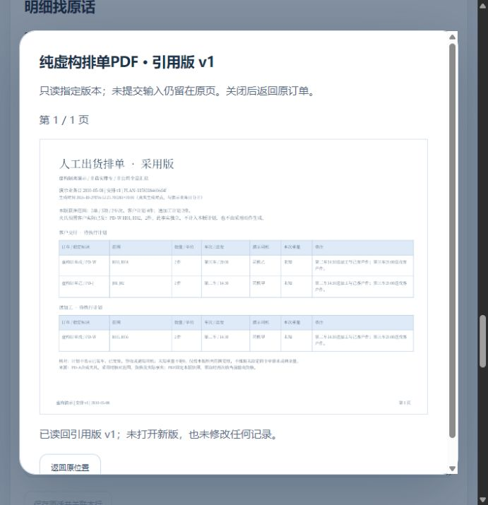

# 新人工单、任务与资料入口接续实测

2026-10-31 · revision 1。承接10月30日接入差异r1及用户“接着往下”。范围：项目外隔离虚构小样；没有正式员工试用、公司原件、生产接入、新组件安装、Git推送或关机。

**员工能看到的变化：**从新人工单或已发布任务旁的“相关资料”打开明确引用的版本；看完回原位置。另一张订单不带走上一单的资料。

## 实际完成

- 新人工单页载入既有related/preview组件并提供整单资料区。按本次获准OID挂载，切单、重读目录和切号清旧资料；明细模块不可读不自动判整单无权。该区是整单资料，不称某一明细专属附件。
- 已发布任务复用原资料卡；获得任务不自动获得原件权限。只读原件与任务正文分别核权。
- 引用v1而资料已有v2时，接口及普通页面仍读v1原文，未偷换新版。
- 新包原来只缺主模块／worker；补齐后普通页面发现PDF只能画表格、中文缺失。浏览器明确报缺cMapUrl。随后从同一已装pdfjs-dist 6.4.299包补cmaps、standard_fonts及Apache-2.0许可证，配置本地资源地址，实际中文复看通过。没有新下载、重装、借外部CDN或把依赖放入业务项目。PDF支持范围仍限本例，未全面字体／格式验收。

## 方法与结果分开

| 方法 | 条件及结果 | 不代表什么 |
| --- | --- | --- |
| FM1 | 14项记录中员工无订单权断言失败；继承员工实际有订单读权。正常收尾并保留失败 | 不能用错误前提证明越权或权限通过 |
| FM2 | 明确设置虚构员工无订单读权；16项后因测试脚本未导入Path中断，正常收尾 | 是检查脚本错误，不包装成产品缺陷或通过 |
| FM3 | 191内部HTTP/PG检查；新文本v1、升v2、订单与任务引用、原件授权与撤回、模块资源字节；原订单／任务事实保持。随后普通PDF出现中文缺失 | 内部项多数为表级保护核对，不是191个功能；HTTP 200不等预览可读 |
| FM4 | 补资源后194内部项通过，含字符映射／字体资源字节与未知资源组拒绝；3库非资料表保护，旧行／原件保留 | 不等真实权限矩阵、全部字体、恢复包／EXE或全产品通过 |
| 模型 | 8个related假DOM/延迟fetch及16个目录模型通过；沿用模型适配当前字节预览接口。继承目录模型缺CustomEvent/dispatchEvent的两次环境失败保留，修测试桩后再跑 | 不是浏览器运行、真实网络或全部竞态 |
| 普通CUA页面 | FM3看到缺字并保留图；FM4实际打开中文PDF、返回后订单未提交文字保留；任务读v1原文返回；切第二单资料为空，再回首单输入仍在 | 未普通创建／关联这批资料；文本、PDF及引用由API准备，权限由隔离SQL明确设置 |

普通查看后再核三库全部业务表，除登录sessions外与FM4收尾一致；76个对象文件逐字节一致。上游10月30日177个根文件哈希保持。测试FM1—FM4及第一次查看启动失败均保留，所属HTTP／PG／盘符正常收尾；最后查看的关闭状态以项目外status和最终收尾回执为准。

## 资料与权限的具体实验

API新建一条纯虚构文本，分别明确引用到新人工单和已发布任务，再增加v2；另用已公开的虚构排单PDF作为文件样本。新建两份资料、三个引用和一份文本新版不是员工普通页面录入结果，也未改旧引用。

员工在实验中显式失去订单读权后仍可读获派任务；没有原件grant时相关列表不露该文件，直接读取拒绝；另授这份原件读权后可读任务所引v1；撤掉原件权后原件拒读而任务仍可读。此为静态顺序资格检查，原demo_grants恢复到起始；不是并发撤权或公司G03。资料能力caps是本次夹具设置，不能当公司角色制度。

查看副本启动首试因ResumeLightRuntime未生成可接续配置而失败，已正常停；后续查看显式复用同源虚构凭据配置，仅本机副本重开，不称只凭Git或备份包独立部署／灾备通过。

## 下一处真实接缝

任务失去目标读权时，原suspendDetail保留DOM中的本人回复输入，但恢复重开show会清空回复。**当前不承诺撤权—恢复后回复草稿自动找回**。下一段应先对同一账号／task-ID／发布版的回复草稿做反例，再决定恢复和提示；切号、整页刷新和关闭仍不承诺未提交稿持久化。草稿任务附件仍是未覆盖范围，不能反推公司必须先下发后准备文件。

本次没有扩上传、类别上报、明细专属附件、自动提取或正式办理规则。来源：[接入差异r1](../../软件开发计划+施工清单/页面与原型/新人工单与任务资料入口接入差异.md)、[既有固定版入口](2026-10-29-相关资料只读入口与固定版返回实测.md)。运行源码／数据／日志／依赖清单均在项目外material-entry-prototype-20261031；公开项目仅报告及虚构截图。

最终收尾：FM1—FM4、查看副本01启动失败、查看02／03均有正常HTTP／PG／盘符回执，cleanup_errors为空。最后普通查看完成后已停；不提供已过期地址。学习库已refresh。当前源码与运行资料只留项目外，没有新Git提交。
