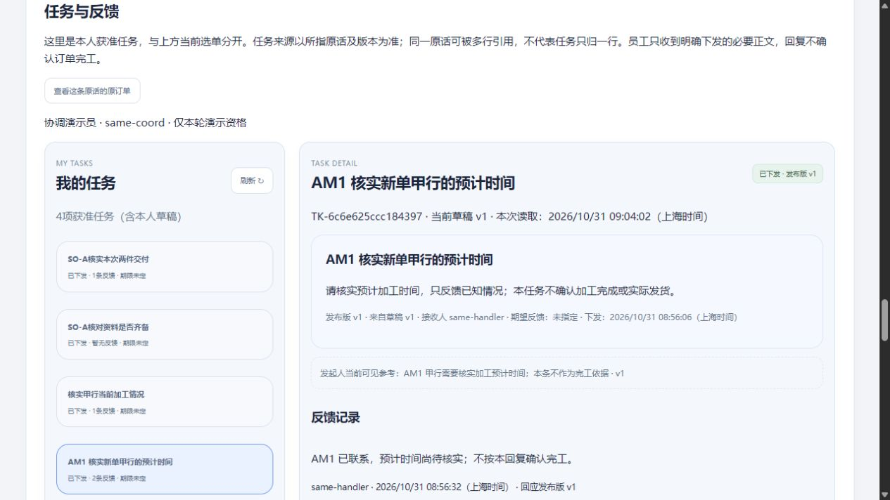
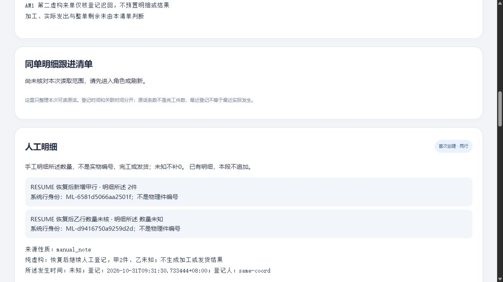
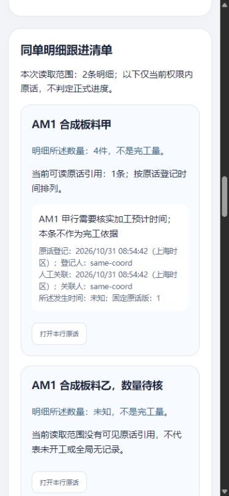
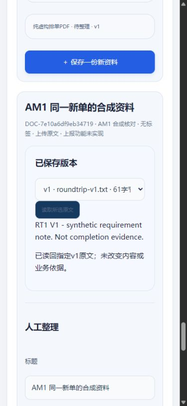

# 新单整段与恢复续办：上午限定实测

2026-10-31 · revision 1 · 用户授权本日上午连续推进至10:30；项目外隔离虚构样机。此稿记录已经运行的范围，不代表正式开发／员工试用、公司真实规则、Windows交付或公网部署通过。工具、源码、库、凭据和日志全部在项目外。

## 1. 本次到底补了什么

以前的资料普通操作接在既有示例单上。本次新增普通登记入口，并用**同一张刚登记的新虚构单**串起：需求未知→人工两行4／未知→行内补记→任务草稿→明确下发→员工反馈→发起人读回→普通上传资料两版→固定v1关联订单／任务→从业务入口找回。均无需AI。

另一张新单先验证登记迟回查原；后来在恢复实例的独立副本中，再对这张单普通创建两行2／未知，并做正常服务重启后查原，不能把两单说成都跑过完整任务／资料链。

## 2. 数据与操作范围

| 对象 | 本轮证据 | 仍未包含 |
| --- | --- | --- |
| 新单 | AM1普通登记2单，来源为明确预置的演示来单；未知数量／交期保null | 公司客户库、任意询盘／报价转单、真实来源接入 |
| 第一单明细和原话 | 2条稳定行身份，所述数量4／未知；普通补记并同次关联甲行 | 实物逐件身份、首次有效加工量、全单完成率 |
| 任务 | 同一原话固定版准备草稿、明确下发1人；2回复，发起人回看 | 多人、转交／取消／审批、公司真实授权；回复不确认加工 |
| 资料 | 1资料2版；订单与任务各引用v1，当前新版v2；普通上传／整理／查原 | 草稿附件、上报、语音视频／文件夹及正式限额 |
| 保存异常 | 提交后人为迟回、同原操作GET、顺序失读／恢复、本页交错草稿 | 真实外网故障、任意崩溃、所有竞争组合 |
| 新实例恢复 | 同点逻辑导出、原件、代码／PDF资源；fresh initdb恢复、旧会话失效、明确只读策略 | 可移植EXE、异地灾备、公司RPO/RTO或G06承接 |
| 恢复后续录 | 恢复实例停库副本，单一演示资格；2行首次保存迟回→正常HTTP重启→刷新重登→查原 | 停电恢复、浏览器关闭／换机未存稿、正式员工恢复流程 |

## 3. 运行版本与结果不能混算

| 运行 | 本轮新增／方法 | 保存核对 |
| --- | --- | --- |
| AM1 | 普通主链；独立API另跑2单；受控延迟／资格夹具；回复与资料保护 | UI库2单／2登记回执、1集合2行、1原话／行引用、1任务／草稿／发布／接收、2回复、1资料2版2引用5操作；191内部项，主要为表级保护 |
| AM2 | 历史资料甲原操作404，不藏当前乙；未知数量显示修正 | 仅甲为设置历史句柄普通整理一次，metadata／operation各+1；乙未写；187内部项 |
| 新实例恢复R1 | AM2同点导出；包内AM2代码，包外启动worker及本机既有依赖 | 59表、544约束、ACL与源见证一致；44对象逐字节一致；196内部项 |
| 恢复后续录 | 源为正常停R1的独立物理副本；不是第二次逻辑恢复 | 仅1明细集合／2明细项／1回执／2detail行新增；旧行保留；原授权恢复、44对象／原包不变；69内部项 |
| AM3 | 后续旧版本补核票据修正；普通v1失败→切读v2→旧补核超时不清v2 | 所有非session业务表／对象不变；177内部项；433源文件实际归档并核hash |

内部项不是功能数、员工验收数或完成率。AM3修补**未回写R1包**；R1恢复证据仍只对应AM2，不能说最新候选源码已做同一恢复全链。各轮的源清单、前后DB快照、对象hash、普通观察与正常退出记录分开保存。

## 4. 发现的问题与修法

1. 回复原稿提交后仍残留：全局revision与当前任务稿revision混用。改为完整账号／任务／发布身份及版本所辖原稿自身revision。模型复现前失败；AM1普通交错甲乙稿后提交甲，成功清除对应原稿，乙稿由明确放弃处理，不写错任务。
2. 资料操作401／403／404后旧原文仍显示。先重核当前所选资料；确实失读收起旧投影，保本人输入及原操作。AM1普通撤当前资料资格→保存失败→恢复→GET原未执行→同原内容重试，仅一整理生效。
3. 历史甲失败误藏当前乙。分别核当前乙，不用甲的失败替乙判权；乙当前可读时保预览／编辑，仅刷新获准清单。AM2普通证据；当前乙真失读的模型仍收起。
4. 补核旧版本时未核读取票据。AM3在请求前捕获readSeq，首次成功与失败改投影前都核票据。失败旧模型实际清掉新v2；修后失败模型、新旧成功模型（当前核验仍能更新权限）分别检查。普通受控v1内容404→旧补核悬挂→切读v2后，旧补核5000ms超时不清新原文及分类稿；服务器随后释放404，不能冒称浏览器在超时后收到了该404。第一次手动太慢，补核在切换前已超时并正确收起；此失败时序保留，明确放弃未存试字后再做第二次。
5. 数量null误显示“null件”、新候选数量说明歧义。AM2已显示“数量未知／预定义演示来单”；继承的未操作演示候选不抹成不存在。
6. 包清单误忽略嵌套manifest.json。保留漏检反例，改为只排除根清单；额外文件包与同尺寸改字节包均实际在initdb／HTTP前拒绝。哈希清单不是签名或来源认证。

## 5. 恢复与续办的具体含义

AM2在同一repeatable-read导出快照内取得表见证与pg_dump快照，复制配套44对象；清单282文件。新建PG集群和服务凭据后恢复，先核表／约束／ACL，再清22旧会话并应用给定演示策略。旧有效会话实际401；只读写入拒绝，读订单不等能读原件。普通页面读回新OID的两行、两回复和固定资料v1，中文PDF正常显示。只读使用后除session没有业务增量。

续办在该已正常停实例的副本上，仅给协调演示员第二单首次明细资格。普通输入2／未知，POST提交后实验延迟超过前端等待；页面保待查并锁切号。正常停止HTTP、清会话、同端口重启，整页刷新后重登同单自动发现待查，人工GET原次成功；再刷新重登，两行ID仍一致且无待查。没有自动POST重放。PG未在这次HTTP重启中崩溃；不称停电或任意事务故障恢复。收尾撤回这项额外资格。

包仍依赖本机Python、PG、已装库及包外worker；没有声称换电脑可双击运行或完成生产备份。AM3后续修补与R1包版本有明确分界。

## 6. 独立复核与证据位置

原2号只读核普通入口优先与下一段方向；原3号逐次静态发现／回看上述异步缺口；原4号独立读AM1及R1快照、hash与策略，未运行被审服务。静态回执不等普通操作、岗位授权或全产品通过。原4号另核恢复续办的69项中53项表级保护、唯一新增及授权复原／44对象／包hash，未运行程序。原3号回核AM3成功／失败两支读取票据未见必改项，并纠正本稿原GET超时误记：保存源码为5000ms，非人工明细的900ms；原观察JSON保留更正前版本，普通AM3不重跑为新时限。

项目外根目录：`C:/Users/华硕/.codex/tools/longshi-collaboration-lab/work/business-01a16bce/morning-entry-prototype-20261031/`。主证据分别为`run-am1/`、`run-am2/`、`run-am3/`、`recovery-package-01/`、`restore-current-01/`、`resume-after-restore-01/`。私有配置／旧会话正文不随公开项目提交。

## 7. 仍需接的主线

新明细的首次有效局部进展尚无普通办理路径；不能把原话“好了”或旧逐件结果夹具搬过来当完成。下一先收紧依据／范围／明确办理图纸，再验证。真实G03／G04、更多范围／返工、成套同版输出、Windows及公司内外入口、G06承接仍按各自条件推进，不以本稿放行。完整36B／原16W与受审六文件保持。

## 8. 10:08—10:11：当前入口窄屏只读补看

在正常停AM3的独立副本`run-layout-01`，普通CUA以协调演示员读同一新单：390×844观察顶部入口、4／未知明细清单、两条任务反馈及资料指定v1；768×900观察任务／资料。所测document scrollWidth分别与clientWidth375／753相等，未观察页面整体横向溢出；截图已实际查看，不用源码断点代替渲染。锚点有平滑滚动，即时截图可能仍在移动，另核最终hash和目标位置后取证。

这段没有改HTML／CSS／JS／后台，没有保存新业务；三库非session业务／90对象保持，176内部项主要表保护。源码全清单实际归档；HTTP／PG／U正常停，浏览器viewport已恢复默认。不是实际手机触屏、所有角色／全页面断点、完整无障碍或公司外网验收。

