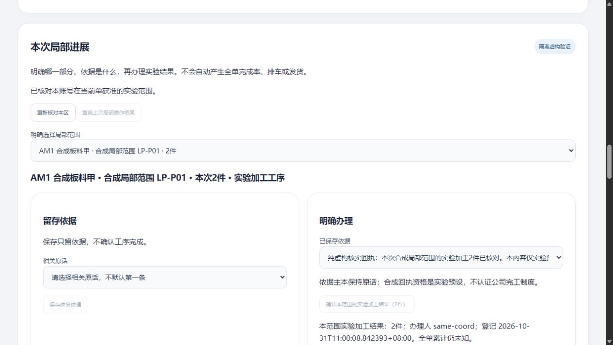
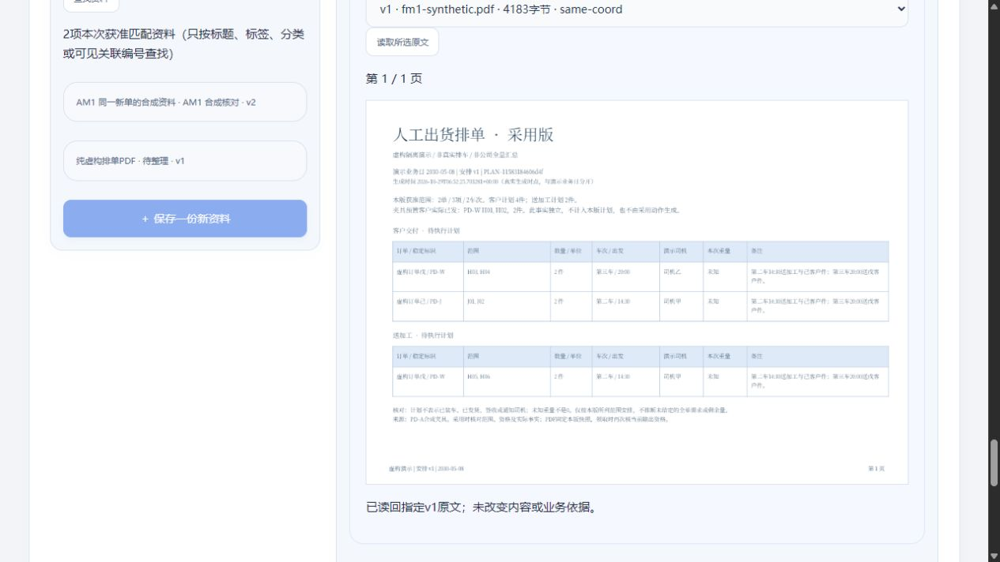

# 新局部进展：同版备份与恢复实测

2026-10-31 · revision 1。用户“下一步”承接首次局部进展卡r4。**本机隔离虚构验证完成；不是正式员工软件、新电脑安装、EXE或生产灾备验收。**

## 给使用者看

已经登记的“甲行本范围加工2件”、它的两份依据和原操作记录，已随这一版程序打包，并在新建空数据库实例中恢复。普通页面能再读出同样的2件，订单／任务／引用旧版附件和中文PDF也能查看。整单累计仍未知，没有自动变成完工。

恢复后先按明确的实验只读政策开放，旧登录会话失效，不能直接沿用备份中的办理权限。源码、运行库、原件和日志仍在项目外；项目只存这份说明及合成截图。

## 1. 打包点、版本和前提

来源是已正常停止的LP4，不是上午AM2旧包。只启动LP4停库副本准备导出；原LP4不重开。程序取LP4的`source-full-used`并核原清单，加入SQL、PDF vendor及包内`restore_app_worker.py`。本轮没有修改业务程序；恢复控制器仍为项目外验证工具，Python／PG18.6等依赖仍使用本机现有环境，不是自包含安装包。

副本中确认一个原会话有效，明文仅留包外私有记录。REPEATABLE READ READ ONLY事务持有导出snapshot，见证行、元数据与`pg_dump --snapshot`对应同点。外部对象在本轮没有其他写入者、没有清理，复制前后SHA256一致；PG快照本身不冻结文件系统，不推广为线上并发备份保证。

| 包中内容 | 实际核对 |
| --- | --- |
| public与local_progress | 59＋8＝67张表，含规则、范围、资格、依据、结果、原操作；恢复到新initdb集群后逐表行值相同 |
| 同版程序／资源／数据／见证 | manifest列302项，含包内HTTP worker；实际子进程从包内code启动，禁写pycache |
| 数据结构与授权元数据 | 647约束、67表级ACL项、13列ACL项及2个schema ACL项，恢复后在应用新政策前对应一致 |
| 本UI库原件 | 44文件／逐字节SHA256对应；不是把其余实验库134文件全塞入本单包 |
| 新局部记录 | 2依据、1结果、4原操作；局部结果2件，整单累计未知 |

## 2. 新实例和只读开放

使用新的服务口令、template0空库及逻辑恢复，不把原PG目录拷到目标充当本轮恢复。应用新政策前先逐表／约束／ACL核对，然后清除28条旧会话、停用其他演示账号、收回各模块写入位，只给明确列出的虚构账号／范围读取资格。

协调账号保留原稳定actor-ID，所以仍能查自己的原操作；只读账号另有一个订单和P01结果读权，不继承他人的操作历史或原件权。空范围账号看不到订单。规则和历史办理人不改写；政策变更另存快照，不伪称与原备份权限逐位相同。

HTTP实际验证：已知旧token被401拒绝；原订单、两行4／未知、两条任务回复、引用v1而资料当前v2可读；局部2件／两依据及四份原成功回执可读。普通跟进POST和本模块确认POST被404拒绝，业务行没有新增。没有逐一重跑所有旧模块写接口，不能据此称所有权限组合完整通过。

## 3. 普通页面实际观察

- 协调角色目录两单；打开AM原单，所述数量仍4／未知；选择P01读出局部2件、两依据、未知全单累计。保存依据／确认按钮禁用。
- 打开订单引用v1原文再返回；资料仍另有v2。任务仍是原发布版和两条回复。
- 从资料中心实际读取合成PDF，页面画布显示中文标题与表格；包内vendor资源有效，未回开发目录补资源。
- 切换只读角色后目录只一单，任务／资料片段不开放，P01结果可读、不可办理。原件拒绝没有显示成“0条已成功查完”。

API后、GUI后相对于明确只读政策的快照，仅`public.demo_sessions`变化；其他66张业务／规则／权限／操作表不变，44原件和302项包文件不变。不是把登录会话变化误判成业务修改，也不把内部232项检查算232个功能。

**页面查原仍有具体缺口：**新页面没有旧的本页内存操作key，因此“查询上次局部操作结果”按钮禁用。本轮四份旧回执的查回是同actor的HTTP证据，不是普通页面重启后找回历史通过；LP4上一轮的同页历史选择修法也不回套为本轮跨页恢复。

## 4. 失败、负例与交叉核对

缺少`local_progress_routes.py`的独立坏包，在initdb／HTTP／映射创建前被完整性检查拒绝。只证明这个人为缺件被拦，不是数字签名、任意攻击防护或自动找回丢失文件。

恢复01的67表比对已过，但控制器的metadata函数与变量重名造成TypeError，未进入HTTP／GUI，已正常停库并保留原脚本和日志。改名后恢复02从新空集群完整重做，正常结束；没有将01算成功。

原3号只读审阅计划，提醒原操作按actor＋key、只读需后台约束；原4号独立只读核保存包／快照／对象，支持有限结论，未连接PG重跑或操作浏览器。其回执与1号实际运行方法分开。

## 5. 收尾、来源与下一步

打包源副本、缺件门禁、恢复01／02均已正常收好；02 HTTP／PG无监听、PID消失、本人V映射移除，无强杀其他进程。上游morning原261平面文件仍逐字节相同；六受审文件／原16W／36B不改。没有推送GitHub或关机。

复用了技术学习库命中的[PG与资料匹配恢复](2026-10-27-PG记录与资料版本匹配恢复合成实测.md)及[上午同单链](2026-10-31-新单整段与恢复续办实测.md)，把工作流学习中的“同一版本交接”落实到实际新模块包，不换平台、不重复安装。源代码／快照／口令／日志仍只在项目外`local-progress-prototype-20261031/`：`recovery-lp4-package-01`、`package-lp4-source-01`、`restore-lp4-01`、`restore-lp4-02`及`restore-lp4-missing-local-gate-01`。

下一优先收拢**来源／范围建立与历史查原的普通入口**：明确后台预设与员工可录边界，先设计不靠手抄技术编号的查原路径，再做限定验证；结果更正／返工、多范围不重叠、真实G03/G04/G06和目标环境交付仍未完成。未知制度集中待核，不让实习生代猜，不把本次恢复变成正式上线批准。
