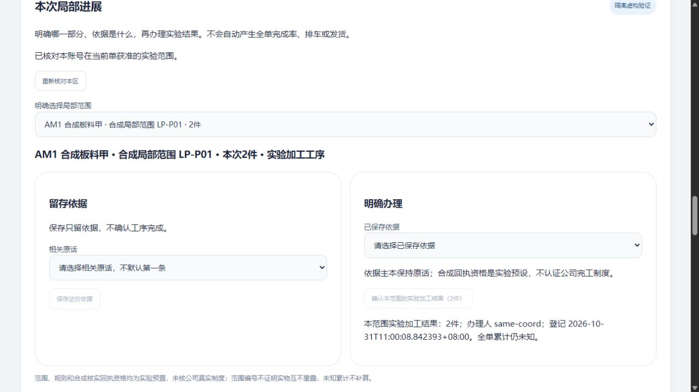
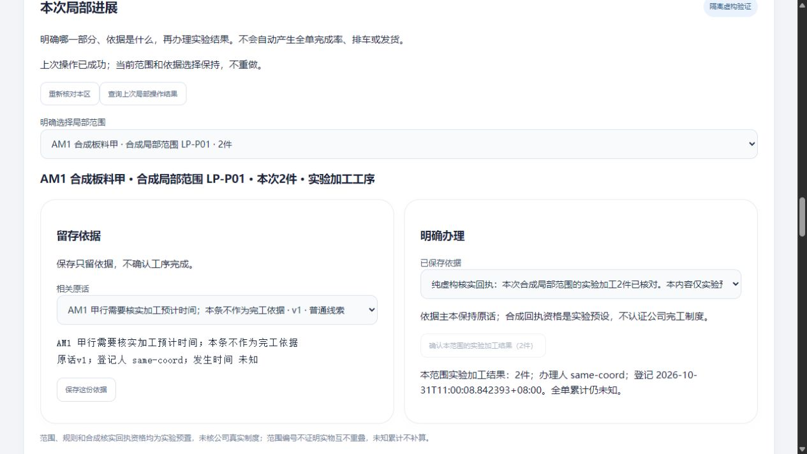

# 新明细首次局部结果：普通办理、重开与原操作查回

2026-10-31 · revision 1 · 用户在上午收尾／新视频方法接入后明确“好，下一步”，承接[首次局部进展卡r3](../../软件开发计划+施工清单/施工与验收/新人工明细首次局部进展-下一段卡.md)。这是新一段项目外虚构小样，非延长原10:30安排，非正式公司软件／员工试用批准。源码、库和日志留项目外；无新依赖、生产、Git推送或关机。

## 使用者现在能做什么

同一新AM单里增加“局部进展”入口：选明确合成范围→保存一份相关原话作为依据→在满足本实验条件时明确确认→重开看结果／结果待查时查询原操作。**保存依据不自动完工；本次2件只属于指定范围，全单累计仍未知。** 旧需求4／未知、任务回复、资料、安排和实际发出不随之改变。

本实验将保存与明确确认分开，验证两者效果不同；不因此规定员工日常必须两步或增加审批人。范围、规则和合成核实回执的资格是准备阶段预置，公司G03／G04仍待核实。

## 1. 固定输入、预期与实验前提

源为上午已正常停止的AM3三库／90对象；UI沿同一新订单和甲行稳定身份。旧AM1原话是“需核预计时间，不作完工依据”，允许保作线索，不能确认。准备另增一条明确标纯虚构的核实原话及同一行引用，并预置“LP-P01局部2件／实验工序”、规则、回执资格与演示角色。没有生成physical pieces或声称这些范围是真实互不重叠的钢料。

basis记录与首次result都没有预置；它们由本次普通入口实际保存。UI只选择后台获准的范围／原话／固定版，不能自行提交eligible或数量覆盖后台规则。合成来源资格不表示软件已经能辨认真伪，亦不替公司认定谁可以确认。

接口试验使用**从同一个正常源handoff_ui新克隆的lp_api**，不拿原handoff_api里另一批新单硬套同一OID。UI／API使用同一候选代码，但样本与运行方法分开，不混算。

## 2. 普通页面实际操作

1. 协调演示员普通登录、从目录选AM第一单与LP-P01。先保留另一条未提交的订单跟进，再保存旧待核时间原话作依据；界面不允许把它确认成结果。
2. 选合成核实回执再保存依据。实际中间DB检查点为**2依据／0结果／2操作**，说明保存没有偷偷生效。
3. 普通点击明确确认2件。提交后人为延迟回复1.6秒，前端等待1秒后显示待查并锁切号／换范围；人工GET原次成功。最终**2依据／1结果／3操作**，没有重做一次确认。
4. 切AM第二单，本区无获准范围且不带第一单结果；回第一单重新选范围，可看原2件结果，原订单未提交文字仍留原单。
5. 只读演示员可查原2件，但保存依据与确认均禁用；接口也实际拒其写入。临时仅撤本范围依据读权后，依据正文／选择不再显示，原获准结果仍可见、父页面本人文字保留；恢复资格后收尾。

发生时间未知仍未知；界面显示的是登记时间。没有把任务反馈算完工、把部分完成变成整单状态或生成客户发出／签收。

## 3. HTTP与事务验证，与普通UI分开

实际HTTP覆盖：角色／目标读权、客户端伪造资格或数量字段拒绝、旧所见版、未获准新scope、含糊依据不能办、成功原键GET／POST回查、原键换内容冲突、原key先核原范围、他人操作不外泄；同key双请求取得同回执，不同key争首次只有一次成功；结果写后／回执写前受控失败回滚，原键恢复条件后可重试。

API最终5依据／4结果／10操作，是四个独立测试范围，**不能与UI合计，也不能把四个2件加成8件产量**。这些范围未证明物理不重叠，回执全单累计未知。全部并发撤权／来源变化、真实身份、更多单位／批次拆并与更正未覆盖。

## 4. 失败、发现与修正保留

| 版本 | 实际状态与限制 |
| --- | --- |
| LP1 | 准备前提错：旧API库没有UI新单／行，断言失败，正常停止；未作为功能通过 |
| LP2 | 受控500响应是纯文本，测试器无条件按JSON解析而中止；保留32项时点及日志，修测试器按content-type读取；不将预期故障当产品新缺陷 |
| LP3 | 同版HTTP与普通主链完成；460源完整归档／112冻结源；388内部项主要为表级保护，不是388功能。仍保留3号发现的历史查回覆盖当前依据选择问题 |
| LP4 | 在正常停LP3副本上，区分“本次待查结算”和“查询历史成功”。旧模型查A会改当前B；修后历史保B、待查仍正常结算A。普通存既有A取得上次句柄，明确选B后GET历史A，B与本人文字保持；只多1条操作回执，没有新增basis／result。历史失读后重核当前context并清失权投影，恢复资格。251内部项，不是LP3全链重跑 |

LP4增加显式“查询上次局部操作结果”入口，历史成功只报原结果，不改变当前选择。查询原次不代表重新办理。修法是在停库／归档后实施，不回改LP3运行版本。

## 5. 数据、版本与独立复核

准备阶段仅handoff_ui／新lp_api各新增1合成followup＋1行引用；原记录逐值保留。准备后四库public表除登录sessions全部保持；原任务、资料引用、计划／实际和原件未变。90原对象加新clone配套44对象，共134文件／字节保持；不是新上传了134份资料。新增basis／result／operations仅在local_progress实验schema。

原3号指定静态审后指出历史选择问题，随后回核候选修补未见新增必改项；不是其运行验收。原4号独立核LP3快照、UI中间／终态、克隆起点、460／112源及134对象，未运行被审程序；其回执不覆盖LP4。LP4普通观察、前后快照与源码另存。LP1—LP4自身HTTP／PG／U均正常停止，失败资料保留。

本轮应用了刚学工作流方法：先固定一件工作及预期，单独留失败反例，打开实际页面并对账，区分操作／反馈／正式结果，按版本交接。没有因为视频提到某平台就换栈，也没有将旧上午测试再算新成果。

## 6. 尚未完成与下一段

**已接通的是明确虚构前提下的首次局部办理，不是公司真实完工制度。** 来源主本／资格／范围建立仍需对应实际依据，真实G03／G04与维护G06不代填。动作待查仅本页内存，未承诺刷新、关页、换机恢复；会话过期／完整撤权协议、更多范围与单位、结果更正／返工仍待。

本轮新增模块还没有进入成套备份包；上午AM2包不能恢复这次LP版。下一优先将当前限定模块纳入同版代码／配置／样本／对象的恢复检查，再收拢普通业务来源与范围的建立路径，不把旧包读回或稳定source-ID误当新的整版恢复／物理防重通过。未作正式架构选定、Windows安装包、公司内外入口或岗位使用验收。

项目外证据根：`C:/Users/华硕/.codex/tools/longshi-collaboration-lab/work/business-01a16bce/local-progress-prototype-20261031/`。各run的完整源、冻结清单、前后DB、对象hash、普通观察、API回执与失败日志分别保留；私有连接资料不放业务项目或公开仓库。
