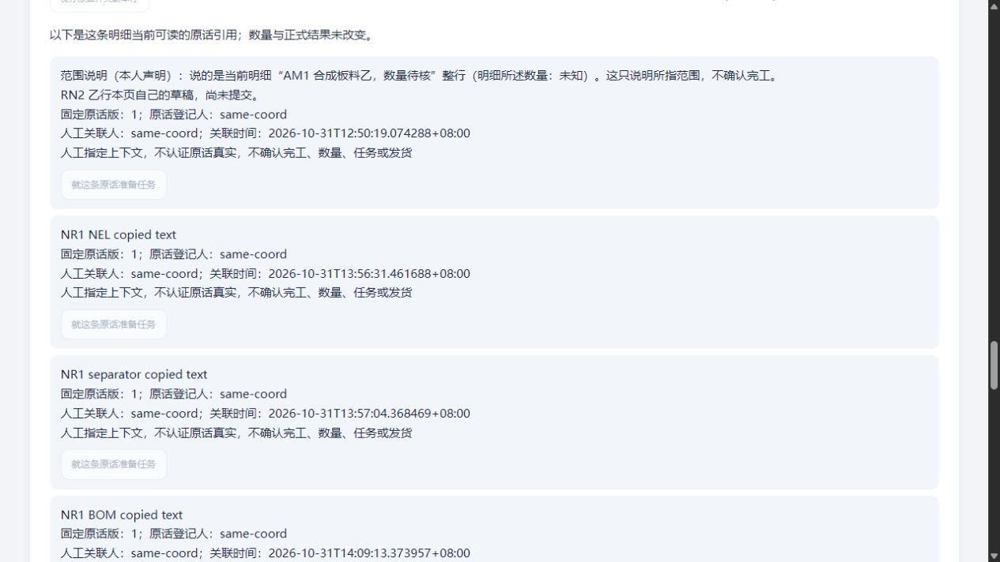

# 明细补记：特殊文字兼容与刷新后查原实测

2026-10-31 · revision 1。承接[下一段卡r3](../../软件开发计划+施工清单/施工与验收/明细补记刷新查原-下一段卡.md)及[前版QG1](2026-10-31-查原读取超时保护与同版恢复实测.md)。当前是项目外虚构小样，基础能力无需AI，未开放真实员工或生产。

## 先看实际改善

- 复制文字里夹了三类特殊边界字符时，能保存并查回同次结果；保留服务端已有原文／摘要规则，不把它误当一直未确认。
- “直接补一句”和“关联已有原话”两条路径，在已保存查原标记的同一标签页刷新、重新登录并选回原单后，均可只读查原，不凭新稿重复保存。
- 查询原操作不清掉后来写的另一行／本行新稿；当前失去写资格、仍有读资格时，只能读取原结果，新的写入由服务器拒绝。
- 本版程序、数据库和原件配套从新空实例恢复，普通界面读回新原话和新增引用。不是浏览器待查标记随数据库备份迁移。

## NR1：把兼容候选实际用于普通办理

只改前端回执正文匹配，沿用现行Python-strip兼容字符集；POST原body、后端DirectNoteInput、历史input_hash和已存原话不改，不做NFC／NFKC折叠。普通tab25明确保存BOM／NEL／分隔控制字符三条合成原话，受控提交应答1.8秒与页面900ms等待形成待查后，手动原GET均解除待查；甲查询保乙后写稿。BOM两端仍保留，另两类按原服务端规则处理。不是全部Unicode、所有长度或目标电脑验证。

另用HTTP重放一个旧成功键：先重算**已有规范化输入**和保存input_hash相同，再POST／GET读同回执、未增行；没有声称保留或回放了原始wire字节。仅+3原话／3引用／3note操作，旧行、五库其他public（会话除外）、UI local八表和178原件不变，源归档对应，正常停。

首次定位器查询、另一定位器保存曾未改变页面状态，原因未定；读取当前AX状态后按可用按钮操作成功，开发错误日志为空，不据此认定网络或旧RN2根因。普通事实、后台核对和旧六类／13项模型分证据，不能把模型数当功能数。

## NR2：最小查原标记与实际刷新

新增独立`line_note_pending.js`。标记只含版本、本人／原单／明细身份、原key和必要匹配信息：直接补记为预期回执正文UTF8摘要，已有原话关联为原话ID／固定版；不含正文、cookie或可执行URL，原GET路径由动作种类固定生成。最小化由源／模型检查，**未通过浏览器工具读取隐藏sessionStorage**。标记不是授权、草稿保管或公司备份。

原页有完整body时沿原路径办理；刷新接回只允许GET，原内容重试按钮禁用，缺原body不从摘要或新稿重造POST。异步摘要先锁本次操作、核epoch后再保存标记／发请求；旧槽不同、无效或不可读不覆盖。存储失败明确“仅本页保留”，清除失败保旧标记但本页已查回的不再反复恢复。GET404／422／超时不推定原POST没执行；只有新写的明确拒绝按原条件解除待查。

普通tab26有两段真实同源同标签页刷新：

| 路径 | 实际动作与结果 | 限定 |
| --- | --- | --- |
| 直接补一句 | BOM合成原话提交迟回，提示标记已保存；夹具清旧会话后实际刷新、重登原角色、选回原单，接回仅查询；乙行另写新稿，原GET清待查且保乙稿 | 无自动POST，未保证关页／换机／断电 |
| 关联已有原话 | 明确把已有NR1原话v1关联乙行、迟回；夹具清会话并仅撤两写cap，刷新重登后仍可原GET；甲行新稿保留，写按钮禁用 | 保留读资格的合成策略，不是公司G03或并发撤权验收 |

服务器另验新写HTTP404，随后只恢复两项夹具写资格的原值再做最终比对；不能称权限全程未改变。NR2仅+1原话／2引用／1note操作／1source操作，各一次原提交与同key GET200，没有重复写；旧行、local八表／原局部2件／6局部操作、178原件保持。

## 找到的错误与证据边界

3号静态发现摘要字段缺严格字符串检查：64位十六进制的单元素数组可被正则强转接受。保留原模块，VM复现原可接受、修后拒绝，NR2运行前已补typeof。3号只读回核71935ad8单点补丁；未把其静态审查说成运行。18项存储／控制器模型含旧槽、不可读、清除失败、404／422、只读和后稿保护；数组前后探针另记，非全部普通浏览器场景。

**NR2原runner最后一项写错了事件名**：期待line_source_committed，原处理器实际发line_source_linked。因此原status.completed缺失、断言失败和exception原样保留，不能说原runner整轮全过。停止后独立按真实事件名重核保存快照、两条同key链、178原件及526份起始源摘要并归档，通过；4号只读核此补证成立，未重跑GUI／API。实际普通链、独立核对与原脚本失败分开报告。

## 本版配套恢复与来源说明

`recovery-nr2-package-01/bundle`有304项payload（含新增标记脚本）、67表、44原件，647约束、67表ACL／13列ACL／2schema ACL；同一重复读快照dump／witness，源为上述NR2且保留原runner失败及独立补证。缺标记脚本坏包在initdb／HTTP／映射启动前被拒绝。

`restore-nr2-01`新initdb／template0／新服务凭据恢复，67表及metadata同包；清3旧会话后明确虚构只读策略。HTTP验新脚本资源、特殊原话、原2件／六原操作；普通tab27读甲行NR2原话和乙行新增NR1原话v1引用，保存禁用、没有旧origin待查。API／GUI除会话无业务变化。未重做全部PDF、六条逐点GUI、员工岗位或新电脑／EXE验收。

成包来源文字曾继承误标QG1，已更正为NR2并保留恢复当时manifest和前后hash；**304项payload、dump、witness／metadata字节与files字典完全相同**，更正后validate通过，未为描述标签重跑恢复。不能称manifest说明文字全程不变。

普通screenshot()两张输出只显示页面概览，不作待查分区画面证明；原AX／DOM与后台证据保留。下图改用实际原生截图，仅展示恢复后只读原话；未伪造当时待查画面。

## 当前状态与下一段

NR1、NR2、成包副本、恢复副本HTTP／PG／V已正常结束，缺件门禁未启动实例，U也无；本人临时tab25—27已关。源码／工具／DB／日志全在项目外，项目只存文稿和合成截图；无Git推送、关机、新依赖或真实开放。

当前候选为NR2及其304项包；前版QG1“尚未合入”的记录保留原时点。只读核实际版本和方法，不把当前局部量相加推全单、不认定真实完工／授权／维护。下一优先把本页待查事项和当前选单状态放到明显入口，减少翻找；按[入口候选卡](../../软件开发计划+施工清单/施工与验收/当前页面待查入口-下一段卡.md)先设计，不为展示新增办理或臆定业务规则。

## 原2／3／4协作回执的实际范围

沿用2号先前范围入口研究；本轮未让其替业务定制度。3号原生回执游标39095fa5-caf3-4bc4-a044-050cdb4340cc:25发现摘要类型漏项、:26回核严格字符串补丁，均只读静态。4号游标909b22cb-bc0e-4585-a238-2fadf5fb8866:20核NR1冻结证据，:21核NR2停止后补证及原runner失败边界，:22核304payload／67表／44对象／清3会话／来源文字更正与正常停。没有冒称3／4独立重跑GUI、API或公司验收。信箱和共同索引按工作段核对，原六受审／16W／36B保留。
