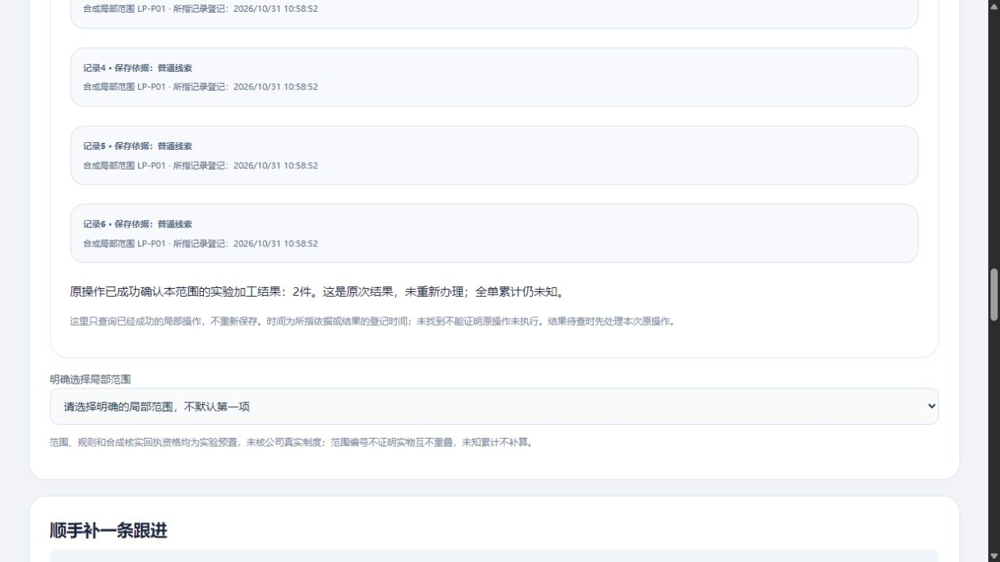

# 本单本人历史记录与同标签页待查接续：限定实测

2026-10-31 · revision 2（r1原字节见项目外local-history-prototype-20261031/history-report-before-soak-completion.md）。用户11:46授权两小时自主任务，暂不阶段汇报。**HR1—HR5及新版恢复已完成以下限定验证；70分钟本机只读观察仍在运行，结果待补，不预写通过。** 非公司真实员工软件、正式权限、范围制度、Windows EXE或公网验收。

## 1. 使用者得到什么

重新打开页面，进入同一演示账号、明确选单，点击“读取本单本人操作记录”，可以找到本人当前获准的成功局部操作，再点选查原结果，不用手抄技术编号。历史查询不重新办理，不替换当前选择的依据，也不把2件变成全单完成。

本次保存回复未收到时，若标签页标记保存成功，同一标签页刷新、重新登录原账号并选原单，可以发现原待查，再人工查询原结果。没有自动POST重放；关页、换机、禁用存储或标记保存失败不保证接续。

## 2. 怎样做，依据从哪里来

先检索技术学习库并回读订单进度权限职责、资料操作稿、当前首局部卡及LP4源码；沿用人工明细待查的同标签页思路，并在后续修补时逐项对照既有`manual_pending.js`。新模块首版仍漏了旧槽防覆盖，由原3号指出、1号实际模型复现并补齐，不能因“已有学习记录”就称没有返工。

复用当前PG/Python/HTTP和普通原生页面，没有新装框架／插件。历史列表是独立只读查询，按当前actor、订单和范围过滤；缺依据读权时保存依据类记录在限量前过滤，不返回隐藏总数／正文。原操作仍按actor＋key重新核原范围，任务接收或同单读权不会授他人历史。

操作表没有独立操作时间，本轮显示的是所指依据／结果的登记时间，重复回执可能时间相同，不按随机key冒称操作先后。最多显示100条当前可读记录，更多只提示尚有可读记录，完整分页／管理员审计未实现。

## 3. 各轮数据和方法分开

| 轮次 | 实际验证 | 数据／版本边界 |
| --- | --- | --- |
| HR1 | 新页无内存key查四记录；历史A保持当前B与父稿；整页重开；3.5秒列表跨单、回执跨号；源无权只列确认结果 | 五库public除sessions保持，局部2依据／1结果／4操作，178对象保持。另有独立history_api四原操作HTTP检查，不把其数据与UI混加 |
| HR2 | 原依据新key保存、提交后迟回、正常同端口HTTP重启／清会话、同标签页刷新重登人工GET，再刷新不复活待查 | 仅+1 save-basis回执成5，依据／结果不增。此版仍有“存储不可用无提示、不同新key覆盖旧槽”缺口，不能算修后版 |
| HR3 | 两缺口修补后再普通走保存迟回→HTTP正常重启→刷新重登查原 | 再+1回执成6，依据／结果不增。19缓冲／16接续／20历史模型与前后两个专用反例分证据，不合计为功能数 |
| HR4 | 新组件就绪门、分层15／12px历史卡、六记录普通读与原确认结果；独立API仍核四记录数据集 | 没有新业务写；18目录模型含加载前后登录门。两次6秒资源控延，CUA快照均在释放后，不声称取得了禁用阶段的普通截图 |
| HR5边界分支 | 旧P01待查→人为服务端会话到期／旧范围失读→刷新重登→新演示范围写入只能内存→先GET新、恢复旧权后再GET旧 | 準备新增一个不能确认、没有合格回执的测试范围；普通新增1未合格依据／2操作，终态3依据／1结果／8操作。不是普通创建范围，不与主候选2／1／6混算，也不把两范围2件相加 |

HR5实际请求轨迹证明：两次提交key分别属于旧／新范围，后续GET顺序为新key、旧key，均匹配原次。旧标记没有被新操作删除／替换。会话失效时当前页面仍锁登录，**目前需在标记可保存的同一标签页刷新重登**；同页无缝重新认证仍是体验缺口。

每轮独立保存前后表、对象、源码、普通观察和失败。HR1／HR4纯读只有sessions变化；HR2／HR3的重启检查点只保存计数，不冒称那个中间点逐行快照。HTTP正常重启不是PG崩溃／停电恢复。

## 4. 保留的问题与修补证据

原3号指出两处：read unavailable静默；当旧范围暂不可读时，新请求会覆盖同actor/order的旧槽。冻结HR2源码的VM原反例两项均不符合预期；修后只允许同key／同action／逐字段相同body复用，不同key、坏标记及不可读均不覆盖，且明确提示无法判断旧标记。原3号再核修法；HR3普通正面、HR5普通旧新标记边界分别补证。

首次恢复后一次立即登录未进入角色，后续明确等待页面控制器提示再点成功；不能直接归因为业务授权失败。增加静态禁用与最后组件就绪后开放，HR4模型和资源控延后普通入口有证据；未做所有资源加载失败／离线页面验收。

辅助脚本首查不存在的launch.private.json失败在SQL前，改读本人端口与私有bootstrap；目录模型新增组件桩初漏bind后修测试器。均留痕，不作为产品功能失败或成功计数。

## 5. 新版成套恢复，不借旧包证明

冻结HR4程序／SQL／vendor、buffer、包内worker，加同点PG dump／见证和44本UI对象，组成303项包。新initdb集群恢复，67表逐行、647约束及表／列／schema ACL对应；清3旧会话后应用明确虚构只读政策。新页面列六条本人历史，普通点击确认回执读原2件，reader不见他人历史；固定v1和中文PDF可看。六份回执逐一GET属于HTTP证据，不写成六条全由GUI点过。

缺buffer的坏包在initdb／HTTP启动前拒绝。API／GUI后除sessions无业务变化，44对象和303项包文件保持，服务及V正常停。sessionStorage不在数据库包内，旧待查不随DB迁移；不称新电脑／EXE／异地灾备通过。

## 6. 开源／视频方法的具体收益

UI视频的方法落在新卡主次字号与分组，实际打开检查；企业工单方法用于区分成功操作、通知、反馈和结果；稳定交付方法用于冻结反例、分版本复验、独立审阅及新版整包恢复。没有为“用上工具”改栈或增加固定审批。来源及真实范围仍按[2号入口补查](../产品经理调研/2026-10-31-局部范围人工说明入口补查.md)分四种人话入口，属于候选，不冒称已新增普通范围创建。

## 7. 当前收尾与余下事项

原2号只读补业务候选；原3号静态审与实际模型复现分开；原4号只读核HR1—3和新恢复保存物，不连接PG／操作浏览器，未核HR5或持续观察的运行。各回执仅覆盖指定范围。

HR1—HR5、打包源及新版恢复／坏包门禁已正常结束；当前仅`read-soak-01`本人U在进行70分钟本机只读会话观察，预计上海13:29结束，**不得据上述已停状态操作它**。其显式只读政策、短会话到期对照与周期结果另存，尚不写通过。没有Git推送、关机、正式开发、公司账号／数据、采购或外发。

源码／DB／私有凭据／日志都在项目外`C:/Users/华硕/.codex/tools/longshi-collaboration-lab/work/business-01a16bce/local-history-prototype-20261031/`。本项目只存说明及合成截图。主候选是HR4及其303项包；HR5是另加测试范围的边界分支。原六受审／16W／36B保持。真实G03/G04/G06、普通范围建立、多范围覆盖／不重叠、完整更正／返工、目标环境交付仍待；当前新历史入口不等完整员工操作日志。

## 70分钟本机只读观察：实际结束结果

本节覆盖HR4应用源码和停止HR4数据的独立只读副本，不含后来的RN2范围辅助或QG1查原超时修补。约12:19:13上海时间开始，实际经过4201.45秒，139次样本，约13:29结束；302项内部核对没有失败，不是302个功能。没有提前stop请求或改系统时钟。

明确设置虚构只读策略后才取基线：139轮采样中，协调账号列本人6成功记录，另一个可读角色列0本人记录，结果仍本范围2件、全单累计未知；空范围账号订单列表为空。独立短会话把到期设为120秒，起初200、后401，新登录可读回相同6记录；主观察会话默认2小时，并未等到默认2小时到期，不能把短对照当默认会话全程测试。

五隔离数据库public除demo_sessions逐行相同，UI local_progress八表、178原件和264份选定应用文件／vendor字节均同开始记录。测试登录及短会话到期设置为明确夹具；不称真实公司授权／全网络不掉线／并发性能／全浏览器UI持续观察或系统长稳验收。HTTP／PG与本人U映射正常结束，未强杀其他应用；V也已无。原读写与同版恢复各见前节，不用长观察回套新版本。

前文“观察进行中／待回填”保留r1时点；当前已按本节收尾。更后候选是[QG1](2026-10-31-查原读取超时保护与同版恢复实测.md)，并有单列复制文字规范化待修项。

4号最终只读复核回执（游标909b22cb-bc0e-4585-a238-2fadf5fb8866:19）吻合：139轮间隔约30.20—30.47秒，末轮4173.75秒；短对照约121秒401、约151秒有新登录读同历史事件。五库／local8／178对象／264选定应用源匹配，302项含290项表级保护；日志无异常、停库／PID／U收尾相符。4号只读保存证据，未启动资源。**定时采样不证明未采样时刻始终可用**，不覆盖RN2／QG1、生产网络或新电脑。
