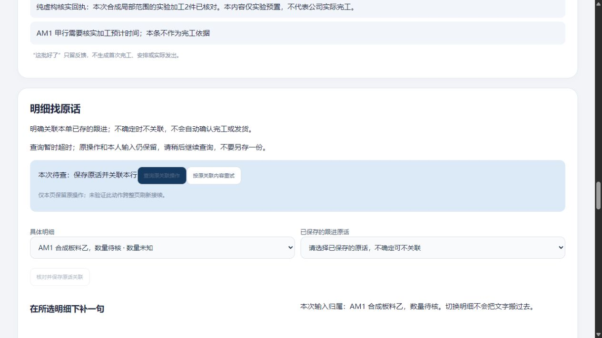
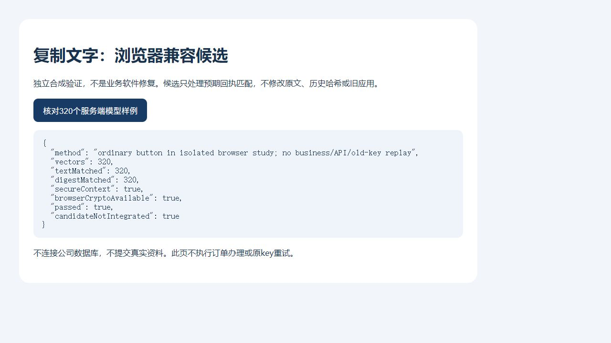

# 查原读取超时保护与同版恢复实测

2026-10-31 · revision 1。两小时授权内的项目外虚构小样，接[范围原话实测](2026-10-31-可选范围说明原话与恢复实测.md)。本段QG1是更后的候选；RN2／HR4各自归档和证据不变。**不将本段新发现说成RN2首次GET未解除待查的根因。**

## 具体问题与改动

检查明细补记控制器发现，原POST有900ms等待保护，GET没有超时。若读取一直不返回，busy会一直保持，查询和原内容重试按钮都无法再次使用。对原字节用假DOM／fetch和虚拟timer复现该缺口，不等于真实浏览器完全卡死或已找到先前异常原因。

独立`line-query-guard-prototype-20261031/`仅改`line_sources.js`：本控制器GET使用AbortController和5000ms实验等待，POST仍900ms；查原超时只释放忙态，保原pending、原key／body和本人后写稿，提示“查询暂时超时；原操作和本人输入仍保留，请稍后继续查询，不要另存一份。”所有后端／schema与RN2相同，不增加接口、自动重交或正式结果。5秒是本实验参数，不是公司网络SLA或全系统统一超时。

Abort只停止本次客户端等待，不证明服务器取消、未执行或失败。GET到达、handler返回及延迟释放的诊断事件只在隔离runner中加，不改业务后端，不记录口令／cookie／原话内容，也不称已实现生产日志系统。

## QG1实际运行

普通浏览器tab22：甲行明确保存一句新虚构原话，提交后应答受控延迟1.8秒、页面等待900ms，进入待查；切乙行写新稿。首次定位器动作之后没有匹配GET到达事件、页面仍旧状态，原因未定；根据可见且可用控件再操作后，GET1到达且handler200，测试包装器把响应继续扣住约10秒。页面5秒后显示查询超时、原操作仍待查、查询按钮重新可用，乙稿保持。

再点原查询：GET2为同一原次操作，200后解除待查；乙稿保留，切甲看到原成功稿已清。没有点“按原内容重试”或新保存。trace仅一POST提交、两GET handler200，首条响应最终释放约10.015秒。旧响应不另写业务。

前后核对：五个隔离数据库public除会话，仅handoff_ui增加1原话＋1人工引用＋1明细补记操作，原行全部保留；local_progress八表和178原件清单相同，仍2依据／1局部2件结果／6局部操作、全单累计未知。另一单／乙稿、未确认完工／发货的含义不变。

新虚拟timer模型证明原版无读超时、补丁解除busy／保pending与乙稿／同key查原无额外POST；原13项明细补记模型、18项辅助模型分开回归，不是31个产品功能。3号只读静态比较e140e193版，未见pending／草稿／权限语义新增必改问题，未运行复现。4号只读核保存DB／trace／源和GUI观察，未启动实例，范围按其回执单列。

## 新版本成套恢复

QG1正常停后，独立构建`recovery-qg1-package-01/bundle`，303文件含本补丁、既有脚本／PDF资源／worker，44原件、67表及647约束、67表ACL／13列ACL／2schema ACL；数据库按同一个只读重复读导出快照生成dump和逐行witness。

源归档时序须明确：113份named应用源已在QG1运行前由runtime冻结并在结束后核同；vendor／fixtures与RN2原字节相同。完整flat归档在运行后装配，并非所有303项都在运行前冻结。`source-archive-method.json`保留此区别；不能拿文件名source-full-start或receipt里的frozen_code_verified推断时序。

`restore-qg1-01`新initdb空集群、新服务口令、template0恢复：67表逐值及上述metadata同包，原8旧会话清除，再明确虚构只读策略；原token失效。HTTP读回原两条范围声明及单位、原2件和六个原操作；普通tab23读到甲行QG1新原话与既有甲声明、辅助／保存禁用，选择局部看到2件、六历史并明确点确认回执读原2件。此次未普通逐点六条、未重复GUI乙声明／全部PDF，也未在只读恢复中重做新写／超时序列，按方法分证据。

API／GUI后除会话无业务变化，原件／包文件不变；QG1、成包副本和恢复副本HTTP／PG／V正常停，无强杀其他服务。另HR4/U长观察仍运行至约13:29，本段不借其结果称QG1长测通过。

## 尚缺与下一段

当前候选为QG1及其同版包，继承RN2范围写法、HR4局部历史与有限同标签页待查。明细补记自身pending仍只在内存，未保证刷新接续；5000ms不替代恢复／诊断设计；首次动作未到达的原因仍未定。历史面板只覆盖局部进度相关成功操作，不是全模块日志。真实范围／完工依据／G03权限／G06维护、Windows安装和公司内外整体验收保持待核。

下一先沿已有待查存储方法评估明细补记的刷新接续差距，明确重复键／旧槽／读取失败与权限边界后再作限定验证；不因某一块通过就扩真实员工试用。源码、DB和日志全留项目外；项目只文稿和合成图，无Git推送或关机。

## 4号对本段恢复的只读交叉复核

原生回执2026-10-31，4号游标909b22cb-bc0e-4585-a238-2fadf5fb8866:17：包内e140e193…控制器同QG1冻结源，303项／67表／44对象相符；清8会话后只会话变化，原RN2两声明保留，local2／1／6。普通结果按保存观测、只点确认一条；113named预冻结与flat后装配分开。647约束／ACL按包metadata与保存检查，4号未独立连PG或跑GUI。没有核HR4/U或把恢复只读当重新超时办理通过。

## 收尾发现：复制文字的规范化兼容仍待修

为后续不存全文的刷新标记核接口时，实际读到服务端`content.strip()`与前端`body.content.trim()`不同。六个独立合成字符串对比，普通／全角空格／NBSP一致，BOM／NEL／分隔控制字符不一致；QG1原控制器假DOM收到按现行Python strip构造的成功响应时，后三类留pending。模型没有实际把这些特殊输入发到HTTP／DB，不能称普通用户已复现，也不能把它当RN2旧异常原因。证据在项目外`normalization-cases.json`和`note-normalization-observations.json`；应用与恢复包未改。

此差距影响特殊复制文本的回执匹配，**QG1不代表全部文本输入通过**。下一优先修跨端匹配、保历史hash／原文，再开展[明细补记刷新查原限定卡](../../软件开发计划+施工清单/施工与验收/明细补记刷新查原-下一段卡.md)，不让新增摘要把现有差距固化。

最终时点补充（约13:29）：HR4独立观察已自然结束4201.45秒／139样本，基线保持，HTTP／PG／U正常停，V亦无。前文“仍运行／待13:29”仅原记录时点；不把旧版只读观察回套本段新功能。最新继续入口是两小时推进记录和明细补记刷新查原限定卡。

3号对特殊字符差距只读核对回执（游标39095fa5-caf3-4bc4-a044-050cdb4340cc:24）未要求更正六例结论；强调模型pending保留不等于服务端未保存，未实际特殊字符GUI／HTTP，摘要仅恢复查原意图、不能重造POST。应用和包仍QG1，不把未修项写已解决。

## 兼容旧规则的候选：完成模型对照，未合入

在项目外normalization-study单独写候选，仅把预期回执正文按现行Python strip字符集处理，保留POST原body、后端、已存原话和历史hash。实际载入未改QG1的DirectNoteInput（Python3.12.14／Unicode15.0），320个合成向量含29种strip边界、BOM／NEL／控制分隔符、内部空白、emoji及两种组合形式；Node候选正文及UTF8摘要与实际输入模型结果相符，BOM和内部字符保留，不做NFC／NFKC折叠。

候选在独立研究子目录，没有改line_sources.js或包，不称已修。尚未在浏览器／HTTP、历史原key回放、实际长度边界或浏览器摘要API中验证；下一按限定卡先补此步再做刷新标记，避免未经验证替换旧行为。研究不新增组件／依赖，不发公司资料。

### 独立浏览器后续：候选能力可用，尚未业务合入

另开无业务DB、只允许固定GET资源的合成研究页，普通tab24点“核对320个服务端模型样例”：实际TextEncoder／crypto.subtle生成摘要，正文320／320、摘要320／320，当前浏览器secureContext为true。DOM结果和原生JPEG截图保存；该只读研究HTTP正常停、tab24已关。**没有在订单界面录入特殊字符，没有调用办理API或旧key重试，没有修改QG1或包。** 这补了当前本机浏览器能力，不替公司浏览器／目标EXE或业务回放验证。前节“浏览器摘要未验证”保留先前时点，新证据以本段限定为准。

后续接续：候选已在独立[NR1／NR2](2026-10-31-明细补记特殊文字与刷新查原实测.md)合入并有限普通验证，明细刷新仅GET亦有实际证据；本篇“尚未合入／未刷新”保原时点。原runner事件名错误和独立补证、新包来源标签更正按新实测限定，不反写本篇旧版本结果。
