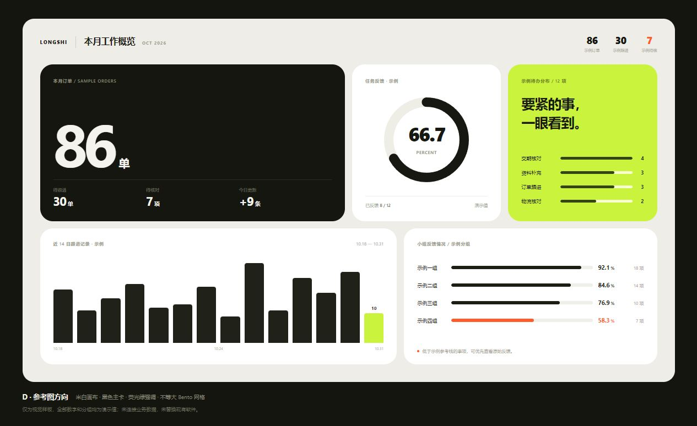
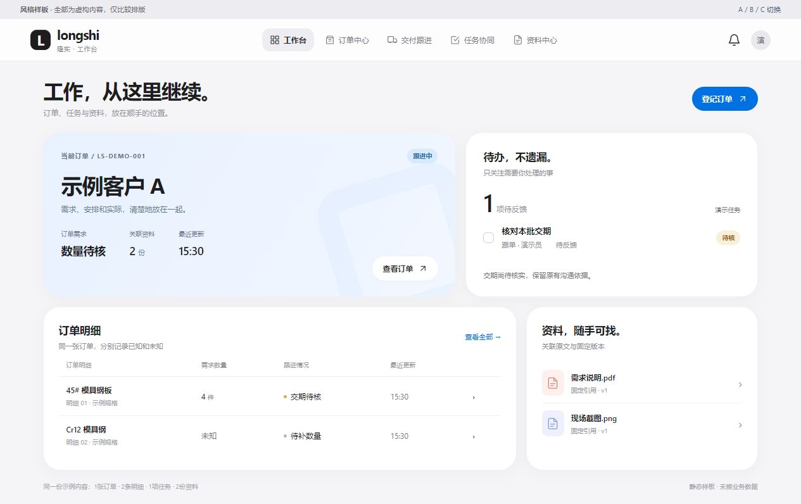
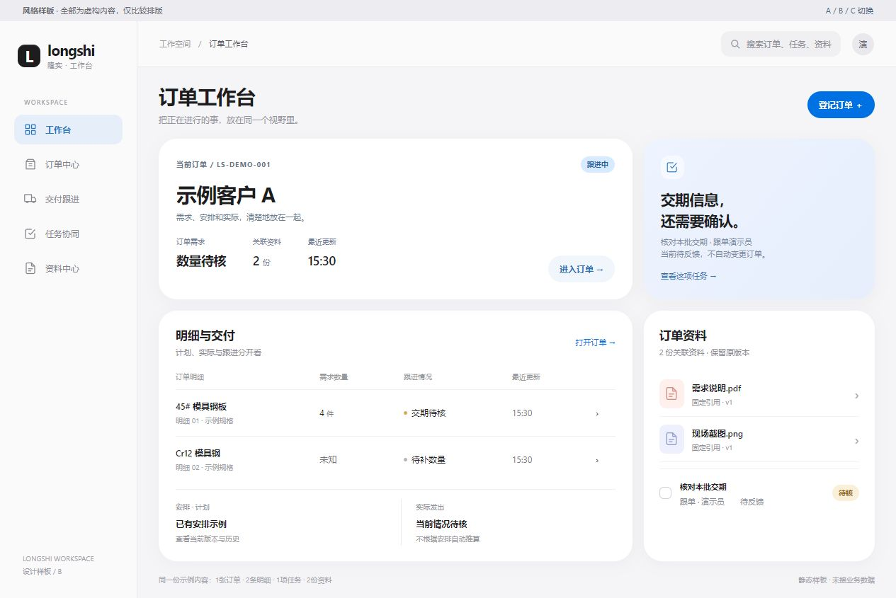
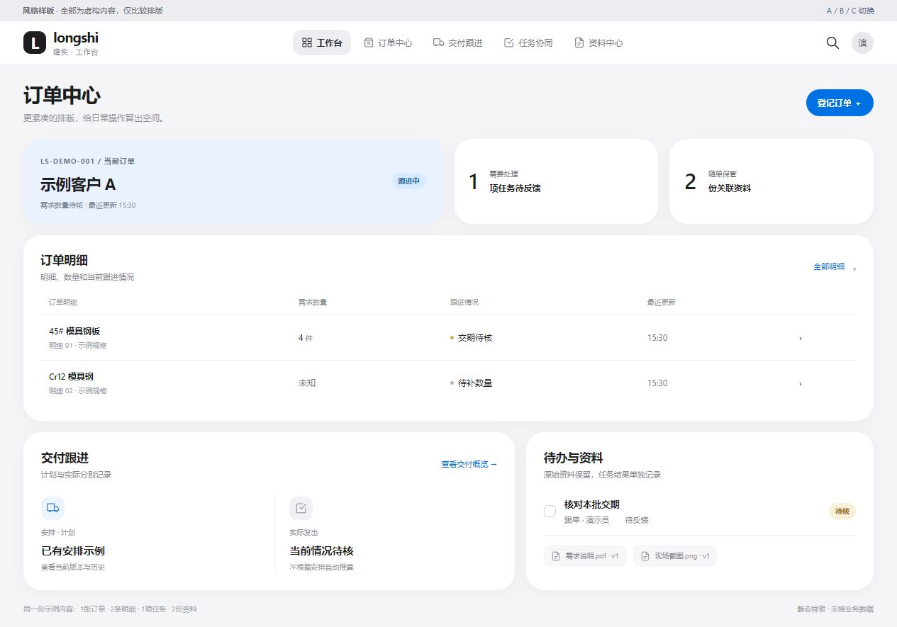

# 苹果 Bento 风格样板：参考方向已明确，当前仍为样板

2026-10-31 · revision 2 · 视觉样板，未应用到当前DO2。

## 最新：用户指定黑色、米白和荧光绿的参考方向

用户在看过A/B/C后提供参考截图并明确“我想要这种”。现采用该图的视觉方向：米白画布、近黑主卡、荧光绿强调、大圆角、无明显描边、不等大的卡片、醒目的数字与简洁图表。A/B/C保留为历史比较，不再作为唯一待选项。

据此制作D样板，展示订单、任务反馈、待办分布、跟进记录和示例小组反馈。所有数值、分组和比例均为虚构排版内容，不代表已实现业务统计、公司口径或新增财务功能。用户参考图中的营收和利润不被移作需求。

本轮实际浏览器检查1265像素宽的完整画面并保存截图；手机断点只是代码设计，未称所有尺寸通过。样板HTML/CSS/SVG及工具在项目外bento-reference-sample-20261031，无新增依赖、数据库或业务API。DO2未被替换。本稿下方revision 1的“均待选择”反映当时状态，最新方向以上述用户回复为准；具体业务页面的落地仍需按信息密度分别排版，不能把每张订单明细表都塞成仪表卡。

## 历史：A/B/C同内容比较

用户在要求苹果Bento后进一步明确“先给一些改了之后的样板看看，再决定要不要用”。本轮范围调整为只交样板，不能把最初重排意图当已经选款。

三套采用同一核心虚构资料：一张订单、两条明细（4件／未知）、一个待反馈任务、两份资料。只比较排版；没有链接真实客户、业务库或接口。A侧重概览，不展开交付细节；B/C展示同一虚构交付摘要。静态按钮和菜单是视觉占位，不代表全部功能已实现。

|样板|重点|取舍|
|---|---|---|
|A 清爽卡片版|更大的卡片、轻蓝重点区、宽留白和顶栏导航|概览轻盈；同屏信息相对少|
|B 侧栏工作台版|固定模块侧栏、白色工作卡、明确对象与下一项待办|适合几个模块间持续工作；侧栏占一部分横向空间|
|C 紧凑办公版|低矮概况卡、通栏表格、下方交付／任务资料分区|更重视行列比较和日常办公；视觉更克制|

沿用已学oil-ui同内容选稿与Refactoring UI层级／留白方法，字体用本机系统字体、图标为代码内自绘简单SVG，无新插件／字体下载、外部素材或依赖。实际浏览器读取并逐张检查全页画面；没有进行业务操作、完整响应式或无障碍验收。临时静态服务已正常结束，34—36号标签页已关闭。

当前DO2六项应用源前后hash一致，业务样机及306项同版包未被本轮替换。样板HTML/CSS、manifest及预览脚本均在项目外bento-style-samples-20261031；项目只留本说明和虚构截图。A/B/C均待用户选择，助手建议不能当作用户已采纳。当前不推送Git或关机。

## A · 清爽卡片版

## B · 侧栏工作台版

## C · 紧凑办公版

