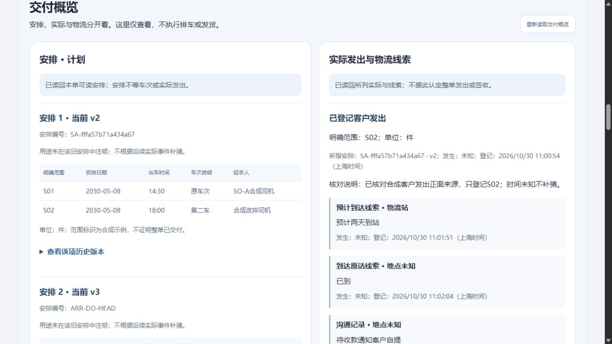
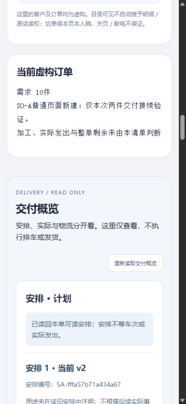
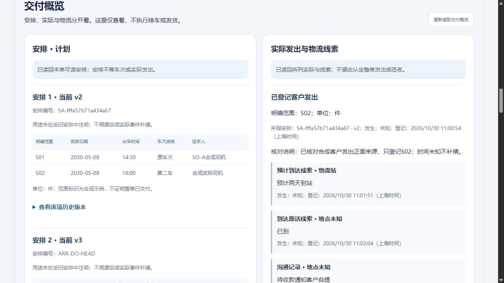

# 订单交付概览：只读接续与同版恢复

2026-10-31 · revision 1 · DO1初版／DO2修正版／DO2同版恢复分开记录。用户“好，我们接着往下”承接[图纸r1](../../软件开发计划+施工清单/页面与原型/订单交付概览与排车物流接入图纸.md)。项目外隔离虚构小样，基础路径不依赖AI，未开放正式员工或真实业务。

## 这次能做什么

订单目录选单后，导航新增**交付概览**。安排区逐项看各自当前版、历史版；实际区看本单已登记发出和物流原话。安排编号与实际事件所指安排编号／版本对应，不按列表位置猜关系。没有当前头版本的一项明确未核，不拿v1当当前，也不拖垮其他可靠区。

本次只增加读取：新GET /api/order-plans/orders/{oid}/overview在同区只读快照中绑定本单各安排、head及history，沿当前订单／安排读权；物流复用原GET及自己的核权。新组件没有排车、采用、发货或物流写入表单；旧写接口／业务规则／DDL不改。两区独立请求，不声称跨区同一数据库快照。原安排未注明用途，显示未知，不因后续客户发出而补猜用途。

## 数据来自哪里，哪些是预置

源为正常停止PC2。DO1准备阶段另外预置两项只读演示安排、四个版本、一个head和两条范围来源；因此页里共三项：原当前v2、新夹具当前v3、另一新夹具无head。**这些不是员工通过页面新建或采用的安排。** 两条新范围来源eligible=false，不能用来主张可交付。

另给协调演示员新AM单的三条对应读取资格，写权不扩，用于合法空记录例；未给新AM插piece、交付范围、安排或实际。原旧单已有一实际／三条线索，完整编号／事件关系保留。DO2从正常停止DO1继承该基线，不再seed；pre-fixture-public、public-before和fixture-declaration分清准备与测试。

## 实际验证按方法分开

|范围|观察／结果|限制|
|---|---|---|
|DO1普通页面|三安排逐项读当前v2、v3、无head；展开原v1/v2；实际S02及三类原话分别显示|初版窄列和缺稳定编号的问题保留，未拿本图当最终布局|
|DO1部分失败／本人稿|安排503只清安排，实际仍读；反向实际503保安排；原单未提交跟进均保留，切回仍在|受控读取失败，非所有自然网络／断电故障；测试草稿明确清空，未保存为业务|
|DO1空／不可读／切号|新AM有权空读明确“不等确认未排／未发”；另新单无模块资格为不可读；切空账号清两区|合法空读权为演示夹具，不当公司G03，404不被解释为没有业务|
|DO2普通页面|补完整稳定安排编号、实际保原编号＋版本；宿主网格跨全列，client1265下区宽1192|DO1停止归档后才改；后端和旧业务处理未改|
|DO2切单／窄屏|旧安排回复受控hold期间切AM，当前新单未被覆盖；390×844覆盖下实际client375、交付区347、单列309，刷新可达，随后reset|该次服务hold为13.25秒，浏览器等待5秒后Abort；不冒称其后浏览器收到了旧回复。实际收到旧回复的失效票据分支另有模型证据。只验本区，不代全产品移动端／无障碍|
|模型|DO1为13项，DO2为14项，含旧回复、错误账号、分区失败、无head、稳定编号、只GET等|假DOM／fetch，不是14功能或所有普通GUI通过|
|API反例|多安排、无head、新单空读、另一单／未知单拒；临时撤物流读权后计划仍200、物流404，再恢复原读字段；POST overview为405|演示顺序撤权；405仅接口反例，普通界面没有业务POST，不等真实权限或全部竞态|

普通页面自首个/manual-review请求后的非GET仅登录；请求清单保delivery-request-audit.json。此次读取、切换和展开历史没有提交业务写操作。发生时间未知保持未知；“预计两天到站”“已到、地点未知”“待收款通知自提”不生成签收、到账、放行或实际提货。局部加工2件、整单需求与本次安排不相加，不生成整单剩余。

## 修正、源码与交叉回核

DO1实景发现新section只占宿主网格半列，DO2以跨全列修正；3号静态发现实际只写vN而多安排无法对应，DO2在两区显示稳定编号，保原arrangement_id＋plan_version。3号增量只读回核限定通过，不代其亲跑或审美确认。旧控制器guard、表单和业务路由未扩大，新增只读组件与目录生命周期连接另验。

DO1／DO2完整源在运行前记录hash并归档，运行结束核相同；旧113份命名冻结与完整474／477份来源清单含义分开。4号只读核预置、DO1终态与DO2起点一致、版本、数据及源归档，未代GUI。普通CUA记录用本轮delivery-current-ui-records，未继承旧同名观察记录。

## 业务数据保护、同版包和退出

DO1基线后、DO2继承基线后，各自五个比较库的public业务行除登录会话均保持；local_progress八表和178对象保持。API临时资格撤销已恢复原字段才作末态对照，不能写全过程资格未变。原PC2源副本与包不回写。

DO2同版包306项payload、67表、44原件及647约束／表、列、schema权限随同一导出快照配对；新增delivery_overview_routes.py和delivery_overview.js均列required，包源取DO2前采且停止后匹配的归档。缺新模块的受控坏包在initdb／HTTP／别名前拒绝，原包未改。

新initdb／template0恢复后逐表／元数据／原件一致，清旧会话，才应用明确演示只读策略：给协调员旧SAME01及AM01的交付读取，全部业务写资格关闭。策略本身改变权限，不声称恢复后权限一直原样；策略后的API／普通GUI除会话无业务改变。普通页面读回三安排、缺head状态、原一实际／三线索及稳定编号，253项是内部检查。仍依赖本机已有Python／PG，不等EXE、新电脑或任意崩溃灾备验收。

4号追加只读核306项payload／两个required模块字节及来源标签、67表／44对象、策略后API／GUI只有会话变化、缺模块门禁与正常收尾，指定保存证据吻合；647约束／ACL依据metadata及保存检查，未连接PG复查，也未重做普通GUI。策略阶段清11条旧会话等变更不被抹成全程未变。

DO1／DO2／打包副本／恢复副本的本人HTTP、PG、V均正常结束，标签页31—33关闭，窄屏覆盖已reset。无当前长期演示地址；先读项目外delivery-overview-prototype-20261031/review-pointer.json，勿照旧端口或操作别人的服务。

## 学习落实与下一步

先查学习库“只读／计划／UI”，回读Refactoring UI和oil-ui方法：维持Bento分区，上层提示、计划表格、实际线索层级分明；失败不写0，窄屏单列加区内横向表。实际全列修正和窄屏观察是本次落点，没有新装UI插件或将视频学习当运行验收。

下一段整理**人工“本次哪一批货”与安排草稿**的最少输入、来源引用及正常／缺信息分支。新AM仍没有可靠实物交付映射；本次只读不构成新单普通排车／实际发出／送加工、签收或收款办理通过。原36B／16W／六受审、真实G项及正式开发／生产／Git／关机边界保持。

## 实际画面

DO2修正版：

390覆盖下本区单列：

同版恢复后只读：

初版窄列问题保留作修正证据：[DO1截图](图示/2026-10-31-交付概览初版窄列问题.jpg)，不是最终布局。
